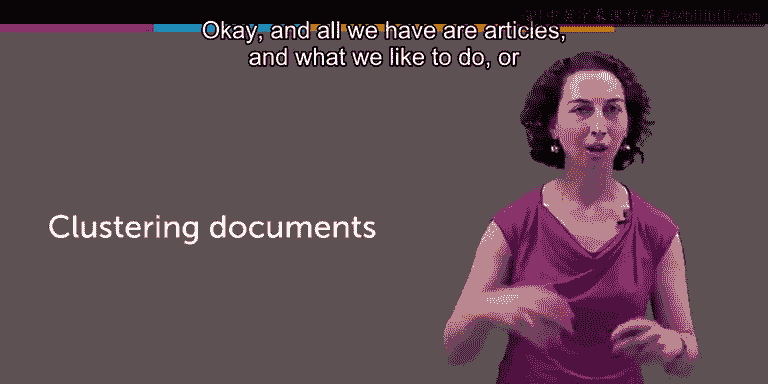
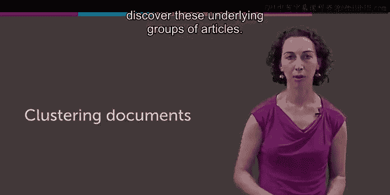
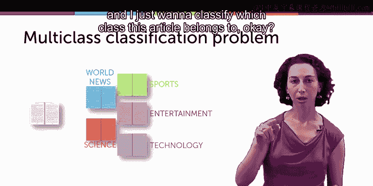

# 华盛顿大学《机器学习（基础篇，第1课／共4课）｜Machine Learning》中英字幕 - P63：62_文档聚类任务概述.zh_en - GPT中英字幕课程资源 - BV1zw4m1e7Zh

。

Okay， so that's one way to retrieve a document of interest， just take all articles out there。

 scan over them， and find the one that's most similar according to the metric that we define。

But another thing we might be interested in doing is clustering documents that are related so for example。

 you might have a whole bunch of articles about sports or world news or different things like this and if we can structure our corpus in this way if a person is reading an article that's about sports then we can very quickly search over all the other articles about sports instead of looking at every article that's out there in the entire corpus but a challenge here is the fact that these articles aren't going to have labels it's not going to be like the New York Times where you go and somebody says this is an education article all we have are articles and what we like to do or discover these underlying groups of articles okay so the goal is to discover these groups or clusters of related articles and like I mentioned one might represent a set of articles like sports and another one a set of articles about world news。

For the time being， let's actually assume that someone provides us with labels so somebody goes through and reads every article or at least a large subset of articles in our corpus and labels them and says。

 okay， these articles， these are all about sports and these ones these are about world news and these about entertainment and these ones are about science。

So we have some set of articles that have labels associated with them Well in this case。

 when we have our query article and we'd like to assign it to a cluster。

 this ends up being just a multiclass classification problem because the question is just here's my query article。

 I don't know the label associated with it and I have a bunch of label documents。

 I have the labels world news science sports entertainment technology and I just want to classify which class this article belongs to okay so this is the question。

 it's just a multi-class classification problem。

So if that were the case， that would be an example of a supervised learning problem。

