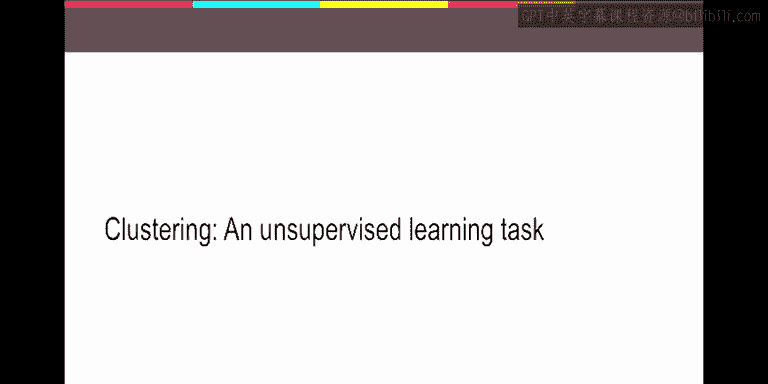
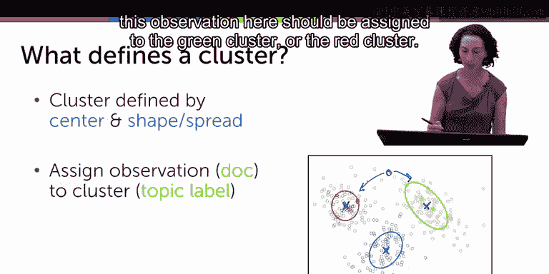
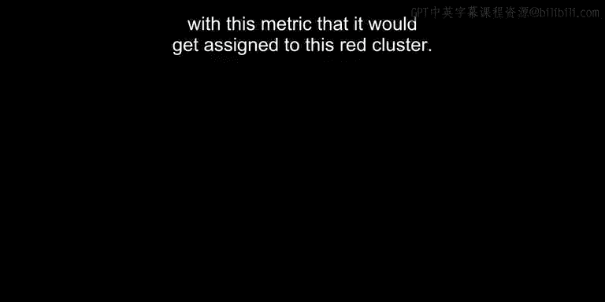

# 华盛顿大学《机器学习（基础篇，第1课／共4课）｜Machine Learning》中英字幕 - P64：63_文档聚类：无监督学习任务.zh_en - GPT中英字幕课程资源 - BV1zw4m1e7Zh

。

We're going to assume that no labels are provided。And we're going to aim to infer groups of related articles。

 which are clusters。Here the input is going to be a vector。

 so every observation that we're plotting here is our word count vector。And in this case。

 we're just looking at a very simple example with a vocabulary that only has two words。

 so we have a vector， we have word one。And Word two and this axis here is word2。

 and this axis is word1。Of course remember that in reality we tend to have very large vocabularies and we have these big high dimensionional vectors so when we're plotting our observations they're really in this high- dimensional space but for visualization let's just look at this 2D representation so we have a whole bunch of documents here all represented by their word counts over these  two different words in the vocabulary okay so that's the input to a clustering algorithm and the output is going to be cluster labels and so what I mean is that this observation and all of these observations here。

All of these get labeled as red， so maybe they get applied some cluster label one。

 So let's just call this。Cluster1， so for every document it's going to get some label so that'll be labeled one。

 Then all of these observations here， they're going to get some other label and let's assume that this is cluster 2。

 so this observation gets the label 2。And all of these observations here would get the label three。

So that's going to be the output of this algorithm。And maybe what you could do is post facto。

 you could go through and look at some articles in cluster1。

 and you could say that this cluster is really a cluster about sports。

 and I just want to write down explicitly that this label is provided post facto。

Okay well this is an example of an unsupervised learning task because we're operating without any labels。

 all we have are our observations and we're trying to uncover some structure in these observations so again just to reiterate the input are word count vectors and the output is for every document in the corpus。

 we're going to associate some cluster label with that document。Okay， well what defines a cluster。

 well every cluster is defined by a cluster center， so maybe I'll mark the cluster centers with x's。

And then there's the shape to the cluster， and these ellipses are representing the shapes of each of these clusters。

And so when we think about whether this observation。

This observation here should be assigned to the green cluster or the red cluster what we're doing is we're looking at how similar this article is to other articles based on the shape of this cluster。

 so we score every observation。

based on the cluster center as well as the shape of that cluster， and in this case。

 because this cluster has this kind of oblong skewed shape。

 it actually gets it assigned to the green cluster instead of this red cluster。But another approach。

 which is very common is instead of looking at the shape of the cluster。

 we just look at cluster centers so we just measure the distance of this observation。

So maybe let me change colors here， so this alternative approach here is we would just look at the distance of this observation to the green cluster center versus the red cluster center and in this case it would be very challenging to decide whether that article should go with the green cluster or the red cluster but there are other cases like this observation here where it's pretty obvious with this metric that it would get assigned to this red cluster。

