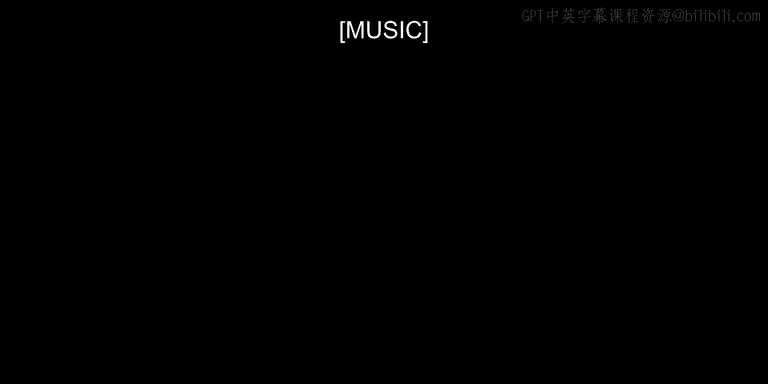
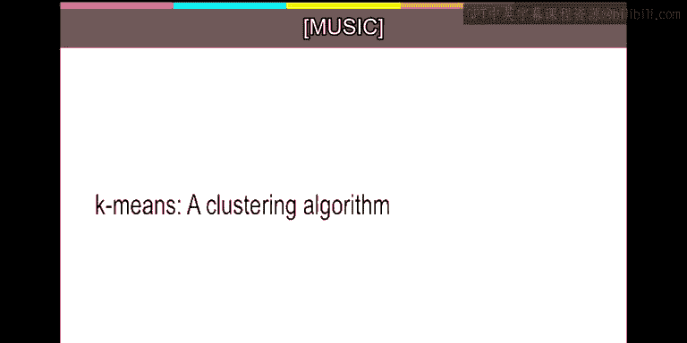
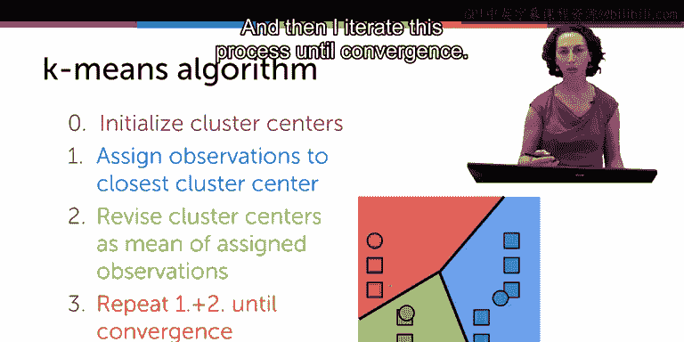

# 华盛顿大学《机器学习（基础篇，第1课／共4课）｜Machine Learning》中英字幕 - P65：64_K-means聚类算法.zh_en - GPT中英字幕课程资源 - BV1zw4m1e7Zh

。

Well， let's look at an algorithm for doing clustering that。

That uses this metric of just looking at the distance to the cluster center。Okay。

 so here we see the data that we're going to want to cluster。And。This algorithm。

 which is called the K means algorithm， starts by assuming that you are going to end up with K clusters。

 So you specify the number of clusters ahead of time。

 So the reason the algorithm is called K means is we have K clusters and we're looking at the means of the clusters just the cluster centers when we're assigning points to the different clusters。

 Okay so let's talk about how we initialize the algorithm。

 So the first thing we do is we just one example， there are many ways to initialize where we put the cluster centers we will talk about these things more in depth later。

 but for now let's just assume that we randomly assign three different cluster centers if we're going to assume some three means algorithm here。

 And then the first step is we're going to assign every observation to the closest cluster center。

 So this observation here， gets assigned to the red cluster。

These observations are all closest to the green cluster。Or this green center here。

 and these are all closest to the blue center。And a way to do this is something that's called just a booid tesslllation。

 so we look at the cluster centers and what we can do or define。

 let me switch again to this magenta cluster color。So here are the cluster centers。

And we can just define these regions。Here。And these regions represent areas where any observation we might get。

 so any new observation， that's a very bad color on red， what other colors do I have about white？

Cool。White。So some new observation I get here， if it falls within this red region。

 I know is closest to this red cluster center， so that's what these colored regions are representing。

Okay， so that's the first step of the algorithm。 so what I end up with are。

Observations that are assigned to clusters， but I just randomly initialize those cluster centers。

 so I probably don't believe that that really represents the structure underlying the data。

 So what I want to do is I want to iterate this process where I then want to update what my definition is of the cluster center based on the observations that have assigned。

 So if you remember this red cluster here， it just had one observation assigned to it。

 So when I go to revise the cluster center for that cluster it just moves to。

The previous observation， but for this green cluster， if I look at the previous cluster center。Here。

Well I'm going to move it to the center of mass of all these observations that have been assigned to the green cluster and the center of mass of all of them is here。

 so this becomes the new cluster center and likewise I do this for all of the blue observations。

 this is the new cluster center for this blue observation。Okay。

 so now I have a new set of cluster centers and what I can do is redraw this forite tesslllation and reassign my observations to the nearest cluster center。

 and then I iterate this process until convergence。

