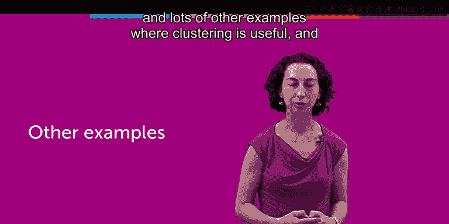
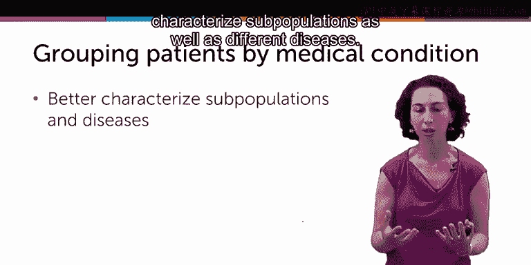
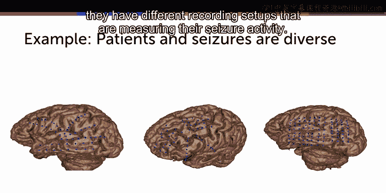
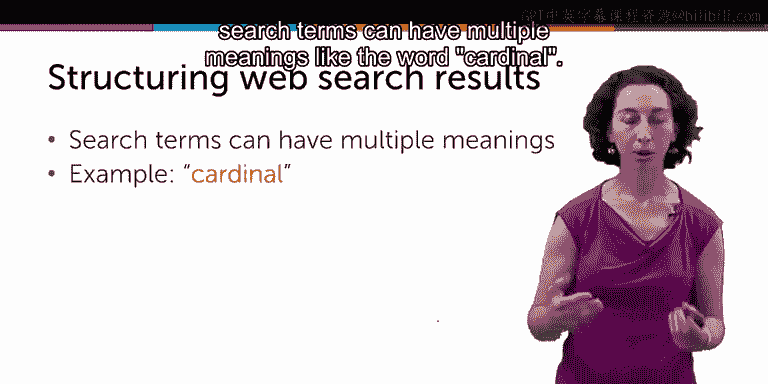
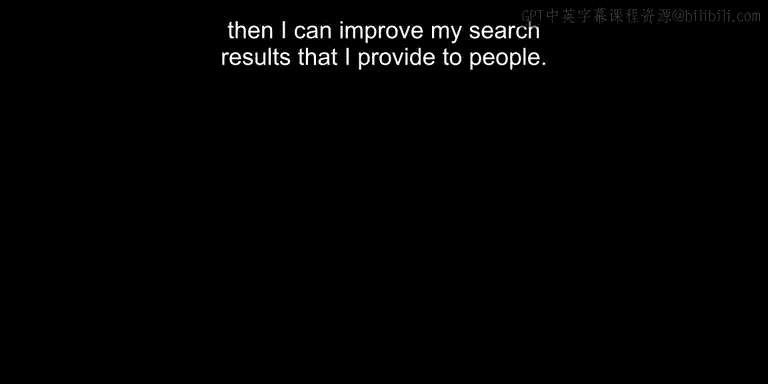
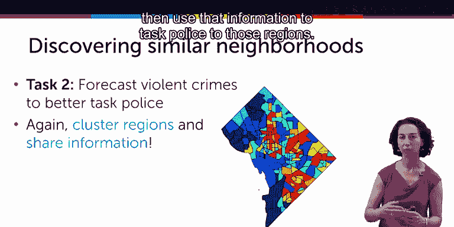

# 华盛顿大学《机器学习（基础篇，第1课／共4课）｜Machine Learning》中英字幕 - P66：65_聚类的其他示例.zh_en - GPT中英字幕课程资源 - BV1zw4m1e7Zh

。

Okay， well， we've talked quite exhaustively about this notion of clustering for the sake of doing document retrieval。

 but there are lots and lots of other examples where clustering is useful。

 and I want to take some time just to describe a few of them。

So one application is for image search， so imagine you're going and you're searching for the you go on Google image search and you type in the wordo well it would be really helpful if we could structure all the images we have by some set of categories like ocean。

 pink flower， dog， sunset clouds， so clustering is very helpful for doing structured search。

Another very different application is maybe we want to group patients by their medical condition。

 so here a goal might be to better characterize subpopulations as well as different diseases so as an example。

We can look at a whole bunch of patients that have seizures。

 so these three brains represent three different patients。

They have different recording setups that are measuring their seizure activity。

 and so for each of these patients。

We get a collection of recordings of different seizures that they exhibit over time。

 so each one of these color squares represents a different recording of a seizure。

And between these different patients， there might be similar types of seizures that appear in these different patients。

 and so what we can do is we can take all of these seizure recordings from these three different patients and think about clustering them。

And if we identify different types of seizures in this way。

 this can allow us to better treat the types of patients that we're observing based on understanding what types of seizures they exhibit well another application is thinking about doing product recommendation on Amazon so for example。

 on Amazon， there are a lot of third parties that come and they post some product to be sold and they provide a label of what that product is。

 so for example， maybe a person wants to sell a crib and they label the crib fairly reasonably as being a furniture item so maybe we get posted under the furniture category。

 but if instead we look at who purchases this item and we look at their purchase history and we look at other people with similar purchase histories so maybe the person who purchase this item also purchase。

A baby car seat， well then maybe what we can do is we can infer that a better label for this crib。

 which had been labeled furniture is really to have labeled it as a baby product。

So in addition to discovering groups of products that are related that have。

Based on purchase histories of these items， we can also use that to discover groups of related users on Amazon。

 and that can be used for targeting products to those users。And finally。

 we can think about structuring web search results， so for example。

 search terms can have multiple meanings like the word cardinal， if I type this in to Google。

 maybe I mean I want an article about a cardinal of the bird， maybe about the baseball team。

 or about a cardinal， a religious figure， so if we can structure our articles。

Based on their content using the same types of ideas we've talked about in this module。

 then I can improve my search results that I provide to people and the list of applications goes on and on Another one that's quite interesting is thinking about。

colections of neighborhoods and there are a few applications where you want to discover similar neighborhoods。

 one is if we want to estimate the price of a house at a very small local regional level。

 so in this case we challenges the fact that we only have a few or very often know house sales observations within a very small neighborhood。

So if we want to estimate the value of the house in that neighborhood at a point in time it's very hard to do that because we have no other houses to base our estimate off of in that neighborhood。

 however， if we can discover other neighborhoods that have similar types of house dynamics。

 house price dynamics then we can come up with a good estimate of the house in the neighborhood with few or no sales by leveraging information that was discovered from this from this other neighborhood that was discovered to be related to the current neighborhood so the idea is to discover clusters of neighborhoods and then within those clusters we can share information like these house sales information to form better estimates so this is a solution that I'm describing here is to cluster regions with similar trends and then share information within a cluster。

And the same idea of discovering related regions can be used for helping to forecast violent crimes to better task police forces to different regions。

 so again， once we discover different neighborhoods that have very similar crime dynamics。

 we can form better predictions of the rates of violent crimes in those neighborhoods and then use that information to task police to those regions。

