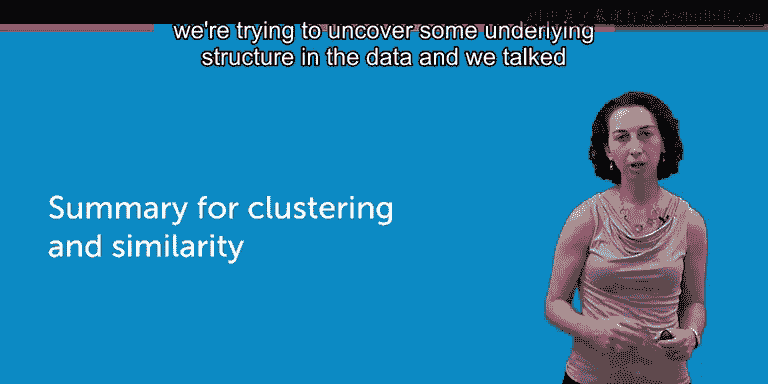
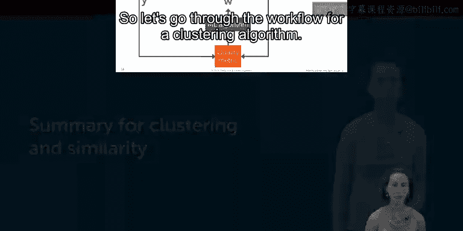
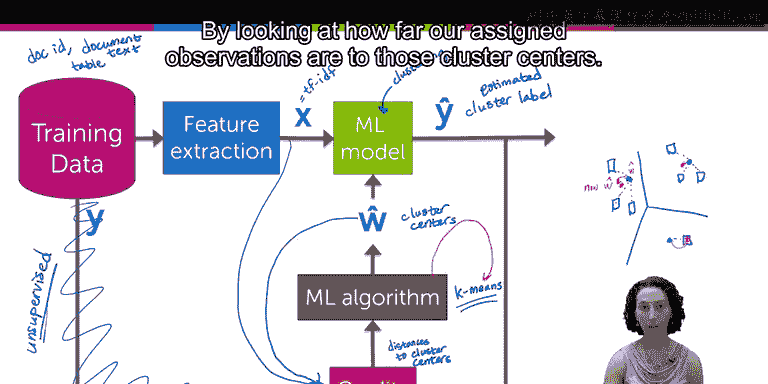
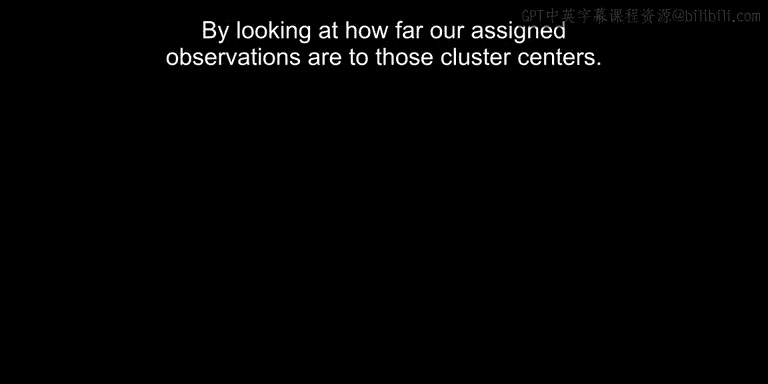

# 华盛顿大学《机器学习（基础篇，第1课／共4课）｜Machine Learning》中英字幕 - P67：66_聚类和相似度机器学习模块图.zh_en - GPT中英字幕课程资源 - BV1zw4m1e7Zh

。

In this module， we've talked about a document retrieval task and we've also talked about a notion of clustering where we're trying to uncover some underlying structure in the data and we've talked about many different areas in which this notion of clustering can be really useful so let's go through the workflow for a clustering algorithm。

And if you feel like you already know this at this point。

 because you've seen this workflow now in two other modules。

 well wake up because this one's going to be a bit different。Okay。

 so let's talk about our training data here our training data for a document clustering task is going to be a document ID。

And document text。Table。So we have a whole bunch of documents and we have all the text associated with each of those。

And then we're going to extract some set of features and we talked about a lot of different ways to represent a document。

 but the one that I'll use just as an example here is our TF， IDF term frequency。

 inverse document frequency representation。And then what we're going to do is we're going to try and cluster our documents based on this representation。

 so we're going to put these features through some machine learning model。

 which in this case is a clustering model。And we're going to output for each document a cluster label。

 so the output white hat is our cluster label。Okay， so here's where things get interesting。

Because we want to assess the accuracy of our cluster labels。 Well， in this case。

 we don't have true cluster labels。 So I should say this is our。Predicted or estimated。Cluster label。

But we don't have a true cluster label to compare against。This why here。It does not exist。

And that's because as we talked about， we're in an unsupervised learning setting。Unsupervised。Okay。

 so we don't have that， but somehow we want to assess some measure of accuracy of our Queing。

 so let's draw a little picture here。Which is going to be our voroid tesslllation in our k means algorithm。

 where we have some set of cluster centers。And we have data。Let's just say our data look like this。

 I don't know， I'm just going to draw some points here。And。

The measure of accuracy that we're going to use， the way we're going to measure our quality。

 is to look at how coherent our clustering is， so we're going to look at the distances from each observation to their assigned cluster center。

And a good clustering algorithm has those distances very small。Okay。

 so the goal is to minimize these distances and so what we see is to measure this accuracy。

 to measure these distances， what we need is we need our data， we need our TF IDF vectors。

So those are going to come in here。And then we also need。The cluster centers。 and so W hat。

That's our current estimate of that's our model parameter here in the K means algorithm。

 It's our cluster。Os。Let's see if we can spell that correctly， cluster centers。

 that's what W hat represents， and so of course to measure these distances we also need W hat。

So instead of having actual cluster labels to assess accuracy， we're going to take our。

Document representations and our cluster centers plug it into this quality measure。

 which is looking at。Distances。2 cluster centers。That's our measure of error， though。

 it's not really an error， it's just a measure of oops。'sJust a measure of quality。

So I won't put that word there because I think that's a little confusing。

 but let's just write distances to cluster centers。And then what's our algorithm we're talking about。

 we're talking about K means as a method of doing clustering， of course there are others。

 but let's focus on K means well what's K means doing， let's just redraw this diagram。Actually。

 I can just switch to another color。That will save us some time here。

Well Ka means is trying to minimize this distance or the some of these distances and the way it's doing that is iteratively。

 it's updating so this was our W hat that we had before and we're moving it。To a new。

W hat that represents the center of mass of these points。 So these points are getting shifted。

And this point will go directly on top of that observation。And。So this is the workflow of clustering。

 let's just say it at a high level one more time， we take our documents。

 we represent them in some way using either rawword counts， TFIDF， normalizations of these things。

 lots of different biograms， tris， things we can look at for our document representation then our clustering algorithm like K means is producing cluster labels。

 and iteratively we're looping through here。Again and again。Updating our cluster centers。

 that's the parameters of this clustering model。By looking at how far our assigned observations are to those cluster centers。

Okay so in this module in contrast to some of the other modules we actually presented you with some of the algorithmic details behind the methods that we're looking at。

 specifically for clustering， we talked about the Ka meanss algorithm and then for our document retrieval task we also talked about doing nearest neighbor search and provided some of the algorithmic details for that and you specifically explore that in an ipyython notebook for doing Wikipedia entry retrieval so at this point you really should be able to go out there and build a really cool retrieval system for doing news article retrieval or any other really really really cool retrieval that I can't think of right now but of course there's lots of interesting examples so go out there and think of the ideas I can't think of right now。

