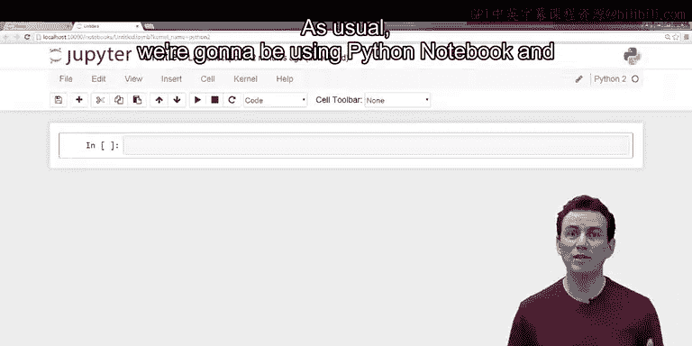
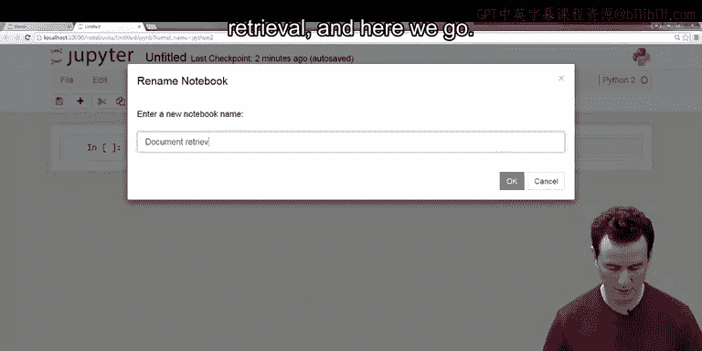
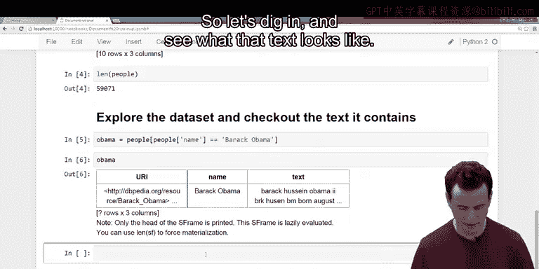

# 华盛顿大学《机器学习（基础篇，第1课／共4课）｜Machine Learning》中英字幕 - P68：67_加载并探索维基百科数据.zh_en - GPT中英字幕课程资源 - BV1zw4m1e7Zh

。

In this module Emily covered various techniques for retrieving documents。

 exploring representations for our data like word counts and TF IDF now we're going to build a really cool notebook where we put these ideas together and build a document retrieval system using TF IDF so let's go ahead and do just that。

😊。

As usual， we're going to be using a Python notebook and in this one。

 I'm going to change the title to document。

Retrieval。

And here we go， and again， as usual， I'm going to hide the header。😊。

And had the toolbar to give us a little bit more space。Okay， let's go ahead and fire up。

Graphlab create。 So we're going to do import。Graph Lab since we're going to be using it again in our notebook Now the first step we're going to load some data。

 so let's load some text data。And this is interesting text data from Wikipedia。

And it's pages on people。So cool cool data set， I'm just going to load it。

 and so we're going to say people， which is going to be an nest frame， is going to be graphraphLb。

The S frame from a file and the file is called people Wiiki。And varietyty。And。Here we go。

 We're loading it。 and the first thing I'm going to do is just look at the few head lines。

 few top lines of that file， I'm just going to。😊，Go ahead and you should see。

we have so this U is basically the location of that page on Wikipedia。

 this is the name of the person involved and the text of that page about that person and you have this for a pretty nice number of people here。

So if you type land of people。In our data set。In type enter， you see that we're talking about 59。

000 people in this data， so a pretty good set and you'll see with a TF IDF。

 we're going to do some really interesting document retrieval。

 even in this relatively large data set。😊，So。The first thing that we're going to do is just explore our data。

So， let's。Explore。The data set。And。Check out。The text。It contains。

So let's start looking at particular personal data set。

 and we're going to look at the page for Barack Obama who is the current US president。

So out of this people S frame， I'm going to select。The one whose name？So that's the name column。Is。

Equal to。Barack。欧巴马。And so I pressed enter， and I created this new variable code。😊，Obama。

 and if you take a quick look at it， you see。It has the URL for the Obama page。

 the name Barack Obama and the text for that page， so let's dig in and see what that text looks like so for Barack Obama。

😊。

嗯。You'll see that Barca Hussein Obama was born on August 4th。

 1961 and is the 44th and current president of the United States。

So pretty natural text what we would expect for this kind of data。

So we can also look at some other personal data set， so for example。

 there is an actor called George Cloneney， so we've been in a lot of movies。

 so if you look at the people as frame， we're going to select。So this is， again， a filter operation。

 which we've been doing almost every notebook now， whose whose name is。G O。Clluy。

And then I'm just going to go ahead and show you the text。That we get。For George Cloney。

 and you see that George Clooy。George Timothy Cloneney was born in 1961。

 so basically he's the same age as Barack Obama， but he's not president。He's an American actor。

 writer， producer， director， and activist。Right here。

你。