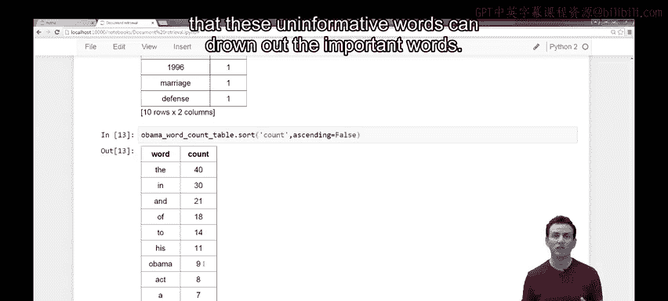

# 华盛顿大学《机器学习（基础篇，第1课／共4课）｜Machine Learning》中英字幕 - P69：68_探索词频.zh_en - GPT中英字幕课程资源 - BV1zw4m1e7Zh

。

Cool so this is the data we're working with it's a pretty neat data set and let's explore a little bit more so in the lectures Emily talked about building word counts and some of the challenges with word counts so let's start by taking a quick look at our word counts so for example let's get the word counts。

For the Obama article。So we had an article in Wikipedia about Barack Obama。

 and what we're going to do first is just take a quick look at the word counts for that article。😊。

So I'm going to take this Obama variable that we created。

 and I'm going to add a new column to it called word count。😊。

So this is going to store the word count for Barack Obama。

 and we can do that by just calling you could write。As we showed in the。

classification sentiment analysis notebook you could write a function yourself to compute the word counts。

 but we just have one ready for us in the text analytics toolbox so we're just going to use it to get started quickly so we just call count words。

😊，See， there's count en gras。 we're just going to count on words， which is the unigram single words。

 And as input， we're going to give it the Obama。Text。So I've now done it and let's take a quick look。

😊，Let's just print the Obama。Word count。And here we go。

 we've now printed the Obama word count and you see that operations appeared with once represent appears one。

 Office appears two， unemployed appearss1 and so on for various words and it's not super intuitive here so we're going to play with this a little bit and in the process I'm going to show you a cute little data engineering trick that might be useful in other areas so。

Let's organ do next is。Sort。Sort， the word counts。For the Obama article。

Now here's something to understand a little bit better if you notice the word counts as read a dictionary。

 this is the kind of the Python dictionary， you're given a key and in this case is the word。

 for example， Honolulu where he was born， whether marriage and so on and then he has a value of 1，2。

3，5，30 which is the count often that word appeared and so。😊。

What we're going to do is sort this and to sort those words。

 we have to turn into a table where one column is the word。

 the key of the dictionary and in the second column is the count and then we're going to sort that table so the way to do this。

YeahThere's various ways to do Python， but let me show you a quick little trick that you'll find useful。

 so I'm going to create a new table called the Obama Word。Count table。

And what we're going to do is take this。奥巴马。😔，And I'm just going to select here out of all the column in the Obama table。

 I'm just going to select the word count because this will make the printing a little neater。

But you could have done off the whole table， too。And then I'll call a function called stack。

And this function stack is extremely useful， it takes one column of an S frame。😊。

They contains a dictionary and stacks it one on top of each other into multiple columns this case two columns。

 one for word and there one for count， so we're going to stack a particular column called word count the one that we really care about。

😊，And the。And generate some new columns so we have to call them giving them a name。

 so new column name。In this case， there are two of them。One， I'm going to call word。And another one。

 I'm just going to call。Count。And if I execute this。And we take a look at this table。

Obaamaward counttable head just the first few lines， you'll see shows words normalize sort combat。

 but it's not sorted， it's not as sorted table so what we're going to do next is just take this table and just sorted by the count and we've seen this before but it's pretty simple so I'm going to take the Obama count table and I'm going to call the sort function and I'm going to sort it by the count column sort by count and I'm going to say asccending。

Equals false so instead of sorting in an ascending order，  one，2，3。

 like we normally sort we sort a descending order 3，2，1。So if I press enter there。

 you'll see the most common word is the followed by in， followed by n off to his eventually Obama。

 and so act A he， so these are not that informative and in the lectures when we were working with Emily andder。

 she covered the issue that。😊，These uninformative words can drown out the important words。

 and that's why we introduced the notion of TF IDF。

。

