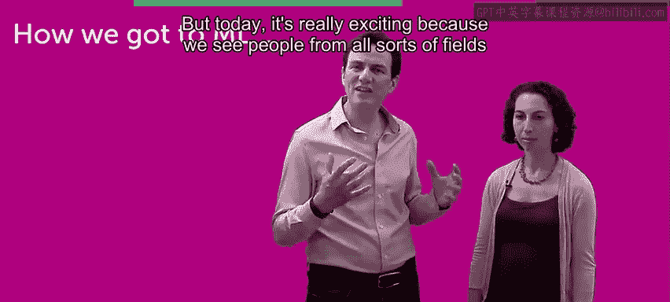
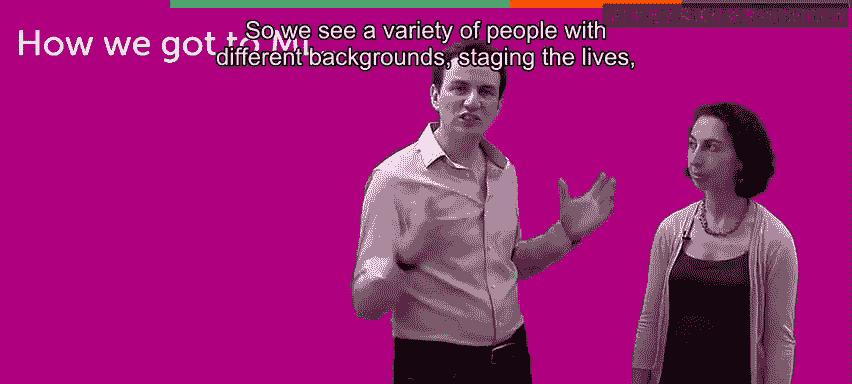
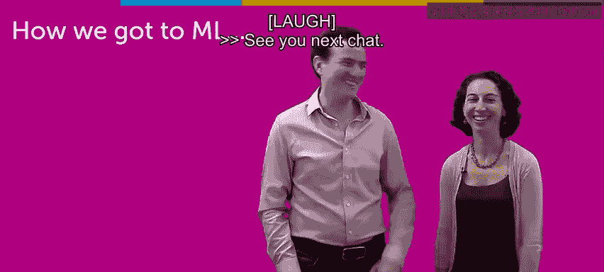
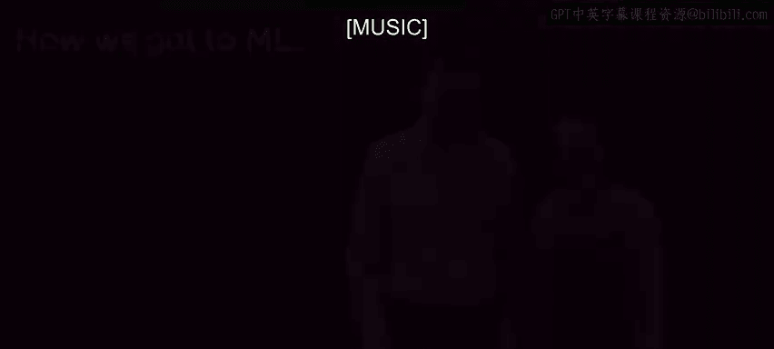

# 华盛顿大学《机器学习（基础篇，第1课／共4课）｜Machine Learning》中英字幕 - P6：5_我们如何进入机器学习领域.zh_en - GPT中英字幕课程资源 - BV1zw4m1e7Zh

。

So how did you get into machine learning It's interesting So as I talked about earlier in the module。

 I started because you know I really cared about robots I really wanted to build robots and I thought okay the way to build robots is to do mechanical engineering and so I started mechanical engineering and then I realized you know the hard thing about building robots is the robot brains and that took me into computer science and then I realized a hard part of AI was understanding data and they brought me into machine learning so I did my PhD in machine learning so that's a journey from thinking about robots all the way to becoming somebody excited about data and about machine learning So how about you。

😊，Similar but different journey I wasn't sitting there raising Isaac Asimov making these lifetime aspirations to build robots。

 but eventually I actually was working with robots。

 but the thing that really got me into machine learning is I was working on this target tracking application where we're trying to track these really highly evasive vehicles like a plane。

 so a planes flying and make some maneuver to try and avoid being tracked。

 but the issue is that the systems were really really highly engineered to assuming that you knew the physics of this airplane that you knew that it was going to do some kind of turn right maneuver and turn left and this is how the physics are when the plane is flying straight or landing or things like this and so you would build these models that were known based on physics of the system all these different modes but what would happen is the plane would do something that we hadn't seen before and the system would try to。

commodate for it by saying oh well it's just rapidly switching between turn right turn left turn right turn left but of course that didn't actually describe what was going on。

 So I thought there must be some better way to actually learn the parameters of the models that we're trying to deploy and somehow capture uncertaintyty about how much we actually believe in the model that we've specified to be a bit more robust to these types of situations So that's what got me into machine learning and statistics right so as you can see you know I came from mechanical engineering and got into data into machine learning and they came from electrical engineering and tracking planes and got into machine learning but today it's really exciting because we see people from all sorts of fields get into machine learning we see physicists excited about data。

 we see people in biology， social sciences， philosophy， all sorts of places math。

 innovative self-tatistics， computer science， all the art。

I always like to mention when I taught to Car New Mel there was even some art students that took my machine learning class and they were building really cool art installations that use machine learning inside them which was really quite amazing we even taught a class there with my friend Oman K on building art installations they use machine learning so we see a variety of people with different backgrounds changing their lives thinking about data science thinking about machine learning and building intelligent applications and they all have a passion for data。

😊。

Itす school。It is cool。 That's how we're going to end every one of these chats。 That's cool。

 It is cool。 It is cool。😊。

See you next chat。Cool。

