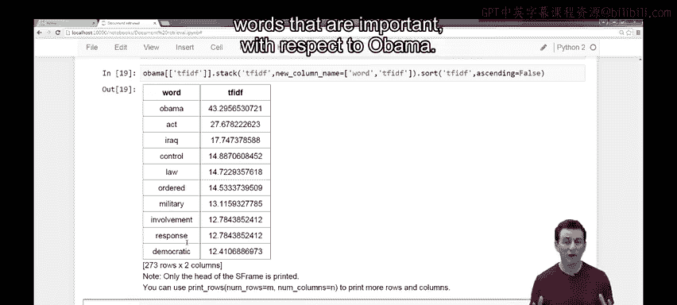
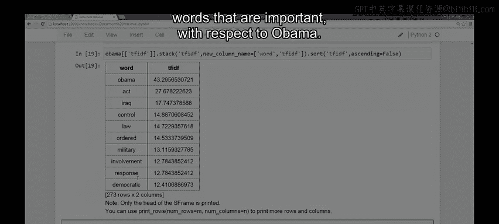

# 华盛顿大学《机器学习（基础篇，第1课／共4课）｜Machine Learning》中英字幕 - P70：69_计算并探索TF-IDF.zh_en - GPT中英字幕课程资源 - BV1zw4m1e7Zh

。

And so let's actually compute TF IDFs now I can't just compute TF IDF and this is an important note by the way。

 I can't just compute TFIDF for the Obama article in isolation because TFIDF depends on entire corpus you need that normalizer which is the number of times a word appears in every article so I have to show it I have to compute it for the entire corpus so let's go ahead and do just that。

😊，So。Here we go， so I'm going to。Compute。T诶。IdF。For。The corpus。And I'm going do this in two steps。

 First， I'm going to compute the word counts for the entire corpus。

 So I'm going to add a new column to the people table called word count。 Remember。

 we just did this only for Barack Obama。 So now we're going do it for everyone。

 So I'm going to call graphralab dot text analytics dot。Count words。And I'm going to put in。

The input， which is going to be the text column， in other words。

 I'm going to count the words in the text column。And just so that we're clear。

 let me just print the as frame people。After we do this。

 so I'm going to print the first few lines of that SV。

 so here we are we've executed now we have the URI column， the location to web page。

 the name of person text， and now we have this dictionary of word counts on the right' a new column。

😊，Good， so next we're going to compute the TFIDFs so just like with word counts。

 you could have implemented your own TFIDF system thatll take you a little while to do so Grafllab create has one already implement and we're going to just use that to make this whole process pretty quick so we're going to call GraphLlab do text analytics just like with word counts there's a function here called TFIDF and all you need to do is give you an input just like we're going to give you an input the word counts。

😊，Word count。And it will output the EF idea， and let me just again show you what that looks like。Ys。

 I did a little typo here， that should be a word count， that are called the column word counts。

And now I'm going through the whole corpus， is 15000 documents computing。

The frequency of words normalizing and what we end up with is a table where for every document calls the table docs。

 it has a dictionary of TF IDDFs for each one of those documents and just so that we get all this right I'm going to add a new column to the people。

😊，Table and this new column is going to be called TF IDF。

 and I'm just going to store in there the TF IDF that I just computed。

 so it's all in one table and it's the doc column docs column。Here we go， we just added in。

 so now we have TF IDFs for every document computed and storedor in there， let's do some examination。

😊，So。Here's what we're going to do。Exza in。呃，呃，TF。IdF。For。The Obama article。

So just like we examined and sorted the word counts。

 I'm now going to examine and sorting the TF ideass I'm going to reread。😊。

The variable for Obama because we now added these two new columns and I want the latest version of that。

 so I'm going to take people and I'm going to select out of the people， the one whose name。

Is equal to。Brack。我爸妈。Okay， I've done it， I've created this Obama。

 and now just like we did with four counts， I'm going to create an Obama。😊，TF IDF。Table。

So that we can sort it， it's a dictionary， we're going to just sort it exactly the same as we did before。

 we're going to stack it and then sort it and I'm going to do this。Actually， self creating a table。

 I'm just going to do it in one line。 oops， I'm going to do it just in one line here。

 so I'm going to。Rightrite out what we did earlier。

 so I'm going to just take the Obama variable and I'm going to select only the TF IDF column so it looks a little prettier。

 then I'm going to call the stack method which takes a dictionary and just stack it into two columns so I'm going to stack TF IDF。

And I'm going to output new column。Names and those names are going to be。The word。

And then the Tf IDf。And let me show you something， oops。Forgot to close。

Okay here and let' me show a little neat trick that can use with Python in various ways。

 I'm just going to change the sort command at the end of this， so I'm just going to type dot sort。😊。

And I'm going to sort this output on the Tf IDF column。And I'm going to say ascending。

Is equal to false。So what I did in multiple lines before now I'm doing just one line。

 I'm taking the Obama column TFIDF， I'm going to stack it into a word column and TFIDF column and then I'm going to sort it in descending order so from Haes Lewis and if remember just before we run this when we did it for just word counts。

 it look like this， there was the most popular word and in and on and off and to his the Obama Act A here so those words are mostly uninformative except for the word Obama。

So let's execute it for TF IDF。And what we see here， Voalah， the most informative word is Obama。

 which makes a lot of sense because the article is about him， but then you have Act， Iraq， control。

 law， order military involvement， response democratic is the Democratic Party。

 so you see lots of action going on here around words they're important with respect to Obama。

。