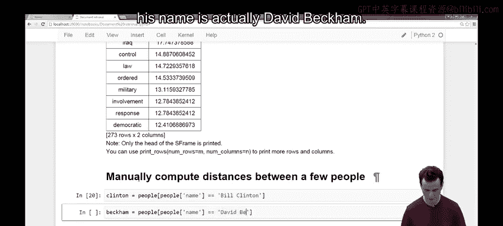
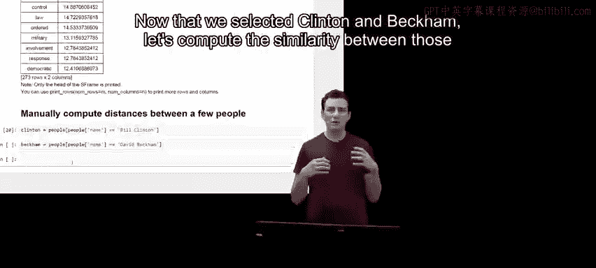
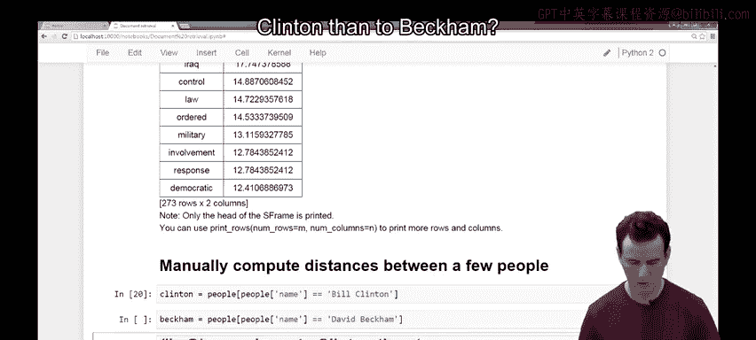
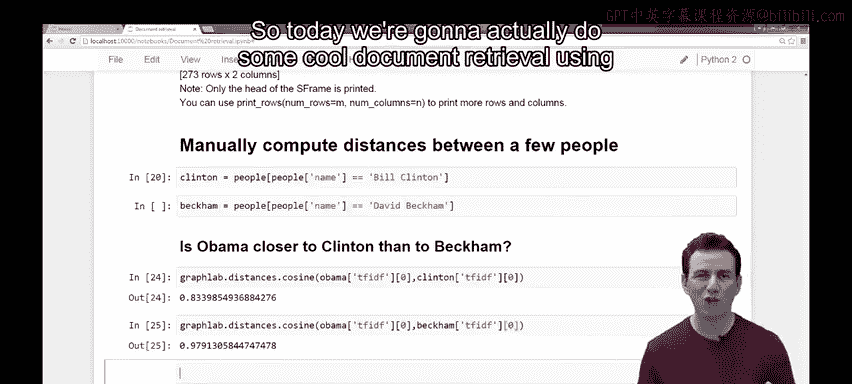

# 华盛顿大学《机器学习（基础篇，第1课／共4课）｜Machine Learning》中英字幕 - P71：70_计算维基百科文章之间的距离.zh_en - GPT中英字幕课程资源 - BV1zw4m1e7Zh

。

So let's take these TF IDFs and do a couple fun things with them。So first。

 we're going to manually let's。Okay， so let me just type in here。 so we're going to manually。Compute。

Distances。Between a few。People。So the goal here is just to show what those distances look like just to get a sense of what we're learning from TF IDDF for example。

Let's take three people， so we already talked about Obama， we already have that Obama variable there。

 let's create two new variables， let's take Clinton。Which out of the people。

I'm going to select the one。The person whose name。Is equal to。Bill。Clinton。The former US president。

And let's select another person， so for example， let's select Beckckham。So Beckham is a famous。

British， English footballer， and so we're going to select out of the people。The person whose name。

Is equal to。His name is actually David。B。

Come。Now that we selected Clinton and Beckham， let's compute the similarity between those two people and the President Barack Obama。

So。What we're going to do is ask the question is。奥巴马。Closer。To Clinton。Then， to。

Beckcca。

Okay， little， stick here。So is Obama closer to Clinton？Then two be。

Now there are various ways to measure similarity or distances between two vectors or in this case two documents。

 we computed the TF IDFs and what we're going to do is compute the distance between this different documents so went about Clinton。

 the went about Obama and so on so I'm going。Use。Distance metrics that are already implemented inside the Graphlab create so we don't have to implement them ourselves so if you look at Graphlab do distances and press tab you'll see several options here the Eucidean distance that we talked about in class cosine distance jaar similarity and so on that we're going to see throughout this specialization we're going to use cosine distance and just as a little note normally we think about cosine similarity if you've heard of it where the higher the number。

 the more similar two articles are here we have a distance version of this number so the lower the better the lower the cosine distance。

 the closer the articles are so the question is what is the cosine distance between。😊，Obama's。DF IDF。

And that of Clinton but notice that I have to select a column TFIDF and I have to add a little zero at the end here because it is the zero row of this table。

 the table only has one element in it but we still have to say what row of the tablere looking at and so we're going to compare the Obama TFIDF with the Clinton。

😊，DF IF。Also 0 in terms of their cosine distance and you see that distance is 0。

83 Now the question is what is the distance between in the same metric in the cosine distance？😊。

Between Obama and Beckham。 So I'm going to type Obama。TF， IDF。Computer at zero with beons。T ideaF。

Also，0。And you'll see that this distance is 0。97。 the biggest distance you can get is one， in fact。

 and so in this case。😊，Obama is much closer to Clinton than he is tobean， which makes a lot of sense。

 but we've done this just manually for a few people。

 how do we automate this process of finding out how close an article is to other articles and in this case how close is the person to other people。

In the lectures， Emily talked about nearest neighbor models and how they can be used for document retrievals。

 so today we're going to actually do some cool document retrievals using a simple nearest neighbor model。

😊。

