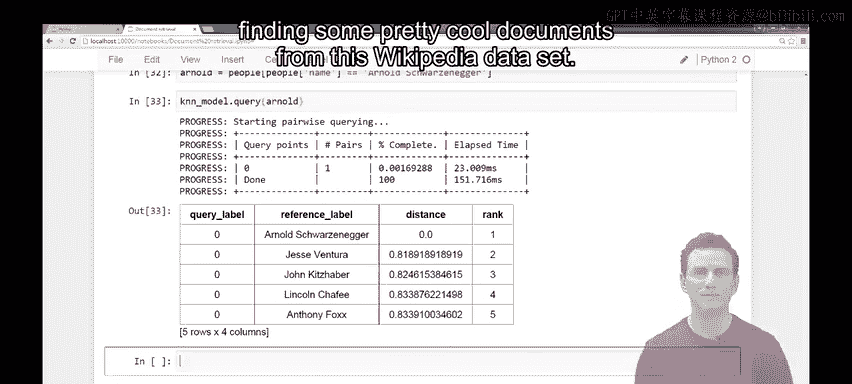

# 华盛顿大学《机器学习（基础篇，第1课／共4课）｜Machine Learning》中英字幕 - P73：72_文档检索实际应用示例.zh_en - GPT中英字幕课程资源 - BV1zw4m1e7Zh

。

Other examples。Of document。Retrieval。Okay， so we have to go through a few。 So for example。

 let's take the singer Taylor Swif。 So out of all my people， I'm going to select the one。😊。

Whose name。Is。Taylor。Swift。And so when I select her， I can ask， let's retrieve some documents。

 they are similar to Taylor Swift's documents， so in other words。

 who are the people just create a model， who are the people who are closest to Taylor Swift。😊。

So she's a a female singer and you'll see other female singers kind of similar generation like Kerie Underwood。

 Alice Keys， Jordan Spars， Leona Lewis， and just a little disclaimer here I had to go and look those people up in Wikipedia because I really didn't know who they were but here we go let's take another example so for example。

 the actress Angelina Jolie。So if I take out of all my people。take the one whose name is。呃。

 angel丽ina。呃，Re。And I'm now going to query。My nearest neighbor model。

To ask who is closest to Angelina Jolie。Who is close to Angelina and Jolie before I press enter here。

 take a moment to think if you know anything about this Alist Angelina Jolie。

 you might guess who is the closest person to her？😊。

And if I run this you'll see that the nearest neighbor is Brad Pitt and we all know about the relationship between Ni and Jolie and Brad Pitt and then you see Julian Moore。

 Billy Bob Thornton， George Cloney， these are all actors and actors have been in movies actually with Angelina Jolie so it's a pretty cool we get some interesting retrieval here。

 so let me show you one last cool fun example。😊，So you might be familiar with the。

With a person called。Arnold Schwarzenegger， the famous。Terminator。So I actually have to cheat here。

To make sure I get his last name right， through。嗯，那个。Okay。

 hopefullype I got that right and the question is。😊。

Who are the nearest neighbors who are those Georgeneggger？Now。

You may know that Arnold had a double career， so first he started as an actor， a bodybuilder。

 then an actor then a politician and became the governor of the state of California in the United States so several lives so who are the nearest neighbors for Arnold Charlesegger and so you'll see Arnold Schwarzenegger then youll see Jesse Venura who is like。

😊，Jesse Venura is a wrestler， an actor， so similar to Ar Soneggt。And then a few politicians。

 including former governors of Oregon and of Rhode Island and other states in the United States。

 so now we see that the nearest neighbors for Arn are politicians and actors and bodybuilders。

 people like him， so this was a really cool example of just building a very simple document retrieval system using TFIDF in the nearest neighbors just like we learned in the module but now taking it to practice and finding some pretty cool documents from this Wikipedia data。

😊。

。