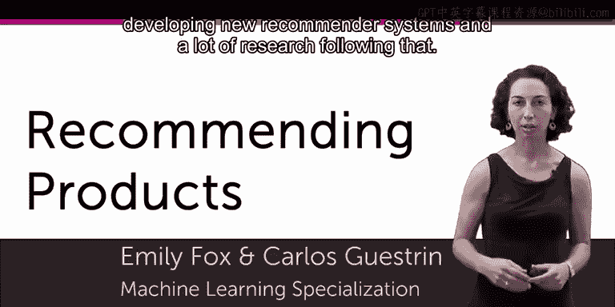

# 华盛顿大学《机器学习（基础篇，第1课／共4课）｜Machine Learning》中英字幕 - P74：73_推荐系统概述.zh_en - GPT中英字幕课程资源 - BV1zw4m1e7Zh

。

Okay， so in this module we're going to talk about recommender systems and one prototypical example of where recommender systems are really useful is in recommending products。

 so imagine you have a large set of products and there are some users and you want to recommend a subset of your products to those users Well the question is how are we going to do this and what we're going to talk about is how to use machine learning techniques in order to use the past history of your own purchases as well as the purchases of other people to determine which products to recommend to you？

And recommender systems just have a really， really wide range of applications and they've exploded in popularity over the last decade。

 but Amazon was an early pioneer in this area， focused on the application we're going to be talking about。

 which is product recommendation， but another example that really popularized recommender systems was a competition that Netflix ran starting back in 2006。

 ending in 2009， where there was a $1 million prize for the person who provided the best recommender system for recommending movies to users and we'll talk a little bit about that application in this module but it really spurred a lot of activity in this area developing new recommender systems and a lot of research following that。

