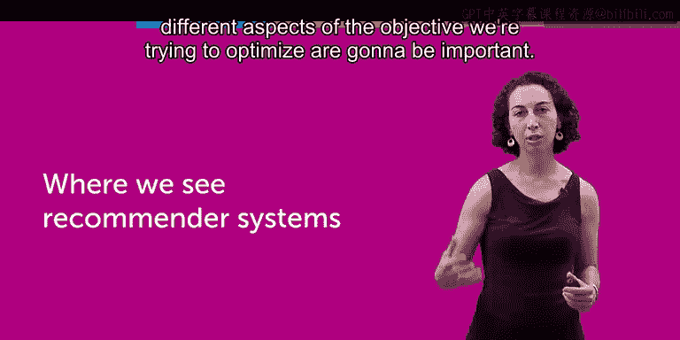
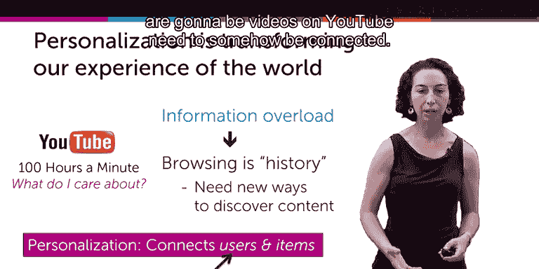
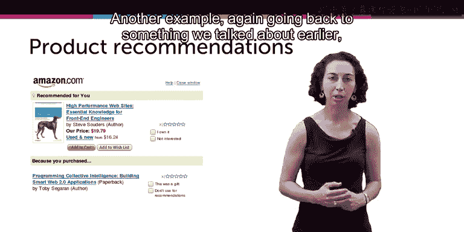
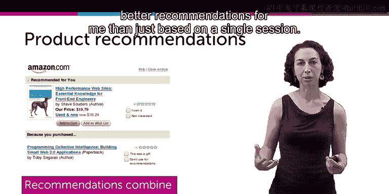
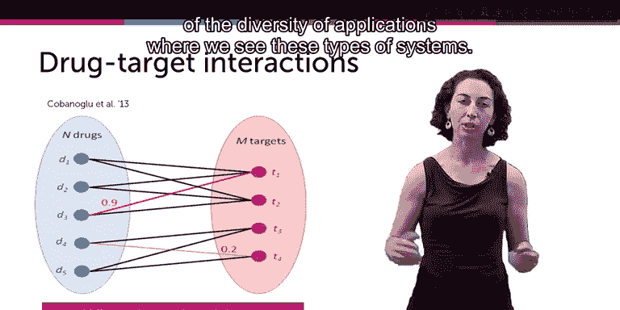

# 华盛顿大学《机器学习（基础篇，第1课／共4课）｜Machine Learning》中英字幕 - P75：74_我们在哪里看到推荐系统的应用.zh_en - GPT中英字幕课程资源 - BV1zw4m1e7Zh

。

Let's start by discussing some areas in which recommender systems are playing a really active role behind the scenes。

 and as we're going to see in this discussion， depending on the specific application。

 different aspects of the objective we're trying to optimize are going to be important。

But before we start talking about recommender systems。

 it's really important to talk about the idea of personalization because personalization is transforming our experience of the world as we talked about in the clustering and similarity module there are lots and lots of articles out there and lots and lots of web pages and we can't possibly be expected to browse all of them So another example here is YouTube so YouTube it's quoted that there are roughly 100 hours of video recorded per minute and the question is what do I care about you know I go on YouTube and I want to watch some video that's of interest to me So this is an example clearly of information overload there's just way too much content there for me possibly to be able to go and for me to find what I'm interested in without somebody helping that content come to me。

So browsing， the traditional form of browsing， is history。

 There needs to be some way in which the content that's relevant to me is automatically discovered。

 And so this is the notion of personalization where we want to connect users like myself。

Who goes to YouTube and items， which in this case are going to be videos on YouTube。

 need to somehow be connected。

Okay， so personalization is going to play a key role in this notion of recommender systems and now let's talk about some examples where recommender systems are very important。

 so one very classic example that we mentioned a little bit earlier was this idea of Netflix where here people go and they watch videos and Netflix has this goal of trying to make suggestions of which movies or TV shows might be of interest to the person who's come to this site and the question is how are we going to go about doing these recommendations？

Another example， again， going back to something we talked about earlier is Amazon making product recommendations。

 so you go on to Amazon， you purchase some product and you'll see on the site that it makes a recommendation of other products you might be interested in but one important thing to incorporate in these recommendations is the fact that not only do you have to take into account the interest that the person had in this one session。

 so for example， here we're showing that somebody bought a book about websites and might be interested in another book about web applications or for example。

 my most recent purchase on Amazon where shoes for my son but the interest that I have in making that purchase of shoes isn't my only interest。

 I'm not only looking for shoes for a one yearold， there are lots of other reasons why I go to Amazon and make purchases and if you look at my history of purchases。

 you're going to be able to make much better recommendations for me than just based on a single session。

And likewise， recommendations might change over time。 So there's interest in making recommendations。

 for example， what I might be interested in purchasing today。

 So if you look at my purchase history a year ago， I was buying a lot of newborn products。

 So newborn baby products。 but that's probably not something that I'm very likely to purchase today。

 So the recommendations that Amazon presents to me today have to adapt with time。

 So just as onded video with personalized recommendations has really revolutionize how people watch movies and TV shows。

 Well， likewise， there are a lot of websites that provide streaming audio with personal recommendations。

 However， in this case， unlike thinking about ondeman video here we want one song to play after another。

 And what we want is we want some coherent stream of songs。 So songs I've liked。

 I want to play similar songs I don't want to rapidly switch between， for example， playing some。😊。

Cafe， Indie， song to all of a sudden playing a heavy metal song。At the same time。

 I don't want a song I just heard to play again and again and again。

 so I want some sense of recommendations that are coherent。

 but I also want them to provide a diverse sequence of songs for me to listen to。Okay well。

 another critical area where recommender systems have played a very active role is in social networking。

 so for example， on Facebook there are tons and tons of users and we want to form connections between these users so for example here might be a graph of connections between users on Facebook and maybe I'm this pink node right here and Facebook wants to recommend other people I might be interested in connecting with。

In this application， it's important to note that both the users and the quote unquote items are of the same type we're both people。

 so when I'm a user on Facebook， the things that are being recommended to me the items they're other people。

 so we're going to end up with users and items being of exactly the same type in this application。

But the recommendation system that we've talked about have really focused on online media。

 but more and more people are realizing other areas in which recommender systems can play a really important role and just as one example we can think about what's called drug target interactions and here maybe we have some drug that's been studied you know。

 for example， let's talk about aspirin you know it's been well studied as a treatment for headaches。

 but what if it's discovered to have some other possible use so， for example。

 for blood thinning for heart patients。If we can find these types of relationships。

 if we can repurpose this drug for some other treatment。

 then that can be really useful because it's really quite costly and lengthy process to get FDA approval for a completely new drug。

 but if we can take a drug where the types of side effects and the possible risks associated are already wellknown and well studied then it's a lot easier to get approval for treatment with some other condition。

 so this is a case where we might say if you like aspirin for headaches。

 you might also like aspirin for your heart condition。

 so recommender systems are playing an active role in medicine as just an example of the diversity of applications where we see these types of systems。

