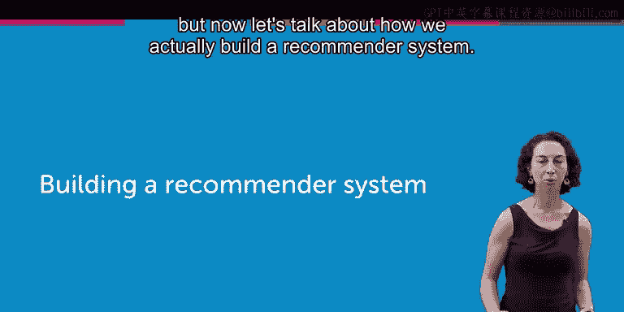
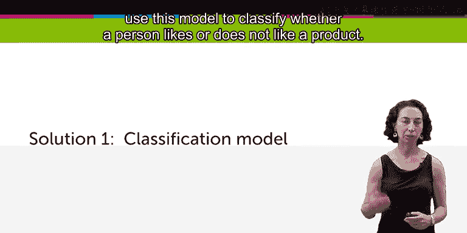
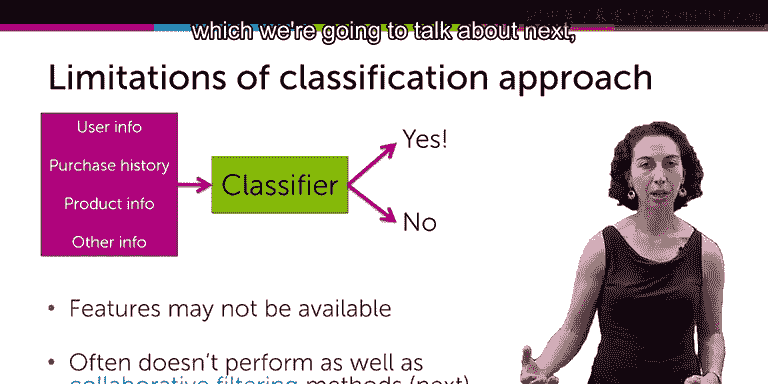
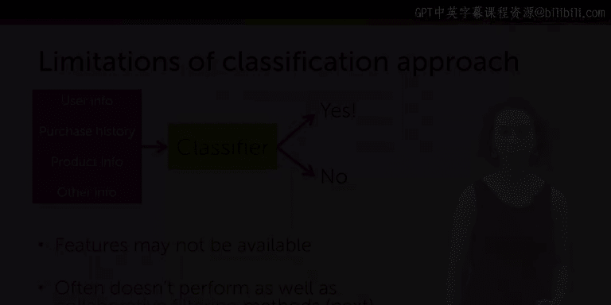

# 华盛顿大学《机器学习（基础篇，第1课／共4课）｜Machine Learning》中英字幕 - P76：75_通过分类构建推荐系统.zh_en - GPT中英字幕课程资源 - BV1zw4m1e7Zh

。

We talked about a lot of application domains where we see recommender systems。

 but now let's talk about how we actually build a recommender system。

And there are lots and lots of approaches for performing these types of recommendations。

 and let's discuss some of them and the first level zero way we might think about recommending products is just based off of the popularity of each product。

And this approach is actually really popular on things like news sites， so for example。

 New York Times has this list on the of the website that says the most popular articles and it's sorted by different topics。

 for example， the most emailed articles。So here， when we think about recommending articles to other readers。

 we're just sorting the articles by how often they were shared by other readers on New York Times。

So this can work fairly well， I might actually discover an article that I'm interested in using this type of approach。

But one disappointing thing about it is it completely lacks personalization。

Because all the recommendations are based off of the entire population of New York Times readers out there。

 which is actually pretty diverse， so instead， I would of course love to have a method that knew a little bit more about me and my interest to recommend news articles to me。

So let's try and add in a little bit of personalization using a classification model where we're going to use features of both the products and the users to make our recommendations and this classification model is going to look exactly like the classification model that you're just learning from Carlos where there you guys were using classification to do sentiment analysis。

 but here we're going to use this model to classify whether a person likes or does not like a product。

Okay so this classification model is going to take in features about the user。

 features about the past purchases of that user， features about the product that we're thinking about possibly recommending。

 as well as potentially lots of other features that we can talk about and we're going to shove all these features into our classification model and it's either going to spit out yes。

 I believe this person is going to like this product or no， I don't think they're going to like it。

Well， this type of classification approach has a lot of things going for it。

 so first it can be very personalized we're using features of the user as well as the user's purchase history。

And in addition， this model can capture context， so for example。

 we can take into consideration the time of the day， what that person just saw， so for example。

 maybe I'm much more likely to purchase a textbook during the day or home products at night。

And one other really nice thing about this approach is the fact that it can handle a very limited user history so for example。

 let's say I'm a user on Amazon and I haven't purchased many items in the past。

 so for a lot of approaches there might be a lot of ambiguity about what I might be interested in or not。

 but if you have information about me such as my age。

 that alone can be very predictive of what I might like or not like。

But this approach has limitations as well， and one of the important limitations is the fact that these features that we're talking about that can be so informative about the products that we're going to potentially like or not。

Might not be available。 So， for example， you might not know my age。 you might not know my gender。

 and the list goes on and on。 And likewise， for a product。

 you might also have either missing information or very poorly written product descriptions。

 especially on Amazon， where you have lots of people on there selling different products。

 The quality of that information might be pretty low。

So often what we actually see is something that's called collaborative filtering。

 which we're going to talk about next， can actually work better than this type of classification approach。

