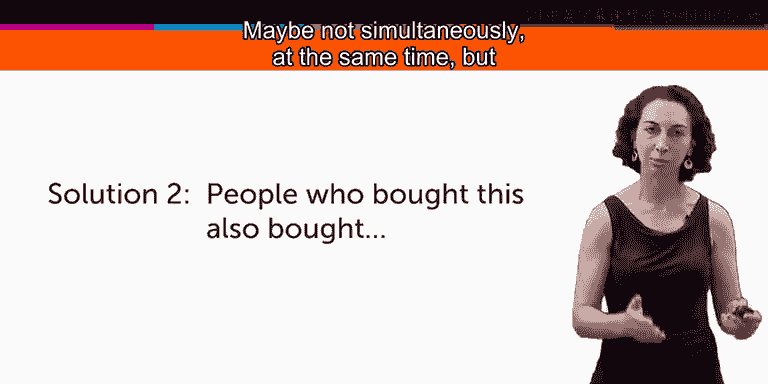
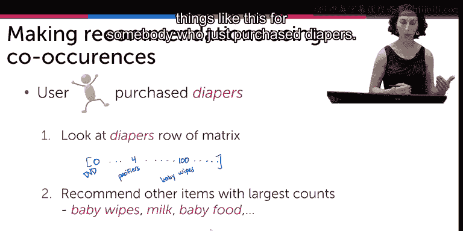

# 华盛顿大学《机器学习（基础篇，第1课／共4课）｜Machine Learning》中英字幕 - P77：76_协同过滤：购买此商品的人也购买了.zh_en - GPT中英字幕课程资源 - BV1zw4m1e7Zh

。

So this notion of collaborative filtering is that somehow we want to leverage what other people have purchased in the case of product recommendation or other links more generically between users and items to make recommendations for other users。

And so it seems very intuitive that when we're thinking about doing product recommendation。

 that we want to build in information like if a person bought this item。

 then they're probably also interested in some other item because we've seen lots and lots of examples in the past of people buying those pairs of items together。

 maybe not simultaneously at the same time， but in the course of their purchase histories。

Okay， so this brings us to the idea of coocnce of purchases so for example。

 if I was just on Amazon buying diapers， well we've probably seen lots of examples of people who bought diapers also bought baby wipes。

Okay， so how can we use this type of coocnce of purchases to make recommendations？Okay。

So let's talk about this coocnce matrix that we're going to build up。

 and this is going to store all of our information about which purchases people bought together and again。

 when I say together， I don't mean simultaneously just together at some point in their history of purchases。

So I'm going to build up this matrix C。And this matrix is an items by items matrix Okay。

 so we're going to list all the different items。For our rows of this matrix。And likewise。

 all the different items。For the columns。 So， for example， maybe。This row of this matrix might be。

The row corresponding to diapers。And then if this is， let's say， the third row of this matrix。

 then I would also have。That' the third column of this matrix。Corresponds to diapers as well。Okay。

 and so if I want to say that many people purchase diapers and baby wipes， let's look at the。

The row for diapers， and then we scroll over to the column for。

 let's say this column here is for baby wipes。And in this entry。Of this matrix。

There's some number entered， and that number represents the number of people。

Purchasing both diapers and baby wipes。Okay， well。Let me ask you a question。

 is the number of people who purchased diapers and baby wipes。

 the same as the number of people who purchased baby wipes and diapers？Yes。

 so we would go to the baby wipes row。And this diapers column。

And notice that this is the exactly same number。Okay。

 and so what this means is this is a symmetric matrix that if we look across the diagonal here。

Then we're going to see a reflection if we took this matrix and folded it across that little diagonal line I just drew。

 you would get exactly the same numbers matching up。Okay。

 and just to reiterate the way we're going to build up this co occurrencence matrix is we're going to search through all the users histories of purchases they've made。

And count and every time we see a purchase of diapers we of diapers along with all the other items。

 we're going to add one to that entry and we're going to keep incrementing that matrix as we're searching over users。

Okay， but now let's talk about how we're going to use this cooccurnce matrix in order to make recommendations。

 and it's really， really straightforward。 So let's say that a user has just purchased diapers and I want to make some recommendation for them。

 Well what I'm going to do is I'm going to look at the diapers row of this matrix。

 So if we go back to that。C matrix here， I'm going to grab out this diapers's row。

 and I'm just going to draw that row here。And what this row has is how often people bought diapers and remember baby wipes was one of the。

Items。Oops， sorry， not baby items， baby wipes。And that has， let's say，100 counts。

And then there's also， let's say， pacifiers。And maybe there are four counts of pacifiers。U。

Let's think of something else， so let's say that there's some DVD。

Let's say there's no counts of those DVDs， we're going to have this whole。

Vectctor of counts of how many times people who bought diapers bought all these other products。Okay。

While using this now we can very straightforwardly make our recommendations。

 all we do is we sort this vector and recommend the items with the largest counts。

 so maybe we'll recommend baby wipes and milk and baby food and things like this for somebody who just purchased diapers。

