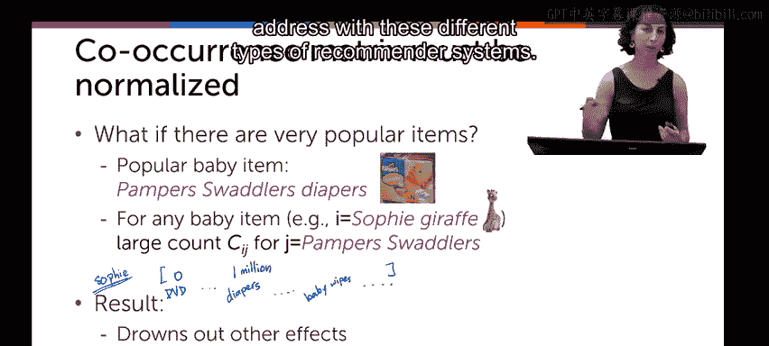

# 华盛顿大学《机器学习（基础篇，第1课／共4课）｜Machine Learning》中英字幕 - P78：77_热门商品的影响.zh_en - GPT中英字幕课程资源 - BV1zw4m1e7Zh

。

One issue though， that we have with these cooccurrence matrices is the fact that they have to be normalized because let's talk about what happens if we have a very popular item。

So one of the most popular items。For babies is diapers。There are lots of these around here。

 they're very， very useful when you have a baby， so basically if you're going to purchase any baby item on Amazon。

 you're also very likely at some point to have purchased diapers。

But then let's look at some other item。This is Sophie the giraffe。

 it's actually one of the most gifted items on Amazon for babies， but it's a little teether。

 little babies like to bite on this， rubberery squeaks， keeps them very interested。

But let's think about what happens when we're looking at this other item。

So we just purchased Sophie the giraffe， and we want to make recommendations for this person who just purchased this little toy here。

So what I'm going to look at is I'm going to look at the counts vector for Sophie。

 this is for Soie the giraffe。And again， we have that DVD that nobody's purchasing。

Then we have diapers。Then we have。Baby wipes。And all the other products you can imagine。

 And diapers is some enormous number， let's say，1 million。Maybe that's not so enormous。

 but 1 million， it sounds pretty big or it used to sound pretty big。

What ends up happening is that regardless of what product I'm looking at。

 regardless of whether I just purchased Sophie the giraffe。

Or if I just purchased this little stacking toy or if I just purchased。

This really cute alligator that。Makes this sound and it rattles no matter what I just purchased。

 according to the process that we just described， I'm really。

 really likely to recommend diapers to you。So let's think about how to make the recommendations a little bit more personalized and have the effect that。

Everybody buying diapers doesn't mean that that's what I'm particularly interested in when I just bought Sophie。

 so let's talk about how to handle this。And the way so this is just to reiterate what I was saying。

 which is the fact that having these very large counts for popular items drowns out all the other effects。

 and so we're just going back to this default thing of recommending based off of popularity。

 which is what we were trying to address with these different types of recommender systems。

