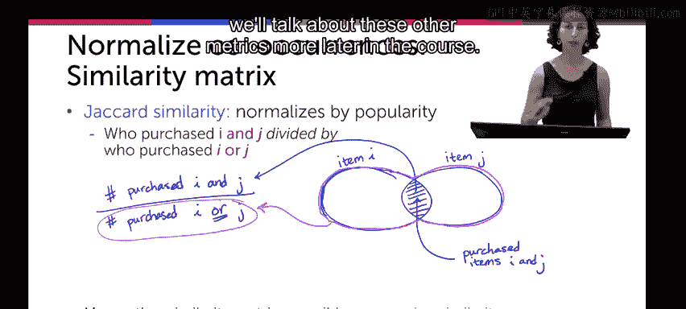
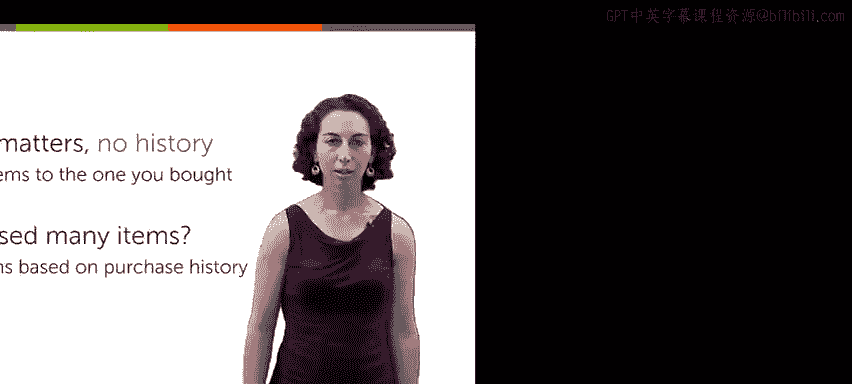
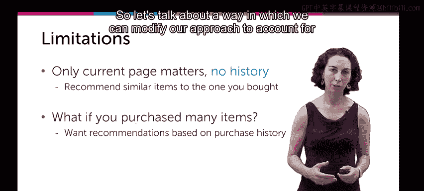
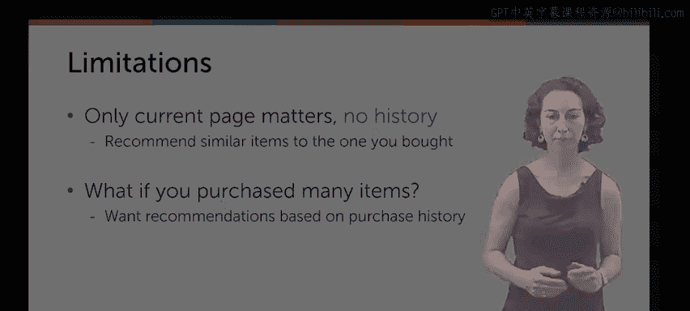
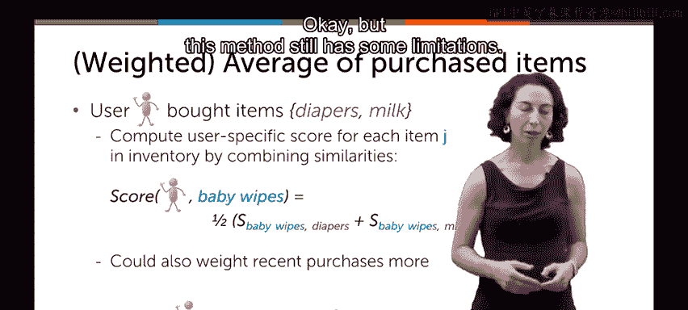
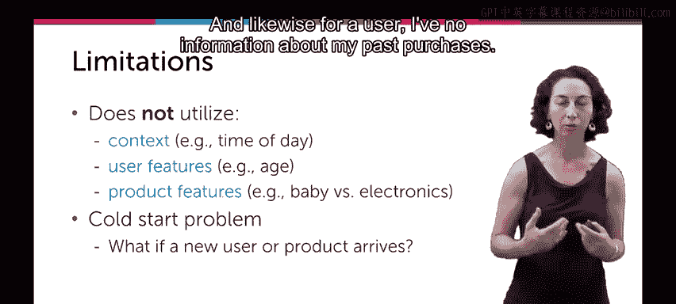

# 华盛顿大学《机器学习（基础篇，第1课／共4课）｜Machine Learning》中英字幕 - P79：78_归一化共现矩阵并利用购买历史.zh_en - GPT中英字幕课程资源 - BV1zw4m1e7Zh

。

Okay， so to handle this situation of having very popular items。

 we can think about normalizing the cooccurrence matrix and one way in which we can normalize this matrix is with something called Jaard similarity。

So I want to mention that this notion ofnmalizing this cooccurrence matrix that we're talking about right now is very similar to what we talked about in that clustering and similarity module when we're talking about TFIDF。

 the term frequency inverse document frequency where there we were looking at documents and we said that really。

 really common words just swamped out other words that we might have cared about and so we had this way of using TFIDF to renormalize our raw word counts that we're using to represent our document。

Well in this case， this is a very similar notion of accounting for a very popular item。

And the way it works is pretty intuitive， we're just going to count the number of people who purchased some item I and some item J。

So number。You purchased。I and J。And that's what our matrix had before， so those are our raw counts。

 and we're going to normalize by the number of people who purchased either of these items。

So the number who purchased。I or J。And so a simple Ven diagram explains this very clearly。

Here's the world of people that purchased item I。And here's the world of people who purchased item J。

And。Here in this shaded area are the people who purchased I andJ。

So what we're going to do is we're taking the counts we had before， this is our numerator。

 this shaded area， purchased I and J， and we're just normalizing by the total area。So， that's。

Let me switch colors here to make this a little bit more visible。

So circling the whole entire world of unique users that purchased items I or J。

 and that's our denominator。Okay。So。That's one way in which we can normalize our cooccurrence matrix and there are other things we could think about like cosine similarity。

 and we'll talk about these other metrics more later in the course。

But this method has its own limitations here， one issue is the fact that only the current page matters。

 so it only matters that I just bought Sophie the giraffe when we're looking at making recommendations for me。

 we're not looking at the entire history of things that I purchased to inform these recommendations。

So let's talk about a way in which we can modify our approach to account for my history of purchases。

Okay so a really simple approach is just to do a weighted average over the scores I would have placed on the products for each item in my purchase history。

 so let's go through a concrete example of this， let's imagine that the only items I ever purchased on Amazon were diapers and milk。

Okay， so now I want to make recommendations for me。

 the user that only purchases diapers and milk and what I'm going to do is。

I'm going to go through every item that I might think about recommending and I'm going to compute the score as follows。

 so let's say I'm looking at whether I want to recommend the item baby wipes to myself。

And in this case， what I'm going to do is I'm going to compute a weighted average over how much I would have recommended baby wipes just。

Based on having purchased diapers before， so that's using exactly the techniques we just talked about。

 so looking at the row diapers and looking at how many times people also bought baby wipes。

 but then I'm also going to look at the row for milk and then look at how many times people who bought milk bought baby wipes and I'm going to average these two results to say how much or how likely it is that I would purchase baby wipes given this purchase history that I have。

Okay， and of course we could do other variants instead of just the simple weighted average。

 I could weight more heavily my recent purchase history to account for context and so on。Okay。

 so then when I want to make the recommendation， I just sort this weighted average score and recommend the products that have the most weight。

 so very similar to the approaches we talked about before。

 but now we're combining weights based on my purchase history。Okay。

 but this method still has some limitations， so for example， it doesn't use context like time of day。

 at least not directly， it doesn't use features of the user like my age or gender or anything like that because it's grouping all users together when it's thinking about looking at this coocnce matrix。

And likewise it doesn't use features of the products， okay。

 so everything's just pooled together without any kind of notion of different properties of these products or users to drive these recommendations。

And another big problem that we face here is something called the cold Start problem。

 and this is a really important problem that we face in a lot of different domains。

 but let's talk about it in this context， so the cold start problem is the fact that let's say we get a new user or a new product。

How do we form recommendations？I have no observations ever for that product。

 so I have no notion of how often it's been purchased along with something else because it's never been purchased。

And likewise for a user， I have no information about my past purchases。

