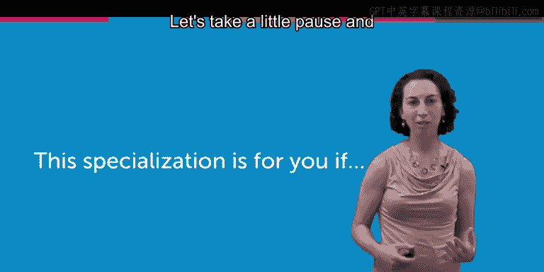
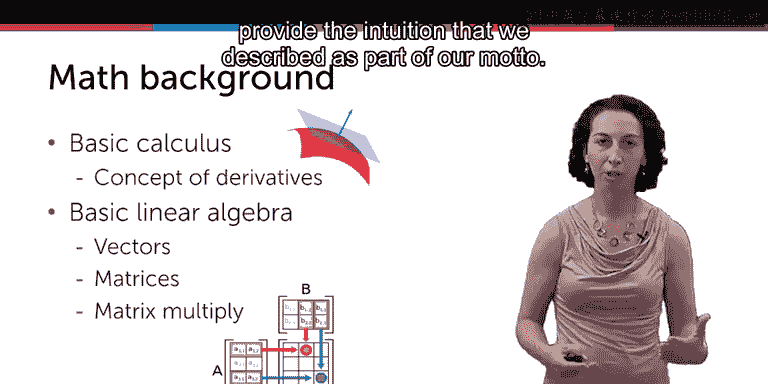
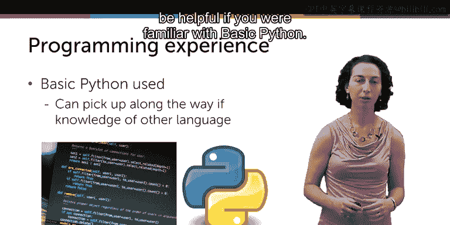
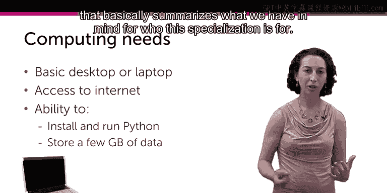

# 华盛顿大学《机器学习（基础篇，第1课／共4课）｜Machine Learning》中英字幕 - P7：6_这个专项课程适合谁.zh_en - GPT中英字幕课程资源 - BV1zw4m1e7Zh

。

Let's take a little pause and spend some time talking about who the specialization is geared for。

Well， the first thing I want to emphasize is the level of the specialization and what we're going to do here is we're going to teach you really important machine learning methods and what we're going to ground them in real worldorld applications like we saw with our case studies so a motto that we have here is tough concepts made intuitive and applicable。

 so this course isn't going to be about theorem improving is going to be about understanding at a very intuitive and practical level。

 some very important machine learning algorithms and thinking about ways in which to deploy them in new problems。

And when we're going about this， our goals here are to minimize the amount of prerequisite knowledge that you have to have to understand what we're presenting。

While maximizing the ability for you to actually develop and deploy these methods on new problems that are of interest to you。

And when we're thinking about this， we're going to be presenting concepts at this very intuitive leadable that's grounded in these case studies。

 so who might you be， well when we're thinking about the target audience。

 we're thinking about software engineers who are interested in machine learning。

 we're thinking about scientists who might want to become data scientists。

 and we're thinking about lots and lots and lots of other people。who have some math。

 some programming experience and want to be able to analyze data and do fun things with it so just data enthusiasts who want to learn more about machine learning and how to derive intelligence from data Okay so I said that we're assuming you have some math and some programming background so let's talk about this in a little bit more detail。

In terms of the math background， we're assuming that you have some basic calculus knowledge。

 so that's understanding the notion of derivatives and how they're computed and basic linear algebra so you guys should know what a vector is。

 what a matrix is and how to multiply matrices but in。These cases were really as often as possible。

 going to present things at the most intuitive level。

 even if we could write down an equation in terms of matrices and matrix multiplies。

 we're going to try and add as many visual aids as possible to provide you with that intuition so that if you're only marginally comfortable with these ideas。

 I do suggest that you go brush up on these concepts， but again。

 we're going to try and provide the intuition that we described as part of our motto。

And in terms of programming experience in this specialization。

 we're going to be using basic Python basic Python for programming。

 but if you're not familiar with Python， it would of course be helpful。

 if you were familiar with basic Python， but we think that you can pick up on the important tools that you'll need if you have some other knowledge of some other language。

Okay so finally what are your computing needs for this course Well we're going to assume that you have some basic desktop or laptop or access to one where you can access the internet。

 of course that's important so you can watch these lovely videos but beyond that so you can do your assignments and to do your assignments you're going to need to be able to install and run Python and in addition you're going to be able you're going to have to be able to store a few gigabytes of data Okay so that basically summarizes what we have in mind for who this specialization is for and we hope that fits your case。

