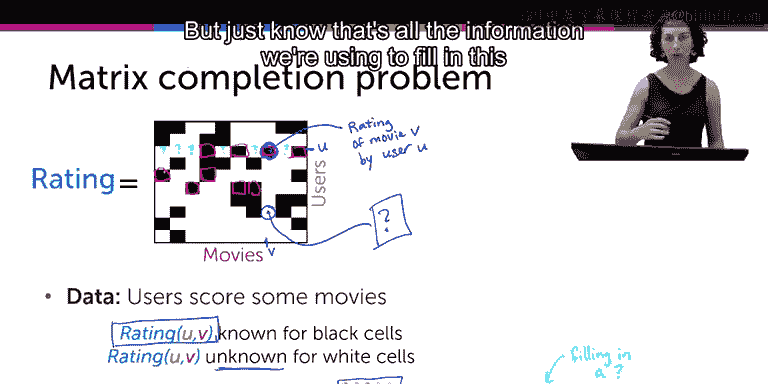

# 华盛顿大学《机器学习（基础篇，第1课／共4课）｜Machine Learning》中英字幕 - P80：79_矩阵补全任务.zh_en - GPT中英字幕课程资源 - BV1zw4m1e7Zh

。

So in the coocnce approaches that we've been talking about so far。

 there's been no notion of different aspects of me as a user or features of the product that are driving the recommendations made instead we're simply counting cooccurrences of purchases and user histories。

So a natural question is whether we can somehow use some aspects of who I am and what a product is to drive the recommendations。

 just like we talked about in the classification approach。

 so we have some set of features for the user and the product。

 but here we'd like to be able to learn these features from the data。

 and that'll help us cope with the problems we talked about where we might not have features available。

And in addition， we like to take into account interactions between users and items just like we did in the cooccurrence application or the cooccurrence approach and so we're going to discuss this in the context of a movie recommendation task because it's very intuitive to talk about this application for the methods that we're going to describe and in this application what we have as our data is we have this big table where we have a whole bunch of users that are watching some set of movies and they rate those movies so our table looks something like this where this green user went on。

 watched three different movies gave them a rating of three stars。

 five stars and two stars and then there was this blue user watch two different movies and this pink user watch four different movies。

And we have a very big table of the user movie ratings combinations。However。

 each user only watches a few of the available movies。

 So we're going to transform this data table into a really big users by movies matrix of ratings。

 And the reason it's a really big matrix in generals there tend to be a lot of users and a lot of movies。

 But at the same time， this matrix is very sparse because there are lots and lots of movies。

 and even though there are a lot of users， there is only a few movies that any given user has watched。

 And so if we look at this matrix that， like I said， as a users by movies matrix then let's say。

 for example， this row represents user you。And this column represents movie V。Well。

 this black square here。Represents the rating that user U gave to movie V。 So this is rating。

Of movie。V。By user。You。So there are a few of these black squares。

 but there are lots and lots of these white squares， so what a white square represents。Is。

A question mark。 It's a case where a user has not watched a movie or at least has not provided a rating for that movie。

And so I just want to be clear that all the white squares represent unknown ratings。

 they don't represent ratings of zero。 it's not that the user did not like that movie。

 it's just that we don't know what the user thinks about that movie。Okay。

 so we're going to say that rating。U comm a V。Is the rating that user U gave to Movie V？

And it's known for the black squares， those are cases where we have the ratings and it's unknown for the white cells。

And our goal here is to fill in all these question marks， all these white cells。

 And the way we're going to do this is we're going to take all the ratings that the user has provided。

 So all the black squares for that user。 So let me switch colors quickly here。 So we would take。

All of these ratings provided by this user。And use these。To predict what the reading is。

For these question marks， actually， all of these question marks。

We're going to fill in using that user。History， as well as those of all other users。Okay。

So we're taking this is the history of ratings of that user and every other user and using it to predict how much we think they're going to like this movie that they haven't watched。

Let me just be very clear this is。We're filling in。A question mark。

 and I just really want to reiterate that we're not just using the ratings of this user。

 but we're using all of these ratings when we're going to make that prediction。

And I won't bore you by drawing little magenta boxes around every black cell。

 but just know that's all the information we're using to fill in this really big sparse matrix。

