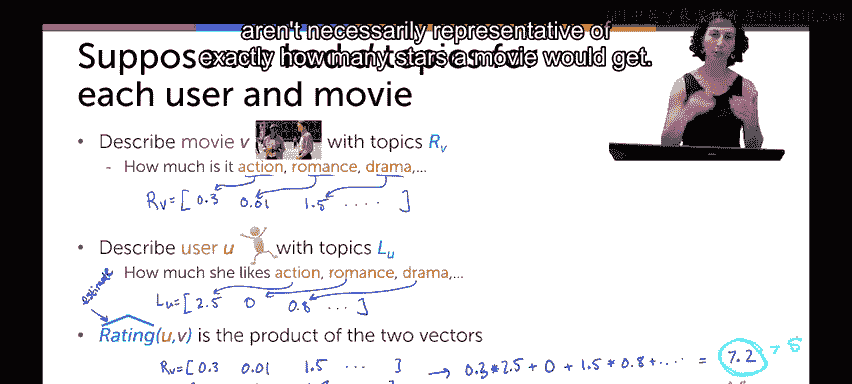

# 华盛顿大学《机器学习（基础篇，第1课／共4课）｜Machine Learning》中英字幕 - P81：80_基于已知用户-商品特征的推荐.zh_en - GPT中英字幕课程资源 - BV1zw4m1e7Zh

。

But a question is how are we going to make these recommendations。

 how are we going to guess what rating a person would give to a movie that they've never watched？

Well， let's imagine for a moment that we have some set of features about each movie and each user。

 So for example， we know that movie V， which in this case is the Shawshank redemption。嗯。

Is about some set of different genres like action and romance and drama。

 and so we have this vector for each of these things， which says it's 0。3 about action。It's 0。

01 about romance。It's。1。5 about drama。And we have these set of things。

 so we know what the movie is about and likewise， for every user like this user you。

 we know which of these different genres that user likes。 So for this user we have a vector。

That says that for action。This user really， really， really likes action。Really does not like romance。

Kind of likes drama。And so on。And we're going to call this first vector。The movie vector RV。

 we're going to call this user specific vector L。Okay， so let's say we know this。

 then what would you do to make a prediction of a rating？Well。

 one thing that might make sense is to take this movie vector and this user vector and see how much they agree if they agree a lot。

 then we'd guess that the person would rate that movie very highly， if they don't agree a lot。

 then we're going to say that it's probably very likely that they will not like that movie。

And give it a low rating。 So we're going to estimate our rating。

 That's why we put this hat over it to note that this is an estimate。

Of how much the user you is going to like some movie V that they've never seen before。

And so the way we're going to do this is just like when we're measuring similarity between two documents。

 we're going to take the two vectors in that case that might have been a vector of different topics for the document。

 in this case we're talking about a vector of。Different topics about the movie。 And so here。

We're going to take these vectors， so 0。3， 0。01， 1。5， and so on， and we're going to multiply it。

Eleement wise。By this vector。So this is our。RV。This is our L and what we're going to get out is we're going to get out 0。

3。Times。2。5。Plus zero。Plus，1。5 times。0。8。And so on， and let's just say that this ends up being。

Some number like7 point。2。Just made that up。But if。The。

User vector really disagreed with what the movie was。 so let's choose another color。

 So this is some other user。 Let's call this user。哦。You prime。

 And let's say their vector said they really don't like action。They love romance。

They really hate drama。And so on。Well， here the score is going to be much lower。

 so we're going to get。Zero plus。Three point。Sorry。Just for consistency。Plus，0。01 times。3。5。Plus。1。

5 times0。01。Plus， all these other numbers that really don't agree with one another。

 and maybe this would come out to be some small number like。0。8。

So the point here is that when the movie vector and the user vector agree a lot will get a much larger number than when they don't。

 so we're going to estimate a much larger rating than in the case where they disagree。

And then when we think about making our recommendations， what are we going to do。

 well we'll just sort over all movies？That we've predicted for that user will'll sort by their predicted rating。

 and then we'll recommend those with the largest ratings。 And I want to highlight one thing here。

 So if you remember the rating scale was between1 and 5 or rather 0 and 5。

 you could provide no stars if you really hated a movie， but the maximum score was a five。

But note here that one of our predictions is 7。2， which is clearly greater than five。

But with this type of model that we're talking about here， we're not restricted。

 there's nothing enforcing that we're going to stay within a score of zero to five。

 but we can still use this to make recommendations。

 because we just look at the movies with the largest scores。

 even though those scores aren't necessarily representative of exactly how many stars a movie would get。

