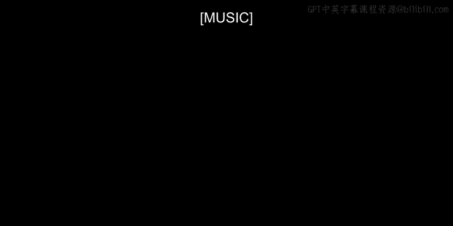
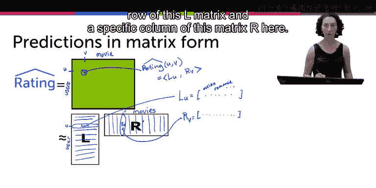

# 华盛顿大学《机器学习（基础篇，第1课／共4课）｜Machine Learning》中英字幕 - P82：81_矩阵形式的预测.zh_en - GPT中英字幕课程资源 - BV1zw4m1e7Zh

。

Okay， so let's take these ratings that we just were talking about。

 and instead of talking about them for a specific combination of a movie and a user。

 let's talk about how we can think about representing our predictions over the entire set of users and movies and to do this。

 we're going to need a little bit of linear algebra。So in particular。

 if we're looking at the score that we're giving to a specific movie V for a user U。So this is。

Reading。Predicted。For user U and Mo V。Well， what did we say that was。

 we said we took the user vector L。And we took the movie vector， RV， and we did this。

Element wise product and summed over the elements of that product。

So I'm going to denote that just with this little notation here。Okay， so this。

These little braces here mean we're going to take the vector L and the vector RV。

Do an element wise product and some。Okay， so what that represents is we're taking。A row。

Of a big matrix L， so there's a row that has a vector L。

So let me write this a little bit more largely here。

 so this row L is the vector that we talked about before with how much that user likes different things like action。

Rmance。And so on。And then we take a movie vector。RV， so again， we'll write it。More largely here， RV。

Is indexed over the same set of genres or topics for the movie and has some set of entries。And。

In this matrix notation， if you're familiar with matrix multiply。To get the entry。 So this is。

The youth row here。And the Vth column here。If we multiply these together。

 we get the Ube entry of this resulting matrix。Okay。

 so if you're not familiar with this kind of thing， that's okay。

 we're going to talk about it in a lot more detail。In subsequent courses but。For those who are。

 this representation is a very compact way to take all of the vectors for all of the users。

So we're stacking up all of the user vectors。And stacking up all of the movie vectors。

And through this representation。We end up with an entire matrix。

 which is just like we were writing before， it's a user by movies Ma。

So all of the users that appeared here。Are appearing here and all of the movies。

That appeared as columns here are appearing as columns in this matrix。

And each individual entry again is a combination of a specific row of this L matrix and a specific column of this matrix R here。

