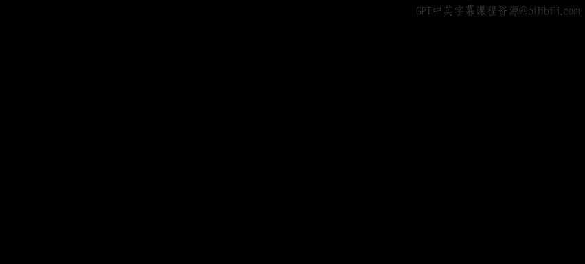
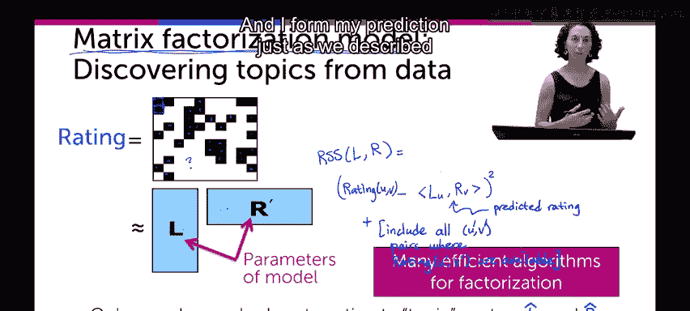
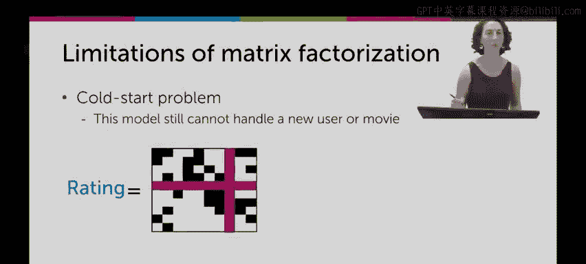
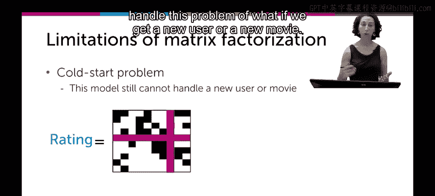
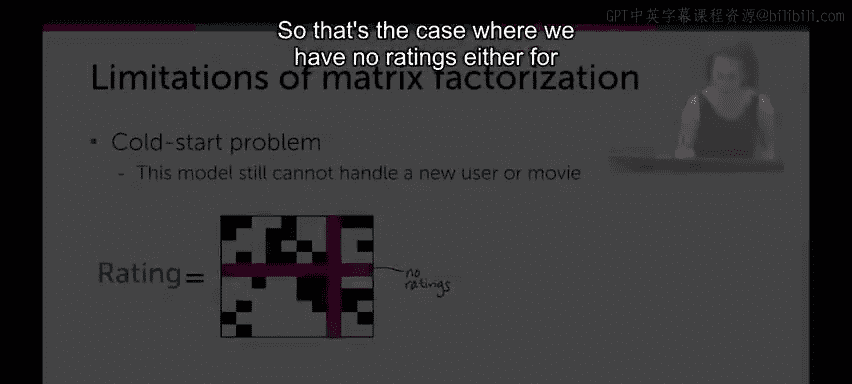
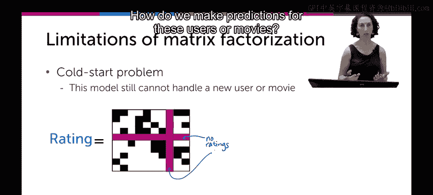

# 华盛顿大学《机器学习（基础篇，第1课／共4课）｜Machine Learning》中英字幕 - P83：82_通过矩阵分解发现隐藏结构.zh_en - GPT中英字幕课程资源 - BV1zw4m1e7Zh

。

So to this point， though， we've assumed that we know all these LU user topic vectors so we can stack them up into this L matrix and we know all the movie topic vector。

 so we put them all together in that R matrix and then we multiply the two together to get this big prediction of ratings that every user would give to every movie。

But important thing is the fact that we don't actually have this information。

 we don't have these features about the users or about the movies。

 So instead what we're going to do is we're going to flip this problem on its head。

 and we're going to try and estimate these matrices。

 this L and R matrix which is equivalent to estimating these topic vectors or feature vectors for every user and every movie based on our observed ratings。

 so these matrices or these collections of topic vectors are the parameters of our model so going back to the regression course that we had or sorry the regression module that we had we talked about models in their associated parameters and thinking about estimating those parameters from data。

So this is a very similar notion， so we have data， what are our data。

 in this case our data are our observed ratings so those are the black squares。And our parameters。

Are these user and movie topic factors？Okay， so what we're going to do is we're going to estimate each of these from our observed rating。

 so only using these black cells， we're going to try and estimate these L and R vectors and resulting matrices。

So how are we going to do this？Well， let's think of a metric for fit。

 just like we talked about in a regression module。If you remember going back to that module。

 we talked about something called residual sum of squares。There we were talking about a house。

 it had some set of features。And then we had weights on those features。

 those weights were our parameters， and we were predicting somehow sales price。

 and then we compared with the actual sales price and we looked at the square of that difference and we summed over every house in our data。

Well， in this case， the parameters of our model are L&R and our prediction。

Our ratings hat is going to be。LU。RV。This。Notation of doing this element wise product in summing。

And that's our predicted rating。And then our observed rating。Is。Rating。Yvi。

And what we're going to do is look at that difference。

The difference between our observed rating and what we're predicting with our parameters LU and RV。

 and we're going to square that。And we're going to say our residual sum of squares。Of our parameters。

L and R。Is equal to。This， and then we're going to。Some over all。Movies。That have ratings。

 So we're going to。Include。哦。Y v。Pears。Where。Readating。

Let me use U prime V prime to distinguish it from the specific U and V example I gave here。

 so we're going to add in all U prime V prime pairs where rating U prime and rating V prime。

Are available。And where are these available， they're the black squares just to remember this picture here。

Okay， so what I'm doing is I'm taking a given L matrix and R matrix。 I'm looking at my predictions。

 so I'm looking at。And then I'm going to evaluate how well I did on all these black squares。

So I'm looking at how well the L and U that I'm using fit my observed ratings。

And then when I want to go to estimate L and R。Just like when I wanted to estimate the weights on the regression coefficients in the housing value prediction problem。

 I search over in this case， all the user topic vectors and all the movie topic vectors and find the combination of this huge space of parameters that best fits my observed ratings。

And so the reason this is called a matrix factorization model， so that's really key。

This is called a matrix factorization model because I'm taking this matrix and approximating it with this factorization here。

Okay。But the key thing is the output of this is a set of estimated parameters here。And unfortunately。

 I've just written over this very， very， very key point。 So I apologize for that。

 Let's pause for a second。 So you get the writing。And now I'll just say in words this next animation。

Is saying that there are a lot of very efficient algorithms for doing this factorization。

 and we're going to talk about them in great extent in the recommender systems or matrix factorization course later on。

嗯。But then， okay， so very efficient algorithms for computing these estimates of L and R。

 how do I form my predictions， How do I fill in all。These white squares。

 which was my goal to start with。Well， I just use my estimated。L hat U and R hat V。

And I form my prediction。Just as we described when we assumed that we actually knew these vectors。

Okay， well， matrix factorization is a really， really powerful tool and it's been proven useful in lots of different applications。

 but there's one limitation and that's a problem that we talked about a little bit earlier of the cold start problem where this model still can't handle this problem of what if we get a new user or a new movie。

 so that's the case where we have。😊。

No ratings。

Either for a specific user or a specific movie， so that might be a new movie that arrives or a new user arrives。

 so this is a really important problem and one that， for example， Netflix faces all the time。

 how do we make predictions for these users or movies？

