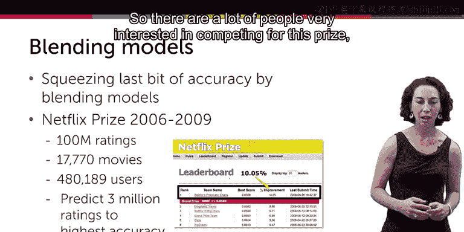

# 华盛顿大学《机器学习（基础篇，第1课／共4课）｜Machine Learning》中英字幕 - P84：83_综合应用：特征化矩阵分解.zh_en - GPT中英字幕课程资源 - BV1zw4m1e7Zh

。

Okay so we saw in our feature-based classification approach that we were able to handle cases where we might have very limited user data and on the other hand in our matrix factorization approach。

 we saw that we were able to capture relationships between users and items and in particular learn features of those users and those items and a question is whether we can have some integrated approach to get the benefits of both worlds。

 so importantly the features of our classification based approach or something like that。

Can capture things like context time of day， what I just saw， user information， past purchases。

Whereas the features that are discovered from matrix factorization can capture groups of users who behave similarly。

 so for example， women from Seattle who teach and are also moms。Okay。

 so a question is how we combine these two different approaches。 Well it's very straightforward。

 What we can do is we can take a new user for which we have no past purchase information and we can use。

Just features specified by that user， such as the person's age， gender。

 and so on to predict the ratings that that person might have。Likewise。

 as we get more and more data from that user。We can weigh more heavily on our matrix factorization approach and use those learn features more strongly when we're forming our recommendations。

 so it's very simple to think about combining the ideas of a user specifiedified feature based model with our learn features from matrix factorization and gradually switch between the two depending on how much data is available from each user or for each product。

And this idea of blending models is really popular。

 and one example of where it's really been shown to have impact in recommender systems was this classic example that we mentioned at the beginning of this module of the Netflix competition。

 So this competition was a competition for who could provide the best predicted ratings for users on Netflix and the data set consisted of 100 million different user ratings of movies。

 There's almost 18000 different movies， nearly 500。

000 unique users and the goal was to predict 3 million ratings to the highest accuracy。

 and the prize was a million。 So there are a lot of people very interested in competing for this prize and。

What we see in this table here is the leading team and their model actually blended over 100 different models to get their performance。

And so this type of ensemble approach we're going to discuss more in the classification module。

 but this notion of combining models to get performance that exceeds the performance of any of the individual models is a very common and very powerful technique。

