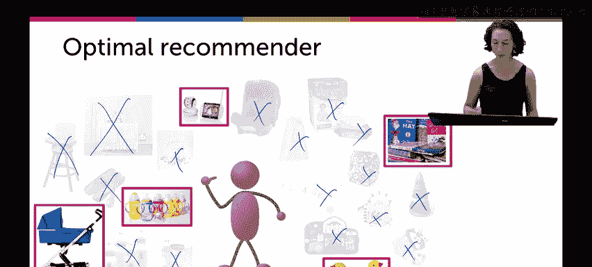

# 华盛顿大学《机器学习（基础篇，第1课／共4课）｜Machine Learning》中英字幕 - P86：85_最优推荐器.zh_en - GPT中英字幕课程资源 - BV1zw4m1e7Zh

。

Okay， so I have a question for you guys， which is。How would you maximize recall？Remember recall。

 we just look at the magenta squares， we look at the liked items。

 and we measure how many of my liked items were actually retrieved or actually recommended to me。

Well as the title answers， there is a very easy way to maximize recall just recommend everything if you recommend everything you're guaranteed to recommend the products that I like so in this case what would recall be。

It would just be one， because all。Five of the products I liked were recommended。

 so this is because there are five out of five products recommended。

But what's the resulting precision of doing this？Well。

 it can actually be arbitrarily small because if you have tons and tons and tons of products out there。

And if I like only a very， very small number of them。Then if you recommend everything。

 I'm going to have very small precision。So let's just say this is small。And maybe。Very small。

So that's not really a great strategy。On the other hand， what would be the optimal recommender？

What's the best recommender you can imagine？Well the best recommender is one who recommend or one that recommends all the products I like。

 but only the products I like， so everything that was not liked was never shown by the recommender。

So that would be great， no wasted effort capture everything I like。

 going to make lots of money with this recommender system。

What's the precision and recall？Both are one in this case。

 and you can go through and verify that using the equations from the previous slides。

