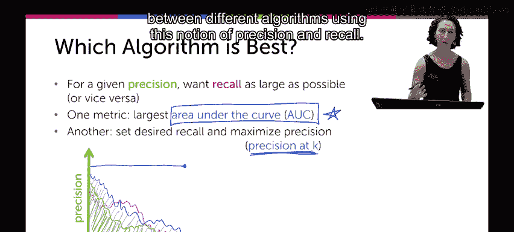

# 华盛顿大学《机器学习（基础篇，第1课／共4课）｜Machine Learning》中英字幕 - P87：86_准确率-召回率曲线.zh_en - GPT中英字幕课程资源 - BV1zw4m1e7Zh

。

Okay， so now let's talk about how using these we can use these metrics of precision and recall to compare our different algorithms that we might think about using。

And to do this， we can draw something that's called the precision recall curve and let's start by。

Talking about what these curves are going to represent and what the curves are going to represent is for a given recommender system。

What I'm going to ask you to do is I'm going to ask you to vary the threshold on how many items that recommender system is allowed to recommend to me。

So I'm going to rank， for example， all the baby products on Amazon。

 and I'm going to allow you to recommend just one。Or two or three and so on。

 and so that's a threshold that you're varying。And that's going to trace out this curve。

And what would this curve look like for our optimal recommender。

 where we only recommend products that I like？Well。

What's the precision when I recommend just one product？ Well， we know that's a product I like。

And so my precision， my world is just that one product， and I liked it。 so my precision is one。

And what's my recall， though？If I have， let's say 10 items that I liked and I've only uncovered one。

 it's1/10th。And likewise， as I'm increasing。As I'm increasing the number of items I show。

My precision always stays at one， I'm only recommending products I like。

But my recall is increasing because I'm covering more and more of the items that I liked。

 So eventually we will hit this。This one one spot， so the optimal precision recall curve is this line here。

Okay， but let's talk about what the curve might look like for another more realistic recommender。

I guess before that， let me just annotate。That this is our optimal。Recommenander。

Now let's go on to look at perhaps a more realistic recommender and what it would look like。Okay。

 well， the first product we recommend might not be a product I like so or it might be。

 so it's going to start somewhere on the precision axis and then eventually at some point when I vary the threshold enough。

At some point， hopefully I will recommend some product I like。

 so both precision and recall are going to go up。Then what tends to happen is we add a product that I don't like。

So at that point， what happens？Well， my recall stays exactly the same because I haven't recovered any more of the items that I'm interested in。

 but my precision drops because now I'm looking at a larger world， a larger set of green squares。

 So my precision goes straight down， but my recall stays the same。And you tend to get these very。

Jaggedy looking curves where you get these drops in precision。

Then these increases in precision and recall， and I'm going to draw it。

 it won't be completely accurate here， but it looks kind of like that。

Typically something like this would be a precision recall curve。Okay。

 so this is an example of a more realistic system。This is another recommender system。

Compared to our optimal。Okay， so now that we know how to draw these precision recall curves。

 we can talk about comparing our different algorithms， how do we know which one is best？Well。

 we know that we like precision and recall both to be as large as possible。

And what's the best that it can be， we talked about the optimal recommender being that curve。

But then when we look at our other curves， which are these jaggedty looking things。

One doesn't have to strictly dominate another。 They might do different things at different points。

 So one curve is not necessarily。Let me actually erase that， do it in a different color。

 so it's a little bit clear。It's not that one is always going to be better than the other。

Maybe we have another one going here。So in this case。

How do I think about comparing these different algorithms and choosing which one is best？Well。

 like I said， we want precision and recall to be as large as possible。But。

One thing we can measure to compare these is in general which one is doing better than the other。

 and what's a way to think about that？Well。We can think about the area under the curve so we can look at。

For example， all this area under this blue curve。And we can compare that。To， for example， the area。

Under this red curve， I mean， green， if I can remember my colors the area under the green curve。

I can say which area is larger and that is one proxy for which recommender system is doing a better job。

That's this point here that。A metric we can use is something called area under the curve。

Which measures exactly what I drew below。But you might not care about how the recommender system is doing across all possible performance situations instead you might be in a situation where let's say you have a website and you know based on the real estate of that page how many items you can display so maybe you can display 10 different items to recommend to the user or you know what the attention span of the users are in general。

 and you want to limit how many products you recommend to 20 products or something like this。

 so in those cases where you specifically know how many products you're going to be recommending。

 you care about what your precision is。Add that number of products recommended because you want that precision to be as large as possible for the constraint of recommending that number of products。

And so these are two examples of metrics you might use to compare between different algorithms using this notion of precision and recall。

