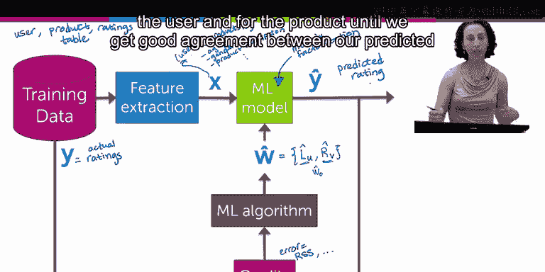
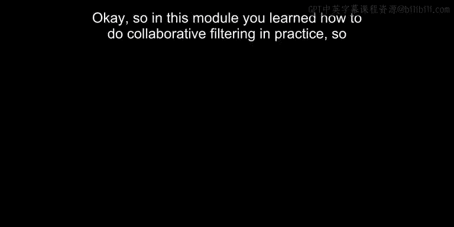

# 华盛顿大学《机器学习（基础篇，第1课／共4课）｜Machine Learning》中英字幕 - P88：87_推荐系统机器学习模块图.zh_en - GPT中英字幕课程资源 - BV1zw4m1e7Zh

。

In this module， we talked about a notion of collaborative filtering and a couple different recommender systems for implementing that idea where we leverage the types of other products people purchased to recommend other products and we explored this notion of having some set of customers and products and understanding relationships between these in the context of product recommendation task thinking about movie recommendation and in the i Python notebook。

 you guys explore this very concretely with an implementation of a song recommender Once again。

 let's revisit this machine learning workflow， but in the context of recommender systems In this case。

 what's our training data Well it's our user。

productduct。Ratings table。And what we're going to do is we're going to extract some set of features。

 which in this case are a user ID。productduct i d pair。

And the goal here is to predict the rating that some user would give to some product。

 so user ID product ID rating。So this is our predicted。Rating。W hatt。If we're specifically looking。

 and I guess sorry I should mention that what is the model that we're looking at， the model。Is。

For example， we talked about many different models。

 but one we're going to talk about quite extensively in the matrix factorization course is matrix factorization。

And matrixtri factorization has some set of parameters， W hack， which are the estimated parameters。

 or that notation represents estimated parameters， and what are the parameters of matrix factorization。

 well it's a set of features for every user。And it's a set of features for every product。Okay。

 so these are parameters， but we also talked about a futurized version of matrix factorization。

So in that case， in addition to our features。Being the user I and product I。

 we might also consider other things like we might have a list of other features like。

The age of the user， the gender of the user。A description of the product。And so on， and in that case。

 we would also add weights on these features。So， let me just add。Some extra set of。

I'll call them W0 to make it different than this W， some other set of weights here。

That are also parameters of this model。Okay。Again， we'll get into this in a lot more detail in the course on this。

 but the idea is we're going to take our predicted rating。And we're going to see how well。

Our model is fitting the data。 And the way we're going to do that is we're going to take our actual data。

 our。Real rating so these are。Actuaual。Ratings that are in our training data set。

And we're going to compare to the predicted ratings。Okay， so。

One metric we talked about to measure the error between the predicted ratings and our actual observed ratings was residual sum squares。

Just like in regression， but there are also other metrics we could consider and we can talk about those more later。

But the point is that from some notion of error between our predicted values and our observed values。

 we're going to have some machine learning algorithm again。

 we're leaving this for the actual module on matrix factorization to describe what this algorithm is。

 but what it's going to do is it's going to iteratively update。

Our features for the user and for the product until we get good agreement between our predicted ratings and our actual observed ratings Okay so in this module you've learned how to do collaborative filtering in practice。

 so now you can go out and actually implement a recommender system。

 you can do a G recommender for your family which will make holiday shopping really easy or you can build a new song recommender that's even better than the one that we demo so lots and lots of cool things you can do with collaborative filtering。

