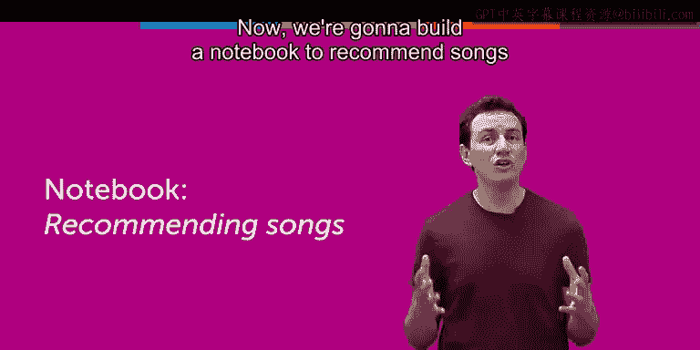
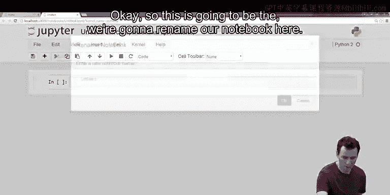
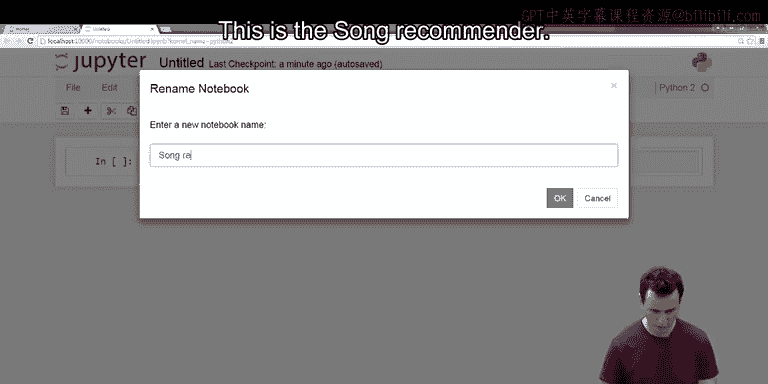
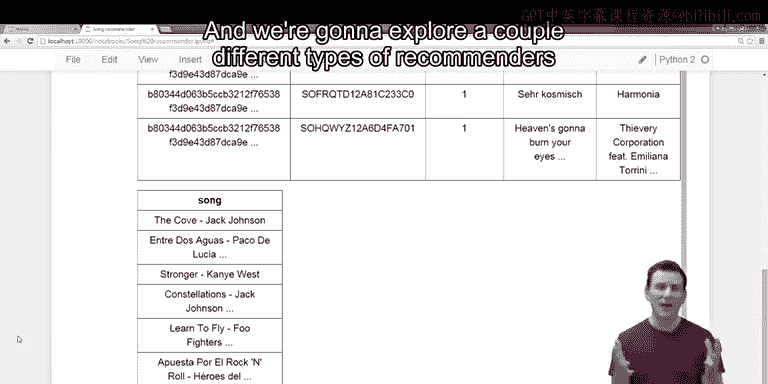
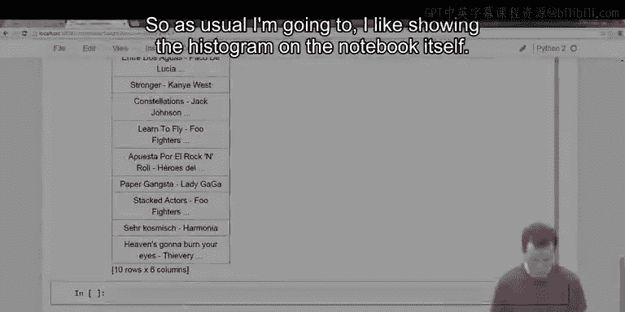
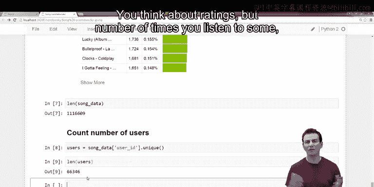

# 华盛顿大学《机器学习（基础篇，第1课／共4课）｜Machine Learning》中英字幕 - P89：88_加载并探索歌曲数据.zh_en - GPT中英字幕课程资源 - BV1zw4m1e7Zh

。

In this module， Emily showed us how to build product recommenders and algorithms associated with recommender systems now we're going to build a notebook to recommend songs we might want to listen to。

😊。

This is going to be really quite cool。

Okay， so this is going to be the we're going to rename our notebook here。 this is the song。

Recommander。So again， I'm going to hide the header and hide the twobar to show us a little more space and as usual。

 we're going to start by。😊，Importing Graphlab， get us has started here。

And the first thing that we're going to do is。😊，Los of music data。So。So we're going to load。Music。

Data。This is a really cool dataset set it's called the Mill song dataset set。

 and we're going to create a variable called song data。

 it's going to store it and we're going to have a graph lab。😊。

S frame where we're reading it and this is a songdata。io， so here we are。

 we're reading it and so let's start doing a little bit of data exploration。So。

Let's do some exploring of a friend data here， music data。

So first thing that we're going to do as usual is。Take the song data and take a look at the first few lines of this table。

And so here's what the song data looks like， a user。With a user ID。Listen to a song once or twice。

 this is the title of the song， this is the artist。And this is the the song itself。

 The title is the title of the。Recodization and so， as we can see。

We just have a table that shows us how often each person listens to different songs and then we're going to use this to build a recommender that finds out other songs you might be interested in listening to and we're going to explore a couple different types of recommenders as Emily shared with us in the module。

😊。

So as usual， I'm going to， I like showing the histogram on the notebook itself。

 so I'm going to do graphralab。 canvasvas。

Do set target。 and I'm going to say iython notebook。And then after we've done that。

 I'm going to take my song data。And I'm going to look a particular column。

 let's say the song column and type do showing in it， which。

It's going to show me a histogram of the different songs and how often they're playing。

And here we are， so this is the different songs by title and you see how this song here was played 5。

90 times this Bard song was played 5，281 times。This song here， this is a Brazilian song。

 TV scene by Catalola 3，185 times， so some people really like their songs and they play them a lot。

So this is the kind of data we're looking at。😊，If you take a quick look at the song data。

You'll see at the length， you see we're talking about here。1。1 million songs。

So million song user pairs。 So this is rating song ratings。 And this is what the data set is。

 a pretty large data set， but we're going to do some things together on this。

largearge data set right here。So lets ask， let's do a little bit more exploration so we said for each user there's1 million about a million ratings or a million number of listen。

 let's see how many users are involved here。I'm going to。Let's see。Oops。嗯。Count。Number of users。

So and in doing this， I'm going to show you another little trick which is useful as you're exploring your own data set。

 so I'm going to create a new。😊，Aray here for users and this is going to take the song data。

That we have and look at the user ID column。And I'm going to ask you。

App the unique command and what the unique command does is select all those users just shows the unique different users that we have。

 just all the unique ions and so if I ask for the length of users。

 you should see we have 66346 unique users in the data with 1 million different song you think about ratings。

 but a number of times they listen tos song activity rows。😊。

。

