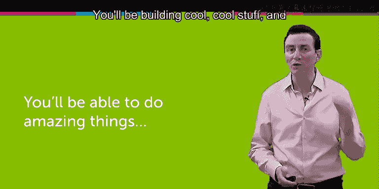
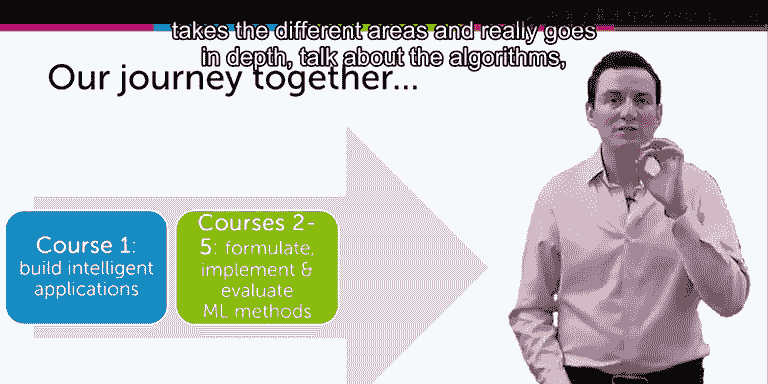

# 华盛顿大学《机器学习（基础篇，第1课／共4课）｜Machine Learning》中英字幕 - P8：7_你将能够做什么.zh_en - GPT中英字幕课程资源 - BV1zw4m1e7Zh

。

Now that you've seen what this course is going to be about as well as specialization as a whole。

 you'll see that you'll be able to do amazing things using machine learning。

 you really intelligent applications as you go through this process， not just at the end。

 but throughout the whole specialization will be building cool cool stuff and you'll be learning about a wide range of concepts and building their algorithms so the first course is really about using those prebuil machine learning algorithms to build a range of intelligent applications Now the follow-up course is the second through the fifth takes different areas and really goes in depth in depth。

 talk about the algorithms， and methods， the techniques behind it Now let's go back and talk about the capstone。

 the capstone is going to be really exciting， you're going to build a really cool impressive application that uses machine learning。

😊。

