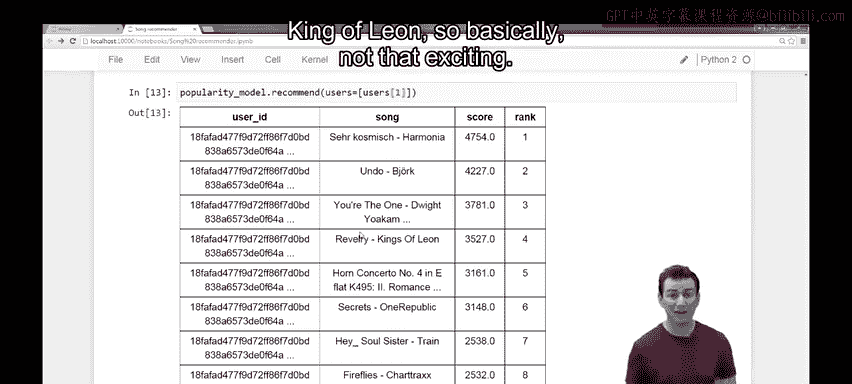
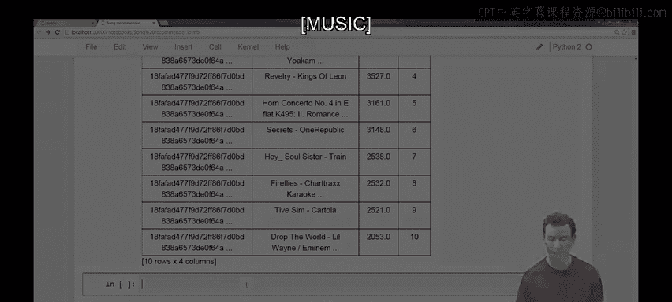

# 华盛顿大学《机器学习（基础篇，第1课／共4课）｜Machine Learning》中英字幕 - P90：89_创建并评估基于流行度的歌曲推荐器.zh_en - GPT中英字幕课程资源 - BV1zw4m1e7Zh

。

Good， so this is our data set。 then the next step for us is to create a recommender system。😊，So。

Here we go。嗯。Let's go ahead。And。Create a song。Recommenander。So as usual。

 we're going to start by doing a train test plate， so'm going I take the train date。

 the data is splitd into train and test data。And we do that by taking。The song data。

We're going to do a random split。On this data set， 80% for training， 20% for testing， and again。

 when set the seat to0 so that if you do this at home， you get exactly the same answers as I got。

Okay， we've done that split and now were ready to train some recommender models so just following the lecture a little bit that Emily gave。

The first recommended model we're going to train is a simple popularity， popularity。😊，Basedest。

Right Commandander。So this is what many websites do， for example。

 when they say here are the most email stories or this is the most purchase products。

 this is what's most popular， the most common hashtags on Twitter today。😊。

Not a particularly great model， but it's used a lot， so let's train our famous popularity。Model。

 we're going to call it popularity model， and all I have to do now is called graphra Lab。😊。

Dot popularity recommender。 So this is a particular recommender and I tried create next with it。

 and as you remember create is the verb here that actually creates a recommender。😊。

And I'm going to give it my。trainingraining data。As import。

And this model takes a little bit of information， so let me just walk you through it。

 you have to say what column is the user ID？😊，In the dataset， so in our case。

 that column is called just user ID。User ID。Then we need to say what column is the item ID？

So the item ID is the in our case the products or users and products。

 but we don't have exactly a product in our item our item here songs。

 so item ID is equal to the song。And now when I hit En， it creates and it was very quick。

 created a simple。😊，Popularity based recommend their system。 So let's just make some predictions so。

In our next step， we're going to。Use。Let me just scroll down a little bit。呃。The use。But you。

lot team毛都。To make predictions。So for example， let's take this popularity model。😊。

And let's ask it to recommend。For a particular user。

So I'm going to recommend some songs this particular user like。

 so this recommend function takes a list of users and we're just going to give one to the list right now and if you remember we had that user's array。

 I'm just going to give you the first person in that user's array。😊。

And execute so what do you recommend for this person， a song by Harmonia， a song by Bjork。

 King of Leon， and so on。Now look at this very carefully， YT Yoan。

 this is what's being recommended by Use Ze。Now let's see what this model recommends for user1。

So again， we're going to take popularity model。And I'm want to call recommendcomd。And。Again。

 I'm going to give it a list of users， but instead of giving a user zero， I'm going to give user one。

Now， before I click enter here， shift enter。😊，ToStop and think。

 what am I going to get back out of popularity model？Wow。

 everybody gets recommended exactly the same things because you just recommended the most popular items。

 So this person also gets recommended harmonia， Borrg， Dwightcom， King of Leon。

 So basically not that exciting。 Everybody got gets recommended the same things。

 This is the problem with this model。😊。

