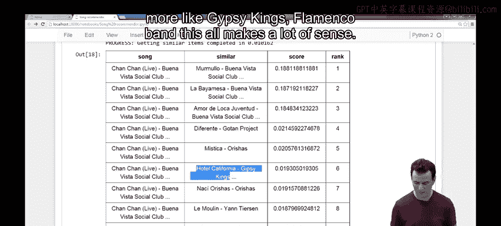

# 华盛顿大学《机器学习（基础篇，第1课／共4课）｜Machine Learning》中英字幕 - P91：90_创建并评估个性化歌曲推荐器.zh_en - GPT中英字幕课程资源 - BV1zw4m1e7Zh

。

Now。If let's， let's in contrast， let's make it a more personalized。

 a model that more personalized as Emily described。 So next， we're going to build。Recommen a song。

Recommenander。With personalization。So， let's call it personalized。뭐东。

And all we're going to do is repeat the line that we had earlier， so graphraph La。That。

Instead of being the popularity model。😊，Let's use that item similarity recommender。

 so remember we talked about item similarity in the module， we can do item similarity do create。😊。

And let's see what happens。So here， just like before， we had to give it a training data。😊。

We have to tell it what the user。ID column is called， which in this case was user ID ID。

And you had to tell it what the item。ID column in this case， which is called song。So。

In of the popularity model， we now build an item item similarity model， and here we go it's done。

 so let's start applying it。😊，So。Applying。The personalized model to make song recommendations。

And here we go， let's apply it。 So let's start with the couple users that we had before。

 So for example， if you take the personalized model。😊，Personalized model。

 and we call recommend on it。For users。For that first user， so users。Of zero。

You'll see that no longer does it recommend Br and a few of those others that everybody got。

 but recommend the doctor feel good， Li Zchikadou and then the Brazilian song Green Sububmans and so on it's kind of an interesting thing so pretty cool let's see what the user one got because it's a personalized model。

 so personalized model they'll recommend。For users。And again， it's a list。

 but I'm just going to put one element in the list， so user one。

And you'll see that now it recommends be totally different。Florence and the machine。

 and somehow this user really like Florence the machine。 just recommends that again， again， again。

 again again。 and put apocalyica and so on。 So as you can see， now the model is really personalized。

 and you can do some really fun things with it， because it's personalized。

 not only can you say for particular user， what songs， other songs they should listen to。

 just like we did and recommendations， but。😊，We can also take a song and ask where other songs are similar are liked by similar people。

 so people who like the song also like this other song so we can do that by calling personalizedmod do get similar items so get similar items you give it a list of items and you find similar ones so for example。

😊，If I really love the song with or。Without you。By you， too。I mean， I really actually like the song。

 It's pretty cool。 You'll see other songs I recommend。 oh by you two。

 I still haven't found what I'm looking for。 hold me thrill me， kiss me， kill me window in the skies。

 vertigo Sunday Blood， Sunday， bad a day without me another place， another place。

 walk on walk on is my song get on your boots。 So all you two songs。 If you like one you two song。

 you like other you two songs。 that's pretty typical。

 Now another thing that I enjoy So if I take this。😊，Birs and the la。Model。

 and I'm gonna to get similar items so you can get all similar users。 So for a user。

 find other users like this one， but like her， but here we're gonna get similar items and the list I'm going to give is a little different。

 So this is another song I kind of like is called Chan Chan and it's I like the live version。😊。

And it is by。buena vita。Social club。Now if you don't know the song and if you don't this one Vista Social Club you should。

 it's awesome， awesome， really cool And so if you like Chanchann by Buonena Vista Social Club。

 Cuban Band， it also might like other Buonena Vista Social clubs songs more little Lokaho and Tu than others it might also like this the Ferent by Goam Project Gotan Project Argentian bandand。

 really cool one my like Gypsy Kings Flamnco bandand。

 this all makes a lot of sense this song down here by Gotan Project now which I kind of like as well。

