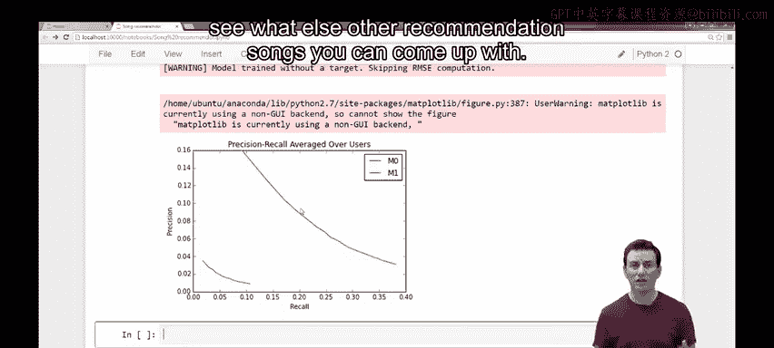

# 华盛顿大学《机器学习（基础篇，第1课／共4课）｜Machine Learning》中英字幕 - P92：91_使用准确率-召回率比较推荐模型.zh_en - GPT中英字幕课程资源 - BV1zw4m1e7Zh

。

So。We've now seen these models in action and we've done this。What is what we call a。

Kind of qualitative， you know， just kind of anecdotal， qualitative exploration。

 let's do a more quantitative comparison between the personalized model and the popularity model。So。

Now， we're going to do a。Quity。Comparison。B。modelss。So as we。

Explored with family in the lectures when in comparing recommenders。

 a good metric to use is precision recall， so can we explore the precision recall curve for these two models？

So here。We're going to use we discussed Matplloot Live earlier in a different notebook。

 so we're going to call Matplot Lib。😊，Ma plot Lib here and I'm going to add this little command in line to make sure the Mat plot Lib actually prints into the recommender here。

So into the notebook。So mylo Li。 And what I'm going to do is。Compute model performance。

This is the variable that I'm going to create。There is this method in the recommended libraries。

From a graphraLb create is a set of utilities for recommenders and one of those is really cool is called compareare models which allows you to compare different recommend models and understand how they do so I'm going to compare different recommender models on our test data that we separated and the models we're going to compare our popularity model。

😊，And。The personalized model。So here's the list of the two models I'm comparing。

 I could compare more， but just compare those two。And I want to say。

We now a little parameter here called user sample where I'm going to just sample。

A small fraction of the test data， so user sample equals 0。

05 because on this machine building the pre call curve takes a little well and they want it to be fast so we can look it together so it does it pretty fast it's comparing it's evaluating first the performance of the。

APop model that's model zero then the performance of the second model model one which was the personalized model and finally what we get here is the precision recall curve。

 the last thing that we saw in the lectures and this compares the recall and precision of these two models the personalized model in green and the popularity model in blue and the closer you are to the top here。

 the better and you see that the adding personalization significantly improves the performance of our recommender so personalization is great just recommending popular items is not so great。

😊，And so with this we've built a song recommender and we explored that。

 we saw that recommended cool songs for somebody like me who likes youtu whenever this is a show club。

 but of course， you can go and explore other things that you might like and see what else other recommendation songs you can come up with。

