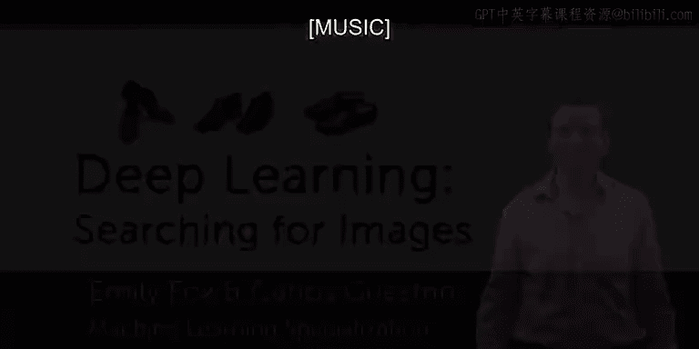

# 华盛顿大学《机器学习（基础篇，第1课／共4课）｜Machine Learning》中英字幕 - P93：92_图像搜索：深度学习案例研究.zh_en - GPT中英字幕课程资源 - BV1zw4m1e7Zh

。

Today we're going to talk about one of the most exciting things to be happening in machine learning over the last few years it's a new area called deep learning in particular。

 we're going to talk about a particular use case of this area related to shopping for products just based on image similarity。

😊。

