# 华盛顿大学《机器学习（基础篇，第1课／共4课）｜Machine Learning》中英字幕 - P94：93_什么是视觉产品推荐器.zh_en - GPT中英字幕课程资源 - BV1zw4m1e7Zh

🎼。There are many ways to shop for products today， typically though you have to use what's called keyword search。

 you type a query on a search engine and try to find products that are interesting to you。

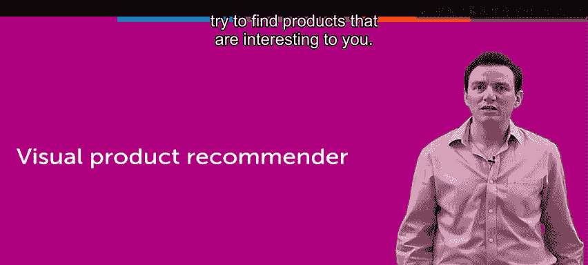

But let's look at new ways to shop。So for example， let's say I want to buy a shoe。Or by parahoods。

 Now people， some people just care about shoes。 I really care about shoes。I have， let's say。

 this cool black pair of shoes it's got some real style to it。 I have this other black pair of shoes。

 it might look to you as almost the same， but they're totally different。

 totally different styles I have this crazy dress shoe that might look transparent to you but it's actually really cool shade of blue。

 I have this crazy twocoled sneakers which I love I also have this other really interesting pair of sneakers which I bought in Hong Kong and theyre kind of fun and everybody knows I like purple so I even have this purple boots it You have a lot of shoes I have a lot of shoes but I need more shoes and so。

😊。

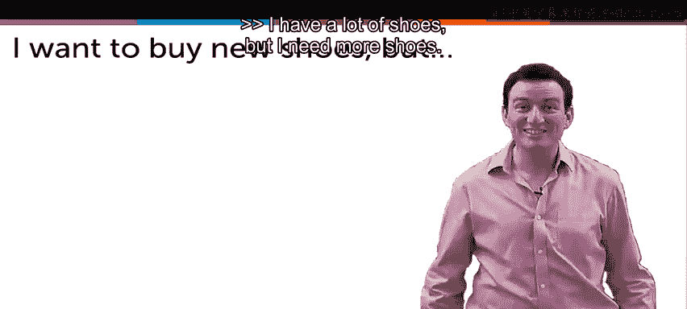

There's a lot of shoes online， and it's really hard to find the ones that are interesting， stylish。

 different， kind of like my style。

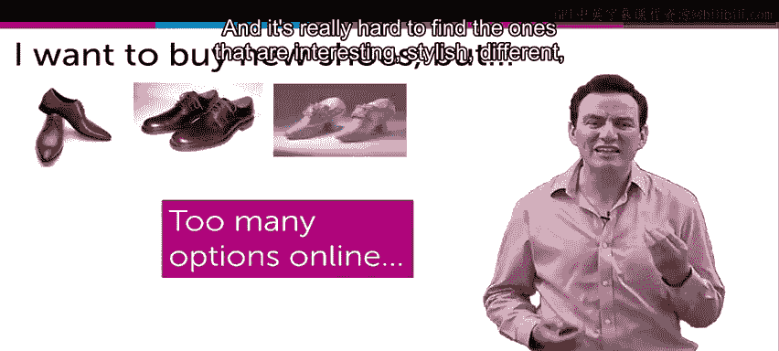

And if I use keyword search， it doesn't really help me but to type their dress shoes。

 I just find a bunch of boring usual shoes， although the ones on the top left hand corner and they are kind of interesting and stylish。

 but still。😊，I want to find something different， and I don't know what keyword to type or how to search for it。

So what should I do？

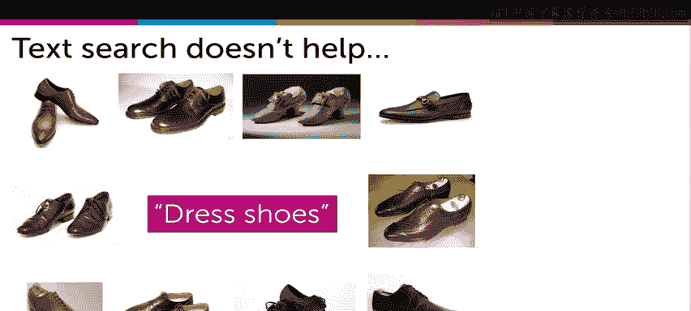

Let me start by showing you a cool demo of a new way to shop based on a similarity search。

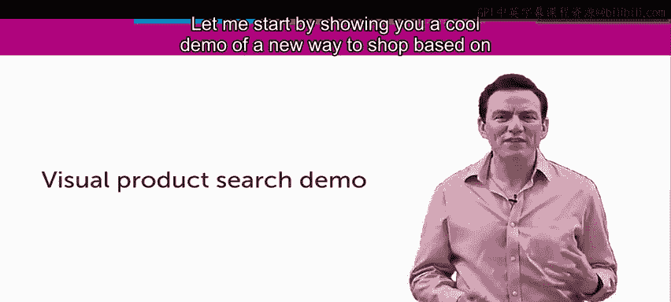

Let's talk about something even more complicated than buying shoes。

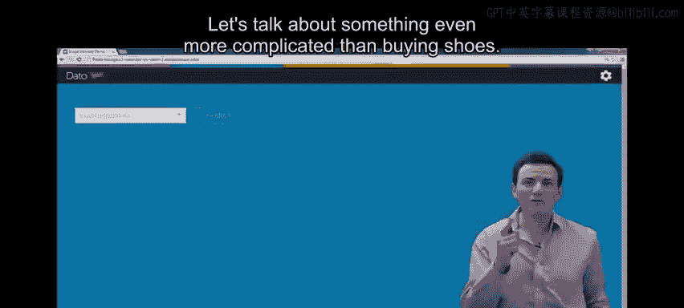

My sister is a fashion designer， and her birthday is coming up。

 and I want to buy her really interesting， cool gift that she might love。😊。

Well maybe I want to buy her address， so if I just use Tual keyword search。

And I tried to look for a dress。

I'm going to find a bunch of addresses， but I really don't know how to choose a dress that you like just based on this properties here。

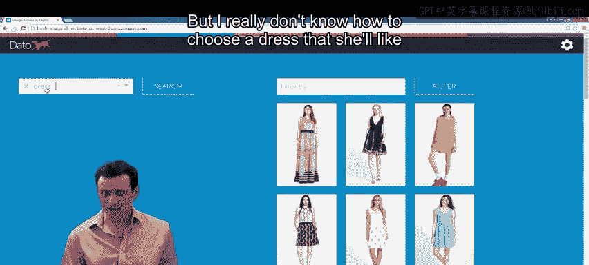

And I don't know how to describe it， how do you describe the dress my system I like？

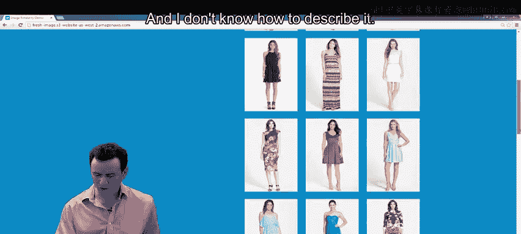

Now I could say maybe she loves floral dresses。Even if I say floral dresses。

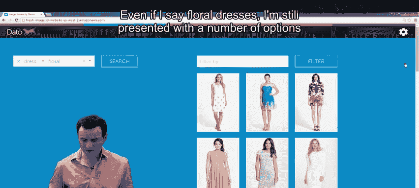

I'm still presented with a number of options and different kinds of floral dresses and her style is pretty unique。

 so how am I going to find a dress that really looks like something she will love？😊。

So if I scroll down。This list， maybe I'll see something that catches my eye。

Oh here's a floral dress that looks pretty good so I'm going to click on that and instead of just finding dresses based on keyword search。

 I'm going to use image similarity to find similar dresses so these are dresses that look similar to just this one just based on image qualities and you see that now we get dresses that do have similar properties and now this is much easier to kind of find something that she might like but of course many of these dresses are a little too usual and she might want something a little bit more interesting so for example。

😊。

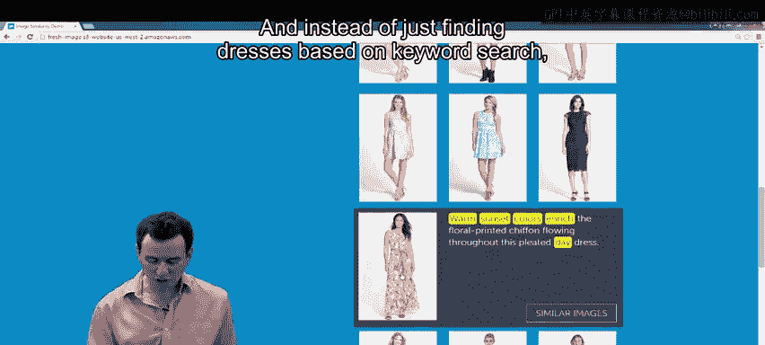

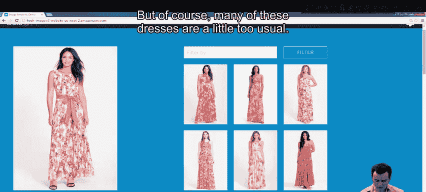

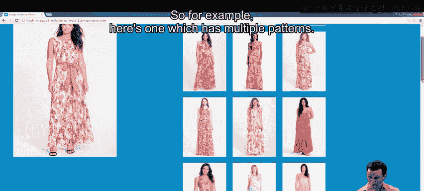

Here's one which has multiple patterns and now we find dresses。

 they are similar and you see they have multiple styles within the dress。

 I wouldn't know how to describe that， so let me search within the set and say oh you know what this one looks pretty good。

😊。

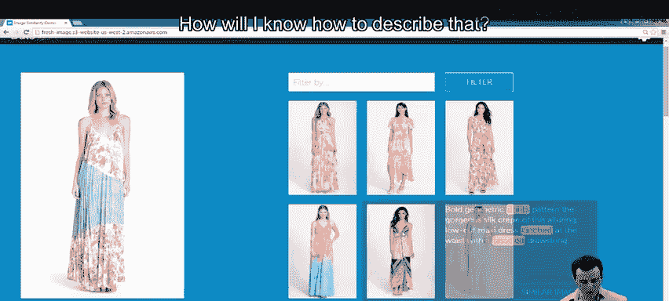

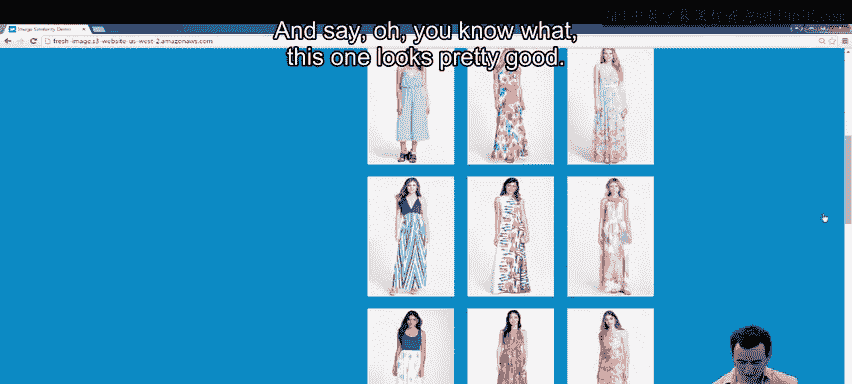

And if I click on it， you see other similar visually similar justice for this one。

 but this one looks particularly good and the model looks a little bit like my sister too。

 so perfect gift for her。

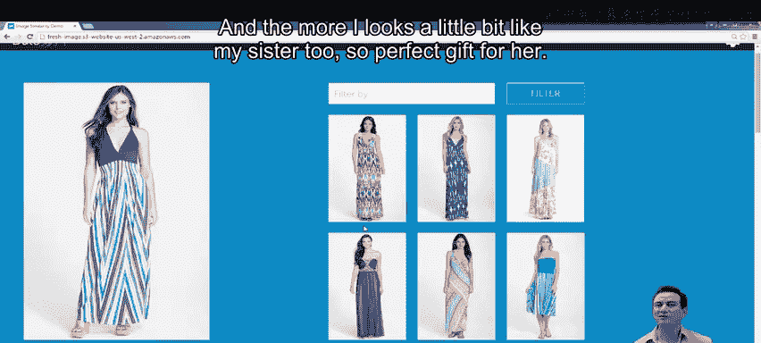