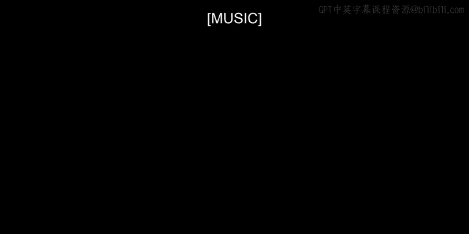
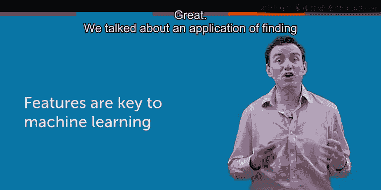
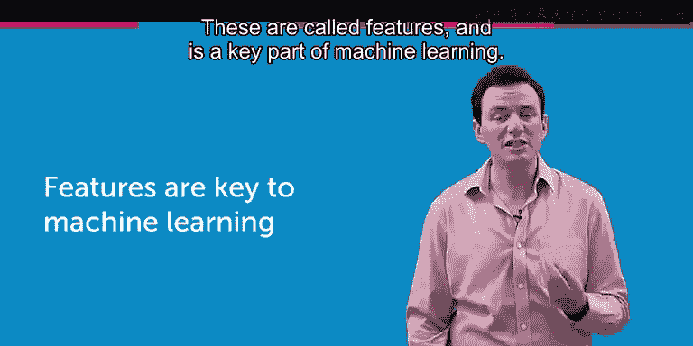
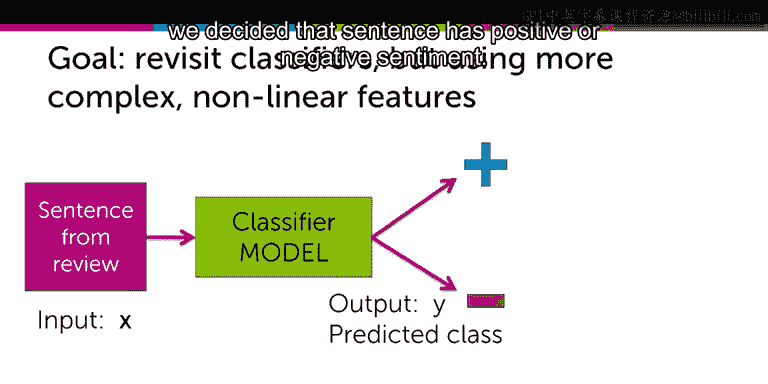
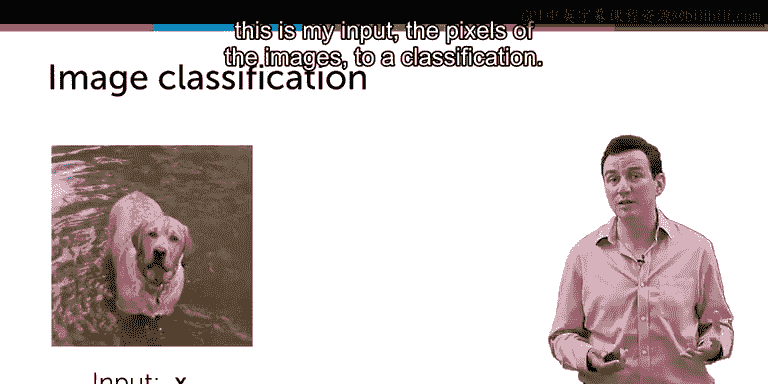
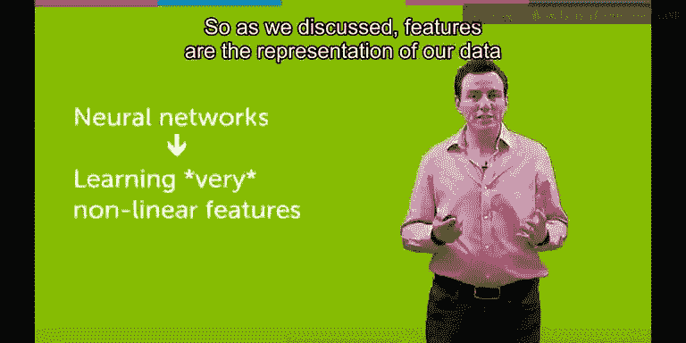
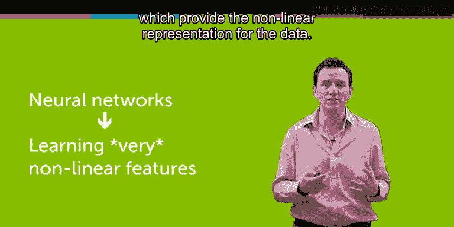
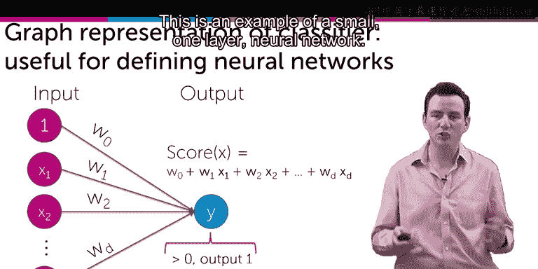
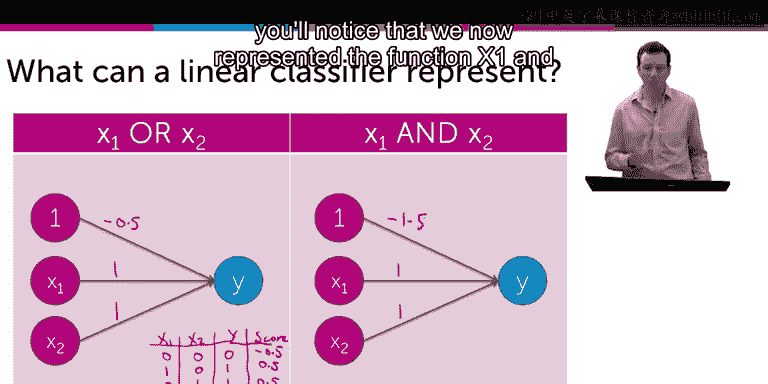
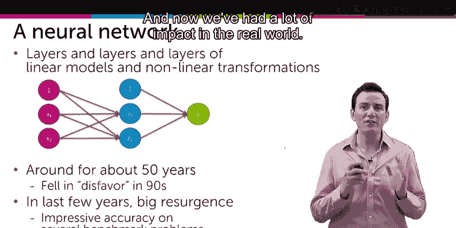

# 华盛顿大学《机器学习（基础篇，第1课／共4课）｜Machine Learning》中英字幕 - P95：94_使用神经网络学习高度非线性特征.zh_en - GPT中英字幕课程资源 - BV1zw4m1e7Zh

🎼。

Great， we talked about an application of finding cool shoes or dresses just based on image features。

 the technique that we're going to use today is called deep learning and in particular is based on something called neural networks。

 but before we get there let's talk about data representation we discuss things like TFIDF em Ba of word models。

 but how do you really represent data when it comes to images。😊。

These are called features and this is a key part of machine learning。😊。

So typically when we talk about machine learning we're giving some input。

 let's say we're doing classification， we talked about sentiment analysis， you're giving a sentence。

 it goes through a classifier model and we decide if that sentence has positive or negative sentiment in image classification the goal is to go from an image。

 this is my input the pixels of the images to a classification in this case this was my dog and I want to classify it as a labbrador retriever as opposed to other kinds of dogs。

😊。

So as we discuss， features are the representation of our data that's used to feed into the classifier。

There are many representations， so for example， text， we talked about bag of words and TF IDDF。😊。

With images， there's a lot of other representations and we'll discuss a few more of those in this module。

But today， we're really going to focus on neural networks。

 which provide a nonlinear representation for the data。

Now let's go back to classification and just do a little review。

 We discuss linear classifiers which create this line or linear decision boundary between say the positive class and the negative class and the boundary is stated by the score。

 W0 plus w1 times the first feature x1， W2 times the second feature x2 and so on。😊，On one side。

 on the positive side， the score is greater than 0 and on the negative side， the score is less than0。

 So if I have this nice score function， I can separate the positives from the negatives。😊。

In neural networks， we're going to represent such classifiers using graphs。

And so here we have a node for each feature x1 x2 all the way to the Dth feature X D and a node for the output Y。

 which we're trying to predict。 So the first feature x1 is multiplied by the weight W1。

 So I'm putting that weight on the edge X2 is multiply the second weight W2。

 I'm going to put it on that edge all the way to x D。

 which is multiply the weight W D I putting the last edge and of the last weight W 0。

 doesn't get multiplied by any feature， but it gets multiplied by the number one。

 So we put it a little1 at the top， multiplying W0。 And so if you imagine multiplying the weights。😊。

W 0 through W D with the features x1 through X D and the coefficient 1， you get the score。

 And when the score is greater than 0， we declare the output to be 1。

 And when the score is less than 0， we declare the output to be 0。

 This is an example of a small one layer neural network。😊。

So we describe the small linear classifiers for as a neural network， as a one layer neural network。

 What can this one layer neural network represent， Let's take the function X1。Or x 2。

Can we represent that using a small neural network like this？ Well。

 let's define that function a bit more formally so。What we have is variables x1。X2。

And the output why。And there's some possibilities x1 can be0， x2 can be0， and since it's x1 or x2。

 the output y will be 0 in this case when x1 is 1 and x2 is 0 the output is 1。

 when x1 is0 and x2 is 1 the output is 1 and similarly when theyre both1 the output is 1 so we want to define a score function。

😊，Such that the value is greater than0 for the last three rows。

 but it is less than zero for the first row， how do we do that？😊，So for example。

 there are many ways to do it actually， but if I put a weight of1 on each one of the edges。

 x1 and x2， and we think about the score， the score of the first row is 0 and the score of the other rows are greater than 0。

 So we want to add a little bit of separation so we might put a negative value on the first edge。

 let's say minus0。5。😊，And so let's see what happens to the score when x1 is 0 and x2 is 0。

 then the score becomes minus 0。5 and yay， I have something less than0 and my score is correct。

 my output is correct。😊，X1 is 1 and x2 is 0， I get a score of 0。5。

 similarly when x1 is 0 and x2 is 1 and finally when they're both1， I get a score of 1。5。😊。

So with the simple weights on the edges， I represent the function x1 or x2。Now。

 can we represent the function x1 and x2m？Well， similarly。

 we can put weights 1 and1 on the edges x1 and x2， but in this case we only want to turn it on when both x1 and x2 have value 1。

 so instead of putting minus 0。5 on that top edge， we put minus 1。5。And if you fill out the table。

 just like we did with the first example， youll notice that we now represented the function X1 and x2 using a simple neural network。

😊。

So a one layer neural network is basically the same as the standard linear classifiers we've been learning about in this course so far。

 so what can linear classifiers not represent we said they can represent x1 or x2 and it can represent x1 and x2。

 but what's a function， a very simple function they cannot represent。😊，Well。Here's an example。

There is no line that separates the pluses and minus in this example， this function is called the XR。

 I like to call it a counter example to everything。😊。

So whenever youre trying to find a counter examples， something， first thing to try is XR。😊。

Now for this case， the linear features that we describe are not enough and we need some kind of nonlinear features and this is when neural networks come to play for realelos and we'll see an example of that。

 So let's review what x or is so x or has value 1 when either x1 is true and x2 is false so not x2 or when not x1 so x1 is false or0 and x2 has value 1。

😊，So how can we represent this with a neural network？ Well， let's call this first term Z1。

And the second term， Z 2。What we're going to do is build a neural network to represent not directly the inputs x1 and x2 to predict y。

 but they will predict intermediate values z1， z2， and then those are going to predict y。😊。

So let's take z1， how do we represent a neural network， one layer neural network that can predict z1？

😊，We discussed that a little bit， but here goes， it's a little bit different than the case the end case from before。

 since we have to negate， we say not x2， we put a minus1 on that edge and we put a plus1 on x1 and a minus0。

5 and there we now have a representation for z1。😊，Similarly， for z2。

 we put a minus sign on the edge x1， this edge here， x1 to z2。

 we put a plus1 on the edge x2 to z2 and a minus 0。5 on the constant edge。And now we represents Z2。

And the last step， if z1 is z2 exist， all we have to do is order them。

 and we already know how to or two Boolean variables， its just 11 minus 0。5。

And this is an amazing time for us。 We've now built our first deep neural network。😊，Not super deep。

 has two layers， but it is a little exciting。😊，We just built our first neural network。

 It was a two layer neural network， but in general。

 neural networks is about these layers and layers of transformations of your data。

 and we use these transformations to create these nonlinear features and I we' see some examples of that in computer vision。

😊，Now neural networks have been around for about 50 years。

 but as long as machine learning has been around， however。

 they fell in this favor around the 90s because folks are having a hard time getting good accuracy in neural networks。

 but everything changed about 10 years ago because of two things that came about first there was a lot more data and because neural networks have so many。

 many， many more layers， so many layers， you need a lot of data to be able to train all those layers。

 they have a lot of parameters。😊，We'll see a really exciting neural network of 60 million parameters。

 so we did a lot of data to train them。So we recently have come about lots and lots and lots of data from a variety of sources。

 especially the web。Now， the second really great change that made deep neural networks possible is advances in computing resources because we have to deal with bigger neural networks and more data。

 we need fast computers and GPUs which were originally designed for accelerating graphics for computer games turned out to be exactly the right tool to build and used neural networks with lots of data。

 so because of GPUs and because of this deep neural networks。

 everything is changed and now they've had a lot of impact in the real world。😊。

