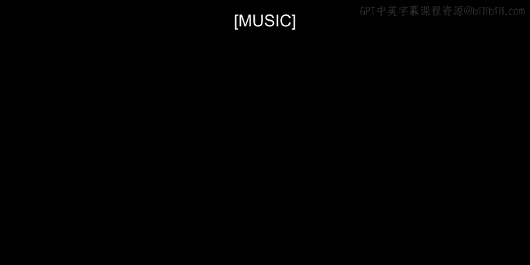
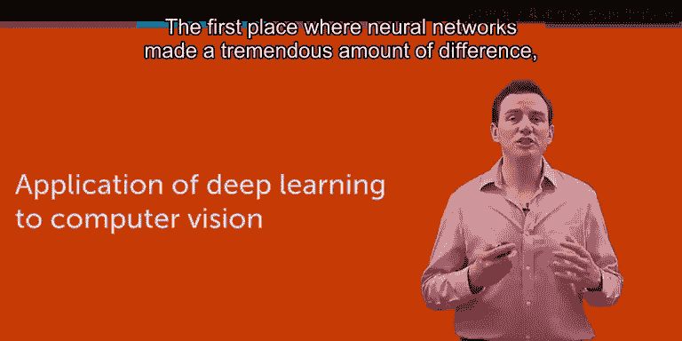
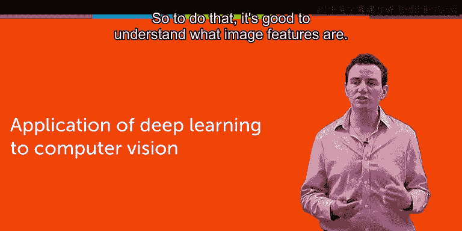
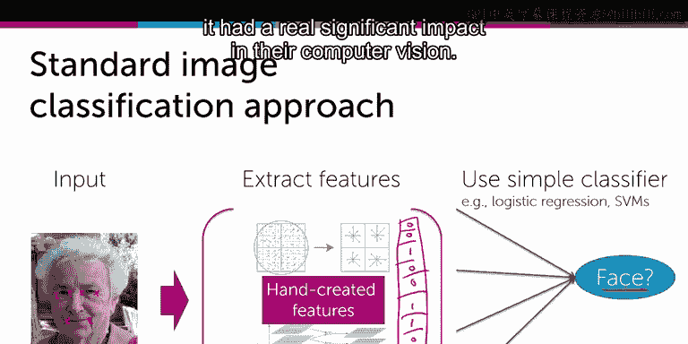
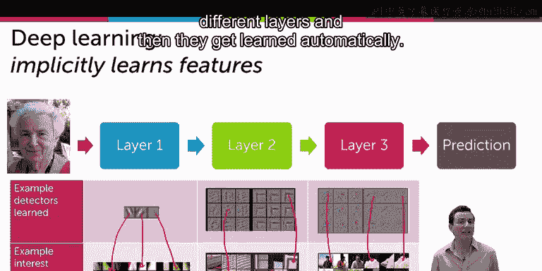

# 华盛顿大学《机器学习（基础篇，第1课／共4课）｜Machine Learning》中英字幕 - P96：95_深度学习在计算机视觉中的应用.zh_en - GPT中英字幕课程资源 - BV1zw4m1e7Zh

。

The first place where neural networks made a tremendous amount of difference in this scenario area called computer vision。

 So analyzing images and videos。 So let's see a few examples of how deep learning or these big neural networks can be applied to computer vision。

 So to do that， it's good to understand what image features are。😊。

So in computer vision， image features are kind like local detectors they get combined to make a prediction。

 So let's say we take this particular image， Suppose that I want to predict whether this is a face image or not a face image。

I run a little a detector， let's say they're a nose detector。eye detector， another eye detector。

 a mouth detector， and if all of these fire， you can do at end。Using a little neural network。

 you can see this is a face。And that's our prediction。Now。

 this is a simple example of how it can build a classifier for images， but in reality。

 don't explicitly have a noise detector or an eye detector。

 What happens is user called image features or interest points。 There's various names or this。

 but they really try to find local image segments， patches that are really distinctive。

 so maybe they'll find a corner。😊，And around the eye， maybe the corner around the nose。

 So if you have lots of this cornerary detectors， a face is comprised of corners。

 coary detector firings， places around the eye， the mouth and both eyes。

 And if enough of these fire in a particular pattern， you discover that you have a face。

 So this is how computer vision typically works。 So is how classification works。 Of course。

 there's more general models and more complex ones。 But this kind of the basic idea。😊，For years。

 these types of total detectors or local features are built by hand。

One a very popular one was called Sift features， and this re transformedformed their computer visions because they were really quite applicable and quite cool。

 and then there are many others that improved their accuracy。😊。

So other kinds of features that can be used。We talked about this hand created image features like sift feature and so let's talk about how they can be typically used for classification What we do is we run the sift textures over the image and the fire in various places。

😊，So for example， the corners of the eyes and the mouth。And then what we do is we create a vector。

That describe the image based on the firings， the locations where those sift features fired。

 So it might have some firings in some locations， no firings in other locations。

 And this can be viewed similarly to the words in a document。

 So there's the word messy appear as the word football appear similarly。

 does a corner appear in a particular place in the image。 Now。

 once we have that description of the image， we feed it to a classifier。 So， for example。

 a simple linear a classifier like we talked about El in a quarter。It's not a quarter。

 we're teaching this online。 It was earlier in the module。

So as we talked about earlier in the module， you can feed it to a simple linear classifier and some names for those are things like logistic regressions about vector machines and more。

😊，And from there， we get a detection as to whether this just image is of face or not。😊。

Now that sounds pretty exciting and it had a real significant impact in the areaial computer vision。

😊。

The challenge， though， is that creating this hand built image features。

Was a really complicated process and required several PhD thesis to be done well。

Neo networks are going to discover and learn those features automatically。

 Let me give you an example of that。 Supp you give you this input image and I run it through a three layerer neural network before making a prediction。

 typically what happens is that you learn local feature detectors。

 they like sift but at different levels in different layers and this detectors that you learn they detect different things。

 different properties of the image at different levels。

 So at the first layer you might learn detectors that look kind of like little patches which really react to things like diagonal edges。

 So this first detector here is all about capturing diagonal edges。

 the center one is about capturing diagonal edges in the other direction。

 And the last here one here is about capturing transitions in color from dark to green。😊，Now。

 if we look at the next layer， you're combining this edge diagonal edge detections and turn into some kind of more complex detectors。

 So， for example， we we discovered this wigly。😊，Line and pattern detectors in the layer。

 you also discover this kind of detectors that react to corners。

 they tend to detect corners in the images。And at the final layers。

 you come up with detectors are even more complicated。 So for a variety of images。

 you might end up with things that react to。😊，Trss and faces， or maybe if you have a bigger data set。

 even to these images of here， which they fire up with images of corals。😊。

So neural networks capture different types of image features at different layers。

 and they get learned automatically。😊。

