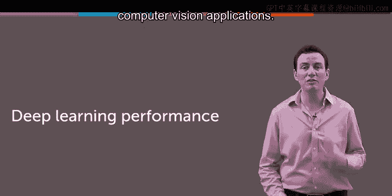
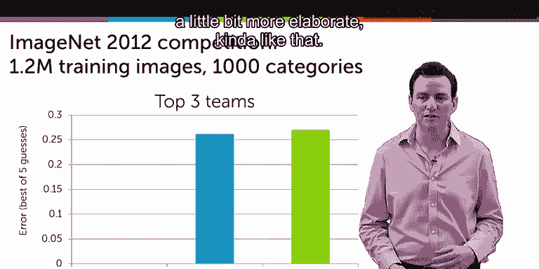

# 华盛顿大学《机器学习（基础篇，第1课／共4课）｜Machine Learning》中英字幕 - P97：96_深度学习性能.zh_en - GPT中英字幕课程资源 - BV1zw4m1e7Zh

。

Deep learning is exciting because it learns these complex features of images and as we discussed earlier。

 they've had tremendous impact over the recent years on a variety of computer vision applications。

 Let me show you a couple earlier examples。😊。

So on the top of the slide here， what you see is an example of identifying traffic signs。😊。

Based on neural networks。 so these are a data set of German traffic signs and the idea is for every image identify what sign it is and they were able to get 99。

5% accuracy using a deep neural network， which is pretty cool。😊。

On the bottom there you see an example that came out of some work from Google on identifying the house numbers based on what's called street view data。

 this is the data that Google uses driving around cars and photographing all sorts of streetss around the world and if you see the images are pretty complex and still they were able to get 97。

8% accuracy on the per character level。Now， these were exciting results。

 but the one that changed everything the really。Excited the field happened in 2012。So for many years。

 there was an image competition called INet。And in 2012， the image that competition included 1。

2 million training images。From about 100 different categories， and the idea was。

 can you classify this image， is it not just a dog， but is it a golden retriever or a Labrador， very。

 very fine level detail？Now there's many teams competing， these are the top three teams。

A team called Oxford VGG which got pretty decent accuracy So if you look at their top five guesses can get the right in five guesses。

 they were getting only about 25% error。 There's a team called ISI a little bit better and those are using traditional techniques like the Cft to one a little bit more elaborate kind of like that。

😊。

Now that year there's a team called supervision。That team used a deep neural network and had a huge gain over the competitors。

And that performance really sparked a lot of the excitement of。

Using deep neural networks in computer vision， because they didn't have to just use hand codeed features。

 you would learn them automatically。😊，Now， that neural network that won the competition with the supervision team was called the Alex Network Ne network。

 And I'm showing here an image from from their paper and that neural network involved。8 layers。

 60 million parameters， and was only possible because of new training algorithms。

 that could deal with lots of images and lots of parameters and the GPU implementation they would really scale to large data sets。

😊。

