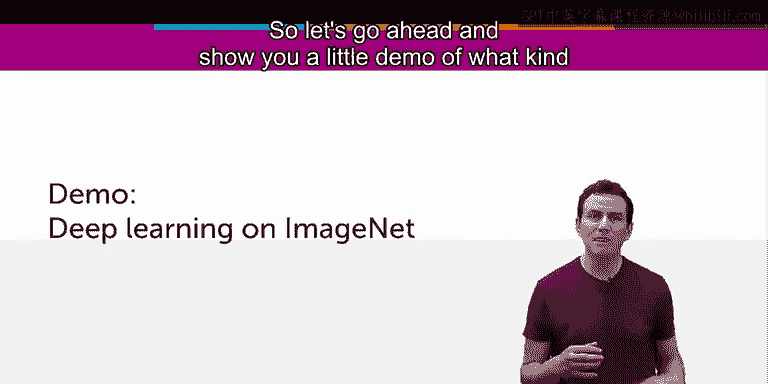

# 华盛顿大学《机器学习（基础篇，第1课／共4课）｜Machine Learning》中英字幕 - P98：97_在ImageNet数据上展示深度学习模型.zh_en - GPT中英字幕课程资源 - BV1zw4m1e7Zh

。

So we saw that deep learning had an tremendous impact on that image net competition which allowed them to take 1。

5 minute image strain the deep neural network and get amazing performance of predicting one of  a000 different categories so let's go ahead and show you a little demo of what kind of categories we're talking about and how cool the predictions were so here's an example it was。

😊。

The Alexnet trained on the imagenet dataset which we then deploy as a service that can be queried from this website and so every time I click on an image it gets sent to that service which actually runs on a GPU so it's fast and it comes back for prediction so if I click on this particular image here it gets sent to a service that actually hosted on Amazon AWS it comes back for prediction here it's hidden but when I click on that it tells my prediction is so if I show you this image it might be unclear what that image is but if I click on that it says parking meter it turns out to be the right label the second best here prediction was padlock which you can kind of see kind of a padlock but parking meter got it right so that's really quite cool let me show you another example for example this one it gets shipped off to that service on Amazon AWS comes back for prediction and here my prediction screen monitor ociosscopepy sits a monitor but I don't know what the difference between a screen and a monitor is but that's okay so various images。

I'm just going to click on a few， so for example， if I click on this one over here it gets sent up。

 it's really sure it really thinks it's a spoon bill。

 it turns out to be a spoon bill which which is great and lastly I'm going to click on this one over here and that image gets sent to that service uses deep learning for GPU and it says it's a beer bottle or popbo。

 the true labels beer bottle and now these are all images in the original imagenet data let'm show an image that was not in the original imagenet data I click on this one here it gets sent to that service。

😊，On AWS that we're hosting there comes back for prediction， it says a Labrador retriever。

 this is my dog， this is the lab in Graphfl and this is the dog over here in data and so as you can see even for images that we're not in the original data set you can still get pretty interesting predictions now in your capstone you wouldn build a service not for predicting images here but for recommendations with deep learning for product images and text and hosted as a service and you'll be able to get a website like this that anybody can play with use I really see the power of the machine learning that you've been learning about。

😊。