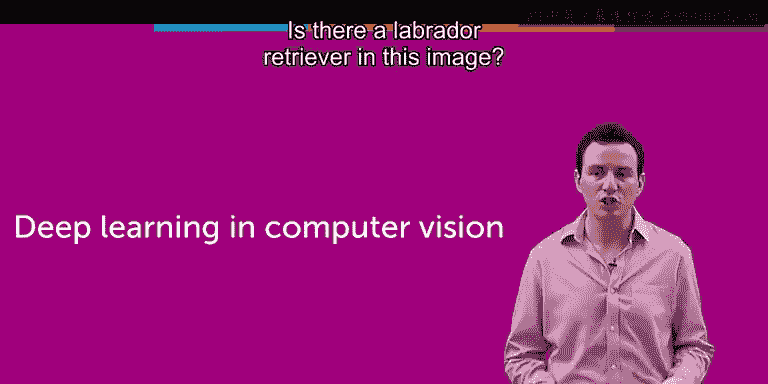
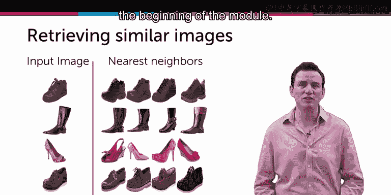

# 华盛顿大学《机器学习（基础篇，第1课／共4课）｜Machine Learning》中英字幕 - P99：98_深度学习在计算机视觉中的其他示例.zh_en - GPT中英字幕课程资源 - BV1zw4m1e7Zh

。

So I showed you some examples of。Neo networks in computer vision and doing classification is there a labbrador retriever in this image。

 but they can do quite a bit more。 So， for example， we can do image parsing。 So in this example。

 for every pixel in the image， you're trying to classify it and discover region。

 So in the center top image， you see a region of sky， another region of grass and so on。

 And this kind of image description or it's called scene understanding is pretty cool。

 And neural networks again， provided significant gains。😊。

But if we go back to the beginning of the module。When we discuss a new way to shop for shoes or dresses。

 the thing that we're really trying to do there is retrieve similar images。 So， for example。

 if I give you the input of this blurring black shoe，What neural network cool output。

 deep neural network is the shoes that I describe that showed here， a bunch of bar and black shoes。

 Now if I do this a little bit more stylish boot， you'll see that it gives you a variety of interesting boots like that similarly for heels。

 for brown shoes for sneakers and so on， so this is the core of the concept that we're using in the demo that show at the beginning of the module。

