# 华盛顿大学《机器学习（基础篇，第1课／共4课）｜Machine Learning》中英字幕 - P9：8_顶点项目和智能应用示例.zh_en - GPT中英字幕课程资源 - BV1zw4m1e7Zh

。

Let's dig in and talk a little bit about that capstone application that we're going to build together。

 So we're going build an recommender system for products that's intelligent， that combines text。

 images， sentiment analysis and deep learning。 Now before talking about the capstone project which is really going be exciting let me give you a quick demo of something that you could build a recommender system that could build a combines text and image data and uses deep learning at its core。

 Now let me show you an example of an intelligent application for recommending products that combines image and text data and uses deep learning at its core。

 So let me start with a story。 my sister is a fashion designer and her birthday is coming up this month。

 and I wanted to get her a gift of the impressor and want to get her address。

 but it's really hard for me to choose a good dress that much about dress。

 So if I do just standard keyword search and I search for dress。 I'm going to end up with。😊。

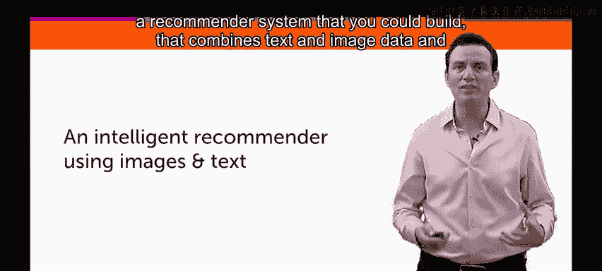

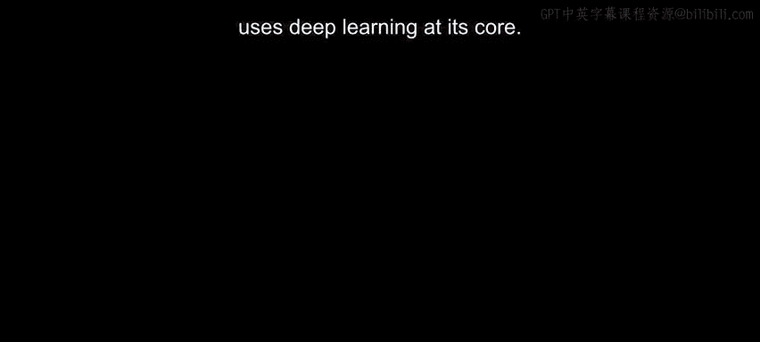

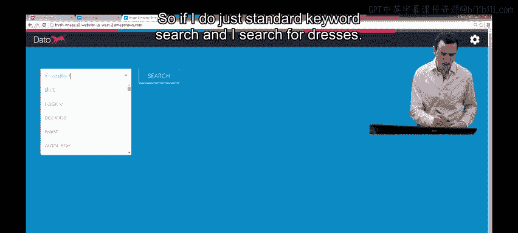

Something that looks like this that I'm showing you on the right here and you'll see there's a wide range of dresses and it's very hard for me to describe the kind of dress that my sister likes and so I've seen her for example。

 wear some floral dresses。😊，I couldo keyword search combines the keywords。😊。

Dress and floral and looks through the description of the dress and try to find some floral dresses。

 But even within floral dresses， you see that there is a wide range of floral dresses up there。

 and each one of them has a pretty different kind of style So the question is how can how can I describe what is a good style for my sister Now。

 for example， take this dress over here。 it looks a little bit like what you might like this warm sunset colors in which So there's some text analysis that we can do that shows you a little bit about what describe this dress。

 but really visually looks good。 So the question is can we use visual cues to find other dresses that look kind of like this one and you do things like this in your capstone project When I click on this dress we're going find visually similar dresses using a technique called deep learning that you're going to align about already in this first course and apply it in practice。

😊。

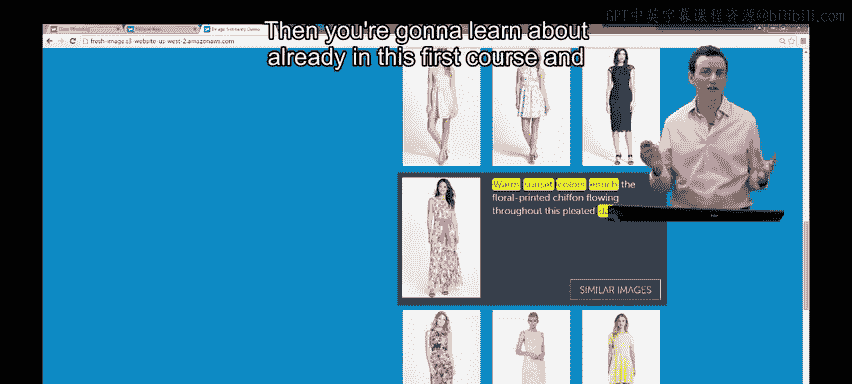

So when I click on this dress， what I'm going to see on the right is a bunch of dresses that are visually similar to this one。

😊。

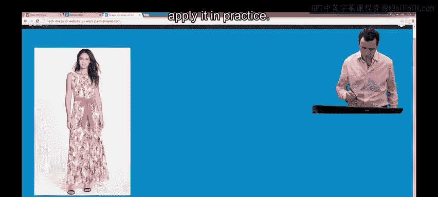

And you'll see， for example， the dresses tend to be floral， they tend to have the similar hue。

 similar colors and even then it's hard to describe what my system I like。

 but I can look at this dress right in the middle over here and say wow， this is interesting pattern。

 different colors maybe this is what my sister likes and if I click on it I'm going to find visually similar dresses to this one so dresses have more interesting patterns and multiple colors associated with them so you'll see as I scroll there's various of these and then maybe my eye catches this one over here where it looks like something that my system I like and I might color her up and say hey。

😊。

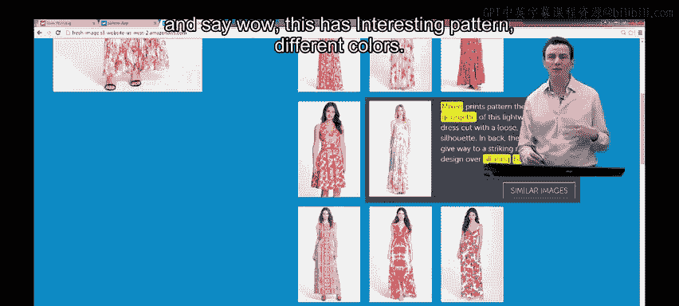

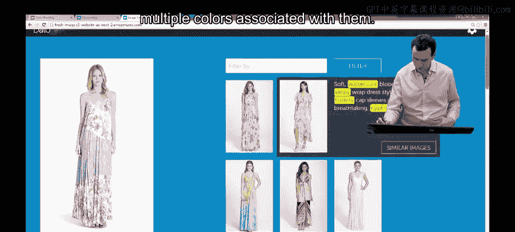

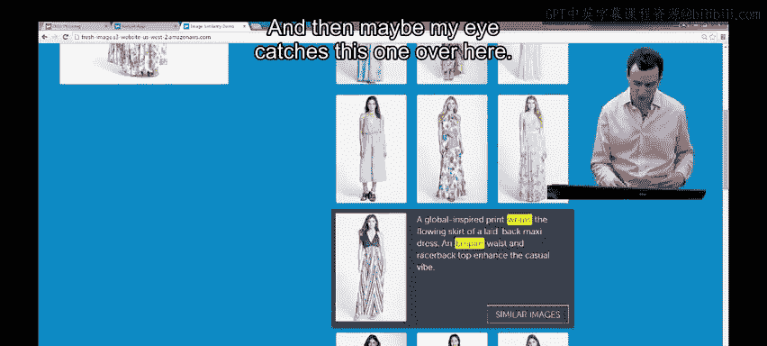

I think I found a great dress for you， this one。嗯。Now。

 let's say that I called my sister and you know， she looks kind of like this model I call her up and she says。

 you know， this looks okay， but I'm going to a cocktail party and why don't you get me a cocktail dress？

So I'm trying to think about a start over and I'm going to try to find her a cocktail dress。

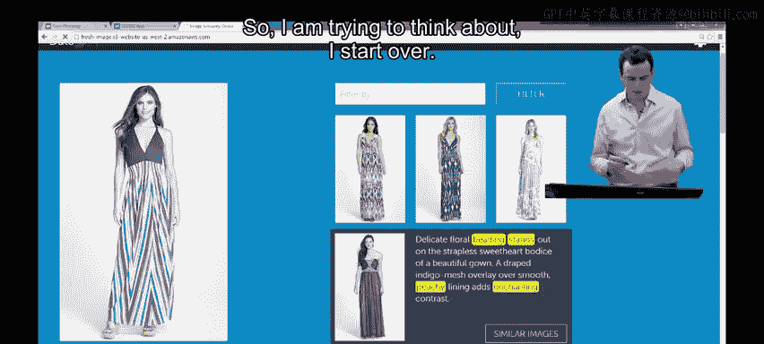

So cocktail dresses are ones that you wear for more formal parties， they look kind of like this。

 and there's all sorts of colors and things， but maybe she's interested in a black cocktail dress。

Just based on keyword search like black cocktail dress。

 you'll get things like this but it's hard to describe what my sister might be interested in。

 so I might ask her what you're interested in， she says you know what I'm interested in is' a cocktail dress that's interesting with a touch of color。

She's a fashion designer。What do they do？How they describe that？So I look for this and say wow。

 this first here on the left is kind of interesting。 If you look at the keywords associated with it。

 you see the keyword jazzy。 So maybe she's interested in a jazzy dress。

 So what do jazz dresses look like So when I click on this keyword that I discover from the text you see other jazz dresses and they're kind of interesting。

 but they're not exactly kind of cocktail dresses。 So let me just click on this one and find a visually similar cocktail dress。

😊。

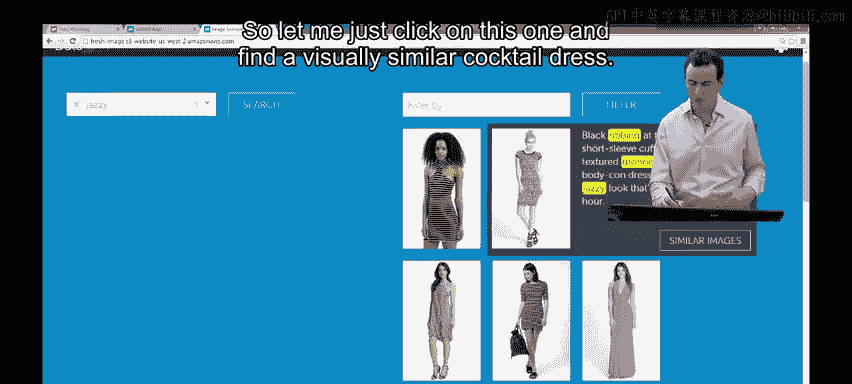

Now what you see is a bunch of cocktail dresses that tend to have a bit more of interesting patterns associated with them。

So， they're more interesting， more along the lines of what she was describing。

 So if I scroll through this。

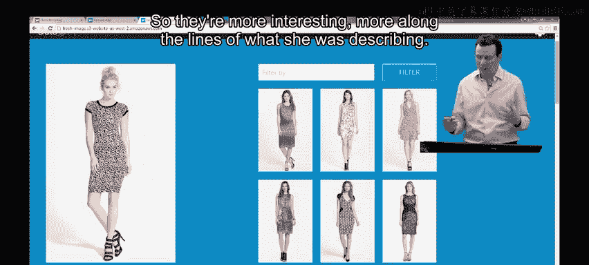

Say okay， this look pretty cool。 Maybe this one on the center which is blue。

 maybe has some color to it， is what she's looking for。 I click on it， I figure out， you know what。

 it's not formal enough for a cocktail dress， but if I scan down。😊。

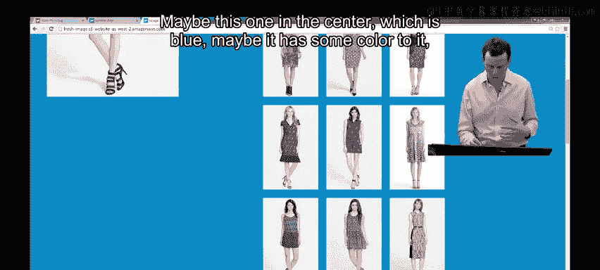

You'll see that I can find a dress like this one where if a cocktail dress is formal enough， it has。

Att a color to it。 and it's interesting。 and it might be something that you'll actually be interested in wearing。

😊，So here we've seen an intelligent application that looks at text data。

 image data uses deep learning and does some really cool and interesting things。😊。

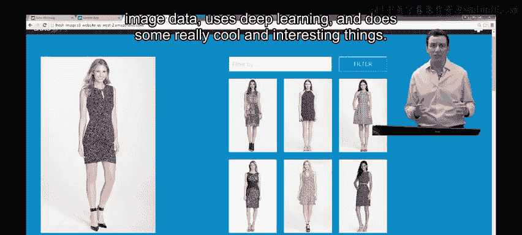

So we saw this demo of a deep learning for visual product recommendation。 But in your capstone。

 you'll do something really even cooler， much more interested in this。

 You're gonna take your capstone project and。😊，You're going to combine a variety of things you' recommenders。

 so you build a recommender system， you're going to do some text analysis， sentiment analysis。

 what people are saying in the reviews about different products and extractors reviews and analyze them。

 you're going to do some computer vision to visually understand images。

 you're going to do some deep learning to really take that computer vision techniques and make them extremely accurate and then you're going to take it and deploy it like a web service。

 like the one I just showed you that web page， you're gonna to have your very own intelligent web service for products which you can interact with。

 do some really interesting things and really show to a ton of people how you created the intelligence behind that service。

😊。

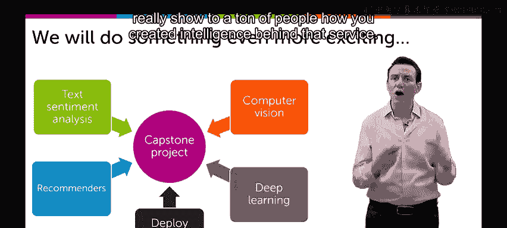