# 卡耐基梅隆大学【中英⚡深度强化学习与控制｜10-703 Fall 2018, Deep Reinforcement Learning and Control】 p01 P1 01 Introduction -BV1RyqPBbEJV_p1-

This is the fall 2018 offering of deep reinforce reinforce learning and control course。

 I'm Katerina Fyalaki。 This is Tom Mitchell and will be instructors of the course this semester。

Let's start direct with some logistics。The grading consists of two parts。

 three homework assignments and one final project。

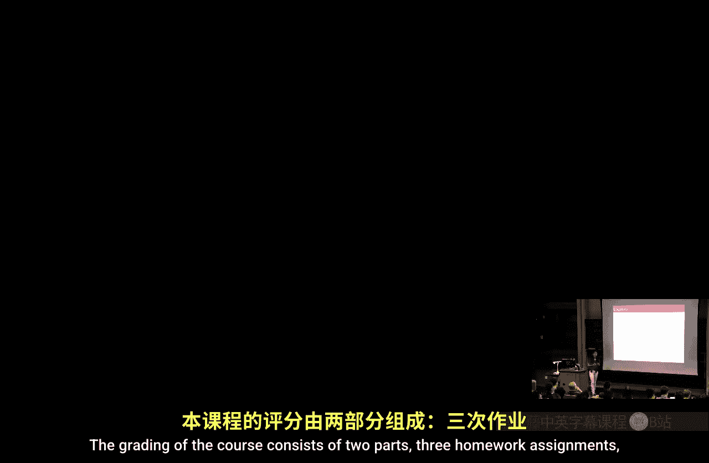

The project park has been。You know， to pick a domain of your choice and you try to make progress and then we would evaluate your novelty and you know performance this semester。

 we decided not to follow that road， there will be two or three topics in which you are free to pick your favorite and try to make progress。

 So it's going to be like a small competition。Although this gives less freedom。

 we believe it's going to push you to really understand them until better， understand the algorithms。

 their limitations， how to generalize them， how to yes。

 to generalize what is the limitations and we'll discuss。

 And this project topics will come back again again through the homework。

 So theres not gonna be a surprise at the end for the project。 We believe this is going much。

 much help your learning experience。Do you have any questions on this。

This is a big change from last semester。Okay。Resources for those that do not have access to GPUs。

 were arranging with Amazon。 So we'll offer you some free hours on Amazon machines。

 and we will update you on this on Piazza。 This should be starting from tomorrow in the next two days。

 Okay， so the first homework will come out in three weeks。

 So you are okay for the next few weeks not having access to to resources。

 Probably we will ask you which one of you have access so that only those that you know do not have advisor with the GPU clusters will be offered these free resources。

So the lecture will be recorded it will be available inside CMU。 many of you send emails about this。

 the prerequisites for those that have not taken the official courses listed on the website。

 do email us as some of you have already emailed， we'll get back to you within this week and let you know。

😊，The important thing that has not be resolved is regarding time conflicts， some of you have said。

 oh， I'm taking two courses， they overlap in time， can I take this course register for this course and attend online。

 We haven't decided this yet， we'll decide this week and we'll let you know on Piazza about this。

People can audit the course。Fly， no problem。 I mean， there are many of。 It's very bigauory。

What is the goal of the course， The goal is， how do we build agents that can learn to act and accomplish goals in a changing dynamic environment。

As opposed to programming agents to execute tasks in static environments like this factory robot and wonderful factor robots have been available for many decades now and they're very useful and they're relying on the fact that the environment the factory will not change so they don't have any sensory input but they just execute some preprogram behaviors。

 they don't need to sense because nothing is going to change okay。😊，And motor control is important。

 Act is important in the world。 You may think that solving my problems is more important。

 but guess what， this is the case because the human brain has evolved for hundreds of thousands of years to direct human motion。

 That's why we care about this motor control and Daniel Wopert and your science since Columbialoia University has a wonderful Ted talk that you can you know watch。

That exactly makes this point that the brain evolved not to think or to analyze emotions。

 but rather to control movement in the world。By the way。

 I'm making this clear because right now it is 2018， when we talk about actions。

 many of you in particular in these audience may think that you know we talk about the world of video games all us spend time there every day。

 we talk about acting in the physical world around us。啊。

Let me give you an example why I do believe that this statement is important。 This is Cki。

 It's all over in the bottom of the sea and they're tiny animals with a small nervous system。

 which as soon as they find the rock they like and they don't plan to move。

 they digest that nervous system， they digest their brain。

And many people have paralyzed this process with getting tenured in academia。

 You don't plan to move anymore。Productivity may drop。啊。Okay， what is what is。

What are we going to learn， We're going to learn them mapping from observations。Two actions。

What are observations， observations， whatever we take。As input from our sensors。

Humans have a lot of sensors。 Vision is a very basic one。 In fact。

80% of the information we get through。Our visual our eyes。 We have also tactile sensing。

 We have audio， We have smell。 Our computers right now arguably have much worse sensors。

 but whatever is available， we should exploit it。 So this is how the input comes。

 And the output is what acting in the world。O。And because。We care about achieving specific goals。

The mapping should also condition in the particular goal you have in mind。

So many times you will not see the goal being explicitly as input to this mapping Y。Because。

 you know， Ar has been linked to doing progress in video games in video games。

 there is a single goal win the game。 As such， you don't need to input it as input on that fact that you're learning。

 But to build agents that connect act in the world， they have tons and tons of different goals。 Okay。

 so in general， we will seek this type of maps。 Okay， input end goal to desire actions。😊，Now。

 many of you， since the prerequisite is also machine learning， youll say， okay， great。

 let's toss the human brain and put a deep fit forward network。

 and let's learn the mapping from goal and and observations to actions。😊，O。In fact。

 the mapping from observation structures can be quite complex。

 much more complex than 30 or 10054 W layers。You may have simulators。

 mental simulators that will allow you allow the agent to answer what if questions。

 What if I move like this， what's going to happen， What if I move like this and enrolling this model forward。

 you can see which action gets you closer to your goal。

 You need to generate hypothesis of how to act。 You may want to retrieve relevant memories for relevant cases you had in the past and try to generalize them in the current situation。

 Okay， so this mapping can be quite complex。And now you're going to say， you know what， look at me。

 I type in the keyboard。 I don't even look at the keyboard。

I'm pretty sure there's no hypothesis generation when I tap in the keyboard。 I do it so mechanically。

 it's so fast。And you're absolutely right。I want to tell you that there is a huge。

Difference between this mapping can vary。

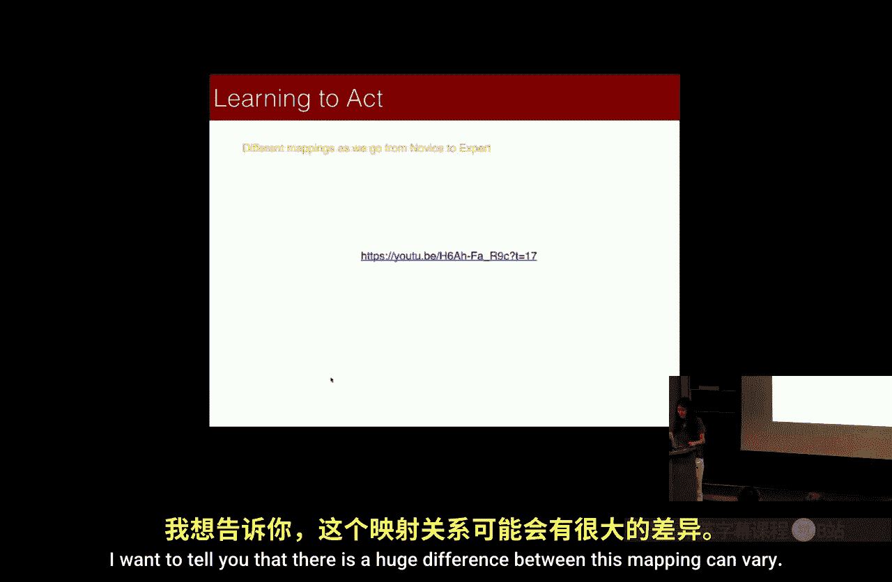

Let's see here。

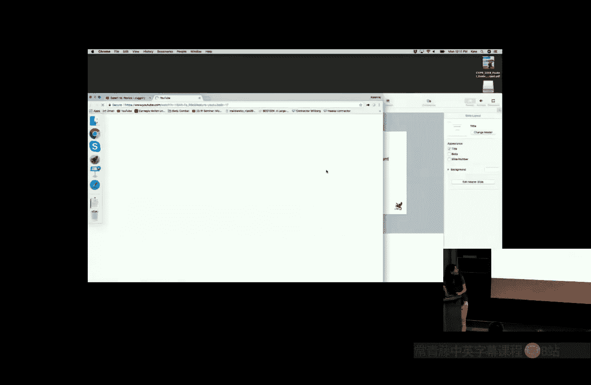

Based on your expertise。

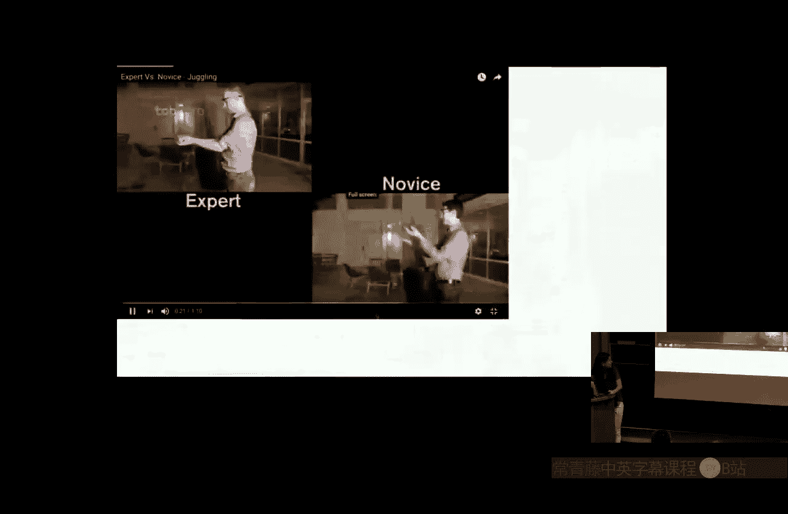

When you are expert already， indeed， this mapping may just be， you know。

 few layers of a deep neural network。But when you are a novice， you require all this model learning。

 hypothesisthe generation， Test and check， etc cetera。

 And you need to be able to balance your expertise to your ability to generalize。

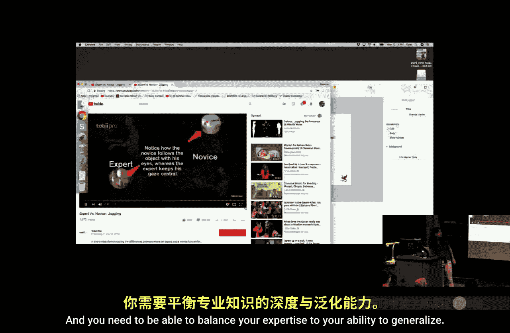

Does this make sense， So we don't just learn one policy and we're done。

 We're gonna to have an agent that is constantly learning and updating his you know policy set as it occurs more and more goes to solving the world。

 okay and we care about generalizing those policies in changing environments。

 Okay we don't care to be expert in one world that if this world tiny little bit changes。

 everything breaks， which is what happens right now on a personaltrain for video games。Okay。

 so this is a big challenge。One second。So we talked about learning to act。 each time we learn。

 we need to have some source of supervision。So what are the sources of supervision for learning to act that we'll explore in this course。

The first is rewards。Reward is sparse feedback from the environment。

 whether our desired goal has been achieved。 For example， did we win the game， Did we drive safely。

 Did we manage to get out of the maze。et ce。And the truth is that those rewards do not need to be extrinsic to the agent and very difficult and far away in the future。

 In fact， these are fantastic learners， extremely fast， extremely selfsupervised。

 which general generate constantly goals for themselves。 Can I make this noise again。

 Can I get that visual。 Can I pick up that little toy in front of me。 Okay。

 and this allows you to you know， constantly explore without any exttri supervision from their parents。

 So those rewards are not only exttris task， but also intrinsic to the curiosity of the agent。😊，偶然。

Now， I want to give you a specific gap of behavior and a hotick so that we analyze the different forms of supervision。

 the advantages and disadvantages of each。This is high jump。

 Does anybody recognize the two different types of of high jump。Do you know the names of those？Well。

 I have the names。 Well the first is Caesars is what was developed in Eastern Europe up till 1950s。

 and here is the forestbury flow。😊，Developed in Oregon State University by Dick Forsbury。 Okay。

 so what Forsbury did is he took advantage of the much soft landing material。

 which was not available earlier。😊，And then completely changed the， the optimal。 Let's say。

 behavior for high jump。From the scissors too to this backfl。

That took quite a long time to discover Yet， as soon as the inventor show it to the athletes and won the Olympic Games on 19 around 1969。

 then athletes around the world were very fast。😊，very fast to fine tune and improve。

 improve quite a bit on， on his technique。ok。So learning from rewards is difficult。

 but learning from demonstrations is easier。 Okay， so as you saw。

 it took years to come out with a completely different strategy。

 but it took much smaller time to perfect to perfectionate this strategy once it was demonstrated。

Now， my question is， once you go to the coach and you ask him， teach me how to jump high。

 how will the coach。Assist you， how will we supervis you towards this process。If it's very worse。

 it will tell you， okay， do it。Thousands of times see which way you go higher and improve on your own。

A better coach would say， don't worry， I'm gonna to show it to you。

 And he's going be jumping himself many times。 and say， okay， are you watching now。

 Do you see how I'm doing it， They try to do it as well。

And an even better coach will give you specifications of what behavior。He will tell you， okay。

 this is how your velocity should be。 This is when you should place your weight from one a foot to the next。

 You know， that's how you should yourself， etctera。 And this is。The most。A commonmon sense。

 supervision that humans use from each other。 We constantly program each other in natural language。

 However， this has not been。Successful so far in reinforcement learning。

 simply because language grounding has not made enough progress yet so that we can use it as a viable source of supervision。

 but we will touch on this in this course。Do you have any questions so far on these forms of supervision。

Alright， so why learning to act is different than T machine learning paradigm， For example。

 my favorite to learning to detect objects and images。Qu answers。Why learning practice is different。

 Why we need to have a separate course as opposed to putting together in general machine learning course。

ItYes。Right， exactly。 So this means exactly because you are interacting that the data you generate and you need to label are constantly changing based on your actions。

So here is the agent， the brain that interact with the environment。

 you will see this look many times and as a response to its actions。

 the environment spits out different observations， So these observations。

 the images are not IID independent and identically distributed。

 but other change as your policies is changing policy is the mapping from observations to actions。

And now you're going to say， okay， sure， it's not II D， but why is this a problem。

Why is this a problem， Why supervised learning breaks under this interaction of observation and action。

Well， let's consider a very simple case to demonstrate the difficulty。This is a racing gig。

Imagine that you have used humans to tell you how to raise a car inside a simulator。

 So you collected expert trajectories。What this expert trajectoryor means that you can take them and strip them into this type of dataset set。

 an image and a corresponding and steering angle。Okay。And I'm asking you。

 I want you to learn to raise this little car。So the first thing that comes in mind is。

Since you have this type of data， and since we're taking the prerequisite of machine learning。Yes。

So I have the input。The images。 and then I have a corresponding out。

And then I want you to learn to raise a car。 So a new image scans。 I want you to predict what to do。

What are you going to do？You'll take theseed examples。

And train your favorite machine learning model using supervised learning， okay。O。

 our favorite model is deepness nowadays。😊，啊。And the result we'll come out is the policy。

 the mapping from observation instructions。Now， here's the problem。

 You go and apply out this policy in the racing game。And you haven' have done a pretty good job。

 but you know， you will have it。little error with respect to the expert。

 which usually is not the case。But because this title the mirror， once we executed in the。

Then got simulated environment。 Okay， will take you a little bit of road。 Now this is not a big deal。

 The problem is that in general， but exactly because in that new place where you ended up。

 an expert probably would have never ended up。 you have no clue what to do in this new place。

 So once you try to fire your policy again， your error will be even larger and will take you even more off road and even more of road。

 and we call this compounding errors。 So eventually you'll be completely road。

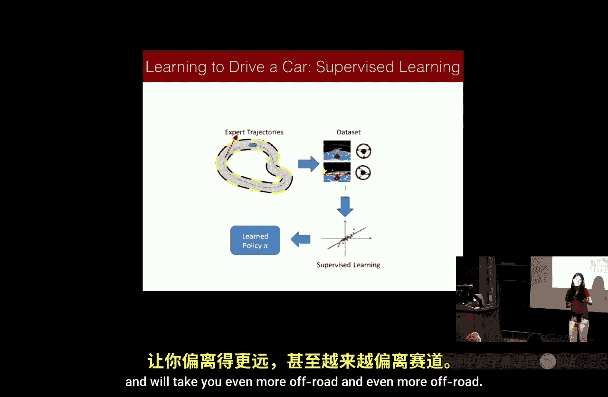

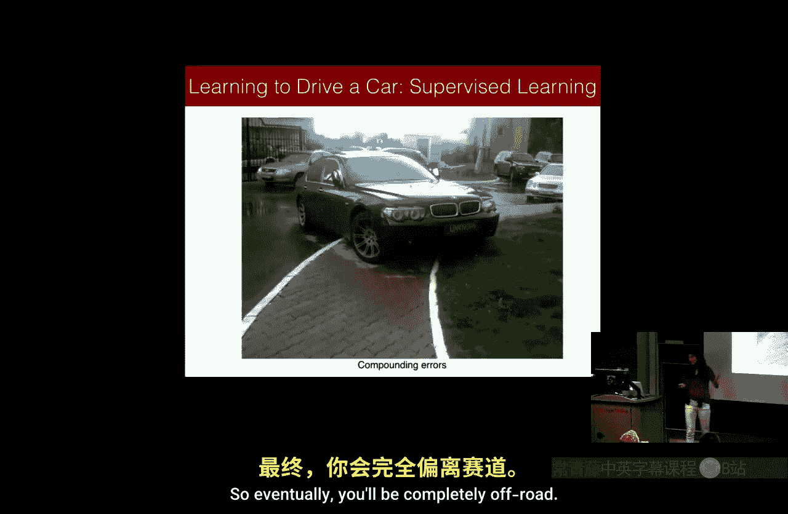

嗯。So how can we do you see the problem。That comes from why supervised learning may not work once we learn the mapping from。

And then we tried to execute in the real world。Great。😊。

So let's discuss a very nice solution that was given a few years ago。 And in the course。

 we will find a much。Sweer solution soon to come， O。We will not talk about this today， though。 Okay。

 so you learn your policy， you apply your policy in your racing car game。

Then you collect your new demonstrations。 This is the new data。

 which potentially are images that your experts had not seen before。 Okay。

 and you ask the experts to label those new images。 So you query again your expert。 Okay。

 you you collect new data。 Now， what do you do， You add this new data to your previous data set。

So that's why it's called dataset aggregator， dagger。 Okay。

 so now you have a larger data set and you use this larger data to train again your policy。

And apply it again in the simulated game and collect new data that you made mistakes。

 you query again your experts and reiterate。😊，Okay， and eventually。

 you will know exactly how not to go for it。And this will push it back in。嗯。Of course。

 this assumes that you have available the expert to be able to query。Now。

 there is a much smarter solution given from Nvidia in 2016。

Which they tried to learn exactly the same mapping for racing a car on the rearro。

 So instead of having just a single camera， they had three cameras left center and right。

 So they would use the left and right cameras simple， simply just to do this augmentation of data。

 Once you see something a little bit of road， automatically。

 they would point a steering wheel towards the center。 Okay without asking any human。

 This is right automatically exactly because we know how your cameras are placed。

 And this worked really well。 And so the compounding error problem。 But of course。

 this is just for racing cars right， the compounding error aing any type of policy you may want to learn。

 So we want a general solution to this and would come later in the course。😊，Okay， great。So。

 the first problem is that。The data is not IID。The second is that the reward， O。

 whether the goal of the behavior has been achieved is far in the future。In supervised learning。

The goal is closer。 Okay， so and as a result， we have this。

 what's called temporal created assignment。 Which actions were good and which actions were bad。

 Which actions were critical to lead us to the goal being achieved versus which actions， you know。

 did not matter。Now， I want you to make the following collection。 Someone can say， wait a second。

 Is't the same also in object detection。People use extremely wrong neural networks。

The words are after 100 layers that tell you whether you classified it or not correctly the image or whether you detected the object。

 and you are supposed to decide the weights in all those neurons， which are many。

 many stops earlier in time， I would say。Isn't it a similar problem。

 You cannot have supervision of what every your needs to do。Well。

One difference is the following that once you have these super long networks。

 you because exactly you don't need to go through the environment， the errors。

 the grants can go backward。 You can just use a change room。

 but you cannot differentiate through the environment。

 So it's much harder to propagate those later error signals。 okay。

I thought that was a nice connection。 We discussed with thevaraman a couple of years ago。嗯。Okay。Now。

 here is the big problem。Aly time to execute in the real world and there is you just cannot afford to have that much interaction time。

 A baby can afford it because it's I mean， the motors， I mean。

 it works 12 hours a day and is' pretty you know， his motor system is well developed and collects a lot a lot of experience。

 let alone all the pretraining in his brain in her brain。

What can we do for our agents to get the same chance？ Well， first of all， we can use simulators。

 and then well learn some policies and try to use S to real transfer。To transform the real world。Now。

Let me go back to this。 But the problem is that this simulator only needs to have photouralistic visuals。

 which I would say is。I mean， we have wonderful movies right now。 had to say。😊。

Cinema does have fantastic forturistic visuals。 Getting realistic physics。

 though in the simulator is pretty difficult right now。 Both for rigid bodies and， I mean。

 let alone non rigid bodies， okay。We can get our robots to work247 right now in the robotics paper。

 they're going to say， oh， I put the robot 50 minutes。 I collected two，3 trajectories。

 I fitted something。 Here is the result。50 minutes is not enough。 However， here in CMU。

 Abbinov and Le let the robot work for 700 hours。This in my opinion was revolutionizing work why。

 because first of all you have to fight with the CMU safety rules that you are not yes。

 you cannot leave the robot and supervise during the night so then somehow said oh。

 we supervise the robots that the graduate who would die there。

 look every day but there was no supervision so you had to go to bypass all these rules to allow the robot to play on its own and explore okay。

Here is the robot exploring。 Now your question might be。

How interesting things would you be able to explore a robot alone。

 The result is not super interesting things。 You just push objects around pretty much， right。

 You don't do anything interesting like putting a inside B or maybe stacking or this and that。

 So how do we can we combine self-exor of our robotic agents with guiding them a little bit towards interesting parts of the state space。

 It， it's one open question okay。😊。

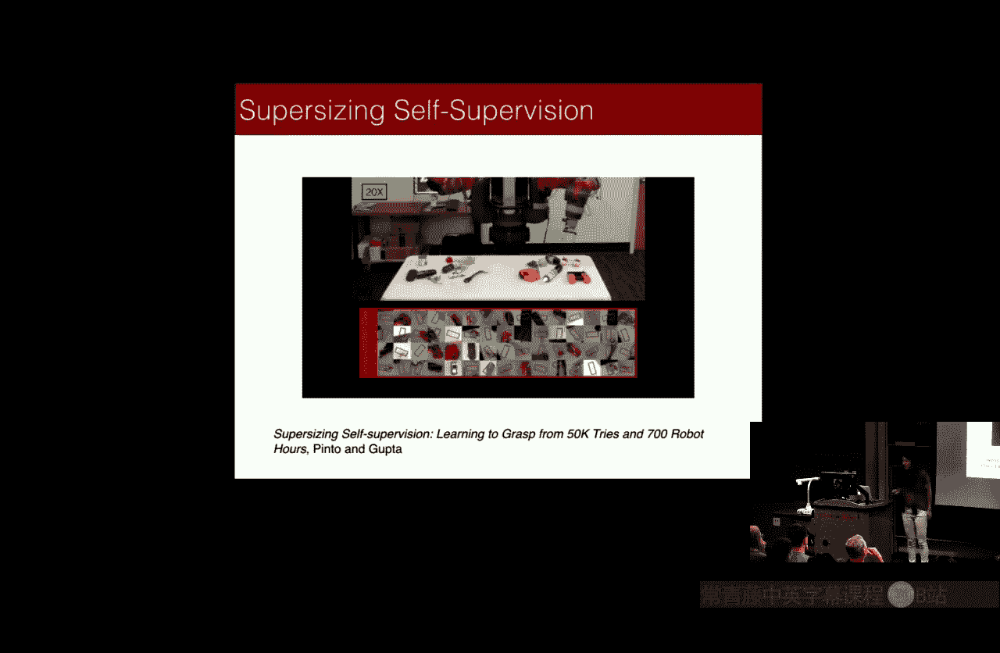

Okay， so， so one solution is to， to make the robots work more。

 And the other is to just buy more robots。 And this is what Google has done。 We call the robot farm。

 have many， many agents jointly collecting examples and learning one common policy from examples that all those different arms collect。

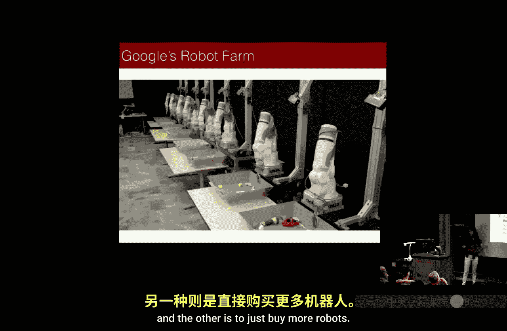

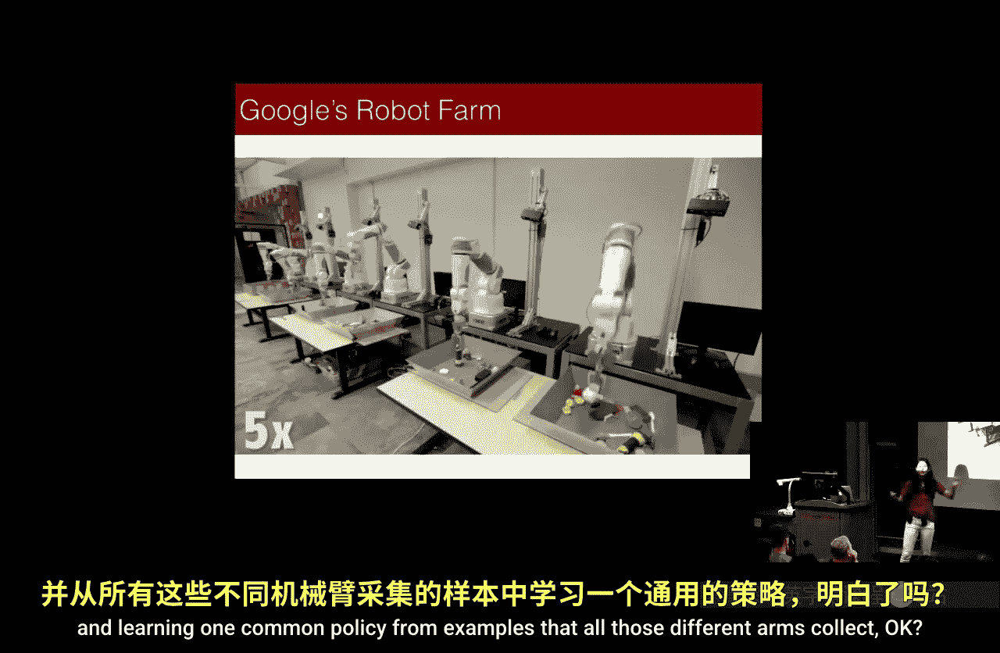

Okay。嗯。I mean， as robots get cheaper and cheaper， potentially this type of framework may be more easier to have also in academia。

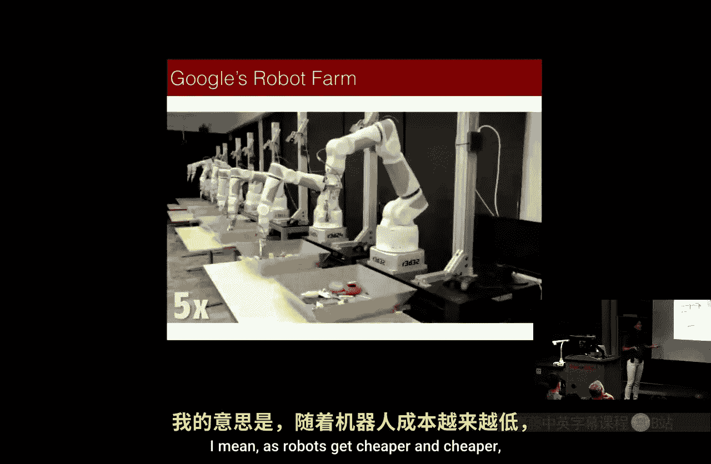

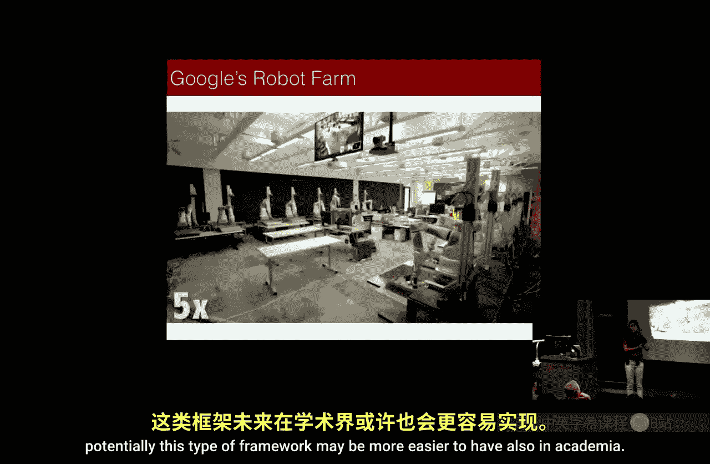

Now， my question is the following。If we had fantastic simulators with wonderful physics and wonderful visuals。

 and if we could， you know， collect a lot of demonstration for humans。

 would manipulation still very difficult problem。😊，Because what we saw in I， for example， we just。

 we broughttefor the problem。 We went out and said， okay， what are all the classes I care about。

 Here is a list of you，'s say 3000 class of objects。 Let me send millions of examples to you know。

 crowd workers。And learn the mapping that I care about。Do you think that if we had these resources。

 we would be able to solve the problem？For example， manipulation。Okay， so I'll give you my answer。

 So this is please feel free to say your opinion。 But my vision is， yes。

 learning how the world works is so difficult， right， and calling it up in a simulator。

 If I was able to learn a simulator。 That's that's the end。 Then I can just adapt myself。

 selftrain myself in that wonderful world。 And I will be perfect。 Okay， I mean。

 I will need some time。 But you know， we have resources we can parallellyze this exploration， I mean。

 humans had the chance of living for， you know， hundreds of thousands of years。

 But now we have the chance of paralyzing the exploration and adaptation of of our algorithms。😊，Okay。

 so。That's the first chapter。 So do you have any questions on this or any comments。

 You doesn't need to be questions。Yes。这个。有两。大卖脚片。I explanation was how to grasp， which was。会证明那个。

In quarter was policy was a different。What's a。All right， okay， so first of all these。

 so let me slow down when you're talking these terms will be visited again next。

 in fact on Wednesday， but simply because you mentioned this。

 let me just say a few things observation is whatever comes from our sensors。

 whatever is input from our sensors and we're able to observe from for example is the images from our cameras or is the tactile signal from our tactile sensors okay。

Then the policy is the mapping from those observations to actions。 Okay， that's the policy。

 What increasing means is that you don't go to the baby and say， make sure you have a tower here。

By tomorrow。 Okay， you just let the baby and the baby from curiosity。

 This is what psychologists and neuro scientists suggest that humans have this what they want to explore and they're curious and they want to learn to predict about the world and they're guided simply by building good predictive models and later in the course will explore one work。

 that the only reward that it has is to make its predictive model fail。 I want to ask。

So that the learned model that have built so far will fail。And as a result。

They can hold a lot of Atari games， they never get feedback whether they succeeded in the Atari game or not。

 they just get feedback whether what they have done surprise them or not。

And they show that this type of policy， a policy that is trying to make my learned model fail。

 correlates very well with succeeding the attack game and by the way to do that。

 they did not need to encode debt on that at game， the agent would just die and go back in the beginning。

 but at some point the agent learns not to die because it will have to run the whole game again and it has seen it before so the predicted model would be very good and predict。

 so you better not die if you want to surprise yourself。We will go all this in very。

 very much detail okay but because I do want this， I mean。

 I do want this have say first lecture to be exciting。

 but at the same time not to go too much above our heads。

 please do stop me if something is not clear。Okay， now I'm not sure how many people understand what is a model。

A model is a simple mapping of whatever I see Okay my observations。My actions。

To my future observations， okay？This exactly the step function in the physics simulator that take the current state of the world。

 every action of the agent， and they map it to a new state of the world。Simulators know the model。

Okay， videoide games， we know the model。 When we are in the real world， we don't know the model。

 we need to learn it and we'll come back to that point later， but please， yes。No， I。

 so like with automated。is really a possibility of a kind of deeper results。这个保安。あかり。

And the first one。根据法案。出らない。える場合の？Your calling is sent。

Learning from demonstration you told us however， it seems that the way you suggested that when from demonstrations is through what's called behavioral clause。

 let's just learn the mapping from those observations that the expert encountered to the actions that the expert chose correct the problem with this is that you can never generalized beyond what the expert has seen if the expert manipulated this particular object you will never learn to manipulate a different object。

So that's exactly what's going to be one of the two topics or maybe three or four of the project。

 how do we generalize demonstrations in manipulation because yes。

 there is some current research of learning from demonstrations but potentially exactly because this generalization is not strong is very。

 very small to therefore of the interpolation of what the neuro network can do we will exactly ask the following question how can you generalize beyond。

Does this a little bit answer to what you said？哎侬。Any other yes。If we。Yes， we can。 And in fact。

 that's going to be one class of models that works for。

 How can you learn neural recurrent models that you can totally unfold， take the rewards and back。

Yes， and that is an ongoing And then you're going to say， okay， great。

 why don't we just learn a re network done， But let me tell you。

 because the question is in what representation are you going to build this recur and on the observations。

 It's very hard to predict the observations。 What is the intermediate state。

On which you can build these recurs。 Okay， because look look in the observations now。

 you cannot even see where my hand is。 Okay， so the observations forget。

 how can we do this in representation that the state will be remembered， okay。Other other questions。

Yes， by the way， those questions that are not answered in the class very well。

 you should not worry about it， you can just post them on Pita and there will try to reply and the Ts will reply and there are going to be discussion。

 so yes。れ対策。おし。So the policy， there's a hugeverse， the policy is a mapping from observations。

And then a goal to action。A model is a mappinging of actions。observations to future observations。

can be enrolled in time。 You can say if I do this， I'm going to end up there and now if I do this。

 I'm going to end up there and if you're allowed in the future type to C future positive consequences of your actions。

And it has also be considered that the model can generalize better across domains， of course。

 depending on the representation that you build it on。

 while a policy is useful for a particular task and once you switch task， you cannot use it anymore。

Other questions。Yes。IIこ。So we didn't use the work plan so far。

 I think a plan is we can think as an anrolllic of the model forward， if I do this。

 what's going to happen next？O。I think。What people differentiate is that a policy usually when they mention to a policy is a reactive mapping between the observations and the actions where the plan may incorporate things like the model and look ahead and more at as what we said earlier。

 more aside of reactive mapping。稍微关机。Next， we will see some successes of learning to act so far。

The first thing we'll discuss is about Baam。B down is a very old gay， one act， for example。

1 thousand years older than chess。Now， everybody knows about Deep Blue。

 the program that Bi Capar of in chess in around 1996。

Why we don't talk about chess and we talk talk about Baggam。

 What is the difference between Baggamon and chess。Well， and， and how to。

Games were solved both inside IBM。Cheses。branch factor of around 30 to 40。

 What is a branching factor， given the current board configuration。

 what are the next possible board configurations。Now Bagamon。

 in the contrary because we all the dice， it has a much larger。Branch发。As a result。

 the research essentially unfolding all possibilities forward is prohibited in background。Okay。

Interestingly， chess let me discuss about chess， simply because the people that know solve chess in a VM essentially come from CMU。

 they came from CMU， they started this project earlier。

 they built this small compound called Deep Though， this was acquired by a VM。

 then it changed the name to Deep Blue， okay。And the developer said。

 you know what this program that sold chess is not exactly AI， it was simply a bruteful solution。

 we tried to learn an evaluation function， essentially mapping the word position to how good it is how likely it to lead to success。

 simply by collecting lots of features and talking to many， many chess extra。ok。

Does this make sense and in fact the master of Jess was part of the team？

Of the development team and Casparrafa said， can I also see those games and those moves that they said。

 no， you， you cannot see？Now， let's go back to Baham。First。

 the first so we excluded how to say exhaustive search。Which means you know。

 let me just a fall see based on that manually define the function。

 which action is better and let's take the action。So how did Gerald。

De So tried to solve Bagamon in I。His first attempt， he called it neurogama， why Negama。

 because it's a neural network that would take the board configuration and would map it to action。

All right。Now， what do you think was the board configuration in would look like。

 do you think it was pixels？It was not of course pixels， it was features of the board proposition。

 it was an encoding of the board position， my own encoding， okay？And then you run。ハエ hiddenユツ。たてエユツ。

Okay， so you take the board configuration and you map it through 80 units to an action。O。嗯。

How it was trained， it was trained to mimic expert moves from 400 games。Who was the expert。

Gerd himself， he played 800 400 games and told the computer that's what you should do at this configuration。

 that's what you should do in this configuration。Now， what's the problem with this approach。

 the resulting。啊，牛肉呢。That was trained， could never do of course， better than Gerald himself。

As a result， he achieved intermediate level， human player performed。Okay。That's fine。

Now he didn't stop though。 That's the thing He went on and he did what he's called a Tity gum。

TD Gamon is still a neuralgamon in the sense that there is still a neural network that maps board configurations this time。

 not to actions， but rather to values。ok。How good is this board configuration？

Same thing was the case for chess。Now， what is the difference。

 The difference is the way this evaluation function was trained。In chess。

 we recruited many chess masters in Tiiggamon。 we didn't recruit Baga masters at all。 We didn't have。

Supervision from experts， rather， we let the computer play with itself。O。

Here is the evaluation function， you an encoding of the board。

You try to predict to the probability of success what exact algorithm weers use is called temporal difference learning。

 what exactly does this mean essentially you try to make the evaluation of the current board position closer to the evaluation of the future eventually the future will be well the end of the game you will always succeeded or not so this success or failure will propagate and inform the evaluation functions of the earlier word configurations。

Does this make sense， Okay， Greg， So we have the evaluation function how this was mat well。

 there was a tiny。Small， look ahead search。 It was exhaustive search。

 If would try all the possible configurations。 Remember， the bar factor is very big。

 So this search was only to。So each time you would unfold two steps， see the branches。

 see if you know which see the evaluations of the resolving board configurations and try to propagate them forward in time and we will look into this algorithm in very much in detail in the two three lectures from now okay now let's see how many games do you think it had to play to get an informative evaluation function？

One million 500 games， Okay， but Gerald did not participate in any of them。

 This is just a computer alone plane。 This is great。As a result， it achieved。Almost。

 it was almost beating the best player of its。And then Gerald didn't stop。 He said。

 I'm going to take the features from Mugamon。Instead of starting from scratch。

 Im I'm going to portray to mimic expert moves， initialize from there and then start playing。

 and then he was able to beat the Bagamon champion of his time。Great。嗯。Nice， so self driving cars。

 again， there's a same story。

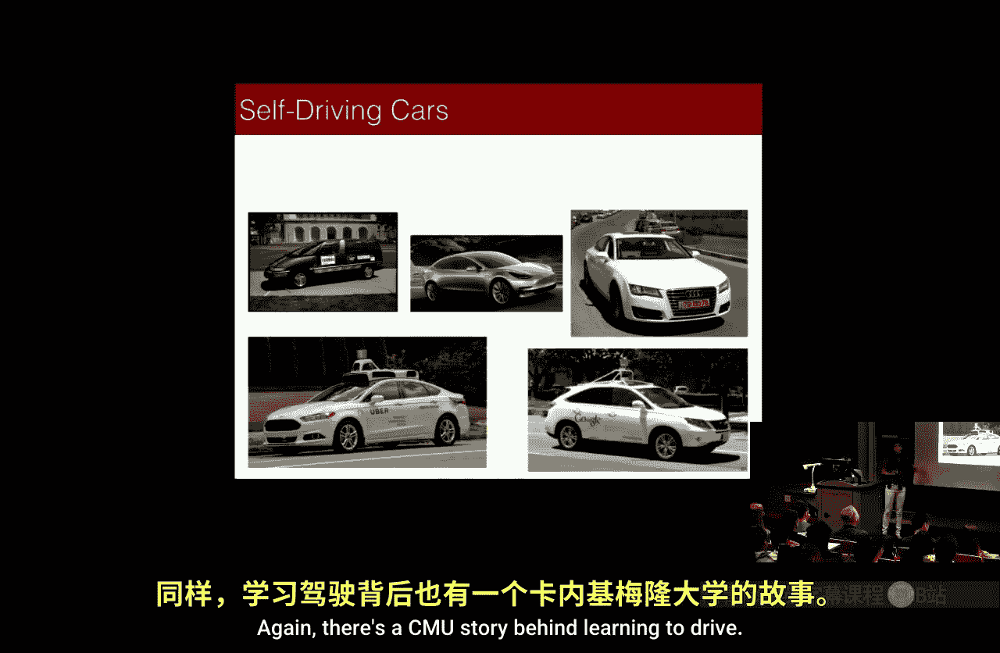

Behind learning to drive。This is Alvi， which is， so by the way。

 are there any questions with the Bagament， something that is not clear？Yes。No。

 you don't need to input the action exactly because the policy did not participate at all on thatfolding。

 that unfoldfolding was extremely done。 All possible cases。 And then again。

 for instance resulting a case in all possible cases。

 and then you look at the evaluation function with the resulting board configurations。

 So I'm going to say but these are not good sure they initialized from scratch。

 then of course initial from scratch， the evaluation function will be completely random。

But as you play and play and play and you'll see that specific configuration is bad。

 then this will propagate forward in time to say you know that that resulting in configuration also bad in order at this is worse than this other one。

 okay？Does this make sense you do not need to learn a policy at that case evaluation function。

 one neural network would do the job， we will see later there are other games where they were training two functions。

 one for policy and one for evaluating the board configuration， okay。Other questions。Okay。

 self diving cars。So the Po law in CMU in 1981 had the truck that would。Drive我种。This truck。

 amazingly how had four hidden units。 This is pretty crazy。 The input image was 30 by 30。

 He generated those images in simulation。Interestingly， generating voice sd images took much。

 much longer than training the network。啊。必し？You399。Now， what happened。

He realized the problem of compounding errors that we talked earlier and he did augment of his data so if the lane would look this way。

 would push it push the steering wheel towards the road and again if it would go the other way。

 I can push it towards the road Now the problem is the following the capacity of this network is very。

 very time so you cannot just train something in simulated images and deployed。

Once you open the trunk， you switch on the camera and you see the surrounding。

 he had to fine tune that network in the beginning。

 using the expert moves of the driver and once fine tuning is done。

 then the driver will leave the wheel and the car would go。O。Makes sense。 Let's see。Hope here it is。

So ideally we would like to have some audio now， but it's okay。 I switched it off。

So now I'm to say since from 19809， we've been driving， why still the problem has not been solved。

Because these is are isolated drones in the middle of nowhere， there are no people。

 there are no other cars， you just need to follow the lane， okay？A子。

I mean the sensing is very simple， you just need to keep track of the lanes of the road， however。

 once you go to urban centers， you need to keep traffic of the pedestrians of the other cars。

 of the traffic lights， of the other traffic signs， okay？

And the mapping from the input to what you need to do is going more complicated。

 Po you need to take into account what this pedestrian is trying to do。 How can I focus this motion。

 How should I make the car behave so that it respects this pedestrian okay？

This is a difficult problem okay because in the real world。

 we never take crazy action to say if I do this， what the pedestrian is going to do and try to do unsafe。

 let's say commands。 so coming up with this is difficult。Now， if the people in the company say， oh。

 how driving is solved is very easy just totally sometimes bypass， however。

 once you go to traffic jams is extremely difficult the car is gonna to freeze there forever is' not gonna move do you see because it doesn't know how to break the rules so how do we teach the car what is a natural driving behavior for humans I would say it simple to just talk to the car and said hi they go now you to guide it through let's say language and language car may be extremely easy like oh。

 make sure you keep that much distance from the front car and in fact。

 there is a paper that did like define some affordances and try to learn to drive through these affordances An example that everybody knows is keep mind 2014 plus they learn to play at games okay without any human input simply by reinforcement learning and that was important because they learn the mapping directly from。

PixelsPrevious works had already learned to map the image of something their representation。

 They showed that this mapping from pixels all the way to actions can be learned completely。

 you know。Unsupervised now is this unsupervised， you query the simulation millions and millions of times and the interesting thing is the following they say oh cool learning is model free。

 you do need to build a model， but if you query millions of times the simulator and the simulator is the model is this really a model free approach I mean you query the model all the time you ask you questions Allright So you assume you know it and that's why these things work on simulateim environment。

So now we're discuss about Go a little bit。Are there any questions so far？

I can explain a bit with the model3 Model three approaches do not try to learn a model of the world and usually they work on simulation where it is effortlessly。

 you can ask the simulator to tell you what's going to happen if I do this you can try all crazy you want you can crash and die as many times as you want unfortunately in the real world you will never want to do that you always want to be safe you always want the robot not to crash okay because they're still very expensive and it's very hard to you know transfer those approaches into the real world okay because of their sample complexity safety concerns etc。

Now let's see go。Well， everybody knows that did mine developed。A program called Alphago。

 which beat the world champion， Lisa Do Ongo Go is an ancient Chinese game。 Let me explain。

There is this board， the board comes in different sizes， smaller sizes are easier， right。

 they are first states， they're easier to tackle， these are called stones and the person thatquizzes the ones that has conquered most of the territory on the board。

 all right？It's a very difficult game because there are way。

 way more states both than the gamma and chess。嗯。However， Deep Mind was able to do very。

 very well using the following strategy。Given a configuration of the board game。

They learned two mappings using two neural networks。Once。

 learn to map the board configuration into an action probability of the next actions。And the other。

我们儿童么。The port configuration tool。I probability of success。

The first one was strained from expert moves。Okay， very simple。这生过啊。

Was trying to predict the outcome using safe play data now when you should play。

 you need to play with some certain policy and here they use the expert policy to play I guess that they learn from expert moves。

O。At this time， both those networks will guide a search。

The action will tell you which actions should you evaluate and which actions you should forget and the evaluation will tell you how to prune the branches。

 oh， you know what this is a really bad configuration， don't explore further from here okay？No。

They had to unfold the tree for quite long， and quite many times。

What allowed them to do this is a new hardware called Tens processing units。

Wwhich was developed by Google and was essentially trading precision for capacity。

 you were able to put more instructions per silicon on that chip。

 it was specifically developed for machine learning。

They say that it is equivalent to three generations of the poor's law。

 seven years fast forward of the technology， and all this thing was used to basically set off all this machine over so this is the hidden actor in the game。

啊。So let me just say that before that people were using Monte Carlo research essentially this tree unfolding to play goal。

 but what we it is that it had these intelligent neural networks to learn to try this so we learn now to search okay and now you're going to say but since we have a policy why don't I test time。

 look at my policy network and just predict whatever action it says well the thing is exactly because the state space is so huge if you unfold forward in time you will always do better because you'll be able to forecast the future to progress the future。

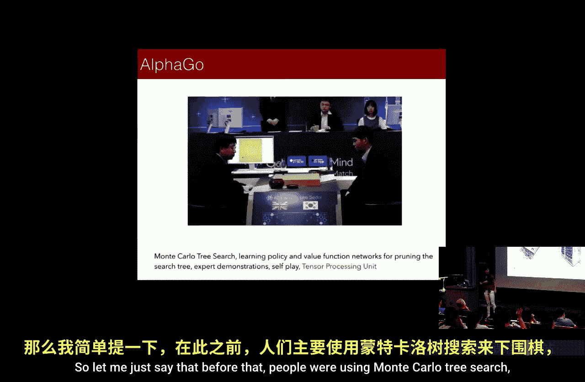

Keep in mind that here this forecasting is correct because you will be querying the go simulator。

 you know how the。The go of how to say environment works。Okay。

 so you will always do better if you look ahead as opposed to this baseline policy that you use to prune essentially your tree。

Okay。The questions。Yes。😊，This Alphago。All the other。

Poten they say under all possible actions of the other agent， what shall I do。

 like worst possible case for me？Why we need the to。再不来。Yes。

 because then you have a huge branching factor and value helps you to prune the trees but it doesn't help you how to guide to pick the branches which actually some actions you may never need to even sample to evaluate otherwise you need to open all of them and evaluate and post more to evaluate this okay I shouldn have opened this one in the first place。

 I mean if there are so many actions okay it is worthwhile to just query a few of them based on your nectar network as opposed to all of them and then prune with a value network。

Okay， so。Experts were used to train this policy network。We talked about the hidden factorctor here。

Now。Progress was made， and then the produced Alphago 0。 Alphago 0 didn't need anymore more。

 The human experts。And the big thing was the following。

 Monte Carlo research was not used at test time， but was used at test time。

 but also at training time。This means that during self play。I'm not going to randomly sample actions。

 I'm going to do a very informative search of what actions I'm going to explore。

 So each time you want to play against yourself， you're going to sit there and think for 0。4 seconds。

Okay so your fault many based on your current value and action networks and pick the right action and it looks like this。

 you are in a current configuration and then you often this not a current research based on your current policy and value on networks and pick an action very very intelligently before if you remember you could just query your policy network now you don't you just look ahead and you use the policy network to do the look ahead but you use the look ahead to propose the action。

You take this action， you go next， next， next， your phone at some point。 you see the end of the game。

 Okay， and then you use。This end of the game to go in。Yourre wife。担保しな。Okay， and another。

Other people say that another big change was the two networks。

 the value network and the policy network was not to disjoint neural networks。

 rather we expect there's going to a lot of synergy and a lot of shared features so essentially we have one in order go with two heads Okay and this is standard practice now in multitaskcal learning。

啊，书记。You play and where you selfplay you are extremely intelligent of how you sample your actions and I think that was a good question。

 I need to check how the action sampling was done in selfplay for TD Gament。

 for Moncology research the actions was based on learning from expert demonstrations I'm going to double check for TD Gament and here those actions are extremely extremely well thought through。

Okay， so fantastic， much better exploration， much better exploration。So let's see the result。

 the result is that Vo onphaco Zero was not very good at predicting expert moves。

But was much better in winning the game。Okay， was able to do better than a human。Experts， okay。

 and suggest different strategies。 and depending on which side of the fence you are。

 you may be extremely excited or extremely upset。But let's go back to this important picture。

This is not alpha。This is a defined person。Moving the stones on the board。

So this suggests that beating the world champion is easier than moving the stones on the board。Okay。

 and let's see since we solved alphaphago， how can we go and you know。

 learn to act in the real world， what are the big differences， okay？So first of all。

 the biggest difference is that for Alphago， the environment is known。W。

Here in the physical world for our agents， the environment is not known。

 they need to learn the model of the environment。Just to make sure this model is used each time we call the Montecarro research。

 right， we say do this action and then in sense， okay， I'm going to do it。

 Here is the new word configuration。 Okay， you just place the stone where you are。 very simple model。

 Allright， well in the real world。We need to learn how our actions influence。You know。

 the physical environment around us。啊。Yes， the other thing is that the model doesn't change。

 That's it。 Here's go。 I'm not even sure if how much transfer there is between the different sizes of the boards。

 but you just need to do fantastic on that environment and in the real world， goals and are changing。

 Now， maybe something is going be placed here and I need to make sure I don't each time dump it and push my laptop of chair。

 Okay So the environment changes。 their environmental variations。 The actions。

 theyre discrete versus the real world continues。 there are just one goal。

 let's bit go well here we have a large and diverse set of goals。

 even for very simple for very simple tasks， for example， to make pizza。

 There are so many other things you need to know to achieve this very simple goal。

 And the last very important thing is that when you're in agent acting in the world。

 you need to be able to assess whether your goal has been achieved You need to be able to see。

Did I put the water in the glass or did they spill it all over。

 So you need to have fantastic computer vision ability While go， the simulator tells you。lost。Or one。

Let's see， let's talking first of about the first two。Learning the environment。

 well there is this very important you task called state estimation。

 state estimation means you take the pixels and you try to infer where are the different objects。

 where are the important parts that influence my task that I need to keep track of， okay？啊。

And you also need to， as you say， check whether you achieved your goal right now in robotics。

 oftentimes we have instrumented environments and we have air tags to say to the robot， yes。

 you manage to open the door there IMU sensors there it's not that the robot the robot is blank to open the door but cannot figure out whether it opened the door or not right you have the IMU sensor to say yes。

 you open the door， this is extremely biologically impossibleusible usually works on state estimation go between two extremes。

The first extreme says the model is not， everything is not， the 3D meshes。

 their physical properties in airia friction， et cetera。

 Lo poses everything and I'm going to act on that environment and I'm going to plan ahead and their fantastic planning algorithms develop from you know robotics research and then there's another thing that says。

 you know what I'm just going to take the picture。And just without any intermediate supervision regarding where the objects are。

 how they look like， what is their motion， et cetera。

 I'm just only going to be supervised by my end taskss， which is predicting the steering angle， okay？

Right now， people have started understanding that， you know。

 we may need to do some intermediate supervision here regarding where the objects are。

 what are their emotions， et cetera， which can be trained from different datas and transfer to help cell learning to drive or learning to navigate or learning to。

Do whatever， and we will talk about these approaches in the course。Now， the bottom line is that。

Learning practice is difficult because understanding your world and how the world is very difficult。

 which is because computer vision is difficult。So， all of you are。Push towards， you know。

 that wonderful field of computer vision。嗯。Another thing I want to discuss is diverse versus continuous actions there are more and more degrees of freedom and the question is how do you explore with that high degrees of freedom。

 There are solutions we will discuss about curriculum learning。

 you start from few degrees of freedom and you add progressively more and more and in fact this is how baby handss work in the beginning they cannot do a lot of things and as some policy is based on this very simple grip they are start adding more and more figures。

 one goal versus many goals will discuss about recent work that explores exactly what we mentioned in the beginning。

 the conditioning on the goal So the policy is not just the mapping of observations to actions like go but rather observations and goals to actions and the most important question is how this goal is encoded I it an image is in some3 configuration because if it's an image how I'm going to you know represent things that are hidden。

 for example， this inside the the water is at the class。

 The water is not visible okay so we will discuss about。Those and codings that are very。

 very important。And the last is， of course。Rewards。

 we need to be able to build agents that can detect their own success。

 learning perceptual rewards and they also。Works that will talk about this。

 So let's go again to our favorite picture here。This has been realized by many people。 the fact that。

 you know。Earning goal probably easier than， you know， acting in the world。 And there is Han Morick。

 who is， in fact， an aju professor here in that stated the AI's para， the fact that。

The counter partly it's easy to make computers to exhibit adult perform on intelligent tests or plane checkers。

 and difficult they were impossible to give them the skills of a one year old。

 on perception and mobility。And。Do you agree with this？

Isn't this amazing and state on the words of Marvin Miskey we're more aware of simple processes that don't work。

 for example， oh I don't think I solve this math problem well and we are not aware of super complex ones that work super well like my ability to distinguish all of your faces right now okay？

Now， this is the AIs powerboxox， but the most interesting is the solution that morerovic。

How to say an explanation and Morwick proposed why this is the case。

Now before I show you that explanation， which we're not sure if it's a correct answer。

 but I'm extremely excited about why do you think this is the case。

 why this is so much harder than yes。That sure， because let me explain。

 even just perception of some objects moving around， even this， we cannot do very well， right？

So the perception is one part and the manipulation is the other part。

 how do you pick up this particular stone， both the perception as well as the motor scale together。

 visual motor， all the visual motor skills are difficult。Yes。

And' not clear that we can dis perception into let's say a small set of rules。Yeses。そよな。Yes， in fact。

 I would say that this is even more important in we were if for every intermediate working you say。

 okay， this is good for 0。7 or you didn the picture of supervision if you had this four number。Yes。😊。

Yes， that's what that ask。先効か。好的。So one second， which ones are subconscious？Yes， it is subconscious。

 We're not even cautious that we're looking and we're recognizing everything right。

 while when we're solving a problem， we're very conscious and strd towards it， right， Yes。

 so why is this the case， yes。大な。Inact， that's exactly what he suggested。 I think it's fantastic。

 It's just a matter of training。 We had hundreds and thousands of years to perfection our perception and mortar skills to survive from the wild animals。

 Po 66 million years ago when the first human species came out。

 They had huge difficulty running away from the lion。 right， But。

 but then it became better and better。 And they had huge difficulty during distinguishing potentially the animal behind the bush。

 But this also evolved。 So we had so much time to go。

 So the explanation he proposes based on evolution。 Okay， no magic here。 So then。😊。

What he says is that the difficulty of he calls it reverse engineering。

 you can understand that it's as learning， okay， the difficulty of learning any human skill is proportional to the amount that it has been evolving in animals。

We have spent a few hundred years doing cognitive abilities， okay。

 so potentially we are not as much fine tuned on those tasks as we are on visual motor basic visual motor skills。

Okay， and exactly the oldest human skills were so helps it perfect that we don't need even to be conscious and spend attention there。

 of course， once you see， you know this night and you don't see well。

 you say oh man I need to focus now right， but most of the time you don't need to focus。So those the。

Reless skills for humans are going to be difficult for AI to solve and those that are difficult for us。

 they should be easy for AI to solve。 That's why here's another wonderful gentleman that says what is AI What is artificial intelligence。

 We need to do things the way people do。 But what are the big milestones。

 and he says the big milestones is to achieve it used to be remembered to be found that the difficult things is what highlyeducating male scientists found challenging chess involving integration。

 improving mathematic the， etc。 However， what children do， you know nobody paid attention。

 but they can distinguish the coffee from the chair， they can walk around and they find their way。

 Okay And what he said and he's a professor and MI as well as entrepreneur behind many robotics companies。

 he says。No cogni。 Forge about it。 Just sensing an action。 This is what we need to learn。

 We need to learn to make rats。Excellent rats that can adapt to dynamic environment okay with the cognitive abilities they're going to come later okay and they're not that difficult。

 you just unfold the graph and you put also to neurals to proverun well and potentially that's it okay so this is extreme I' saying that these are open questions we don't have answers okay but it seems to me that babies。

 we have a lot of things to learn from them and that it is this wonderful paper of how babies learn okay these are the six lessons that the two psychologists suggest as important for learning behaviors be multimodal use multiple sensory input this means be incremental。

 don't try to teach the very difficult thing before teaching the very simple thing first so that you can build on it later be physical let it interact with the world explore this is extremely important intelligent exploration and this we're going to talk a lot in the course and you will have a chance to unfold your creativity during the final project。

And learn a language so we are able to communicate with humans and get supervised by them。

Do you have any questions on this last part of the talk？Okay。

 so I'm kind of done it theyre 10 minutes and I'm going to let Professor Tom Mitchell take it from here and tell us his opinions。

Let me turn this sense to。Hi， so I'm Tom and Joan going to be the other coin with Catarina in the class。

 and we thought we would try something a little different。

 which is each of us promises to the other that we're going to end lecture a few minutes early so the other person can riff on whatever we said。

😊，So today， so forgive me， but this is a real time experience。Another that we' work。嗯。So let's see。

 first of all， I think I want to say that there were many wonderful and illuminating things Kariina mentioned。

 but for me， the most valuable lesson was that the animals seek their brains。Yeah。

And so I encourage you to remain very physically active throughout this semester。嗯。

I also have to say I was reminded during this lecture， something I didn't even tell Kaarina。

My very first。Machine learning class that I took， it wasn't really quite a machine learning class。

When I was a student， I took this course from a wonderful guy named Bernie Woodrow。

And we had to do a course project。And I ended up actually doing now， this lecture made me remember。

 my course project was to write a computer program that played games against itself to learn to play three dimensional kick tae。

So very simple game， but in fact it learned an evaluation function and it looked it had two steps it took a move and let the opponent。

 which was itself take move。I was very proud that by the end of the semester， it could be me。

At three dimensional T tech do。Maybe a little harder。But I think that in this course。

 the projects are going to be a real opportunity for you。

To explore not only the kind of textbook content that we're going to be teaching。

You really want to learn the current state of the art of reinforcement learning。

 but there are also going to be an opportunity for you to push a little bit。Further。

And to experiment with some ideas。嗯，Maybe。Currently in the state of the art。

And so I just want to end by mentioning a couple of themes。 I Kaarina did a great job of。

Showing us some examples of reinforcement。And then pointing out how， for example， the alpha go。

 example， is kind of a special case in some senses and what are the。

Dimenssions along which we could broaden。For example， it's a special case in the sense that。嗯。

We know the rules that we came， we know the next stage function。

And so we can do a perfect simulation of。Whereas for example。

 if you're trying to use similar reinforcement techniques to train a car to drive on Pittsburgh City streets。

We don't really have such a perfect thing。And so there's an example of a kind of dimension of the problem where there's very active research in which you might decide to zero in on。

On your own project， for example， so I just want to mention a few others。To me。

 one interesting dimension。Is really sharing across different agents。

So you saw the movie of the team of robots at Google who were all trying to learn。

 but there's an interesting question that's really kind of open。

About what should one robot tell to the other， They're all working together on this。呃，一次呢。

It's not completely obvious because the robots， they have the option of doing a complete brain transplant。

The robot， but of course， that would erase from the other robot anything。So the question is。

 what's really the right way to take？Let's say you to learn。robot about A。

 and we're in neural network to robot B， put those together。So that's， I think， another dimension of。

The course that language is very equal。Another dimension is advice taking。

If you're an expert at're playing some video game。And as you're out with your friend and they're playing the video game。

 you might stand behind their shoulder and say， oh no， no， no， no。

 go left here because there's a zombie over on the right。嗯。

How do we get computer programs to take that kind of advice at the same natural language advice。

 perhaps， or even demonstration and natural language kind of advice。Together with。

Doing look ahead and search and experimenting in the world。

So that's another direction which I think could be interesting to explore here。So anyway。

 those are just a couple， there are many more and as the course goes on be。

Looking more mathematically at many of these algorithms。But I want you to think of the course。

 I think of the course as a kind of two thread for activity。

 one is make sure by the end of the course we all really understand the current algorithms the state of the art。

 the set of ideas that the community has developed， but also the other thread。

 let's challenge ourselves。To push the state of the art and use these projects。

 which will be a substantial part of the work that you do in any course。To create。Okay。

 the other thing we agreed on is that we're going to end on time。 So I'll end there。

 It leaves it the time for a few minutes of questions that people have them or we can。

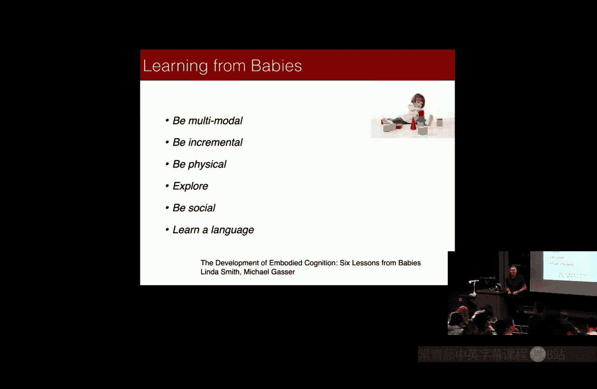

Okay， you're voting with your seat， we'll take that。

