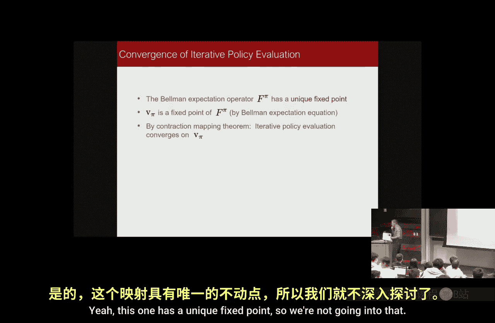
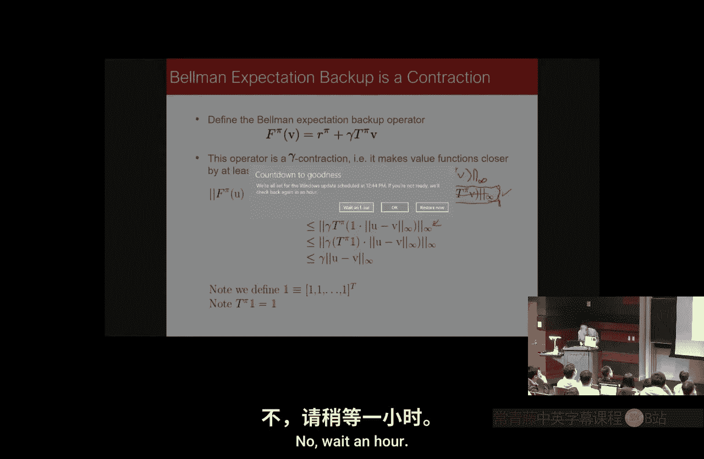
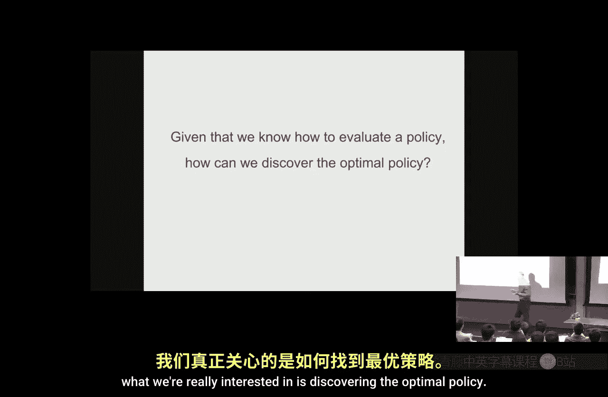
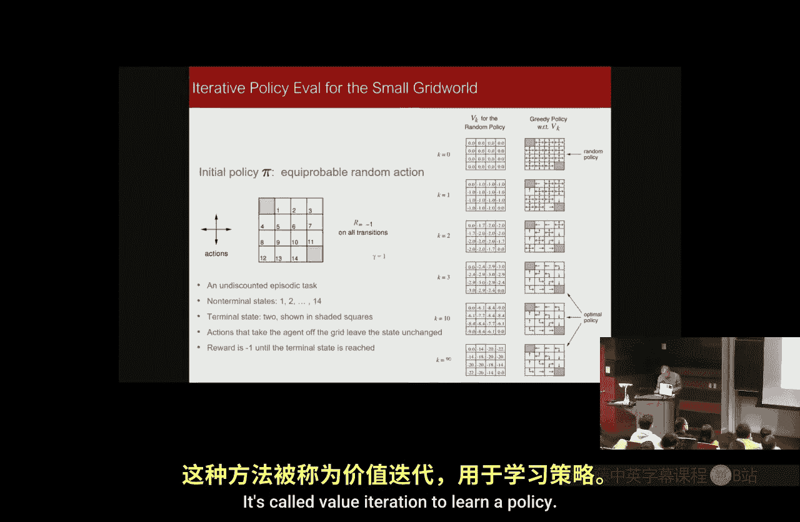
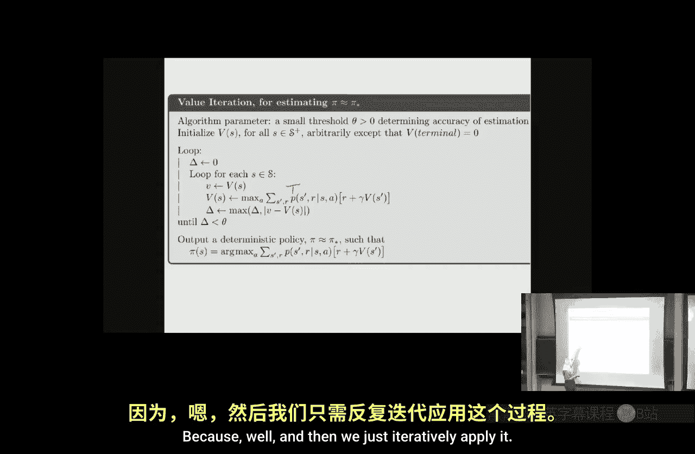
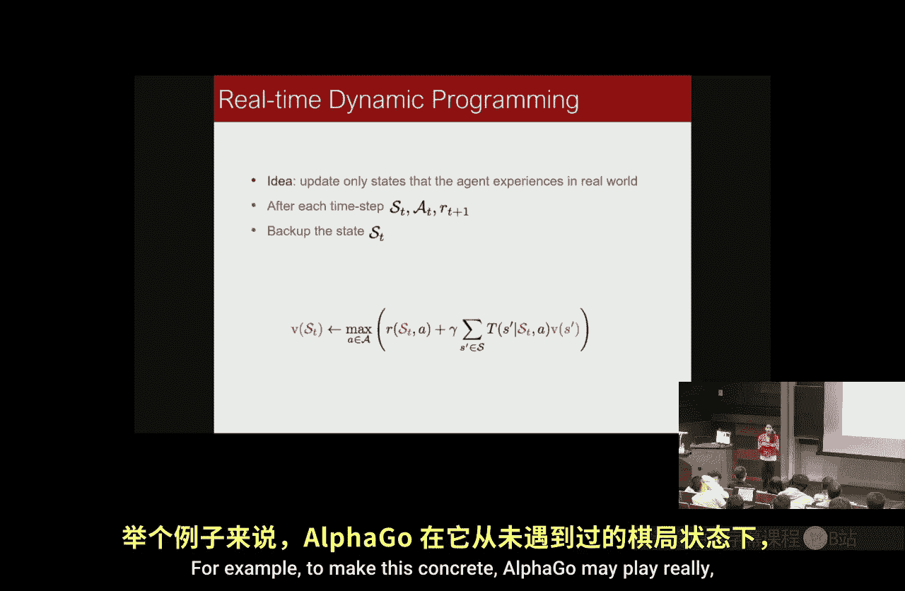
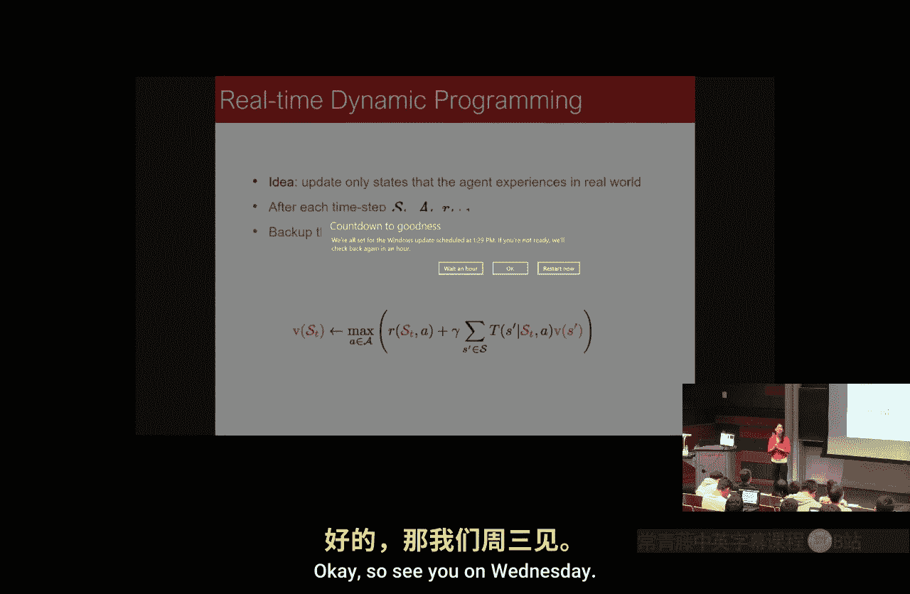

# 卡耐基梅隆大学【中英⚡深度强化学习与控制｜10-703 Fall 2018, Deep Reinforcement Learning and Control】 p04 P4 04 Solving Known MDPs -BV1RyqPBbEJV_p4-

Okay， well， let's get started today。 we're going to。Let's see。 Let me put it this way。

 By the end of today's lecture， youll know everything you need to know to solve homework 1。

 That's the easiest way to put it。嗯。Oh， there is a homework one。

 and I think everybody knows that by now， but in case you don't。

Take a look at the Piazza site and you'll see a pointer to homework one under。The resources page。

And well homework one gives you a chance to just。Make sure you understand these basic policy iteration。

 value iteration algorithms that we're talking about yesterday and today。

 and also gives you a chance to implement an experiment within。

Play around and see how they behave in practice。So I think hopefully it's going to be helpful。Okay。

 so today。The plan is to finish off policy iteration and value iteration as ways of。

Taking a Markov decision process， MDP， off on the right and。Answering the questions。

 given a particular policy。What would how can we evaluate it that is how can we get the value function for that policy and then kind of more importantly。

 how can we discover the optimal policy？All right， so just to kind of quickly review from last time。

 we talked about， of course the definition of the value for any policy pi at any given state is just the expected future discounted rewards we're going to receive infinitely into the future with our discount factor gamma。

We can write that by noticing that there's a recursive definition of that。嗯。

But the value at state S is can be written in terms of the value of the at the next state。By， well。

 this equation that we talked about before。 So I won't go through the details again。And。

So as we talked about last time， we talked about。The question of given in。

 given a particular policy pi， how can we。Calculate the value function。 We talked about。This is sad。

We talked about。Policy evaluation， iterative policy evaluation。By the way， this is what。

Most people would call synchronous iterative policy evaluation。Okay， we're back。

 So here is the algorithm that we talked about last time in a single slide， given a policy pi。

 what we can do is additional initialize the value function。

 which we want to calculate for pi to basically anything we'd like and then we just iterate where on each iteration。

 we go through every single state， and we simply update our estimate or k plus1 estimate of the value at state S will be based on our k estimate。

😊，At the value at data S prime。 And this is just using the standard backup equation。So again。

 just review。And we had this example where we could see that in this case。

 where we define pi to be a random policy that just chooses north， southeast or west at random。

For any state， you can move randomly in any direction， except that you can't fall off the board。

And then we said， well， let's define two terminal states， which are the shaded ones。

 and we'll say that the reward is minus one for every single action from every state。

 except when you reach the terminal state， then you get zero reward。And so then you can see here。

If we， for example， initialize our value function with all zeros。

 then here you can see iteration by iteration， the evolution of that value function。 And sure enough。

The， the states that are closest to the goal have a less negative。

 better value than the states that are far from the。Which is intuitively what we would want to say。

Okay， so。First question for today。Can we prove that this。

Itterative policy evaluation is guaranteed to succeed。

 to converge to the actual value function for the policy pi。And the answer is yes。

 and let's prove it。To do that and again， I'm following along pretty closely。嗯。

For most of this lecture， what's in the reading。 So you should stay up with the readings。 But here。

 what are going to do to。The crux of proving this is to rely on the contraction mapping theorem。

 which is shown here。And it says， let's just read it。 An operator F on a normed vector space X。

Is a gamut contraction？For any gamma between 0 and1。

Provided that for any two vectors in the vector space X， say x and Y。The norm。

Of the difference between F of X and F of y is less than or equal to gamma times the difference between X and Y themselves。

Okay， and so what we're going to see is that this backup equation that we're using to iteratively。嗯。

Iteratively update our estimate of the value function。Is， in fact。

 a is an operator F that is a gamma contraction。And then it turns out that this is important primarily because we know that for any contraction。

Contraction operator， contraction mapping。Iterative application of that contraction operator converges to unique fixed point in X。

Independent of where we start。And。One way to think of that is if x and Y are two different starting points。

 than every time we apply the operator F。The resulting difference is going to be smaller than by gamma than the two points that we started with。

And it'll converge at to a linear rate， determined by a gamma。So now。

 how do we map this on to the question at hand， which is。

 does value iteration really converge to the correct value function， We map it this way。

 We're going to say， let's think of the vector space。V over value functions。 So we could think。

 if we have， let's say， a finite set of states， we could think of the value function as just a vector。

Of that dimension mention， right， where the if value in the vector is simply the value that our function assign for state I。

Okay， so we're going to say。If they're。That many dimensions， that many states。

Then each point in the space fully specifies a value function。嗯。And the Bellman backup， turns out。

 we'll have to prove this is a contraction operator。

And then we can use the theorem that we just saw on the previous slide。To show that， well。

 if the Belman Backcl operation is a contraction mappinging。Then by iteratively applying it。

 we know that it will lead to a fixed point。 Now， our fixed point is going to be a fixed value function。

And in fact， it'll be the， the value function for pi。Okay， so let's。嗯。Proceed to do that。

 we have to measure the distance between two different state value functions。

 That is U and V are going to be two vectors， each with the dimension of the number of states。

 their value， the value of the I。Me element of that vector， as I said。

 is going to be just the value that this vector assigns to the I state。And so U and V。

 if there are two vectors， there are really two different value functions。And so。

 we're going to use the。嗯。The infinity norm to measure the distance between two value functions。

 which is simply the maximum over all of the elements in the vector。

Of the difference between U and B for that element。So in other words。

 this says whatever state out of all the possible states。

The infinity norm of these two value functions， U and V is simply the difference between。

Their values on the state where they most disagree。That it's the infinity ignore。

And so now we can show that。In fact， his backup operator。Is a gamut contraction？

So here's our operator up at the top of the screen。Now， you're probably thinking， wait a minute。

 that operator doesn't look quite like the one on the first slide。 So again。

 to remind you from last lecture。We pointed out that we could。

Take our usual recurrence equation for defining the value function。

And write it in vector and matrix form。Where。Just as we've been saying。

 vector V really represents the entire S dimensional vector defining the entire value function over the entire state space。

Similarly， R pi will be another S dimensional。嗯。For us。

 as dimensional vector where the I element tells us the expected reward。

 if we're in state J and follow policy pi。And then T is a matrix。

 that's just states by states where the JKF entry。Gives us the probability of transitioning。

 given that we're in state J。And follow policy pie。

The probability that we will next end up in state care。

So if you take the equation that we had seen before。嗯。

This is simply it in that vector matrix notation。Okay， so now we can go back。There it is， again。

 the top of the screen。 we're simply saying。呃。The value at some state is the immediate reward plus gamma times the value at the next state that we're going to transition to。

And so let's define that to be our。Operator。That's going to transform a vector V defining one value function into on the next iteration of R。

Value iteration algorithm。嗯。To the next estimate of the value function。Okay。

 so now to show that this is a gamut contraction， we need to show。That this quantity。

 that is for any two different value functions that we apply。This。F operator 2。

That it is less than or equal to gamma times the difference between those original ones。 And again。

 we're going to use the infinity norm， which means just the biggest difference between overall possible states。

 the biggest difference。In the values assigned。Okay， so let's go through the proof。嗯。

The first step is really just writing out the definition。 So if F is given at the top here。Then。

Obviously。Do I have。 Yes， good。Then this first step is just writing out the， the definition。

The second step is just combining terms。 if you take these。And subtract them out。

 You see that the reward goes away and we're left with simply gamma times the transition matrix。

Times the difference between U and V。The third step。Is probably the。Important one。

So here we're seeing。Well， U minus V， U and V are vectors， right。

 So U minus v is a vector of the same dimension。嗯。What I'm claiming here。

Is that if we replace that vector， U minus v vector。

By a vector of where every value in the vector is simply the largest value we can find in U minus v。

So， the， the。Note here is that one here really means just a vector of all ones。Okay。

 so suppose U minus v has three dimensions， and its values are 5，3，1。

What what this step is saying is if we replace 5，3，1， F vector by 5，5，5。We just find the。

The largest difference between。Overall all possible states， the largest difference。

And then that'll give us a scalar five。And then multiply it by the one vectors。 Now we have 5，5，5。

Then， this quantity。Will be greater than or equal to this quantity。Now， in general。

 that won't be true。But it will be true in the case of our transition function T， because remember。

 what is T。The elements of T tell us。The probability of transitioning from state I to J。And so。

 each row。Of tea。Is really a probability distribution。That sums to one。

So each row of T will be a set of numbers that sum to1。And if we're in。

 let's say the first row will be a set of numbers as sum to one。 if we're in state one。

 that set of numbers tells us what's the probability that will end up in each other's state。

 given that we start in state one。And so T is not really going to change。呃。嗯。

T is all positive numbers and not going to change the size of these。So in this case， we can。

 we can simply say that， well， if we change any vector to one times the maximum element in that vector。

 then this will certainly be equal to or even greater than that。Did I see a questioner。

 did that take care？Okay， and now we're home free because now we can simply refactor this。

 recall this is the scalar， right， This is the norm。 So this is just a simple scalar。

This was a vector， but now we're just replacing it by the vector of ones。Times this。But now。

 this transition function times 1 is just。1。嗯。And so。Now we have is just ones。And so now we have。

This basically goes away and we're simply left with gamma at times。The remaining scalar。

So now we're saying that once we， So basically， that's the proof。 And you can see it depends。

It follows pretty straightforwardly from that definition。And again。

 what it's saying is that if we apply our。Iterative operation to the value function。

Then given what this is saying is given two arbitrary initial value functions。

 after we apply that operation to both of them， we'll have some two functions that are closer。

Then the two functions we started with。By a factor of gamma。こ。計そと。のに。Sorry。

 in the case of the infinity York， can you say？而且呢个第个。Can you actually distribute them that clear。

Nowもユマナスリ。こ normal。あの。Yes， because honors are constant。It's just comes。

And so if you think it through or write it out， you'll see that the constant simply goes away。

Because what we're。What we're talking about is the difference between the infinity norms。嗯。

And so the constant just goes away。SoSa that like where we turned F pipe。せがしてきとで。

You've taken about this thing to the right。Only the first line。The left hand side and the right。Oh。

 oh， I see what you're saying。イに。Yeah， we just expand。Oh， you're right， I see。

 you're saying we could have written。And should have written。Like this。喂。Well。

 that mean that's even more， yes。Yes， I agree with you。That's the correct thing to write。

Does that seem right to you？Replacing that first line by。The red stuff。Ohm sorry，t if you were。Yeah。

So I think we can just do this。This is really the definition statement。And then from there。

 the Rs obviously canceled and we're here。Thank you。Yes。😊，は月。Why。The lastOh， less than or equal here。

Well， these are now equivalences， but the less than an equal came in here。

Where we replaced the difference between two functions by a different vector that had even larger。

で思ります。So that's where they came in the recipes are actually this is an identity， this is an identity。

Okay， so， so answer shows us that this beman。Update， operation。Applied to all states。

Is it contraction？And so now we're， we're home free because。

That means that if we apply it iteratively， we get to a fixed point。And， in fact。

The Belelman expectation equation shows us that that fixed point will， in fact。

 be the value function for pi。And so， that's the proof。

So in many of these algorithms that are iterative reinforcement learning style algorithms。

Depend on this kind of contraction mapping。 And you can see that gamma plays a key role here。

As as long as gamma is less than one。Then we know that on every iteration。

 these different functions that we could have started with。

 different initial states that we could have start are going to converge toward that fixed point。

 So gamma being less than one plays a key role there yep。嗯。Yeah， this one has a unique fixed point。

 So we're not going into that， but。嗯。

No， contraction mapping。Contraction mapping means that you're going to have a unique fixed point。

 doesn't it that？This is terrifying。嗯。No， wait an hour。

Of。Yeah， so here's the contraction mapping in general。

 there's a theorem that shows in general that a contraction mapping converges to a unique fixed point In our case。

 it's possible to show that that fixed point is in fact the value function for pi。Okay。

So we know how to give in a particular policy。 We now know how to iteratively estimate its actual value function。

 That's good。 But given that， we know how to do that。

 what we're really interested in is discovering the optimal policy。

And so how can we use this to do that？ And the answer is very straightforward。嗯。

One approach called policy iteration does the following thing。

 We start with an arbitrary initial policy， pi 0。We evaluate it using that algorithm we just talked about。

 So now we know the value function for that policy。

And now what we do is we use that value function to improve。Over policy pi 0 to give us a new pi 1。

And then， we just repeat that。So we that's why it's called policy iteration。

 because we go through this sequence of policies that have better and better value functions。

And so the remaining question is， what is this I step， How can we go from a value function。

That's associated with particular policy and use that to find a better policy。

And the answer is that it' it's really not hard。 We talked previously。 In fact。

 Kaarina spoke previously about。Not just value functions， but Q functions。

 which are very similar to value function。 Q function for a state and in action。

Just like the value function is the expected discounted future reward。 But for the value function。

 it's given that we start in state S and。And in this case。

 it's given that we start in state S and take action A。Okay。

 so you can think of Q is very similar to the value function。 In fact， we can write it。

In terms of the value function。Like this， we say Q is， well。

 if you're in some state and take some action。Your discount of future reward is just the immediate reward you get for that action from that state。

 plus gamma times the next thing you're going to be in。Which is。This， you know。

 the sum over the next state distribution。Of the value。At that next state。

And so if you want to think about it， all we have to do to improve on policy pi once we。

Calculate its value function is look for situations where。This quantity。Is actually larger。Then。

The value function for pi， which assumed that we're going to take the action recommended by pi。

And so we can find a different action， A that has a higher value for this quantity。

Then the current value function for state S， then obviously we can do better by instead of following policy pi。

 editing it to pick action A for this particular state。

And so that's the way that we can use the current value function。To update the policy。In fact。

All we really have to do if you think about it is once we have a value function， we can。

Define a policy。For that value function。That basically just says the policy is at every state pick the action A that maximizes the Q value。

And again， Q is tied to V in this。Simple way。And so that's the idea of policy iteration。

 We're going to take an arbitrary policy。Estimate perfectly its value function with this convergent procedure。

And then we're going to go through that value function and define a pi prime。

 which just greedily from every state assigns the action that we'll give。The highest Q value。

 according to。The value function for that。Current policy。And it turns out if the policy。

 if we don't find any actions any way that we can improve on it， then， in fact。

 we're already at the optimal policy。It's possible to prove that。Okay， so let's see how this looks。

 We we write it all out。 So here's policy iteration。We're going to start with an arbitrary。Pai。

And arbitrary estimate V for that function。 Then we're going to do the policy evaluation。 That's our。

The algorithm we just prove converges。That is， we're going to go through each state。

We're going to estimate the value of that state， according to our standard recurrent。Relation。Again。

 using our current estimate for V。To assign a value to the downstream state。Ts。

Pine can be either deterministic or random。T takes。Pi here， if it's non deterterministic， then pi is。

 well， in both cases， pi is simply the probability of choosing action A and state S。

So if it's non deterministic， that's where that。Shows up and so you can think of this as taking the expected value over the action we're going to choose。

So we do that， and then we， we do our update， and then we keep this variable deelta。

To keep track of the biggest change that we make in this way。

So each time we iterate through all the states。Delta is going to tell us what's the biggest edit we made to any of the values for any of the states？

And we can use that as a threshold to stop。Things from going we can run it all the way till that's zero。

But in fact， H you'll see in the homework， often you don't need to run it all the way to zero。

 you can get a good enough estimate that you can proceed to the next step。

 which is to improve on the policy pie， whose value you just estimated。And to do that， again。

 we have a global variable that keeps track with whether we're editing the policy。

 But the policy update is this simple rule。We said action8 to whatever the policy would recommend。

 but then we。Reefine the policy to be the。A。That I should put an A under my Aig Max。Agms over a。Of。

This quantity。 So in otherwise， the action is going to give us the best immediate reward plus downstream value。

And then if a is not equal to pi of S。Then we know that we did an update。

 So we set our global variable to indicate that the policy is not yet stable。

And then if it's not that stable， then we go back and loop if it is， we're done。Okay， so。

Itteratively evaluate the current policy。Improve it。Evaluate the improved policy， improve it。

 repeat until you can't do anything。So that's policy iteration。A will policy defines。也坏了。Now。

 the definition we've talked about all through the lectures。

 the definition of the optimal policy is the one that gives you the best possible expected discounted future reward。

From all states。Sorry。You could have the best value you all。AGood question。

 What if you can to have the best value on one state。

 but a different policy gives you the best value on another state。 It turns out that's impossible。

So it turns out there if you and the way to think of that， suppose I have two policies。

 this one gives me the best value if I start at state S1。

This one gives me the best value if I start at state S2。Then what I can do is I can say。

 I'm going to create a third policy。It chooses policy1 for every state where it gives a better value。

And policy， too， for every state where it gives a better value。That's not quite a proof。

 but that's the intuition that's behind the proof。这是好。

It will definitely rely on how you initialize it。 You can see that because if you get lucky and guess the right value function initially or the right policy initially。

 you'll only go through this loop once。In general， most of these iterative algorithms。

A n squared where n is the number of states。Times m where m is the number of actions。

We'll get to that in a little bit。That policy。I。And after， after a while。I see what you're saying。

 So this tends to dampen the nondeminism。Because you're going， if you find an aic max here。

You can do it， so you're right。And one thing not spelled out here is， what do we do if there's a tie。

 What if we have two different actions。Both of which。Give the maximum value for this。And。

A reasonable thing to do there。We can either pick one。 That's okay。

 or we can make them equal probable。And both of those work。But this will， you're right。

 this will push you toward more and more deterministic actions。Yes。Sorry。😔，Oh。

 I see what you're saying is this similar to expectation maximization， it's similar。 It's analogous。

 And E， we iteratively reest some values of some variables that we don't know。

 and then maximize according to that。 And so here you could say we're reestimating the actual values for V。

😊，For V， for the optimal policy。 and then maximizing according to that， the the only disconnect is。嗯。

We don't really have a problem well。I don't think it's it's not a direct application of E。

 So you can't rely on the E theorems to prove that it will converge to a。Local optimal。

But it is analogous to that。 you've got the right intuition。Okay， so there's policy iteration。Now。

We could go back to the example， where we。Illustrated value iteration to estimate the value function for particular policy。

 Remember this example， where we have。A world where we have。嗯。

Reward minus1 until you reach the goal state。And so if we had an initial policy。

 which is uniformly at random， move in some direction shown on the right。

Then as we iterate to estimate the value function associated with that policy。Here are the improving。

 improving， final convergent value function for that policy。

And so if we wanted to apply policy iteration， as we just described it。

We might start with that policy。Evaluate it and get this value function for it。

And now how now we have the policy improvement step。 What would we do now。

How would we edit this policy， given that this is the value function。For example。

 what would we do in， say this state？What's the optimal action to take in that state。

 According to this now understood value function， Can you see those numbers。

 I'm sorry if they're too， are they too small。Okay， I'm going to read them out。0，14，14，18，20，202020。

 And those are all negative numbers。So large is bad。I should blow this up。 I just realized that。

 if your eyesight isn't better than mine， you won't be able to see it either。 Okay。

 so there we have it。I'll just。So I'll just say， given that， what we want to do。

 say for that action up in that one state where the policy is saying with equal probability。

 choose north， southeast or west。 But now that we know that in that state。If we go this way。

 we'll get a value of zero in this next state。Times gamma。Oh， here we're using gamma equals 1。

Times gamma。 So we get a 0。 On the other hand， if we go south， we're getting-18 instead of 0。

 If we go east， we're getting -20 instead of 0。 So obviously， given this value function。

 if we're in this state， we should go west， We should go left。

And so the policy improvement step will take this value function and edit that action to not be a uniform。

No deterministic action， but just replace it by go left。That's an artist's conception of Go Left。

Okay， and similarly， for every other state here， we can read off something like here's another -14 where that's next to a 0。

 So down there， it would suggest go right。And so this is the loops。

This is the sense in which we can use。The current value function。To suggest。A better policy。Yes。

Like it seems like by k equal。Good point。The astute observer like this gentleman will observe that these values here do a pretty good job They telling us how to edit the policy。

 So we might not need to iterate all the way to the end。We might get away with。嗯。

Just editing the policy。After， say， the first iteration。Which makes some changes。

 So where the second iteration， or it turns out all these ones after iteration 3 really do give us the optimal policy。

So even though we originally defined policy iteration as。

Evaluate to get the correct value function for the current policy and now improve it。 In fact。

 if we're interested in efficiency， we often can get away with just doing some number of steps。

Toward calculating the value function for the current policy。

And without going all the way to convergence， make some improvements to the policy and then start evaluating this。

 this new policy。And so in terms of efficiency， that might save us a lot of time。And， in fact。

 that's。Called generalized policy iteration。And the ideas in， in general， for policy iteration。

 we're going to go around this loop of。Calculating a value function for the current policy pi。

 and then greedily。Editing。Polic pie greedily in the sense that with a one step look ahead， it can。

We're going to assign it the action that gives it。嗯。

The best estimated discount of future reward based on a one step look ahead。

But and as this process proceeds， the initial value function。

 which might have been some arbitrary thing we made up。

 converges toward the value function for the optimalti policy， and similarly。

 this sequence of greedy updates to the policy leads to the optimalimal policy。

And so even though we initially defined it as。CompCompletely converge on your estimate of the value function。

 now edit pi， now completely converge。 Now edit pi。 In fact， we'll see that there are many。

 many ways of interleaving。Interleaving these steps and that and we use the term generalized policy iteration for that。

And those different ways of interleaving these steps can involve。As we just saw。

 only going a certain number of iterations on the。Itterative policy evaluation。

But they can also even involve things like not even looking at all the states。On any given iteration。

 just looking at some of the states。Maybe the ones for the biggest。

Difference has been made in the value function。Things like that。

 So there are a lot of variations on this。Okay， but。So in general， we have。嗯。In general。

 we have this kind of idea of policy， generalized policy iteration that can interleave these。

As we said， we can stop after K iterations of evaluating the value function and go on from there。

 The extreme version of that is just take one iteration on the value value function estimation and then update the policy accordingly。

And。So that would correspond to， say only using this very first iteration。

And then updating the policy。 And you can see it does make an update。But then。Doing that。

 that's actually got its own name because it's so common。It's called Val iteration to learn a policy。

And that gives us the following algorithm。 If we go to that extreme point of doing policy iteration。

 but taking only one。Ittererative step during the evaluation of them。Policy。

Then it gives us this amazingly simple algorithm， which is beautiful。 one of my favorite algorithms。

😊，So see what we're doing。We start， we make some small threshold theta。

Determining the accuracy of estimation。We initialize our value function to anything。嗯。

Except that in this example， we make the value of the terminal 0。嗯。So， and that's because in general。

 the idea here is we like to。G the reward。 This is a way of putting the reward in。嗯。

And now what we do is， again， we said Delta， that's just going to be our indicator of whether it's time to stop。

 But then literally， we just sweep through all the states。Record what the value is。

 update the value according to our。Usual。Rule， here we're using P， but we've been using T。

For that to represent that probabilistic function。 So al right。Tea there， also。

I took this out of your textbook。 So they're using a probability instead of T。

 but it's the same thing。 It's the probability of transitioning from S and A。

To S prime and receiving reward R。嗯。So we make the update using our one step backup。

And then we indicate we just log whether this is the biggest change we've made so far or not。

So literally， we just sweep through the states and update the value function。In a sense。

 we're not even really explicitly describing a policy。

We're just relying on the fact that if we have the value function， that entails the policy。So here。

 it's really， it looks a lot like value iteration。Except when we talked about value iteration。

 there is one key difference。 What was it。Right。Algorithm for evaluating the。

 for finding the value function for a given policy。 That's the one we proved converged。

Was getting the value function for a specific given policy？This looks like that。

 but it's different in a very key way。 There is no fixed policy。

Whose value function we're looking for？Well， there is。

 It's We're looking for the value function for the optimal policy。 And unbelievably。

 this converges to that。Believably， wonderfully， this converges to the value function for the optimal policy。

And then when we're done， we output a deterministic policy just by reading it off the value function that we learned。

Okay， we're just going in any given state。 We're just gonna to pick the action that maximizes that。

So again， in， in this， this is。Really a degenerate case of generalized policy iteration。

 where we're just updating the value function one step at a time。

 then changing the policy implicitly。嗯。Because。Well， and then we just siterly apply it。

Okay， so now。嗯。Here's the key thing。 somebody had asked before。

 but couldn't there be two different functions that。1，1 policy function。

 one policy that optimizes if you're in state 1， but a different policy that optimizes if you're in state 2。

 Here's something that relates to that。The principle of optimality says that a policy。

Achievees the optimal value from some state S。If and only if。For any next state， reachable from us。

It achieves the optimal value from that new state too。

And so that's what guaranteed me the opportunity to make if I had two different policies where this one did a better job from state S。

S 1， and this one did a better job from state S 5 of just cherry picking the best action from each policy。

 that works because。嗯。What should happen in the successor state is independent of which of those policies I'm choosing from It's just。

嗯。Okay， that's a little。That's a non proof。 But again， this is。

 this is the this is the fact that makes that underlies the idea that there's a single unique policy。

So you can only only achieve the optimal value from a particular state if you also achieve it from。

The successor states and vice versa。If and only if。Okay， so here's an interesting example of。

Let's say。Value iteration。 That is the algorithm we just described for learning a policy by iteratively。

Updating the value function。You can think of this as really the shortest path problem。

 So we have this grid， we want to solve the shortest path。One way to do that is to define， again。

 a reward of -1 for every transition that we make， except for when we enter the goal state。

 then we'll have。No cost。And so。If we start， let's say。

 with this randomly assigned initial value function。

And apply our value iteration algorithm to find the optimal policy。

What we'll find after the first step is this， and you see why。

Like why is this state a minus1 when it used to be a1 or0？

Right what we're going to do here is we're going to replace that value。

By the maximum over possible actions。Of the immediate reward received plus。The value。

 according to our current value function of the successor state。And so if I look at this state。

I know I'm going to get a -1 reward for any of these actions。And so it's that reward。

 immediate reward of -1 plus gamma times0。And so this gets updated to a 1。Similarly。

 on the next iteration， this gets updated to a -2 with the same reasoning。I'm going to get a reward。

 I know， of -1。No matter where they go east， west or north。Plus， gamma here。

 we're using gamma of one。 Sorry， I didn't write that down here。 We're using gamma of one， obviously。

So it's immediate reward of -1 plus one times the value of the next state， which is -1。And so forth。

And of course， it differs。For the states that are closer to the goal。

Or differ sooner for the states that are closer to the goal because。For example， as we go from。

This iteration to this iteration on this state。Versus this one。You can see when we update this one。

 again， it's the arg max over actions of the immediate reward。

 if we take that action plus the value of the next state。So that's going to be minus1 plus this。

 which will give us again a three。Whereas this one will be -1。Plus minus3， no matter what we do。

 it thatll give us a four。Okay， so as you run this iteratively。

 you see very quickly get basically a policy that gets the shortest path。And in this case。

 I guess we get it in the square root of the number of states。Yes。或者7大。

We it will be like a lot more efficient if you out。对。そせ。Yes， good point。 So youre。

 if you didn't hear it， you saying。Right， right， we can be way more efficient than sweeping through every state on every iteration。

😊，Like， you guys were getting bored when I went through this stuff because you knew it wasn't going to change。

 And so what would be a more efficient way of doing this。If we knew this is the goal state。

 we could start there。And then we could update the values of the things near the Gulf state。

And then kind of work back。 The algorithm is effectively doing that for us。I mean。

 it iteration by iteration。 You can see the front of the wave of information is proceeding further and further from the goal state。

But if， in particular。Cases， if we know。Something about the state space。Like where the goal state is。

 for example， and how reachable it is and the minimum number of steps to reach it， for example。

 then we can schedule our updates in a way that is cleverer or at least more efficient。Then just。

Sweeping through everything。Okay， so now does this converge。 Well。

 it turns out it does by a reasoning that's remarkably similar to what we talked about earlier today。

So now， if we want to prove that， this value iteration。呃。improves。Then we can， again。

 define a contraction operator， or we can define the operator that we're using in our algorithm。

 which is。嗯。We're replacing the value function value by the maximum over actions that we can achieve。

呃。Summing the reward if we take that action from the state。Plus， the expected value over next states。

Of the next value。So we can define this operator， which is different from the one that we used in our first proof。

But again， it turns out this is a gamut contraction。

 It takes two value functions and makes them more similar。

And so the same contraction theorem applies， and there's a unique fixed point by the contraction theorem。

 and that fixed point happens to be the optimal policy。Value function。So it converges as well。

So you see these things， if we look at them all， here's kind of what we've looked at so far。

We looked at the problem of prediction， which means given a policy， let's evaluate it。

And we talked about iterative policy evaluation。 We prove that it converges。

To the correct value function for the given policy。And then for the problem of learning。

Control learning the policy itself。We looked at policy iteration。

 where we iteratively evaluate the current policy and then greedily improve it。But also。

 value iteration， which is。Kind of a variant of this， where。We only take one step。

In the iterative algorithm toward improving the value function。

And then change the policy based on that。So those are the three key things。

 The complexity of these algorithms does go with a square。

 the number of states and with a number of actions。And that's。So that's kind of it for。嗯。

For these cases where。these algorithms are kind of the basis for many algorithms that we're going to talk about in the course。

 You can see they， they're kind of pure and simple algorithms。

 We're going to be looking at variants of these algorithms that， for example。

changenge the assumption that we know T。 So far， we've been talking about algorithms that depend on us knowing the transition function。

If we take an action， what state are we really going to end up in？

We'll be looking at algorithms where we get rid of that assumption。And instead of using tea。

 we will let the agent actually move around in its world。And find out in this state， if I go left。

I end up here。And so it' would be sampling。The transition function， but not really know it。

And there will be ways to modify this kind of approach。To use those samples。

In a reliable way so that we can effectively do the same kind of backup。

We'll be looking at ideas like suggesting in the back row of， well。

 isn't there a more efficient thing than sweeping through all of these states on every iteration。

 We really only need to look at the ones that are。Close to the frontier， the goal initially。

 and maybe there's something we can do there。So let's take a quick look at that。In fact。

What we've looked at so far。what some people call synchronous dynamic programming techniques。

Synchronous in the sense that， and this is kind of an informal terminology in the field。

 so you see this used a little bit differently in different papers。

 including our homework assignment。But the distinction I'm after here is that the algorithms we've talked about so far involve on every iteration exhaustively sweeping through all the states in our state space。

And updating our value or our Q function only after we do a full sweep。If we do that。

 then those are typically called synchronous dynamic programming。We can think about asynchronous。

 where we don't go through an entire sweep。But we just repeat until we get convergence。

 pick a state at random and apply the appropriate backup。In fact， value iteration is kind of。

Like that。嗯。We still need lots of computation if we do this sort of thing but we it still comes with a convergence guarantee and the way you can think of how you would prove that convergence guarantee is if you can guarantee that through this kind of random sampling of states and actions。

That。We're certain to sample every state action pair。If we use that kind of a random sampling。

 say uniform distributed state action pairs， then we can talk about every sweep interval。

 which is an interval in time during which we've sampled every state action pair。

And then we can show that there's a contraction mapping。嗯。

That corresponds to applying our backup across that interval of time because we've really now done the backup on every state action pair。

 And so even if we randomly sample as long as we do it in this kind of uniform sampling way。

 there's still convergence， even though。The guarantee。Wors case。So anyway， these are。

 these are the kinds of things we're going to be looking at。

 Here are three simple ideas to get us thinking down this road。 One is。

What we might call in place dynamic programming。On the first slide today。

 we put up this slide that said。The new， we're gonna keep two copies of value function。

 the new value function。 and we'll use the old one to。Estimate the new one。

 And then when we're all done， we take that new one and。Update， you know。

 the old one to be it and then repeat。So it's like we sweep through all the states here。

Keep a second copy of the value function。That we're calculating。

 And then once we're all done sweeping， we update our value function。But in fact。

 we could do it in place。With S's hovering， we could do it in place where instead of keeping two versions。

 we just keep one。And so as we're sweeping through the states。

 we're updating what used to be the old value function。 By the time we're done with the sweep。

In the last state we're sweeping through， we've already updated the value function for all the other states。

And so that's， that's the difference between what people call in place value iteration。Versus。

Maybe synchronous value urge。Here's another idea。嗯。Instead of sweeping through all of the states。

 we might want to just sweep through the ones that are going to give us the best， biggest updates。

And so。Here's the size of the update that we're making。It's based on the beman era。

 which is the difference between the value for state S and this quantity calculated from the value of the downstream state S prime。

And so if we could look at all of our。State pairs and find the ones where this quantity is the biggest。

 We know that's where we're going to make the largest update to our value function。

And as the slide points out， we can implement this efficiently。 at first， it sounds， well。

 this won't really be efficient because we have to look through all the state pairs to find this。But。

If we're smart about keeping a priority queue。We can sweep through once initially。

 and then update that。Based on the updates we're making to the value function so that we don't。

 on every iteration， we don't actually have to go look at everything。

 We can just be grabbing stuff off the priority queue。So there is a way to make。

Make this actually helpful。But you get the idea， we're just saying。

 we know that the biggest update we're going to make to the value function is the state pair where this quantity is biggest。

 So let's prioritize。The update operations on those state pairs。Here's another one。And this is。

Actually， getting toward。An algorithm that。This one still requires knowing the transition function。

But the idea here is there are many states of the world。

 and maybe the agent only has to deal with a relatively small fraction of them。

Like there are many states。 if this room could be in， but actually。

We're organized enough that we keep it in a small subre of the state space。

 And so the idea here is update only states that the agent actually experiences。

And so as I walk over here to flip to the next slide。

 I'm doing a bunch of state action transitions and we could say， well， let's just update those。

And again， if you go back to like value iteration for learning a policy。What if I just did。

TheVal iteration updates on the state action pairs that I'm really experiencing。And even though here。

 the update。Is the same one we've been using。 There is a way of using that as a sample of the transition function so that we actually can do an update in that case that。

No longer requires that we know transition function， but instead use these observed transitions。As。

A sample of that function。Okay， so I think I'm going to end there， yes。

Because I want to give Kaarina a chance。嗯。So let me just do that。Kidarina。

Can somebody think why stochastic policies， you know。

 there was this question that simply take the argument。There policy and then said， know， depends。

Bak their ties。原会机构。Why breaking the tax force of gas policies？We show over just using it。我式。可しなの。

Yes， exactly， and this is going to be needed in the next lectures where the state is going to be very large I think for five minutes。

So。啊。And this is very important， so keeping your alternative strategies is very important when the environment change。

 you could know only one way to do something and imagine there is a wall now so you cannot do this way。

 keeping the alternative rounds would be very important， so we'll see this in a bit。And。啊。好意思的。

Smallテ。啊。Is never the case。 and later， as we improve the policy， we'll go to collect more experience。

Right， barks from streets。And the approximations were going。険に？M have this bias。

 they want to do well， we want to have good on the state that we do。For example。

 to make this concrete alphago may play really， really bad on states that he doesn't reen。

 so if you just randomly pick a board position and okay give me now a good action。

 know for many of those board positions the actions are going to be completely crap because he never encounteredpart those states。

 potentially he with the opponent before linking himself into this configuration all right so this is important。

这个可意。We need to sacrifice because we need to approximate and we have to do our approximation。

By what type of states we visit and we encounter， you know， in this kind of。してペイスだ。

Also replying to the comment of Tom about two three lectures ago。

 I about their stomach and getting hungry。I think a good thing to keep in mind is that whatever the agent is whatever the agent can control。

 okay， so my body， I know it like the environment I know it， but I cannot control it。

 I cannot control when I feel hungry， I cannot switch up hunger during the blinds for example。

So the fact that it still comes for me and these rewards and you know。Feedbacks is it's okay。

 The environment doesn't need to be outside of it。 It's just outside of my control。

 Whatever I cannot control is what I interact with and I try to， you know， kind of。

Invent policies for to handle in my best printerinterest。呃。Okay， so see you on wedding。

