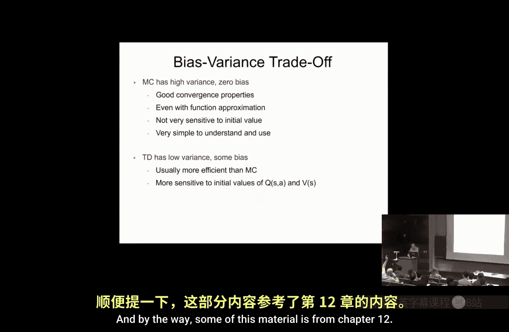
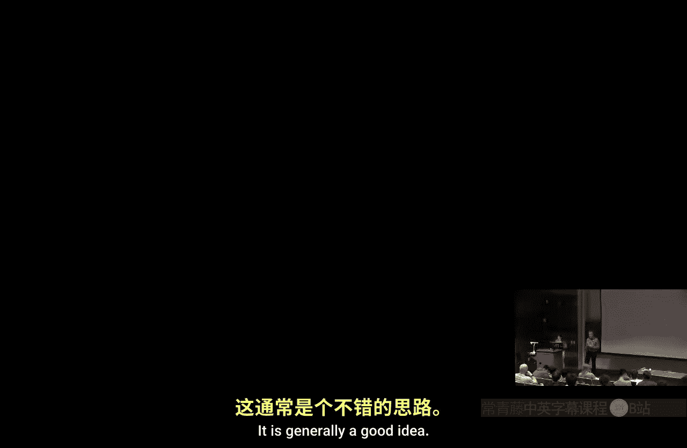
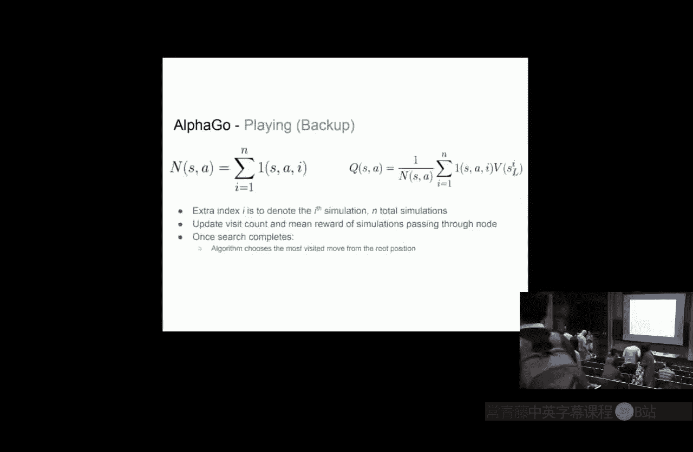

# 卡耐基梅隆大学【中英⚡深度强化学习与控制｜10-703 Fall 2018, Deep Reinforcement Learning and Control】 p06 P6 06 Temporal Difference Method -BV1RyqPBbEJV_p6-

Okay， well， good to see you。嗯。You look very dry。Today， we're going have a。Sreo lecture。

 actually monoo， but sequential， so I'm going to speak for about 15 minutes and then turn it over to Kaarina。

 but I wanted to start today's lecture by finishing up one more topic that fit into the theme of the last several lectures because over the last several lectures。

 we've really been talking about different ways of evaluating a policy that is getting its value function or its Q function and different ways of learning。

😊，An optimal policy。And we talked about dynamic programming methods。For example。

 where we assume that the agent begins knowing。What we sometimes call。The action model that is。

 it knows， we assume in advance the probability distribution。

 given that it's in some state ST and take some action A。

Knows the probability distribution on what next state it will end up in and also what reward。

It expects to receive。And so given that， we made up。

 we saw that we could train a system to learn the value function for some particular。Pi policy， pi。

But it's effectively doing a one step look ahead， right。If it's in state ST， it can apply that。

Knowledge that it has to estimate the probability of being at each of the possible successor states and the rewards that it would receive。

 And then it can get the expected value of that。And by this recurrence relation。

It knows that the value in state ST is the simple function of the immediate reward it receives when it takes in action plus the discount factor gamma at times the value。

 then it'll get when it's in the next state is the expected value of that。

 and so this equation is simply writing out that expected value。And the expected value again。

 is taken over both。Pi， which might be an nondeterministic policy。

And P of S Prime and R given state in action， which。

Covers the possibility that the world itself might be non deterterministic and the reward。

Also could be non deterministic。Okay， so that was the one approach we talked about。

 and it's based on the assumption that the agent really does know this P of S prime art。

The transition function， sometimes they call it T。The other main approach we talked about was Monte Carlo's sampling。

Where instead of training the function based on that that equation we saw in the previous slide。

 Instead， we assume the agent can just。Sample the world itself。

Take actions in the world and perceive the rewards it receives and the next states that it's in。

 And in this way， it can by wandering through the world， if it's in。

A world with some terminal states that absorb it。Then it can simply gain the empirical experience of what sequences of rewards it does receive。

And in that way。We use GT to mean the。Sequence of discounted future rewards received when we started in state S T。

And so we saw there were some Monte Carlo methods that we could use too。

Empirically estimate by sampling the world。What those stick counter words would be。And so the。

 the topic I want to talk about today is actually halfway between these two ideas。So。嗯。

There's a family of methods called temporal difference learning methods。

And the idea is we can use this kind of an equation。That is， if we want to have a target value。For。

What the value is in some state T。We can say， well。

 one way to calculate it we saw in the two slides before， two ways to calculate it。

 A third way to calculate it is to actually take one step in the environment。Observe the reward。

 R T plus1。And then now that we're in the next state， S T plus one。

We can apply our value function estimate that we already have to this new state。And therefore。

 we can estimate that V of S T should actually， and one way to estimate it is it's R T plus 1 plus gamma times the value of this successor state。

So you see， when I say it's halfway between the two methods we talked about。

 it shares with the Monte Carlo method the idea that we're actually going to take a step in the world and just experience the reward。

 observe whether it's。What value it is？But then we're going to rely just like dynamic programming does。

On our current estimate， even though it might be incorrect。

 our current estimate of the value function V。Applied to a successor state。

And so the red part is really our estimate of。What。V of S T should be。Okay。

 so that's the idea of temporal difference。 It's very straightforward。

 You see why I wanted to cover it while we still still had dynamic programming and Monte Carlo methods fresh in our mind。

😊，And so here's another way of saying it。嗯。Suppose we want to evaluate some policy pie。Then the idea。

 again， of Monte Carlo method。Is that。We want to change our old estimate of what the value of state S was to be closer to what we observe。

G， T， the actual observed sequence of discounted future rewards going forward。

 And this equation is just， remember when we talked about。If you want to take the mean as many。

Sampled GTs。There is an incremental way of computing the mean that depends on。

The mean for the first K -1 example。 then when you get a new example， you can just update it。

And so that's what this formula really is。So it's just saying we want to update our。

Former estimated B of S T to B。It's old self plus some less than one for action of contribution from the new example。

And， of course， if the new example gives us a discount of future reward。

 which is exactly what our old estimate of V of S T was， then we were right。 And so there's no。嗯。

There's no difference between what we predicted when were in V， when we were in S T。

 what we predicted the future reward would be and what we observed。 And so there will be no change。

 no update that willll make to that function。Okay， so now we can think this way about temporal difference learning。

 It's the same idea， except we're going to use a different estimate。Of what。

V of STT really should have been。Now we're using， as we saw on the previous slide。

A one step in the real world。Observedatoryboard plus gamma times our discount。 or sorry。

 our discount factor， gamma times。Our current value function B estimate applied to the successor state。

Okay， so you can think of it as just。The same idea。 But we're using now。

 instead of a sequence of steps in the world to get GFT， we're using one step in the world。Plus。

 our estimated V。Okay， so if you think about that， you realize not only can we apply it to estimating the value function。

 but we can do the same thing for the Q function。And I should have left this slide this part blank and asked you what to fill in here。

 Because by now， you should know， you should be able to just think， oh， of course。

The relationship between。The value function and the Q function is just that。呃。Q takes an action。

 And so。If we're in some state T， taking action T。And we end up in state T plus 1。Then。

The target estimate of what this Q value should have been。

Is simply the observatory reward that we experience when we take that step。

 plus the discount times V。But V is just the maximum over all the actions we could perform of Q。Okay。

 so we can write this and apply this idea of temporal difference。

Both To value function and ourQ function。And once you start thinking that way。

 you realize a very general idea。 We could actually。

Come up with a third idea related to this instead of taking one step in the world and then using our current estimate of Q。

Or B。To， to update。Value function。 we could take two steps。And we would get two observed rewards。

 And now we'd want to target， which is what。Then the target would be R of T plus1。

And then for the second step， we'd want to add in gamma times RF T plus 2。

 we're going to observe both of those。And then we'd want to add in what？Right。

 plus gamma squared times the max over a ofq of S of t plus 2。So once you get this idea。

 you realize that we actually can。Do this several steps ahead。 Let me do it this way。

 And so I could estimate it。Just taking one step in the world or two or three。Or。As many as you like。

And in fact， at the extreme。Down here below the dots。It's really Monte Carlo sampling。

 what we were calling Monte Carlo sampling。You could just take all the steps until we get absorbed into the target state。

Terminal state。And now we don't have to use Q at all。 We just。

Take the experience some of discounted future reports。

 So now you can see this all sits in some kind of continuum of methods。

And it's very nice to think of it that way。 because， again。

 if you think what we're really learning in this course is a toolbox of techniques and ideas for designing a good algorithm for the application you have in mind。

 Now you realize theres this whole continuum of ways of doing this。😊，In fact。

 theres a beautiful idea called TD Lambda。Standing for temporal difference lambda。

Which blends these all together， all of these different estimates。

So what we could do is we could use any one of these estimates for what the target value really should be。

 or we could take an average of them。And the idea of TD lambmbda is precisely to take that kind of average。

And here's what it looks like。嗯。So imagine we have， we start in state T。

 We take a sequence of actions。 We end up in some absorbing terminal state。

And we get rewards along the way。Then you can think of after the first step。嗯。Over here。It's。

We could use that estimate， corresponding to the first step。Or we could do two step。 Look ahead。

And use that second estimate or three step， look ahead。Or。

All the steps till we hit the terminal state， look ahead。And we can blend these。

 And in the idea of TD Lambda is that we do take a weighted average of these。

But the weights are as shown here。 We pick lambda， which is some number between 0 and  one。

And we take  one minus lambda times the target estimate we would get from the one step。 Look ahead。

And weight times the two step。 Look ahead， target value， etc cea。And then as this caption shows。

 notice this is from Cha 12。嗯。If we choose gamut to be zero， then what do we have here？

If we choose gamma to be0， terms， all these weights are0。而。We're going to define that to be 0。 Yeah。

0 to anything is still 0。 Okay， all these weights will be 0。

 and we'll just be doing one step Look ahead。And if we choose gamut to be one。

Then all of these weights will be zero and we'll be doing Monte Carlo sampling。

So this covers the two extremes and then intermediate values of lambda。Will give us different blends。

That depending on the choice。If we choose that value to be close to one。

 then these early estimates won't be used very much and we'll be weighting more heavily the later ones。

 And if we choose lambmbda to be close to 0。Then we'll be putting more emphasis on the early estimates。

Andless on'm later。Okay， so that's the idea。Of temporal difference learning and TD Lambdas is just really elegant。

 I think， framework。For blending all these different types of estimates。 And also。

 there's a nice incremental way of doing this so you can kind of keep track。As you go。

Multiplying by lambda again along the way and so forth。Now， let me ask you， here's。

 if you really understand this， then here's the question you should be able to answer。嗯。

What's the advantage？What's the argument in favor of choosing。Lambda close to 0。

 And what's the argument in favor of choosing。Lambda close to one。

Or when would you want to do one or the other？So think of this way。 What's the， what's the。

Sdadest thing about Monte Carlo。嗯。Methods。That we talked about。 So we the pure Monte Carlo method。

 we take a trajectory， sample it in the world all the way to the goal state， to the terminal state。

And so the saddest part of that is we're gonna to do that many times。

And if we do it only a few times， we're going to have a very high variance estimate。Because。Really。

 the expected discounted reward from this state， especially if we're in a probabilistic world with a probabilistic policy。

In many different possible paths we could take and we have to sample them all and get statistically significant。

Numbers of those get a good estimate。So。The downside of picking lambda close to one。嗯。Is that it。

 it basically makes us do Monte Carlo sampling。 We have high variances。

 We have to do a lot of roaming around in the world to get good estimates。On the other hand。

If we already have a pretty good estimate of V or Q。Then instead of roaming in the world。

 we can use these one step lookheads。And basically。

 what we're doing with the short ones is we're relying。Proportionally， more on。

Our belief that even though our value function is currently imperfect， it's pretty good。

If we do a one step look ahead， well， we'll get a better estimate with that value function。

And so if we believe in our value function， then it's fine to do。Just one step。 Look ahead。

Because that value function is going to summarize the expectation over many。

 many different trajectories that we a much more efficient way of。

Taking advantage of the information we have。 On the other hand。

 if we're just starting out and we have。A completely random made up value function。

Then the risk of doing this is we might be。Just taking a step ahead and then applying our completely wrong value function to estimate some completely wrong target value for updating the value function。

So basically， the argument is。If you， if you think your value function is decent。

 then short look heads is good。If you don't， then the safe thing to do is many。

Full Monte Carlo samples。 That's just kind of a rule of thumb y。这个我。In terms of。Maybe some。Under。

Yeah， that's a good point。 So like， we've talked about reward functions that are very sparse。

 like gameplay reward。 where at the end of the game， you find out win or lose。

 And then we've had other reward functions like -1 for every single transition。

 So they're dense reward functions。😊，嗯。I don't know what I like your question if you didn't hear the question it was。

How does the density of the reward or the character， the reward function？Influence this choice。

 I don't know the answer。比个爱思。It's a good question。Make very good homework because I make a good。

Allright， so let me just end。By the way， those， those gammas， if you actually sum up all those terms。

 they really do sum to one。 So you're making a。weighted combination of these estimates where you are waitinging them in a way that you get a reasonable estimate。

 And here's kind of a summary what we just discussed。That the nice thing about Monte Carlo。

 which is if you have lambda equals。One， thank you。 is that it will converge。

 And it's also an unbiased estimate。嗯。But it can be high variance estimate， whereas if we do。

 T any temporal difference kind of learning。It's usually in practice more efficient than Monte Carlo because we have to roam around the world as much。

 but it is more sensitive to the initial values， the initial estimates of those functions。Okay。

 so that's what I wanted to say。 Let me invite Kaarina to take it from here。And by the way， the。

Some of this material is from chapterpter 12。 there's a chapter called temporal Di。TD Lada， yes。我。

Yes， I think that's a great idea， the suggestion is given what we said about why we might want lambmbda close to zero or1。

 wouldn't it be wise to begin with Lambda close to one？

So we're not putting much trust in the value of function。 But then as the system starts learning。

 maybe change the value of lambda to a smaller。Smaller and smaller number。

 and people have done that sort of thing。 and it is generally a good idea。

Okay， Kaarina。Okay， so this lecture is more for us to get acquainted with some definitions。

And I think the title is a little bit an overstatement of what it willll do because the problem is that we're still in Tular methods and modelnda learning is hard to really convey in Tular methods。

 I'm going to show why。Meaning that there is going to be in about five lectures for now， another。

 you know。Lecture or model based reinforcement learning with functional approximations， where again。

 we're going to have this similar title， How do we combine learning and planning。

 but not in tabular methods， but with volume of approximation。So， the definitions。

How learning and planning are different so you tell me now what you think learning if you look in Google is defined as the acquisition of knowledge or skills through experience。

 experience here probably they mean experience with a world。

 as opposed let say to play a video game right， study or by being taught by being taught means imitation。

Planning， on the other hand， is defined in our Saturn andbarto book as any computational process that uses a model to create or to improve a policy。

And somehow planning is not categorized as learning which means that when I stop interacting with the world and I go in front of my desk and whatever model knowledge I use it to enroll and enroll and enroll and know try to improve through enrolling my value functions。

This is characterized as planning and not as learning right， so I would say that many people would。

 let's say， disagree with this distinction， but as soon as we you know we are all consistent。

 that's okay。 So whenever we use a model to help us choose actions to help us improve a policy。

 we will pull this planning or model based reinforcement learning。

 the book uses both terms it interchangeably okay。Is that clear because there were a lot of questions about planning and what it is or what it's not？

Okay， so some examples of planning so far。Where have we used the model to try to improve a policy？

Yes。Right， all all our dynamic programming goals， right value policy they all used if you remember this transition function。

 which by the way， this transition function has two symbols。

 One is the row in the book and one is capital T and capital T only considers a state transition and we have a separate R for the reward or the expected reward while the book has also the reward into the transition。

 but that's okay。 we have already seen this value policy sounds good。

 Now what other examples from the， let's say introduction lecture we have seen that that used the model to improve a policy。

Well， first of all， Tom even mentioned his homework， right， where he was using a look ahead search。

 What Titi Gamon was using a two step look ahead search。 Alphago was using a Monte Carlo research。

 chess。Is using a search， heuristic search， any type of search。

 any type of classical search where you are in a state and you try to look ahead what you should do is a planning method。

 okay。Okay， great。 So now it's super good。And here are some examples here I'm reminding you the backup diagrams right that we're using for valueeration。

 policy iteration。Now， why we are trying to study this learning and planning together， all right？啊。

So， first of all， I have put some examples here。 What do we learn， We learn directly value functions。

 What is value functions， What I better do right now in the state， as well as the model。

 You can also learn the model from experience。 This is also part of learning and planning， well。

 we've seen so far， computing value function。 So we'll use this verb compute。

The reason why we try to put together。Model free learning and planning is that even rats do it。

 Even rats have reactive behaviors， but also to， you know， navigate in a maze。

 There is special learning。 They try to remember landmarks。 Okay。

 And so next time they do better for。 they try to extrapolate from the previous experiences。😊，So。

What exactly we're going to see in this lecture。 Well， three things， the first。Is， oh。

 if the model is unknown， we'll learn the model。The problem is that this is a little bit good to be underwhelming because learning in a tab our methods simply means counting。

 we're just going to be counting transitions， okay we're not going to be able to generalize beyond our past experience and this creates some problems and we'll see。

The second is okay， great， what we've seen already。

 we're going to try to learn or compute value functions both from real experience with the methods that we've seen。

 as well as using the model， okay。😮，And I think this is an interesting unification that the book tries to say that everybody model and model they all try to they all try to compute value functions at the end of the day and to schedule backups of those value functions and the all thing we care about in this course is what this exact form or your backup update and how deep is your backup update。

 how shallow this Lambda is controlling the depth there right as well as in which part of the state space do you put your effort to do your updates。

 that's it is the whole course is about this。So there is here this earth。 this is the real world。

 and this is a fake earth。 This is the model that you think。

 right that you create by interacting with the world。

 And it is in the bubble because it's in your head。Okay， I'm just explaining the diagram now。

The last thing we're going to see in this lecture， which is I would say also the most concrete thing。

Is how do we combine learning and planning at decision time。

Which means I don't try to improve a general policy。But rather。

 when I'm playing with an appointment or I'm in the apartment， I'm about to act。

 I think I had to just select the next action for this particular state， for this particular state。

This means I focus my planning and learning for the states that I visit online at test time right this is very different than just you know offline you go and you visit every little state and you update the value functions now you only care about the value function of the state right now。

 how should I move my opinion on how should the agent moving the video game etc and will' motivate why this thing is very important and in fact the most real worldord examples in this lecture are going to be in the third bullet simply because in Tar methods it's not real real we just try to develop toolbox still okay？

And the reason that the brain here has this is because there is time pressure。

You need to think ahead fast because you need to act， okay。Okay。

So what is a model many times we've seen what is a model。

 anything that the agent can use to predict how the environment will respond to its own actions is the state transition capitalta and the reward function all right and the state transition includes both the state of the environment outside of the agent as well as the agent himself。

 what I'm going to do where is going to be my hand。

 but also where's going to be the object with which I'm interacting okay。

And we're going to talk about how to use oracle models like this one， ground truth。

 as well as models that we learn from data。And one distinction is that we have two types of models。

 one is called distribution model。 This is what we have used in the dynamic programming。

 right last week。That they list all the possible transitions and the corresponding probabilities。

And on the other hand， the sample model， it doesn't list this you know。These functions。 but rather。

 just samples provides to you the next state。 and this state is drawn according to probabilityability。

And you can think， for example， that in black Jack。

Or let's say when you roll the dice it's much easier。

 to create a program that will roll the dice and give you a result as opposed to sit down and compute all possible probabilities。

 right so。The other thing to think is that if I have a distribution model。

I can always mimic the sample model， right， I have everything laid down。 I have the problems。

 I can just sample， al right。嗯。So here is a diagram。嗯。The agent is interacting with the world。

 these experiences。And from this experience。😊，Essentially， we learn a model。

The model is used to simulate experience， F experience that you run in your head。

Then our real methods will take this experience doubleples and try to predict the value function。

Alright。😊，Planning methods will use directly the model。 That's say dynamic program， right。

 We'll use this parametric form of the model to compute a value function。 And at the end of the day。

 the value function will be translated in the policy， right， that's what we care about。And so far。

 this model free reinforcement learning has followed that path。

 We didn't go at all through model learning。And planning。Will both involve sampling from the model。

 as well as using the model to， you know， directly plant value functions。Okay。

 so the advantages of planning， as opposed to just model free learning。

 is that it exploits the experience。Its better exploit the experience。

 If we just get a particular task， a lot of tables will just return zero reward。

 we will be able to update nothing in our value functions， right， so theres just wasted experience。

 but if you bookke a model， then potentially those transitions can be used also for a different task okay so if you know how the word works you can use it for multiple different tasks。

 while model3， unfortunately it just for one particular let's say go。嗯。Now， let me tell you。

 these first chapters are classic chapters。 we will see in later lectures that a lot。

 a lot of methods have tried to mingle that two things together。 For example。

 a lot of latest model of free methods instead of considering one goal。

 they put also the goal as conditioning for the policy。 Okay so this brings and again。

 they don't waste experience， right， because they say I want to reach there。 but I reach there。

 They say okay， let me keep this as a successful experience for this alternative goal。

 Okay and save it in my value function。 So then nothing is wasted。 So at the end of the day。

 we should think about not about terminology， but rather about。Who exploits the experience better。

 which gives us the best result， because those definitions and you will see actually huge contradictions in two3 slides。

 I would say are a little bit obsolete。Okay。But yes， that's the classic thing。

 that model explores the experience because gradients can you can update the model at every little step。

 no matter whether you get rewarded or not。All right， model learning。 So what is the model learning？

We just need to know for each state an action where you end up。In later lectures。

 we will explore parametricic forms of such model learning， but this lecture it's on tabular methods。

And we're going to focus on the left。 And you know what in in Tr methods， learning is just about。

Counting how many times you saw this state action next state transition。

And that's exactly what you see here。As sumation。呃。We have hats now。 Okay， Thai hat are hot Why。

 because these are not oracical models。 They are things that is their estimates。

 They empiricalillic are estimates from your experience appleples， okay。嗯。And and that's it。

 And they have， I mean， the books are just two different ways。

 One way is you can count and have these nice capital TR functions。

 The other is just save the experience， just book keep everything and just sample from this okay。

 experience with replacement。😊，So here's the problem。

 Just bookkeing the experience is essentially a memorization。

Atmo where you've been through don't try to squeeze out any rule of how things might happen in a different state。

 because right now， each state is a different。 how to say square in your table。

 a different row in your table。 There is nothing that can be shared across states。

 That's why these definitions look a little bit。You know。

 not as powerful theres going to be in later lectures。

And here is my specific problem that I have with this definition。 I mean。

 current deep Q learning also has an experience buffer also doesn't throw away the experience。

 all the experience saved in the buffer， you sample from the buffer and you put and do you know your you know Q learning updates。

 right？ So this is considered a model free method。 but according to the definitions in this chapter is a model based method。

呃。I think the reason is that because in Tular methods。

 you just let's say you just memorized if you go in the real world。

 such memorization is essentially zero， is super， super weak。

So if you really want to talk about model in the real world。

 you really need to train the parametricic form and try to， you know。

 generalize from your past experience。 once you don do this and you give up on a generalization。

 you know， you're called model free。 So do you see how things change depending on the context。

 So that's why I just don't want you to stress out about about this。

 There are some interesting things in this lecture on which we need to stress out and understand and very useful。

 But I wouldn't worry too much about the definitions。Here is an accounting example。

 here is the experience。😊，Do we have two states。And。This is my experience from A。

 I get a zero reward and then I go to state B and I go0 again and then from B， I have1 and one and1。

 but then from B， I have0。 So if you just sum up， you have that my transition function。

 100% I go from a to B。 and here my transition function。

 70% with 5% of the time I end up in this reward and 75% of the time I get the zero reward。That's it。

 You just count。Allright， so once you count， what can you do， Well。

 you can go back in your backup diagrams now you have some T hat and our hat。

 you plug them in into value policy iteration and you just carry out dynamic programming that we discussed in the previous lecture。

 Allright， very simple。Here is a。Now， what is the problem with this， The problem， obviously。

 is curse with dimension of dimensionality。 I mean， the state space。

 even in a single sweep of the state space， will not be in the practical problems will probably take you more than you know。

100 years。Okay。嗯。So what do we do？Well， we do prioritize sweeping。 and this。

 we already talked about when we talk about dynamic program。

 dynamicy program is not tied to you know， exploring one state at a time。

 We have a synchronous dynamic programming where you do the updates whenever you like in whatever order you like。

 Now， of course， to prove convergence， you need to visit every state。

 infinite amount of ties in the limit。 But if you you know。

 you don't care about that in practical terms， you can just schedule your updates。You know。

 the best way you think is， you know， the best way you think。 And the whole point is。

 how do we distribute our updates， We have a huge state space。Many of those states。

Are completely irrelevant。 Many of those states in go， for example， you will never end up there。

 Probably either your opponent would have beat you before each there or you have been the opponent before each there。

 Why would you go through this and start updating the value functions of those states。 I mean。

 it's a huge part of the state page， which is useless。And you don't want to， to， to spend time there。

Okay， so the question is， how do we find the good states。All right。

This is the approximation we're pursuing。So what do you think we should do？Well。

We can sample states according to our policy， our policy visits some parts of the state。

 Okay so instead of just going go every little state and update。

 which probably is going to end up zero initial value，0 the result of the update。

 you just sample more and more from your own experience。

 okay and try to propagate out of your own experience。And。This is called sample base plan。 Allright。

 and do not get a。Let's say confused。 The same thing can be done。Once you have real T T N and R N。

 there is not empirical estimates， but write real transition functions and reward functions。

So what happens you sample， and then you just you just， you know， apply your model 3 equations。

 What is Monte cargo control， You just go to the end of the episode。

 Look at the just average of the full returns of the you know， the full simulation of the episode。

 Okay， no backup here。 We have SARSa， a Q learning， the Q learning you。

So sometimes like 15 minutes ago， SARSa， I'm not sure if Tom talked about this。

 but you will find the same in the same chapter on the book。 Basically。

 instead of taking maximization， it just looks at the cu of the next state that you end up， alright。

Allright， great。 So now what is the most beautiful approximation instead of by visiting every state。

 I'm going focus my resources on the states that I actually visit with my current policy。 Okay。

 I mean， this is， I would say obvious。😊，And。Okay， so here we are。 We created the model。

 and now by Monte Carlo learning， we can compute the value functions of the different states， okay。😊。

Okay， so we have two sources of experience。 One is the real experience when the agent interacts with the world and the other is simulated experience。

 The first algorithm was proposed to put the two things together was called DnaQ。😊。

Given the current state of the world， you act in the world。

 you execute the action based on your current policy， you look at the resulting reward in state。

You use this doubleple to update in a model free way your Q value function，😡。

Along with the value function though， you will update your model。

And then you stop interacting with the world。 and this is the thinking loop。

 You just n times randomly sample from your model。ok。

The model state and action from your past experience。

 you ask the model where I'm going to end up with and what is going to be a reward。

 And then you apply this Q in particular， this you know， Q learning rule。

 but you can also put other other adaptations， for example， SARS， allright。

And I would say that this is very similar happens in， you know， in At games， right， on the， the。

 on the paper that showed that you can use deep Q learning to to learn to play at games。 Again。

 there was an experience buffer。 and you would think you would not just。😊，You know。

 interact with the world， you think you replay your experience your head and back up your backups here。

 somehow it's sold as a model based method， all right in this tabler setup。

And we have the three sections。Directctor reinforcement learning in that tael。

 This is a real experience taple。This is a model learning part。

 and here is thinking what is called planning， why planning。

 because you are not learning from experience anymore。

 you learn from the model and whenever we use the model to obtain value functions we call this planning in the book。

 all right。😡，Nothing special here。Yes。And why。失な。じやな。社我意是。Right， to stabilize the network， right。

 I agree， so the motivation is different， but still。So you're absolutely right。

 but the thing is the following right now that we're in D our methods。

Even if this is one state and this is the next state and they are super identical。 Still。

 there are different rows in your table。 And this state and this state。

 which is completely different。 Still， there are two different rows in your table。

 So we don't right now， at this stage， the correlation between the states doesn't really create a problem。

Because we're just counting and these counts are independent。 Does this make sense？

Everything is independent。 Yes， everything is independent。Arrive。Well。

 I would say the function approximation closer to this would be tip learning。 Do you agree with this。

Right， So in that case， yes， we have this experience replay because if you just collect experience with the world。

 consecutive samples are extremely similar， right， So if you put those in a batch and you take gradients。

 your gradients are going to throw your model probably very， very， They're going to be very。

 very skewed， right， and they throw your model fires。

So what you're saying is what is now the gain of DynnaQ versus you know standard Model free method。

 I this what you're asking， okay， yes， exactly， let's see it。Here is。

 So here is the initial start state， and here is the goal。 Allright。

 And imagine that I just start walking in the maze and I have one complete episode。😊，And then。

So according to this diagram， all right， if you do zero planning steps like zero thinking， all right。

 you just take your experienced apples and you do your backups the Q backups。

 okay then somehow you have this type of curve。All right。

So steps per episode we want you ask your steps per episode because this' is an episodeic capacity we want to end up in the goal basically So the lower we are the faster wes from the state to the goal。

 Does this make sense。 So' is good here。 As you see without any thinking。

 you don't exploit your experience well and in fact， look what picture they showed they say， oh。

 if I go to goal state and I have every reward of0 there right And then I go and do a sweep。

With dynamic programming along my trajectory， then the only state which could be updated will be the one right before the goal。

 right。However。You have to say。If you update every state and in the right order。

 you will have a much denser， let's say。I am much， much better， you know。嗯。And much much better。

Image rather than this one。 So the order in which you update or you apply your Q updates on your real experience matters quite a bit of how you exploit the experience。

 makes sense。 So here D a queue has this particular form of scheduling the updates。

Throws everything into one。Big bucket。 and then samples uniformly from the bucket。 Okay。

 that's what it it does。 And the more， you know， thinking steps you have。

 the more you sample from the buffer and the more you are able to， you know。

 push backups around and have much more informed value functions without wasting any immoial experience makes sense。

😊，And。Yes， however， and it's in fact exercise 8。1 in the book。

 the question is if instead of using the super， let's say wasteful Q backups from real experience so that you just have the next state。

 let's say having an informative value function， you could do something smarter al right。

 like schedule the update in a smart way， etc ceter。

 how much better you'll be able to do and would you ever be doing as well as Dna queue and this is gonna to be one of the homework exercises okay。

Now， let's focus on these two lines。We have a big bucket of our oral experience。

 and we sample randomly。 Why should we sample randomly All right， there is no， I mean。

 this looks wasteful。 And I mean， here is the state right next to the goal。

 If you apply a backup on that state， you will see a change。 Here is a state far away from the goal。

 if you right now apply a backup0 is going to end up to  zero。

 Why should you randomly sample those states and do backups。

 Let's just do some let's keep a priority queue。 I think we see exactly the same priorityitized sweeping in the。

Two lectures ago。 Let's give a priority cube of which state is more useful。 okay。

 to update and then look back。 So you need to have some extra data structures to remember which state and up to which state look back which state end upon that state that was updated so that we propagate the backups backward from the goal towards our starting position。

 Allright， so again， extremely extreme sense。 and it was actually proposed by Andrew Moore and Chris Atkin。

Both these people are still right now in CMU， okay。So what is different here？This。

 this capital P here is what is the change on the。Q so this is the target Q value and this is the initial Q value just keep it there so you have a priority in the states。

 So if this value is higher than what you have right now， that you put this guy first okay。

 put this particular state then when you are thinking instead of sampling randomly from the bucket of experience sample from the Q so you always take the first state from the Q allright。

啊。You ask the model where I'm going to end up。 You apply your Q update。😡，Okay， and then。

For all the previous data actions that we're going to lead to this guy that you just updated。

You know， estimate。啊。Estimate their P。And then insert them with this particular priority。

 So this is the priority of each state。 Okay， so every state is inserted with a particular priority。

Which is how much its Q value just got updated from the last backup if it was updated tiny bit。

 then this means that if you use the previous states and to propagate you're not going to have huge changes。

 if the queue was updated quite a bit， then this means that if you propagate from there backwards you're going to have huge change and you better prioritize that Q update。

😡，Very， very obvious， right？Okay， great。 so yes， as expected。

Prioritize sweeping instead of random sampling from your bucket of experience。Will be able to。

 you know， go faster to the optimal solution。So now we come to the most， let's say。

 real part of the lecture， which is online plan。Planning to help own an action selection online rather than just trying to improve our general policy。

 okay。And here I put the new completely new arrow。This is we are in particular state test and I'm going to plan ahead just to pick the next action。

 And you know what， I may even throw away all the result of my planning and then when I go to the new state and I'm about to you know pick a new action。

 I may just again plan from scratch。So why this is a good idea， why is it important to do such。

 let's say online planning， that's the most important thing to understand why we cannot just have a good enough estimate of the action value function。

 What is the action value function in this state， What are the different values of different action so that I' am able to pick the best one。

 Okay why I need to look ahead in the first place， does this make sense。

 so let's try to understand this first。😡，So we said that this course is all about updates。

 okay value function updates where we are planning which states and you know how deep they are and this particular algorithm says。

 you know what I'm going to apply the update on this particular state I mean I don't care about the rest of the state space。

 I'm going to focus my resources on this particular state。

 that I mean right now and I'm going to build a search tree and we all know what is a search tree。

 where in a state I'm querying the model in this section where I'm going to end up in which state。

 what the work to take and。And stuff like this。 Now， if your reward is at the very end。

 then the reward is only going to appear at the end of the episode。 That's fine。

So what the For search says is instead of learning how to act in the whole world。

 just learn how to act in your particular case。And this is important， because。

The world has a huge number of states， for example。

 some versions of go have 10 to the 170 number of states just has 10 to the 48。 It's probably okay。

 I mean， let alone table most of those states you will never even visit a training time right so you are now at the new state and sure you can have some estimate but there is a big chance that you didn't even visit that particular state at training time so you want to do better。

You can have some initial estimates of action value functions。

 The question is how can you do better than your initial estimates by you know looking ahead and this is a perfect example of combining learning right。

 you have some initial estimates of action value functions and planning let me look ahead to improve those right So this let me say to one more this particular setup of trying to improve action value functions online is a very sweet so far empirically know as the experiment very sweet spot of combining learning and planning okay。

Hello。The problem is the following。 so far， this has been demonstrated with ground roof oracle models。

 not with learn models。 however， it is an active area of research。 How can you learn your dynamics。

And still， at this time you're bound to move your grip or whatever。

 how can you enroll with those learn dynamics and choose actions you know in a smart way。

 but yeah in the later lectures， we may be able to see some results of this but right now，😡。

What I'm going to discuss assumes that the model is known to the agent perfectly and is very。

 very accurate。😡，Okay， so simulation based search， given a current state。

 a simulate experience forward， so it's very similar to the previous simulated experience， right。

 we talked about sampling from the model， the only difference is now all the samples will start from this state that we're in。

Okay케。And you go down， and then you compute value functions usually the simulated episodes。

 And what is the simplest form。Of doing this。Well， Monte Carlo， just sum。

 just sum all the returns for all the case simulations。 All right。

 and this is going to be the Q of your initial state， S。

So what do we do in this simplest form of the search。

Given a particular state that you are in right now， let's call it S。

 I'm just going to run K episodes till the end。I'm going to see， you know see the returns that I get。

 and then I'm just going to average those and assign this as the Q of my you know the different action value functions for each action。

 I need to do many simulations all right to have let's say accurate estimates and then I will pick the action that give me the highest action value function。

Right， is this clear this super simple。Online search。Yes。

We're usingsing this search that library needs to。Yes。

 so what you're saying is that this particular search doesn't use any learning， right？Very nice。 Yes。

 absolutely。 So we'll see in a little bit。 this kappa have a lot of variance in this I mean。

 you need to probably have enormous amounts of simulations for this to be accurate estimates， right？

 I mean， you like them because they are centered at least they are rooted to your current state and this is great。

 But still， if your game has 700 moves and each the depth to 700 and each of the branching password is huge。

 right？ I mean， how many simulations do you have the time to run。 probably few。

 So whatever you have learned from before， a training time。 because at training time。

 you don't need you're not in stress。 you don't have time commitments。

 you can just keep playing and playing and playing。😊，With an imaginary opponent， right。

 So you can have some idea about this particular state。 Okay， some value， some value action。

 It's just at least if you combine this together， you're gonna probably do better。 right now。

 there is no combination here， by the way， right， This is just planning。

 You just stay there and unroll experience in just some。 That's it very simple， yes。也不你了。ててた。你接过全。

Right， right。 So so this I would say even。Yes， your returns are very suboptimalhuh。😊，Oh。Exactly。

 that's an excellent idea。 So we'll see that you don't want to， because your colleague says。

How I'm going to get that simulate experience， Who's going to tell me what actions to to use？ I mean。

 one thing you can do is random， completely random。 You don't forget about simulation policy。

 just random。 You just throw out， roll out， roll out。 Okay。

 so this probably are going to be very different that what you're going to see in the actual game where your opponent is you know。

 doesn't play randomly， okay。Now， so in that case， you have a problem。 Now。

 in the case where you have。A policy。 And you say， oh， I'm going to sample based on this policy。

 then you can only be as good as this policy。 Does thist make sense。

 So what happens is that you have also what we say， exploration bonuses。 So for every state。

 you have some prior。And so you combine， basically， you don't just try your exploration policy。

So basically， you have also some exploration bonus that you say， you know what， Yes， I have a bias。

 but I also like to explore my actual space。 Does this make sense。

And the other thing is that your simulation policy may have been good but maybe have never been able to see this particular state and what the consequences come for me。

 et cetera， so you don't just trust one policy right you have one policy and supposedly by look ahead。

 you should do better than initial policy that you have。The simplest form of search。

 just use a random policy to do the simulations。Actually here， yes， so yes。

 so for if you're actually set small， you can just try for every action。

 just do an exhaustive enumeration till you know whenever you run out of time you stop。

 you truncate and then you just compute the mean returns from there。Okay， great。

 And then you select the the action that gave you the maximum Q。Now， yes。Instead of backwards。

To do what backward， why would you do backward， Because as you keep proing out。

 it is not necessary that you end up。I would just keep。Adding up episodes。

 it is not necessarily that you have an optimal policy rate。if you do a backward。

It is likely that youll end up at somewhere close to a start。

So let me tell you maybe you can say one more time。

 but we were playing that were in this particular state。

 And I care what I'm going do next to defeat you， right， So I'm just going check what if I do this。

 What if I do this， What if I do this。 And yes， you can have a simulation policy。

 But the simulation policy， What is going do if you take the art max is gonna give you an action。

 Well， I'm going use that simulation policy to sample different actions and you know。

 explore multiple you know， type of branches from this from this policy。 Allright， And then you know。

 unfold my episode， see which one is better and just you know， pick。

How do you decide which one is better， Well， this is the first slide。

 I'm going to have multiple slides later。 But in this super simple slide。

 you just unroll androll androll。See if you won or not， just this is the mean return。

 The mean return is the general form because you may have rewards intermediate in intermediate thats。

 it doesn't need to be only a all state that get a reward。 So we call it mean return instead of just。

 did you win or lose the game。 Now， if it's indeed a game， You're playing。

 this mean return is essentially only if you， you know， did you win or did you lose in the game。

 And that's it， You just sum， you average。You average across your simulations。

 And then what do you do， You pick the action that gives you the highest Q。Does this make sense。

But backwards what what if my opponent had not done this。

 he did it now I considering that I have to that this is my goal this is my goal state I can do a backward search and see can Oh I say well probably is's going to explode right there's no way you're going to end up in in your initial state right but we get to know that but what goal state how do you know in which goal state you're going to end up there there are tons of goal states in gold。

就7だ名。Right。tan of。G locations， right？I think I know what you're saying you are trying to say something like curriculum and maybe if I'm on the goal and then go backwards。

 etc ceter for manipulation， for example， when I know there is one goal position and then I can move backwards right。

 we can see those things later in the course this doesn't say anything about this is just for search and by the way I think I have a better answer for your colleague that okay I have a simulation policy。

 why this is going to do better because the simulation policy， what are you going to do。

 take the arc maxs right here you're going to sample。

 you're not going to pick the best you can pick the top 10% So if your simulation policy is not completely crappy that top 10%。

 top 20%。Are are going to be better than just random sampling and still are going be better than picking the a maxs。

 Does this make sense。But we can see this search as a policy improvement。 You have a policy。

 and through look ahead。You have a new policy， and this is an improvement over the initial policy that you had of opening the branches。

 Let's say， and simulating forward， okay。So， here is now the big idea that comes with Monte Carlo research。

In the previous slide， we only had to bookkeep a queue。

For which state the state I mean and in which I'm trying。To choose an action。Now。

 I'm not only going keep。An action value function for my current state。

 But the other through a set of states that in my current tree， Okay， we have a tree。

 and then we have beyond tree rollouts。And why we want to do that。

 Because we believe that in this way， by estimating the cues of also intermediate nodes。

 we will be able to do even better。 Okay， because both theircus are also going to be improved using this you know。

 online focusing of the resources， all right。😡，And then we're going to back up those q values and you know。

 choose again the the action in the in my current state。So basically， now that he informed cues。

 what does this mean。Before we were just using a fixed policy。

 the initial what we call simulation policy。 Now within the three， because I have those updated cues。

 my policy of unfolding that that tree improves through search。 Does this make sense。

 So not only my final action selection will improve from my current state。

 but also the way I unfold and I look ahead will improve the more look ahead I do。

Does this make sense。So I will explore。Even better， the more I， the more I explore。

 I explore to explore better。😊，So that's see。 It' is not very simple， actually。

 So we have now two policies。1 is the default policy， Okay， which does not improve。 And O。

 here I wrote pick actions randomly。 You can also， it doesn't need be randomly。

 It doesn't be so dumb。 It can be some。Policy， which is what cheap to evaluate。 That's all you need。

 because we need to query that policy so many times。 this make sense。

 So you want something cheap there。 And then you have the tree policy。

 which pick such just to maximize those cues。 Okay， so as you are in the states in the tree。

 you are gonna pick branches based on those queues and those queues are updating all the way。

 Allright。That's it， evaluate a state by Monte carlon evaluation， What does this mean？Returns。

 mean returns， that's it。So as you look ahead， some states， you see， oh。

 I think winning is towards that direction of the tree。 Let me stop now unfolding this way。

 While before you would just blindly unfold all of them。 Take the returns and choose an action。

 Now you're gonna say， oh， I'm going expand more this way。 Oh， now it seems this way。

 Now it look like this way。 Does this make sense。 So you guide your exploration because within your tree。

 you keep track of how good the states are。 Allright。Okay， so we have go here。

 let's not go through again the same， but basically you are in a particular state and you want to do simulations。

 you see what happens in the yes。不。If you要。No， no， you don't， This is in the lead。

 this theoretical result。So these convergence come in the same convergence results as what we have in dynamic programming that every state needs in the limit to be visited many。

 many times right so the same thing here， you have the RQ values which we update。

 you have hereQ values which we update so you have the same convergence guarantee that you know what at the limit。

 you're going to have a great tree policy， a great exploration policy。OhYes， this is not in practice。

 There is nothing in practice。You're right。So here， we all understand so far what's happening， right。

 What do we do， We just。Sample， so whatever we said earlier is just a random policy outside the tree。

 And then you learn a policy based on Q。 So far， we discussed a very very。

 very basic version of Monte carlo research， which is what you start from random policy。

 you opening branches as you open branches and you look at the returns， Who wins who doesn't win。

 you back up few values of the intermediate notes in this way， in at least inside the tree。

 you can improve instead of random sampling of actions。 So so you have this tree policy。

 which improves outside of the tree like what is means of the tree。

 each time you know you pick a new state， you expand it， then you roll out。 once you roll out again。

 you go default policy， random random selection of actions。 Now the question is， this is just。

Planning， right， This is just。We combine learning。 Okay， with this。 How can we have some priors。

On those。So basically what we said till far， once I reach this particular S， I don't have any prior。

 I have essentially a uniform prior。 Everything will be computed through these simulations。

 both the queues， the tree policy then you queuees everything is as if I've never played that game before okay so another question is I played that game before。

 but you know the states were so huge， So still I want to look ahead now because you know in this state potential have never been exactly。

 I have some estimate， but maybe I'll do it better by just look ahead and unfold folding。 okay。

So these are the two ideas。The first idea。Is the following？

Along with those Q estimates that you keep building， okay， based on the mean returns。

 you're also going to have a prior。This is the exploration that we talked before in the standard exploration schemes。

 you just have a P there， okay， this is the prior。The more you visit。

The more you visit that particular state， the more this bonus goes down because you say you know what I visited this state before。

 now I know the cube because like for my actual experience， before I visit that state yes。

 I do want to encourage exploration， but the more the more I visit that state and action。

 you know I'm going to trust more the Q part unless the Q part okay。Now。

 this prior P before was kind of not very informative。 And right now we say， you know what。

 I'm going to use s pi sigma to have a good prior list of my actions。All right。

So in the simple multi carural research， you go into planning without having any good prior speed。

 they're essentially uniform of all your actions。😡，And in。Alpha go， okay。

 the previous version node goes0。 you go while you have already a neural network that tells you which actions are kind of better than others。

To buy us。Your search， Does this make sense to buy your opening of the branches？

So that's the first idea。 Is that the idea clear？Yes。有谁呢？Alright， so at each state。

 you need to evaluate which actions to explore。 Alright， which actions to sample。Here we say。

That potentially， not all actions should be sampled uniformly in the beginning。 I mean。

 you know that later， yes， you're going to have your cues and you're going to do better。

 But in the very beginning， Imagine in very beginning， you go the state。In the simple course。

 you would just randomly start querying actions here。

 we're saying that instead of just starting from random， start from this p sigma。

 which you know I have trained before， how did you train it Well， I don't know。

 I got some expert and train it with supervised learning I just have something better than random Allright。

 now I'm not saying all the time you pick the a maxs。

 then what look ahead you're doing you need to explore right， Of course。

 if you take thes of the policy， you do nothing。 you're not improving the policy。

 the whole point is that you will explore also the suboptimal things that your p sigma would not have picked right。

Is that clear now or okay， great？This， again， is very simple。 Instead of just completely random。

 just use a very lightweight network for all out， something very cheap and fast。

 Remember that these are all online。 and the time is clock is clicking。

 and you need to give an answer。 Okay， and of course。

 we forgot to say it's obvious that different simulations can be run in different。 in parallel。

 but still， we're talking about huge number of simulations。 So。😊，This is also important。

And the last thing is how do you evaluate， how do you compute those cues， All right。

 before we said that you just look at the outcome。 So I'm state。And， you know。

 things are coming out of my state。 and they have some outcomes。 in some cases， you know。

 the black screen that I care about。 I want the black Sw。 And in some cases， they lose。

 And I'm just going to average those to assign my IQ。 Well， no。

 this is not the best thing you can do because。It's you're going to combine this。 This is the Z。

 The final outcome with a learned。V function。Estimated， okay， during your training time。

which will have much， much lower variance， all right？So a combination of the two。 Now。

 you're going to say， you know what， there are a lot of threshold code here。 There is this lambda。

 and then there is potentially some additive things there。 Yes。

 you optimize over those hyperparmeter as well， alright。And that's it pretty much。Here。

 utilizing expert moves is going to give you this the two policies， the chip and the。You know。

 kind of more expensive one。啊。And then using selfplay， your compute value function， essentially。

This a training time， essentially you run， run， run a lot of games and you try to say， okay。

 from this board position that many times I won that many times I lose， so this is my value function。

And the value function， of course， depends on which policy you use to do the rollouts。

 and here well use the supervised learning policy。 And again。

 this is from the previous version of0 of alpha right。

 this is the previous version of the program that。Wong go。

So you go into Monte Carlo research having these two neural networks。

 one that evaluates actions and is train in a supervised way and other that evaluates board positions and it's evaluate again。

 using standard regression by just tons and tons and tons of selfplay where the selfplay what was the policy that was used by you and by your opponent。

 it was the same policy。 this supervised learning this one that was trained from expert moves。

 and by the way， in the first lecture， I I said a mistake。 during this look ahead search。

 you and your opponent I assumed to use the same let's say best policy。 not oh。

 I'm going take the worst out of the。 you don't have the time to take the worst out of your opponent it assumes that both。

Whites and black use exactly the same policy。Great， so actually， we have two minutes。 but this is。

 we have said a lot of things already。Four steps of Monte Carros research selection。Which brunch？

Expansion。Let me sample different alternatives， evaluation。

 sample go simulate till the end to see your if you want or not。

 and then back up based on your results of your simulations， go and update the Q value functions。

 Okay of all the node inside your tree。Okay， so this。

This we see this before this how we choose the actions， the U is proportional to this prior。

 the more we visit the state and action， the less U is valued and the more Q is valued and we said that the P here is this neural network that is strain from expert moves。

 okay。So this is what it is processed by the SL supervised network R S and stored as prior probabilities。

So how do you pick the child， Well， you pick the one child that has the highest prior probability。

 okay？Now the evaluation again， instead of just looking at the final outcomes thatele was this game one or not。

 you just have this weighted of between that， yes， the outcome and also what it is this value given by the neural network that has been given to evaluate board positions。

 all right？😡，And this is the backup。 exactly what we said。 So instead of just。

You have a sumation of those evaluations is that we just have outcome。

 You have this way more informed evaluations。 Does this make sense。 I think， you know。

 things have changed in the next version of going。 we'll see in later lectures。

 But I think this is very kind of。Helpful into understanding how we can combine planning like a fo of research with learning。

 having a prior of which actions to check how to change these priors as you gather more and more。

 look ahead experience for this particular state you're in and knowledge about your higher estimation which you can use along with your outcome from the simulation。

We may have a tiny little homework for you guys to。

Actually run something like this since it is I mean it is a very active area of research I think the fact that Alphago did so well has inspired a lot of robotics research also looking into this which robotics researchers the classical one is just planning and planning and planning and you don't save any experience from one plan to the next and here we say how can you combine experience with your online search all right so。

If people have questions， you to raise and hands and I ask the questions now。Yes。

The outcome of the simulation。Yes。No， it's not going to be。

 you just have a better estimate of that simulation， you can use it also for pruning the branches。

 but also you can use it for having better， more informative Qs within the states of your current tree。

 the tree that you're expanding， right？Otherwise， it's going to be very high variance， right。

 You could just。Right what you're saying is that do I always need to go at the end of the game or I can also prun in earlier and look at those values。

 Yes， you can do that。Yes。

