# 卡耐基梅隆大学【中英⚡深度强化学习与控制｜10-703 Fall 2018, Deep Reinforcement Learning and Control】 p07 P7 07 Neural Networks Architectures for RL -BV1RyqPBbEJV_p7-

So why we need to bother about neural networks in the first place， so far we'll be discussing Tr。

Proular methods represent each state as a separate row on a table， what is the problem。

 the problem that there are too many states， Go has1 to the 170 for big boards， Baghammo has1 to 20。

 the real world has a huge， enormous continuous state space。Not only we cannot visit every state。

Not only it is， but even if we visit some of them， we cannot learn anything about others。

 extremely similar states exactly because we represent them are discreteet completely disjoint entities If you represent your state as on the table。

 this means that every state is very different than everyone else and all states are equally different than。

Disimilar。And we know this is not the case states cluster right。

 so we want to explore such clustering and although we visit some states。

 we'll be able to generalize our knowledge to states that we haven't seen。

So we're going to use function approximation。So this means that instead of saving a state as their on a table。

 we're going to fit the representation of the state， as we see here， S to a fact approximation。

 which is going to fit out as output either the state value function or the state action value function。

And why this is a good idea because such mapping function can exploit similarity between different representations of S T。

 this state and this state are very similar， this state and this state may be disim and this is going to be captured by this mapping function okay we can train this mapping function theta to represent such similarity of the states okay。

For example， imagine you have an agent that wants to navigate in the world wants to go， for example。

 to the door。 The color of the carpet of the room is irrelevant。 Okay。

 so even if I'm representing here with a completely new carpet， okay， I should still be able to。

 you know， walk around perfectly well and such you know function approximation should allow me to do that if。

Every， you know state of the room would be different row of the table each time you change the carpet。

 you say， oh， I don't know anything now， I really need to explore again。 Does This make sense。

 So this。Ming functions needs to learn what's important and what's not important and to ideally ignore what's not important。

 And in this way， bring the similar states close by and share information across， okay。

Why else we care about such mapping functions because so far in the course we'll be talking about states and states and states。

 and in fact， the book will always be talking about states。

 but the truth is that harder problem is how do you get to that state representation。

 how do you go from your own sensory input， visual auditory tactile to your state representation？

And I think this is exactly the exciting part that you can use mapping functions or neural network architectures to distill knowledge from your sensory input to the state to you know。

 your action value functions or policies， action， probability of your actions。😊，Is this clear？

 And this is often known as end to end reinforcement learning。 Okay。

 because it doesn't require an engineer to take。The sensory input and distill it into some Han design。

 S T state representation。 Rather， we learn all the way from sensory input to map to our value functions and policies。

And we'll get to this point soon again。 Does this make sense。Yes， you。

You can learn to squeeze so much information from your input， right。

 like sequence of inputs so that the state inside the neural network is still Markov， right。嗯哼。Yes。

あなにかってるべき。对。Alright， so you will see in a little bit in a few slides。

 we will learn them mapping from observations to， let's say action values。 Okay。

 so the state is encountered in the different layers of the neural network。😊。

Well'll take a layer and say， okay， here is my latent state。Okay。Yes。

 they captured the state of the world， and they captured that state of the world in the best possible way。

 For example， they can learn here that these tiny little combinationminations of how the the light is reflected around is super unimportant for the task that I care about。

 which is who is paying attention or who and who is not paying attention。😊。

We will see concrete examples。 and this are going to become very obvious soon。Now let me say。

 first of all， that of course， as you go from S to OT OT。

 you can imagine being know long videos right that the robot sees the navigation agent takes as input and needs to decide what needs to do next so this is huge。

 very high dimensional while VST potential because it's kind design it would have been like okay this is the free space and object at the 30 comma 30 another object 20 comma 20 much much more succinct representation so to learn all this might were way。

 way more data and this poses a very big challenge。

 but there was ways to get around this challenge and this is an active area research and we'll see solutions this year that we didn't have last year for example。

Yes。ややってる。Alright， so we say we have a company， and theres a perception team。

 We'll take the observation， make a state， and there will be the R team。

 We'll take the state and make the action value function。 Is this what you're saying。😊。

I wouldn't say so。 you will see in a little bit。 I would say we have a deep net。

 and we have the final goal， which is what our agent to navigate you safely around the world。

And then you say， oh my God， how I'm going to train all this hugenet， so many layers。

 so many parameters， and then you go to your perception team and say。

 guys do you have any auxiliary task I can put on my network like do you have some。

 let's say object detection label data， maybe I can pretrain it on or I can put some intermediate devices。

 We have some image classification that will sure no problem but also have some fancy and supervised tasks that I can do for you to pretrain your features and then you'll take their features and you'll see that you're able to learn much。

 much faster。Okay。Arr right。But yes， so， so we'll see exactly this。 We will see this type of。 I mean。

 I'm not sure we'll see it today， but we'll see it soon， yes。Yes。Sa don more done。在分。

To give you an example where this works。 Okay， for example， let's say we want to learn to drive。

 okay。Very simple。 We have asing simulation and you know we can play quite a bit there millions of simulations right so we will learn to drive in simulation very well。

 The problem is that the simulation visuals are very different than the real world visuals。

 correct So once you go to deploy the policy that you're learning in simulation is going to kind of break。

 So what are you going to do you go to your perception team and say guys。

 you know let's pretendtrain the first 20 layers with labeling where the road is and where the pavement is and where the objects are and then let's take the output in terms of labels and train the policy on top of this let's say symbolic input why we call it symbolic because instead of looking at pixels。

 you will see at label maps， you will see the road you will see the pavement you will see the object okay。

And then you'll train a position on top of this， let's say， semantic label input， you guys。

 And you train this policy。 And now you， your detectors are going to fare well on the real world because we have a very big data sets。

 In fact， the self drivingriv companies。Capture continuously huge dataset sets of how to map pixels to where the road is where the objects are the cars。

 etc cetera。 And you'll take this level input and train your policy on top of that。 makes sense。

 And this you will see that transfers very well。 Same for navigation。

 You train your navigation agent inside the simulation environment。

 And we have fantastic simulation environments now because people have have gone around and scan many homes。

 interiors， etc cetera。 And。The visuals look not super realistic， okay。

 but you'll train your navigation policy， not from pixels， but rather from semantic labels。

 where's the table， where is the chair， where's the free space。

And then because those detectors transfer， people have put a lot of effort on collecting data sets in the real world where they label chairs and tables and free space。

 et ceter， the policy that you turn on top of this labeled depot will transfer。

We can see concrete examples of these two later in the course。But these are all great questions。

This means we care a lot about， you know， succeeding in the real world。

There are a lot of types of function approximators， and we'll consider。In this lecture。

 neural networks for the reasons will discuss。What is a neural network。

 and neural network is an arrangement here of neurons。

 Every neuron is a small function computation essentially has a small linear part and a non nonlinear part。

 and you know these functions are and are arranged。

 the reason that are called deep because we have a lot of function composition。

 the output of one function enters the other function and the output of the second function enters the third function right so we have compositions。

😊，And so that's number one， which is why it's important。

 And we know that this similar type of compositionality exists。In the virtual cortex。

 at least according to the neuroscientists。But the other interesting thing is that all of those functions are trained in a different of the way and to end。

 You have your loss at the top layer network or you can also have losses and intermediate layers。

 Okay， and the errors that you compute back propagate just using the change rule。So。

AndI must say that the requirement is that all those functions are differentiable。

 You can put differentiable functions there。 And there is， let's say。

 tools that would allow you using sampling to back propagate through them， but。

At least so far from what I know。Is not that effective in the sense that you cannot easily escape from。

Lo mini using such a sampling type of methods。 But we will see maybe later in the lectures I'm gonna do again search what happened the last six months and maybe something breakthrough has happened in that domain。

 But so far， we'll ask that these are all differentiable functions from the beginning to the end。

All right。What do you see here， A cat。 This is very important。 You see when this neuron fires， okay。

 gets excited， has high activation。 And then you aggregate the input images cause it to fire。

 and you see a cut。 and they say， okay， my neural network has learned to recognize cats and has learned to recognize faces。

 etcter。 And we know that the human brain also has designed theirs to recognize this and to recognize。

 let's say。😊，Important things that you see every day。Yes。SoSure， we do not。

 But there are ton of papers that say， you know what， what I'm going see if this no。

 I don't think this is a great way to understand that thiss a cat neuron， but they say。

 what I'm gonna see， I'm gonna look the excitation of this neuron。

 and I'm going to aggregate the inputs like the images that cause this neuron to get excited very high。

 The other people say， oh， I'm going propag gradient and see where is the heatm， where this output。

 you know， is really localized on the and the input。 And some of them work really well。 In fact。

 you know， you can train your network only for classification actually。😊。

Why don't we wait till we get there despite the fact that you're trained only for classification。

 you can take its output and really see you know in which part of the image really the network thinks that this label sits。

essentiallyly， you're arguing that it's。the mapping of state。 So if you said before that like。

Nothing that deep net or that neuraler limit can represent some state。Well， Well。

 that's what this shows。 Yes， this。Is true。For particular， let's say how to say templates。

 usually exactly the reason that this is not easy to distill in that form is because。

What the power of neural representations comes from the fact that they're distributed。

 a set of nodes together jointly holds。The concept of a cut， right。

 And this is where their power comes from。 And we'll see this very concretely in like 7 slides now。

 okay。That's why it doesn't make a lot of sense to take a neuron and say， okay。

 where does does neuro get excited。 Well， maybe this neuron wants also its company to get excited together。

 Does this make sense， Yes， but there are other techniques。

 beautifulut techniques that go from the output layer and you know， try to localize the。😊。

Which part of the input if I change it causes the maximum change in the output。

 and I think potentially these are better ways to kind of see which part of the image really holds the label。

 we can have a small this lecture is not about， you know interpretability and of the neural activations。

 but we can have you know a small type of section in a later lecture about this。Very quickly。

 because I think most people know this is one neuron。 and these are the input to this neuron。

And we have one wig。 This is one scholar， right， And this is a bias， again， one scholar。

And we have this multiplication that we see。 So this is the linear part of the activation。

 and its output is good。 We are going to call it pre activation。Now。

The result of these linear part is I get one scholar and will enter in this nonlinear function。 Okay。

 there are many different types of nonlinear function you can choose from raillu and H， sigma。

 etctera。 And the output of the nonlinear function， we will call it output activation。

 And why you need nonlinear functions you just stack linear functions。

 If you compose linear functions again with the day you only have a linear function。

 So you do need to add nonlinearities in there。 okay。😊，啊。Let's see a beautiful diagram。Here。

 imagine that you have only two inputs， two numbers， all right， extremely small input。

 it's a two dimensional input。And we have this then two weights， W and W2 and one bias。

 And this is how is the output of the activation of the neuron and the bias controls where this reef comes from。

And the activation here。E。啊。The sigmoid activation that squishes the output between。0ero and one。嗯。

Yes， it so always suppose the but strictly grazing。 The reason that。In the beginning。

 we thought that beginning here is difficult。 It's because exactly the squeeze。

 That's why later people。Oh， rail is really a key。 But the thing is that other optimization tricks came。

So then now， even soid are totally okay to optimize。 So do you see So this all the time changes。

 what is easy， what is hard。This is not important。 Here is another beautiful， only reality。

 if you go beyond。啊。I mean， it depends on the bias will put you wherever it wants。

 But if you go beyond some point， there is zero， nothing fires。 And then before that。

 we have a linear activation。Okay。Now， the important thing to understand is that here is one number。

And this。Uni takes input from all those numbers。 Okay。

 and there is one way to multiply each one of those numbers。 And we will use this type of notation。

 W I J K， the weight from neuron9 to neuro J in layer K。All right， very simple。That's it。

 So this a metrics， While this B is what。呃。For every neuron is a scholar。

 for the whole area is one vector。Very it simple。Right， do you guys agree。

 So now I just talkeded before we talked about every neuron。 Imagine now I have a layer。

 I have many neurons together。 I'm going to represent the activations using this equation。 Now。

 one f is a vector of the activations of all the neurons of that layer。Over that layer。

 I would say this is layer 2， because this is B1 W1 here。Makes sense。Exactly。

 so that's it not to get confused with what is a scholar and what is a vector and what is a matrix。

 That's all we need to to make sure here that。Is it clear what is a color， what's the vector。

 what's a matrix？Okay。That's it。 So then we go on， we go on。

 and at the end here is the what we call the pre activationivation of the top layer that that' our foul output activation function。

 All right， whatever output so the important thing and the one bag that' happens all the time is that the top layer。

 you push it both through the you know kind of volume react and from the output function。

 usually you need to just take the linear the linear output and fit that with your output function。😊。

Okay， so here we have multiple layers。 Here we have only one hidden layer here we have multiple ones。

 and things go in the in the right in the normal， the way you understand it。

 the output of the first fits in the input of the second and the output of the second fits the input on the。

Next one， and of course many of you will know that you know what skip connections are also very useful and they're used everywhere。

 which means that you can feed you know layer 1 to layer5 if you want or to layer 7 etcter。

 right and I mean this is what a little bit more standard picture but right now every layer can fit to every other layer allright。

I think the neural you're going to use will be。You know， standard architecture。

Why we care about depth？Well。Here is the output of one。Neuron， as we saw， all right。If so then here。

 he thises it。You have to hidden neurons。 once you combine them again for one more layer。

 you have this very complex， you know， Partitioning of the space。

 So in some part of the x1 co X2 space， you have low and another part high， and then again， low。

 right， And the more layers you put， the more complex can be this function。

 So that's why you can say arbitrarily， it can arbitrarily well， you know。

 approximate any function that you want。 So the first layer have this very simple partitioning。

 And as you go all layer， you have this super complicated partitioning， right。😊，Very beautiful。嗯。Now。

 if you have enough， hit the layers。Just how many people layers you need？

You can partition the space arbitrarily well。 Now， the problem is that you need an exponential number。

Of of hidden layers for a single hidden units in a single layer to do such partitioning。

 That's why they say in practice， despite that the theory tells you， you just need one layer。

In practice， you need depth， right， because otherwise， you need too many。Too many units to do that。

 And the theory doesn't tell us how many， but it's just enough。 Okay， so that's number one。

 The second problem is that。The optimization with this single layer。

 which is just simple gradientding descent or， you know。

 gradientding descent with momentum or some other simple rule， will。

 may never get you to the right solution。 So depth is important in practice to， to get to， you know。

 complex approximations。Yes， that sounds so much like。Over 5 one。Absolutely， yes， and this is super。

 super， super important。 If you put a deep net， you can always fit your data perfectly。

 except if you have a bag like you didn't standard as your input or something is very complicated with enough capacity。

You should always overfit on your training set。 So then what you're saying is。

 how do I know that I generalize？You， you will。 you， you will。 And if you don't。

 you just add more capacity in the U will over。 Does this make sense， All right， so。

What we hear here is not to overfit to our training， although to be honest。

 they say if you overfit on the visual world， you know computer vision is done。

 you just need to overfit to whatever's around。 you know what I mean， is' not that complex。

 what's around。 So if you have that data and youfit this is good In any case。

 we will always have train and test and well always have domain shift between train and test and we'll discuss right now why you need regularization。

 Why regularization is very， very important Allright and now you're going to say why don't we just make the neural network smaller。

 let me this is going to appear in next lecture in next slides okay。So for now， we say， okay。

 we have a deep net， and it is huge， and we can overfit very well。And how we're going to train， Well。

 we'll put our favorite loss function。 Let's say image classification。

And we always need the regularization and what people use as regularization。😊。

The norm of the weight should be small。 That's the simplest thing that you can do， okay。And in fact。

 the regularization is always by default。 I don't know if you。

 there are fantastic deep learning packages out there。 The default is， there is the regular。

 You don't need to even think about it。 Is there as soon as we instant the layer。

 Does thist make sense。😊，Great， so if we want to classify want to minimize classification error。

 If we want to decrease， we will want to minimize the regression error。

 which means Euclidean distance between your predictions and the ground roof。All right。

And how will they gras？Well， if you have a very， very big training set。Ideally。

 you want to go through all your training examples， compute their gradients， average and take a step。

 This is impossible， right， because you have a very， very big training set。

 So what happens in practice that you do what we say is spastic gradients。 you grab on example。

 compute the gradient， take a step。As you understand。

 this gradient computed from one example is way more noisy than the gradient computed from many examples。

 Do you guys agree。Let alone if the examples that you fit in there are generated by an engine you know sequentially acting with the world that are extremely correlated。

 like if I start interacting here。All the example will concern this area。

 I will never concern the area in the back of the room。 So now we take gradient。Okay。

 based on these very correlated examples， you probably set the network in a very bad situation。

 Very bad。 That's why experienced reported buffers are very important。 They say。

 you know what gather your samples， but don't fit them directly to learn from them。

 Just put them in a bucket。 Let them mingle with all your know recent experience。

 and then randomly pick from the bucket， take gradients。 So does this make sense。

Also in practice we don't take gradients based on one example， we take a mini batch。

 Min batch is one small set of examples， you compute gradients than you average， alright。

 if the GPU memory is your bottleneck and you cannot have a big batch a big mini batch。

 what do you do， you increase momentum or what we say you accumulate gradients all right。

 although people have said that you know what if let me see， do we show the momentum here。嗯。Well。

 so the momentum essentially adds the gradients from previous steps。 So you have memory。

 You don't just take gradient based on your current mini batch， but also from previous mini batchs。

 Allright， the other thing that you can explicitly code up in your deep learning package is that I'll push one mini batch。

 but don't take a gradient， just compute it and then I'll push another and another and another。

 and after I push， let's say 20 mini batchges， then take a gradient。

 So then still the training is gonna be slow， but at least your gradients are not going to be noisy。

 Allright。嗯。Now， the beauty of coding this detection nowadays is that you have this tiny little blocks。

The teacher computes the output with respect to the input。

And you fire them one by one in your computational graph。 So now all your architecture or your。

Neural architectures and computational graph where the signal flows from top to bottom in the forward pass and the arrow flows from bottom to top in the forward pass and the arrow flows from top to bottom in the backward pass and oftentimes the gradients are even code up in these little functions and building blocks that you're going to be using and the only thing you need to worry about is that if gradients of blocks that you choose essentially cancel each other or do not interact well and you know if you combine to blocks together and you simplify potential the computation。

 the gradients are going to be much easier to flow but in practice the blocks that we're going to be using they are not going to have such problem。

Yes， this exactly says that we take the gradient and this is the momentum term that remembers gradients from your previous set of the optimization T the times that T essentially runs during the mini batches and essentially orders。

 the mini batches and numbers of the times you take gradients。Okay。

 so this is the most important thing how do we guarantee that we generalize how do we regularize beyond asking for small weight norm Well an obvious thing is you have a validation step validation set and you check when you start overfitting which means your validation error stops starts going up once you see that the validation error starts you stop so this scope early stopping early stopping is a form of regularization。

ok。Why we do not make the neural network small to prevent。Overfitting。Because it's going underfe。

Right。Because the theory tells us that you know what you really need big nets to make the situation of you getting stuck in a local minimum exponentially unprobable once you make the neural network small。

 you cannot really optimize so the idea is that make it big and as La Kun says regularize the hell out of it and how can you regularize you can comm your data and in fact this is the most how to say effective。

 it's a winning key。How do you augment your data？The simplest thing you can do。

 you have images you have labels instead of just fitting this particular image so that the network really memorizes where if every pixel is。

 just do some random crops， some random you know， shears of the image。 Okay。

 shear transformations and then 5 it team。 Allright， So one image now will you know generate。

 let's say 500 or000 different examples。And this is very， very， very， very， very effective。

So that augmentation is the key。 Actually， I'm going to show you in few slides。

 an object detector trained only from such data augments with only one true positive example。😊。

So just concept。Now。Since we understood。You know， neural networks。

 Let's go and check what happens with recurringcuran neural networks。

 Why we care about our neural networks。Because are agents， they don't just open their eyes， you know。

 act and then go back to sleep。 But rather they open their eyes， they act。

 then they see a new observation。 They act。 They see a new observation。 They see new observation。

 right， So there there are sequences of observation。 Okay。

 that you want to fit and you want to learn from。So the question is。

All these neural networks that we showed before， the input has a fixed size。

 Do you remember the input O。Hundred numbers or an image of， let's say， I mean。

 we're gonna see image soon， but they must save 50 by 50， for example， size。 Okay。

 how can you feed multiple images？ You can say， you know what， I'm gonna stack multiple images。

 I'm going stack for at the time。 Well， yes， but what if。

This time step is 4 next time the 5 and 6 and 7 and 8。 How can we take。

Input that have variable length。 Does this make sense？So Ri and architectures can take such input。

Why here is your input at time step T -1。 Here is your input at time11。

 Here is your input time T plus1。 Okay at each time step， you go， you compute something。

And then you spit out your route if you want to have up， probably what action you should take。Now。

 in the next size step， you're going to have this input and you're going to have also this state of the previous time step。

 the hidden state， you fit both in， you predict again。 Now the state has changed。

You take the next input with this change state， field， but we predict again so on and so forth。

 and the interesting thing is that the number of parameters does not grow linear in time， why。

 because the same wave matrix is being used at every time step。Okay。

 so there is weight sharing in time for those architectures， and the important thing again。

 is not to mix what is a vector， what's color and what's a matrix。If you have a layer of。

 let's say four neurons。Yourur takes input from all neurons of the previous layer。

オー it's not like oh this should that yourド all inputs fit to。Every year here， does this make sense？

All right， so。

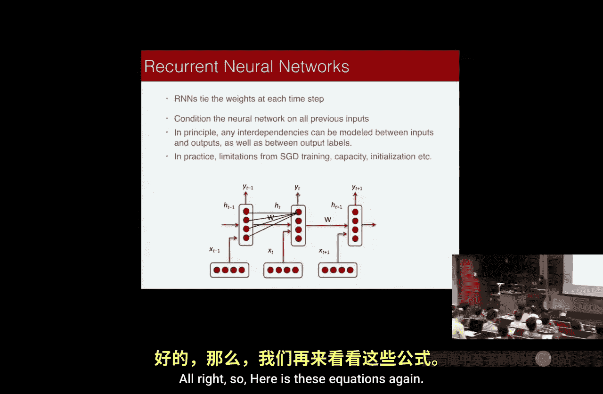

Here is these equations， again。HD。Is our hidden state。 What is our hidden state。 Let's say a vector。

 a long vector。 Okay， it can also be if you want a grid。 if you have convolutional SDs， it's a grid。

 it can be 3D， whatever you want it can be。 Let's assume it's a vector。 Alright， it takes you see W。

 it's a matrix。 So every。You know， component of that say has been computed by taking multiplications with every component of the previous state。

 Allright， and I mean， okay， we're not showing here the bias。 that is not important。

 The important thing is to remember that we have multiplication both with input and the previous state。

 extremely simple。 Okay， the basic current and equation。Extremely simple。 And here is a softm。

 we'll see in one second， the details behind the softm。So you may see that in practice。

 instead of this simple RN equation。Other equations are used that are call long short term memory。

Or G use， okay。They are a bit more complicated。 The updated wayss are complicated why。

 because they have designated gates。1 gate should take care of whether every point of the hidden state should be affected or not is should I forget it or not。

 Should I reset it or not， And in practice， it's much easier to control whether you should update or not the hidden state through those gates。

 as opposed to through this。You know， matters multiplications， okay。So first， you decide。

 should I touch the state and once you decide you can touch the state， then you go and manipulate。

 once the gate allows you。 Okay， it's very difficult with this very generic matrix multiplication equation。

 All right， this not multiplication。 let's say， assignment to say this particular part of the state。

 Please do not touch it。 It's extremely difficult。 Okay。

 that's why you will put all these gates and we make like this control unit。

 essentially you learn when to touch and what to touch， etc。

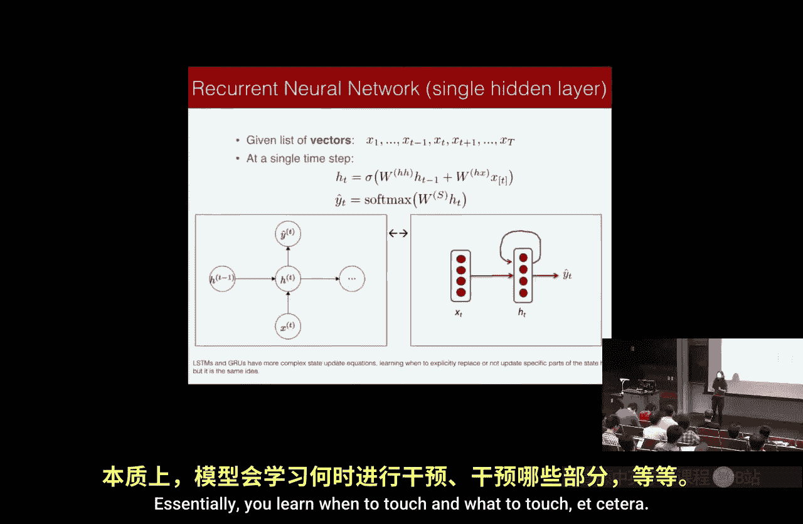

And not that complicated。 Here is one use， imagine。We have a neural network to do what。Slam。

 it wants to estimate the camera pose。 And by the way， the way it goes。

 like since neural came out from 2013， I remember， you know， they broke the image。 I mean。

 let's discuss about this story later。 but isn't this beautiful。 Now。

 we have a neural network that can predict your camera change。

 You don't need handdesign manual slam architectures。 We can just learn everything in trend。

And you fit the frame。 You fit first in the CNN。Interestingly。

 the CNN will come later in the lecture， but then it fits in the R andN fully connected and then S3 is S3。

 the transformation， the relative transformation， What is the rotation and what is the translation of the camera with respect to the previous frame Does this make sense and then you put your loss because hopefully we will have some supervised set to train。

This relative camera motion prediction。 And then you more propagate。 And you know what。

 even if you don't have such a supervised training set。

 there are ways that you can train unsupervised similar to， let's say， s type of losses。

 But this is not important for now。 The important thing is to say that you have a video you want to estimate。

Commer。Post change in every frame。 What are you going to do， You will use a recurring neural network。

 why， because your input changes every time。And now you may say， why should I user re your network。

 Why don't you just take two frames， fit them in a CNN and predict the camera pose change。

 And then again， two frames fit them in a CNN and predict the camera pose change。

Can somebody answer this question， Why would we model this problem of predicting the camera pose change from one frame to the next with the re neural network that has CNN has a apart as opposed to just using。

 you know， from the CNN， forget about RN and go all the way and predict。

 you know the transformation and particular loss。Yes。

 you take into account also which was in your previous frame the camera pose right and implicitly it allows you to smooth in time。

 let's say there is a more uncertainty in this frame than you may trust more of your previous frame。

ok。Yes。😊，谁。你下。给た一。你次。为晒音。こ small。That's a good question。

 And what I had done when I wanted to capture both actually it is even in the slides if you allow me to make progress。

呃。To， to capture small small temporal context， the easiest thing was to just concatenate those and feed them together in the CNN。

 So this CNN， by the way， this CNN takes two frames。 Okay， obviously， you need to frames。

 But what I'm trying to say is that。You potentially can take this four and fit them in a CNN。

 If it's fixed， you don't need to have an R。 If it's a fixed input。

 you just put some CNN makes sense。 Why would you， yeah。Which is exactly this， right。

 You may have a different weight。Yeah， when we use it our。Get any assumption。No， we， we are not。

We are not making such an assumption that the state can change arbitrarily much。

 and you can learn that this state changes a lot， okay。Mmhm。😊，So basically。

 these temporal smoothness that you're saying why would put temporal smoothness。 Well。

 maybe we learn that each time I do the next is， because I'm about to ya。

 You know what I'm trying to say， this is going to be captured by the LSTM。

It doesn't mean that if I'm going to do that， I need to stay like， you know， hip the same motion。 No。

 you， you just find motion patterns， right， So now I'm holding my arm and it's not gonna to be like this later。

 It's probably going be like this because maybe somebody does all the time， you know。

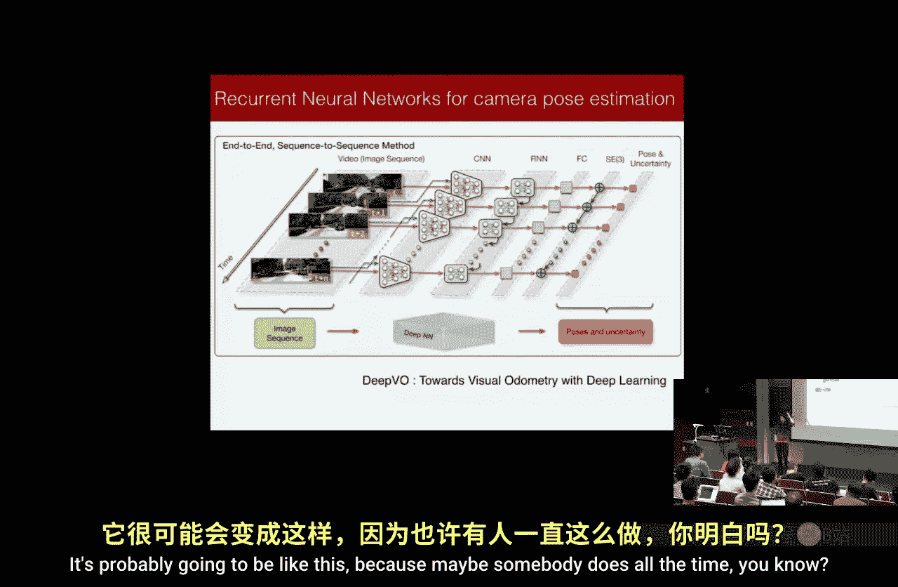

So， this is going to be captured。Here is another RN。Were going to take a video's input。

And we want to predict， let's say， some caption。 Okay， we predict some words。Well。

 I'm not exactly sure if this is what it is， but you take different frames。 Again。

 you fit first from a CNN because the gen image then goes to this fancier LSTM version。

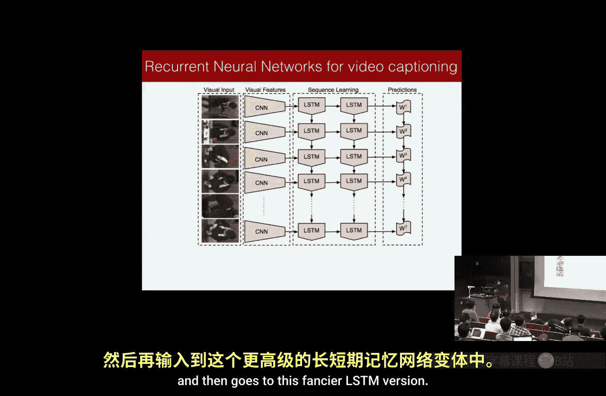

啊。A very important point。What do we mean when we say distributed representations and why we need to care about distributed representations。

 okay。Because it means that the state of the world is。Hed a。With all the neural。

 let's say units in one layer jointly， it's not that every little unit on its own represents a different state altogether will hold the cut and altogether will hold the grass and in area layers maybe altogether will hold that little edge or this other edge from another from another let's say orientation now what is distributed on earlier layers may become a single neuron in further layers up right but the important thing is that we jointly jointly the neurons you know will hold the state of the world and let's see this in practice。

If you want to do nearest neighbors， you need to have one prototype for every part of the state。

So depending on how much you want to part on your state space， you know。

 the number of parameters scales linearly。With a number of regions。Well。

 look at what's the situation here with the number of。

Units inside a single layer of a neural network in ideal case。 So just remember， it's an ideal case。

Here， you have one。Imagine that each of roads has an activation function。 You can。

 when you think of an activation function， you can always， is it activated or not。

 So you can think that this is just yes， no。 Is it tone or is it tough。

So depending on whether this neural unit answers yes or no， it partitions the input space into two。啊。

Subspace is correct。 Let's add the second。N run， second unit， hop。We partition again。 So now。

 although， we have only two。We have four different parts of our， our space space。

 And if we add one more。Hope。So many， right， this is beautiful。

 So this means that it's not a linear scale anymore， okay。So now that you've seen this。

Exponential in the number of parameters。And。So this result is very important， right。And now。

 based on these results， we're going to go and try to explain whyed neural networks are more powerful than HMMs。

 and we'll do exactly the same reasoning。N HM。How many states of the world can encode。

As many as the states needs graph representation， correct？And how many parameters it needs to have。

Well， there's a transition matrix， right， that sells you from this state。

 What's the probability to every other state。 So it's quadraing in a number of those states。

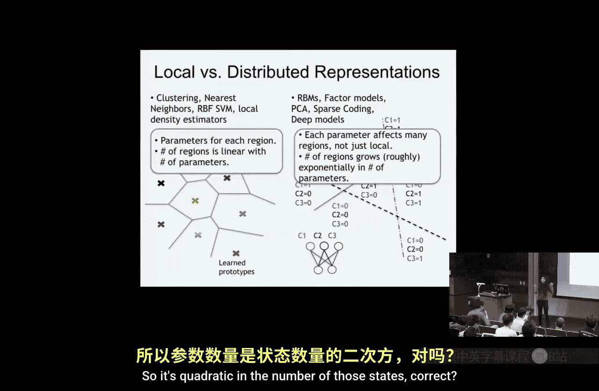

Correct。啊。However。Here is the state of the world。Is not one to one mapping between neural units and states of the world。

 right， We said that all this together。Hold what is one state。

 And imagine that each one of those takes two values， how many states you can encode here。

With four units。You have four units， each unit can take two values on or of based on the output of the activation function。

 how many states of the world you can encode。Alright，2，2， to the four， okay。Unbelievable， right。

 Isn't this beautiful。 So it's exponential。 The number of states your kind is exponential to the number of your hidden units。

 This is the magic。 Okay of distributed representations。 Now， you may say， sure， that's in practice。

 I have 100 units。 I can have two to 100 states。 in This is in ideal case in practice。

 because your optimization gradient descent。 you may not be able to discover all those and partition your space in this nice way。

 right， This too， for example， neural units。😊，Learn to co adapt。

 Co adapt means that if the one goes up， the other one also goes up。 I really don know on this。

 Does this make sense。 And there are tricks like dropout that essentially discourage the units from。

Quading makes sense。 They they ask them to。 we essentially manually switch on and off 50% of them at every training group。

 If you care about details and you don't know them， I can add them in the slides。Makes sense。

 But this is the important thing that we want to remember。

 And that's why many times it doesn't make sense to grab one unit and say， okay。

 what do you represent， Do you agree。Great， now I'm going to talk about a little bit about computer vision。

And so that we make a link between， you know what type of architectures are right now in computer vision and what type of tricks we can borrow in our architectures for enforcementment learning。

Do you have some questions till now。Yes。这个。Iating them as binary and because outputs are continuous。

 right， So you can number of states。Allright， but imagine if binary gives you that many states。

 let alone continue what's going to give you。 do you see what I'm trying to say if this is your problem。

 And also because the activation function， yes， it does have a linear regime。

 but also have some saturation resume like no activation。 and then you know， imagine the sigmoid。

But it's a good point because it's easier to run， you know， to just give you a concrete result of。

 let's say， the exponential， let's say growth rate of the， of the state space。 Okay。

 with respect to the parameters。 If the output is continuous。sure。

 you can describeize even more and show that even more you know， states can be represented。 Okay。

 I just put binary because the sigmoid gives you units。 Yes or no。Okay。

 so once we go to computer vision， the problem is that the input has this particular form is it two dimensional。

 there are some number of pixels。 Here are some number of pixels here let alone the three color channels。

 alright， and yes， we can say that。You know， neuroscientists always believed that before 2012。

 the architecture that they were being used that were shallow would never be the， the， let's say the。

 the answer， because they knew that， you know， this sequential processing is important。

 and this composition is important from what they had seen in there。In there， let's say experiments。

So right now， what happens is we have an input image。😮。

And you pass it through as what we call a convolutional neural net。

 And these are the intermediate layers， the intermediate layers before were're vectors。

 Now the intermediate layers are what。2 degrees， okay。And one of those2 D maps。

 you call it a feature。Fature map。 And you have multiple feature maps， let's say 256 per layer。 Okay。

 and we'll see how these are generated real quick。嗯。Well， the first， no？Yes， here we are。

 So what did we say earlier earlier， we said that if you have a neural unit。

 this neural unit better connect to every input right to every scholar in your input。

 this would mean that you have that many weights going into a single neural unit。

2 billion parameters。 This is too much， al right。So。The first thing that we're going to say。

The important thing that that came out， you know， from thep 1999 is。Convolution。

 which means what every unit。Can be。connected locally to a small patch of that image。Using。

 let's say this patch could be， let's say 4 by 4。 This means that it only requires 16 weights。

 All right， And then the same unit can be fired with the same 16 weights。

To the left and to the left and to the to the down， down， down， that I the sliding window。 Okay。

 and this is exactly convolution。 You slide that kernel and now you have activations and the output of that kernel in the whole image without though having such a huge number of parameters。

 okay。Right， because you use the same 16 by 16 kernel。How can we think， why this is possible？

Because if I give you a random image， similar statistics will be seen in the upper left of the image Two similar statistics will be seen to the bottom right of the image。

 I may take a picture here。 Your faces can be anywhere in the image， okay。Now， of course。

 if you take a picture of a face and the face are registered and always you have mouths down and eyes up。

 then it would not make sense potentially on the top layers， you may want to adapt your heavy。

 let's say space adaptive weights in the early layers though。

 that they all look for edges and tiny little patterns。 Sure you can still share weights。

 Does this make sense。Make sense。 So convolution tells you that statistics。

 image statistics in space are the same。 There is no reason to learn different weights。

 I can just learn the same weight， and apply。And convolution is very simple。

 You just don't get confused by the word。 It's just multiplication。

 but shifted everywhere as a sliding window along the image。Op， here you go。This is 4 by 4。 I mean。

 I'm not sure， but this 4 by 4。 and this is different4 by 4。 And this is different 4 by 4。

 By the way， you're not gonna to have one，4 by 4。 You may have， many， many， many kernels。 Allright。

 as many as you like。Let's say 32，64 to 56。 somehow we pick from power of  two， okay。And。

But I'm just sharing。And here is how it' is going to look。

 The same thing is applied everywhere in the image。 And you take the results。

And if this is one kernel， the results of this kernel are going be one feature map。

At 2 degree makes sense。 I not clear。 And now if you put another kernel is going to end another feature map。

 And if you put。Let me see if we have the numbers here。

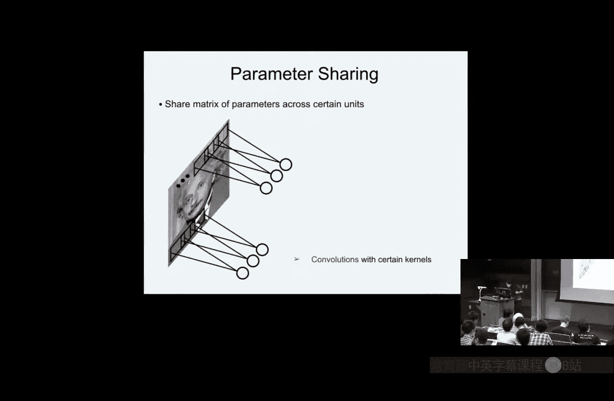

Y， so this is how it looks like。 you have your kernel and you split a corresponding feature map。

 you put another kernel。 another feature map make makes sense。 And these kernels are what。

 These are learned ways。 This is what you're going to be learning through training。 Okay， not this。

 This is the output。 This is the output。 This is what we call activation of a layer。

 That's what it is or pre activation， because it is just convolution。

 You need to pass it through someone U the， okay。😊，Yes。Yes， to be honest。

 I'm not sure it has to do with the GPU being happier。Okay， but I can ask about this。

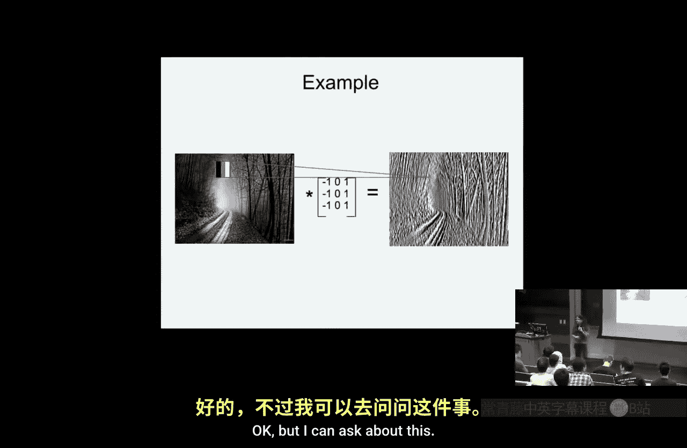

Up here， how many feature maps we're going have to， How many kernels we have to，1616。

 That's how many weight we need to learn。 Allright， huge a reduction。Oh， here are 10 by 10。

 It doesn't matter。 So when they say filters， they mean the actually it this kernel。 Okay。

 so we have now hundreds filters。 How many feature maps we're going to have。

How many feature maps we're going to have after this layer。Hundred， exactly。

 So every filter every 10 by 10 will do like this will take the results。

 We arrange them in a2 degree and we say this is one feature map。 Okay， then the other feature map。

 the other feature map hundred， al right。Okay， great。 This is very simple to get。 Yes。

 so now why we need pooling。Because after one covolution layer。The point later， what it does。

 it looks at a small subreion and says， I want to record the maximum value in that subidion。

No matter where the maximum activation happened， I could record this one in this。

 let's say two by two window。 if this is the highest， then this solution is going to survive late。

You're trying to do a little bit of the formation invariant。

 If let's say the eye is a little bit there or there or there。

 It doesn't matter you're going to pull。 And here is how also it looks like。

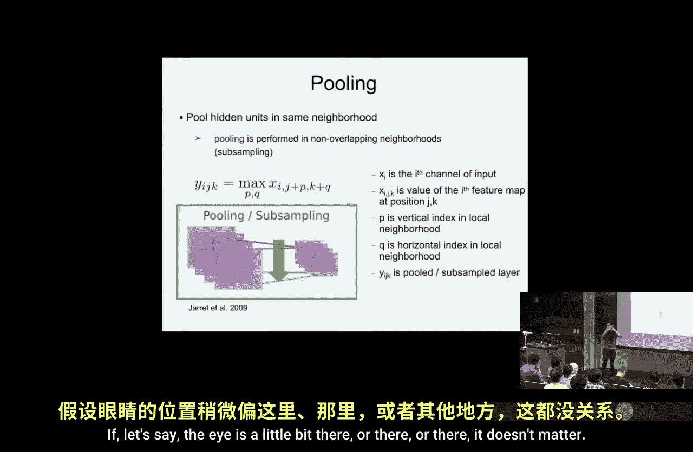

So this is pulling bottom right， bottom left， etc cea。 So we， we know。

 I think most people know about these details。Yes， so we have in various translations。And。

Itds also the resolution。And that's it。 So this is how pooling looks like in this big neighborhood。

 one of them is going to survive。 The one that has the highest activation。

 So a convolution neural looks like this。 It alternates between convolutions， pooling。

 convolutions pooling here， convolution pooling。Here is the pulling。 Here is another convolution。

 another pulling， another convolution， another pulling， right。

 We have a pulling in every feature map， right。Very nice。

 And just before we go into the interesting things， let's see theax layer。

 which is used every time we want to do e classification。

The output of your top linear part is going look like this is what we call the logicits。

 the different scores for the different labels。 And then you pass it through what we say。

 the soft box layer that looks like this and makes those logics to be a distribution。

 and also it tasks as a soft arc max。 So the one that dominates essentially much higher than the。

 Okay， that's we gonna call soft max。 It is arc max but is differentiable。

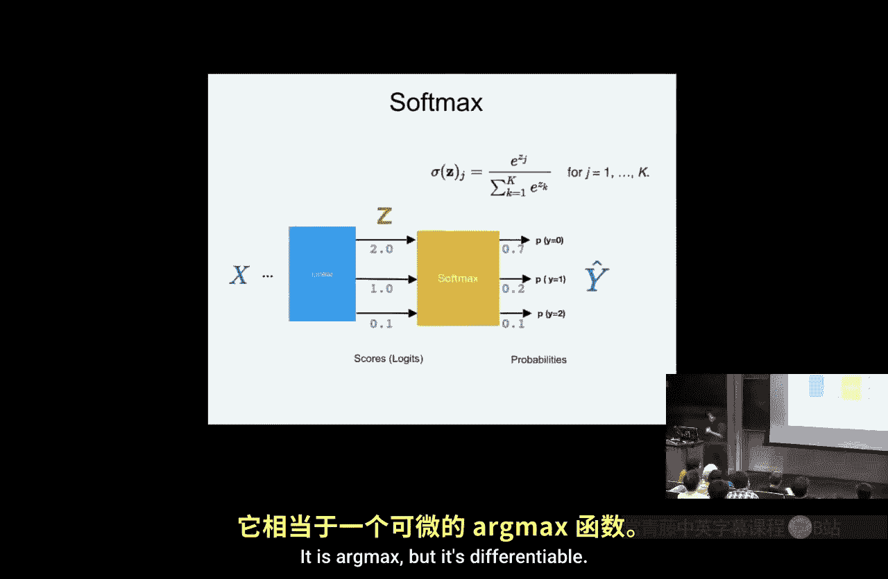

Okay。Now， the important thing that everybody knows is that there was a big breakthrough with CN in 2012 because they were able to be trained from this huge image database that had 1 million images with labels okay。

 associated with labels。 interestingly， these images were pretty difficult。

 and they only had a label cut without knowing where the cut was。

 So it was kind on trivial that training and neural network for classification right。

 it would actually succeed。 So what happened 2012 is that。

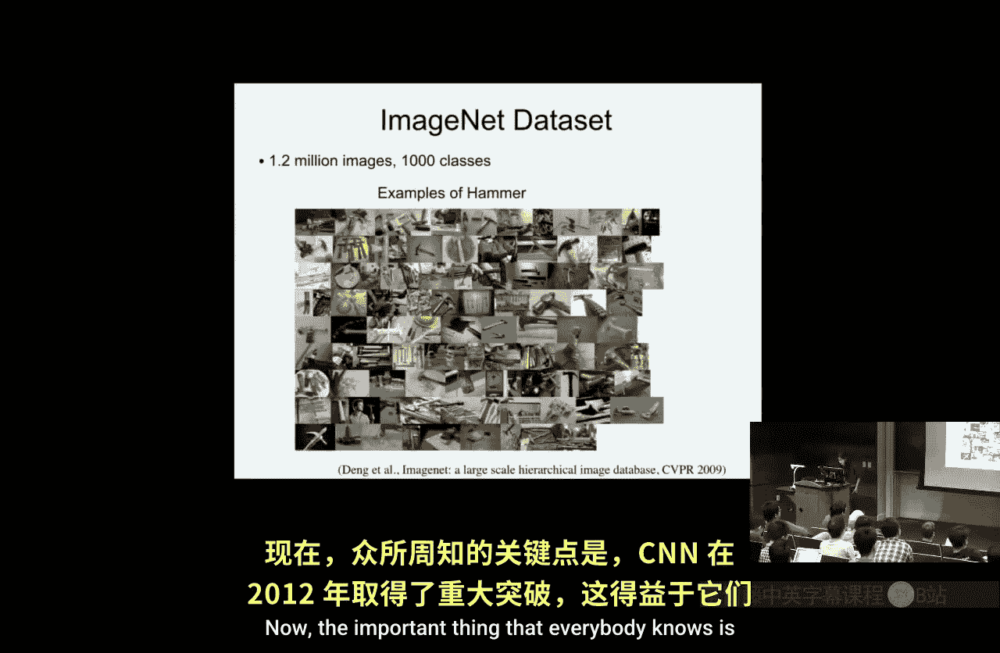

We had AlexNe， right， which is the first neural network on a GPU that actually was you know big enough to handle this data set and the GPU。

 the training was fast enough to know happen in a realistic time。 So two things。

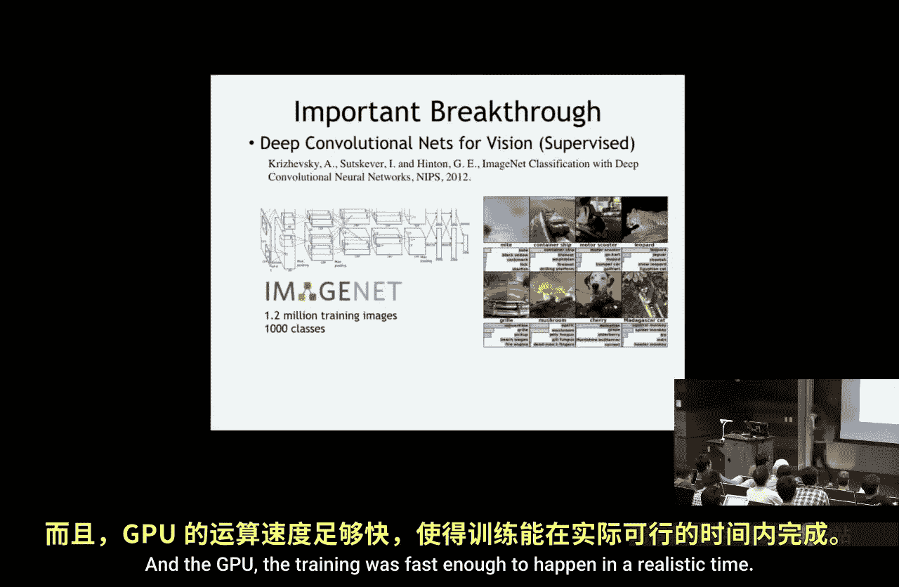

And see the huge general reduction， right。From here to here。 And then the people have continued。

 you know， changing the architectures and innovating， etctera。

This is the first architecture's called Alexit from Alex Kzeky。

 who is the first author in the paper and had， let's say。

 five convolution and pulling layers and two stacked fully connected layers that had tons and tons and tons of parameters。

 right， So convolutional layers， as we say， are extremely economical， parameter wise。

 but fully coordinate are not。😊，So interestingly， if you remove the top fully connected layer。

 which is that many million parameters， you have a tiny drop in performance。AWhile， if you move。

I mean， many other layers， you make it shallow， then you have a huge drop in performance。 All right。

 I want to say that yes， the two stacked， fully connected layers did not survive beyond that time。

 so that was， I mean， we see that there are way more economical architectures that you don't need to waste that many parameters and you get better performance。

So depth of the network is the key here。 And here is a much deeper network from Google that had a lot of you know。

 convolutions， pulling So， etctera。 And I think it put also intermediate supervisions。

 not only supervision at the。Very last layer， but also intermediate。

 Why you need intermediate supervision， Because people。I thought， you know， it's hard to optimize。

 It's hard to optimize very deep networks because the gradients vanish as you。

 as they get multiplied and multiplied and multiplied with numbers， they vanish as you go back。

 and indeed。Now， the interesting thing to remember is at the bottom， there are convolutions。

 and there is no fully connected layer。 There's just one average pool。 Okay， average pooling。

 not max pooling。 You just average all the activations on the ver top layer。 Okay。

 for average pool to work。😊，Every location on that top layer needs to have aceptacle that is the full image。

 Okay， other ways， average pool doesn't make sense。

 And later architectures have use this average pool to see which weights for particular class activation。

 how they're distributed the image。 We willll see this attention methods later in the course。

 But this is an interesting image。The before residence， okay。

 another architectural innovation that was very important and facilitated much the， you know。

 kind of the back propagation of the gradients。 very deep networks were very difficult to train。

 Both the train and test error was higher than shallower networks， which were 20 layers deep。 Okay。

 so you could not train really， really， really deep networks。

 So the innovation here of residual networks is how can you train really， really。

 really deep networks。😊，And see your performance improving as opposed to， you know。

Such being suboptimal。Well， what they said is， you know what I will always allow the gradient to flow in a way that is not affected by choosing this。

 as we say， the shortcut， okay， which is an identity as opposed to this multiplications。

 So then you have this very， very， very deep network。 But you know。

 the gradient if it follows that path， there is always one way to shortcut and go all the way back。

 And in fact， there has been architectures that have tons and tons of different paths that the gradients can follow shortcut pass through 30 sub blocks pass through 5000。

50 sub blockss。 And they seem they offer robustness and they make a lot of sense。Great。

 so these are basic things that we need to know。 Let's go back to our problem， which is what。

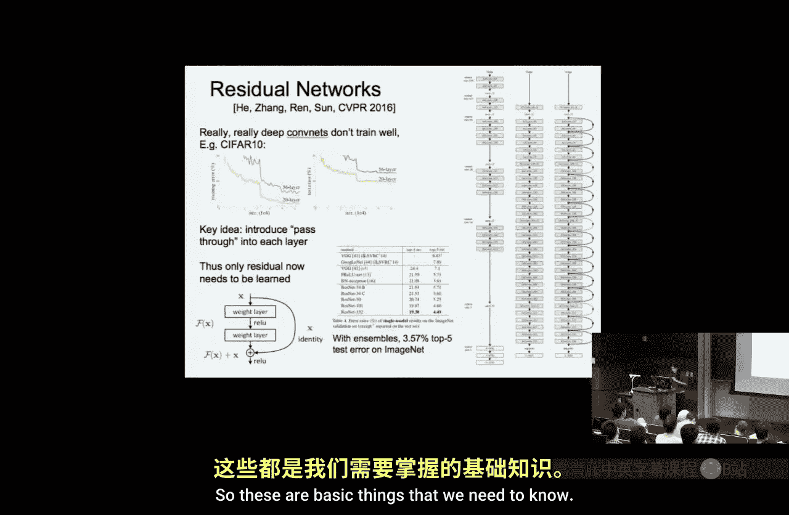

How can we go from？Stus input to observation as input， okay。

 this is our question and what type of architectures we should use。

To effectively take observations and input and compute value functions。O。And how can we handle。

 I mean， going from here to here， these two slides are extremely different as is short。😡，Oh it huge。

 Okay， so what， How can I train this and to end。We， you know。

 do you see what try and say what intermediate laws I need to put。

To a auxary task need to devise what pretraining mechanisms to be able this N to N method to。

 to to work。Well， let's start with the first example。 It was playing at games since 2013。

 That was the first learning model。The2 successful learn control policies directly from high dimensional sensor input。

 Okay， before that， there are neural networks that use coded state， right， First of all。

 we noted the gamon a long time ago， in fact， okay， the state was short。Even before GPUs， right。

 no problem。 You could train。 Now， of course， once you go to high dimensional。

 no surprise that this came after 2012。 O， then we do need GPU and all this machinery。Okay。

 so the important thing is that the image comes as the input。 Here is the image。 Here is the action。

 Here' is the neural network， and here is your action value function， alright。嗯。

Did particular innovation， the architecture happened。

 Well the only thing I would like to tell you is here。

 if let's say you have four actions up down left right。

 to estimate the action value function of those four actions， what do you need to do。

 You need to fit each one。In the network and take the results。 So is this wastes time。

 Why should I do that， Why don't I just hit the input。Okay。

 and hope at the output have the value functions for all the actions。At the same time， All right。

 this is way morechoical。 I don't need to feed every action  one at a time。

 So that's the first thing they did。Yes。With the I have no clue what I said from which part I should read it。

What is this， So this is the following。Here is a neural network。This guy is an image from Naar again。

This is a joystick actions。To play at our game。This is what。A color， what for this action。

 and that's the image。 What is the value of this particular action。You feed all your actions。

 Let's say 4。You'll get for。You pick the one that's highest。That blocked。 Okay。

 so now we know what it is。嗯。What else shall I say？But again， it's what。Oh， I see。

 So let me tell you for this is next lecture。 So we're not going to talk about this。

 But the only thing I want you to remember is that this is an action value function。

So the same exactly the same thing that you used。 Okay， for example， the Q learning rule。

 You remember it， you had the target and you can apply exactly this on the。

On this output of the network。 But to be honest with you。

 this is exactly the topic of the next lecture。 how we can train our architectures where instead of having tables and to replace their values。

 we have neural networks。 So this is going to be a full lecture。

 what I want to discuss is imagine that。There is a particular loss。

Their reinforcement learning will give you those voice。 What should be the architectural， let's say。

Interesting architectural choices that you may need to do beyond convolutional networks for you to do well。

 Is it important or we can just put vanilla CNNNs in that。 That's all I want that we discuss。Okay。

But imagine that somebody told you what is the ground risk and you want to， you don't know that。

 right， You initialize it， and then you play， and then you see if you succeed or not。

 and then you back up the same same thing as previous lecture。

So this input this visual input the visual input。Essentially it's not a continuous space because if I remember printinging from this game。

也是 not enemies and like that。Whatever。whatever they have discrete positions right Yes and the blue color of let's say 20 3。

Okay， so the areG values， right？那再几诶。Like again， this could be if we have。mount of time to kill。

 this could be represented by Le。like the full image to be one one that's lot are but yes， well。

 it's very difficult to go and record all the different images。

 So what your I think what your colleague says is the following Yes。

 this might be 10 by100 image and this may be you know that0 multiplly or 100 states but in effect I'm never going see that many images right why don't they just play thoses of ats you know cluster all possible images I can see and put each one of them as a separate row in my table still they're going be quite many。

Rose on the table。Or does this make sense， Yeah， A lot of a lot of sense It's going be used could be a very huge space。

 but unlike like a camera feed where the spray so。Inputs and features continue this right there。

Yours so actually， your question is very good。 And you will see guys that how things are simplified if you play video games versus when you're in the real world。

 I'll show you papers that may make a big， you know mess about how we can learn features to do good in games。

 etc。 And then they say even random features will work。 Just put a network。 Iize randomly。

 And that's that's it。 You don't need anything else。

 So we'll see this when we talk about exploration via curiosity。😊，Yes。

They have a fixed number each channel。 All right， so let's not talk about continuous discrete。

 Of course， everything is discrete 256 numbers。 That's it。 I mean， what the continues。

 the image has been quantized， right， yeah。It just is a very big space。All right。Okay， guys。

 so we already talked about this。 Here is the image。

 and I'm going to split all the action values together。

 How I'm going to end them with DQ learning group。 And we're going to see the details in the next lecture。

Very simple。 The other thing to remember is I'm not feeding just the current。

 I'm stacking four frames because I just need a little bit of history。 I just did first of all。

 I need to capture velocity。 Where is the ball going。 Allright， so I need at least two frames。 Now。

 if you add a little bit more， it's good。 the images start from2 to 1060。

 you downs sample you crop 84 by 84。 I want to remind you that in C MU in 1989。

 we did have this alvin， right， that had the 30 by 30 images。To feed and to drive a car。

 So we did have。Some well， let's say neural network with real images that would move a real agent。

 which was the car。大不。But they say that。They are the first deep learning model that succeeded with reinforcement learning。

 which is true， because the car was not reinforcement learning that we had to drive it first then to mimic us。

 If you remember the details of Calvin， we will come back to Calvin。

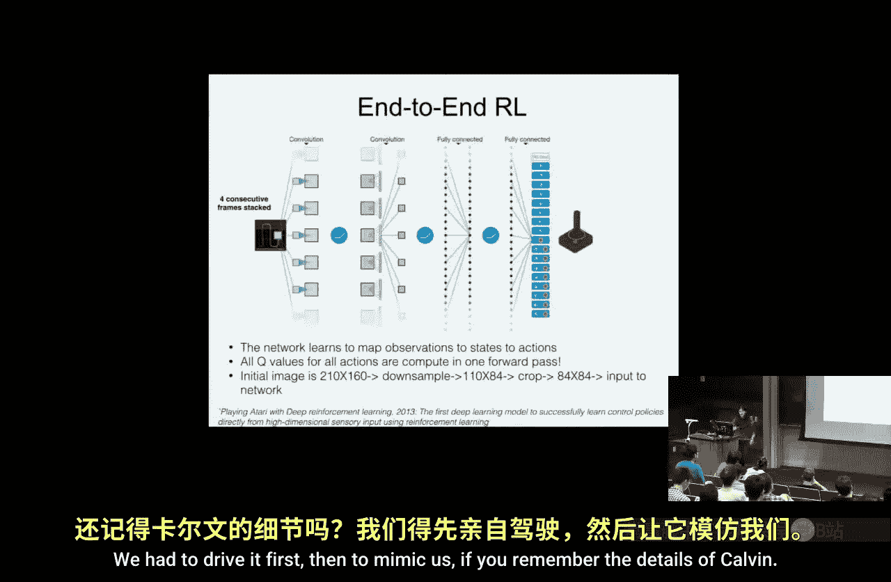

Okay， and everybody says， everybody， I mean， probably you heard in the community say， oh。

 but now we don't engineer the features， but we need to engineer the architecture。

 and how do we pick the right architecture， right？ So what do they mean when they say。

 how do we pick the right architecture。Right， and then Jeff Hinton says， oh。

 now the next game is going be， you know， who's going to design the right network architecture。

 Do they mean how many convolutional layers shall I put， How big should be described。

 What would be the learning grades。 Is this what they mean。Probably this is what many people mean。

 but I would argue that。There are way more important questions to be answered about network architectures。

 Okay， we may need to devise way， for example， convolution is one structural bias。

 We didn't learn convolution。 Somebody thought about it and said， you know what。

 I think convolution can work for this for this scenario of images because statistics are stationary。

So what are the other structural biases that we can think that we can put our your neural network architectures to make learning much。

 much faster。Okay， this is what I want to discuss。 And first thing that we need to think is this what where the composition。

So far， this imnet classification that we talked about that you just take the image and I need to say cat and dog and chair。

 And then I agree in。 if I do correct you know， guess correctly， the label is all about what。

 what is in the image。I don't need to know where。To do well， Okay， But in order to act in the world。

 And let's say to push this bread in the right place， I also need to know where things are。

 I need to know precise special locations。Okay。So how can I add this what where into my architecture。

 How can I learn to attend to important parts of the space and forget about other parts of the space。

 does this make sense to be able to do way more fine grain reasoning。Okay。

So I argue that we can take inspiration from object detection。

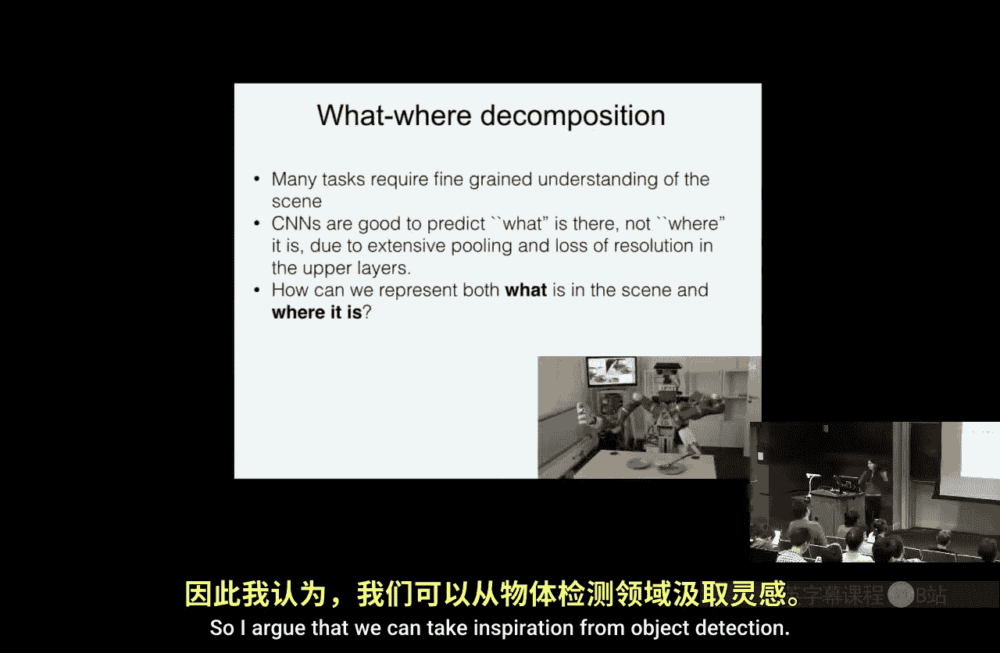

Because。Look at these images。 Let's assume assume we want to get those results。

 We want to take these crowded pictures and detect every little object。Is this clear to you。

 I have told you， yes， for image classification。 You know what to do。 Take the image。Crop， feed into。

Convolution폴， convol폰， convol폴링。Convolution convolution polling， sorry。Softm， and that's it。 You win。

 Is this clear to you， what architecture would you use to do object detection。Right。

 it is a very important task because now you need to localize the objects。

And I want to tell you something。 since 2012， the story has always been the same。Yes。

 CNNNs are great in image specific， But will there be able to do object detection。

 And then somebody does amazing object detection。 And yes， CNNns are great in object detection。

 But will they be able to do optical flow， And then yes， somebody does amazing optical flow。

 And then， yes， CNNs are good for optical flow。 But will there be able to do slam。 No。

 there's no way they can do slam。 And then somebody does amazing flow。 And then， you know。

 CNN you I think it's always yes。 The answer is always yes。

 You just need to find the right architecture to get there。 Okay。

 And I want to say that to do object detection， optical flow。

 I assume people know what is optical flow， right， you take two percival images and predict the motion of the pixels。

 correct， we have to do not we， but they have to be done very important architectural changes。

 particular for the task。 Make sense。😊，Great， so when we say what architectures to use。

 you should not think， oh， how many convolutional layers I should put。

 And maybe we need to put also even an a algorithm to tell me how many convolutions to to put。

 There are way more important。Architectural choice that we may need to do。

 And the CNNs are not given by God。 They're given by La。 Shes a little bit tiny bit different。

 You know what than but。哎，你好。So this is the question here。Let's see the first answer。

 or let's see the first answer。 What comes to mind， somebody that knows already。Would they tell us。

 would you like to tell us what you would do to detect objects。Come on， guys。

 This is a very important task。Yes。Consider detect edge like。Edges。

Like the closure of the objects and okay， so that's how we think about smatic。

Like if I detected it like outlines， yes。I would。How is they。Like originally from a William。

Did outline and crop the image and keep outline some sort of classification right。

 So I think the answer is not bad。 I think your colleague is seeing the following。

 I will rely on outline of objects and ra edge features。

 etc to predict some segmentation of the image into subregence。

 let's say boxes and then I can take this box and decide。

 is this an object and what object is it Okay and in fact， this is a little bit further。

 but this is how it was done， you take some original proposal。

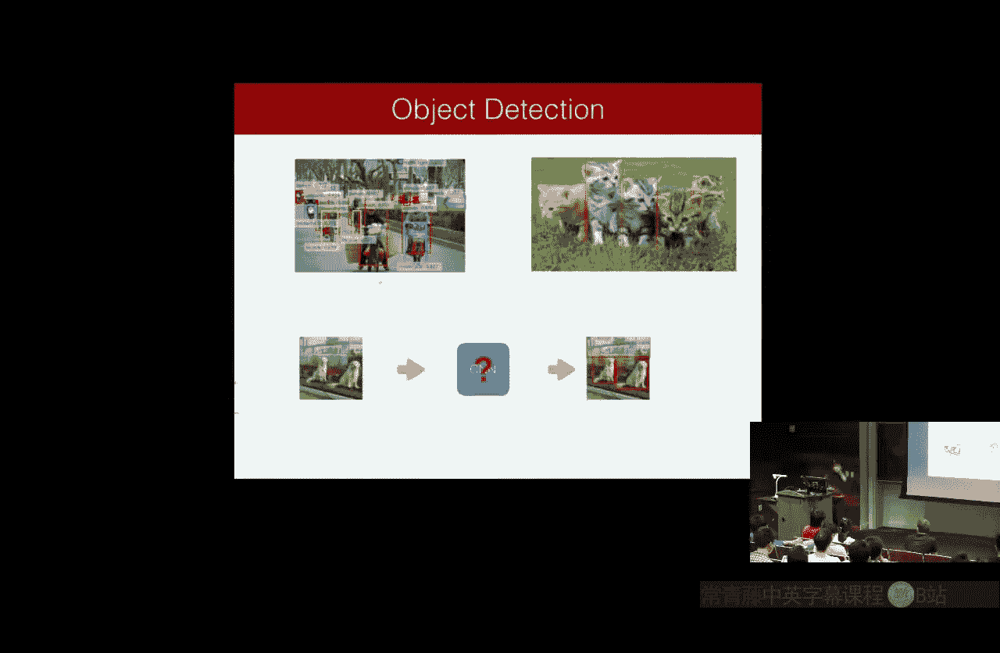

Algothm， which is not deep。 And what does these region proposals do。 They do slid the window。

 They take features。 and in a very shallow way， say this likely that iss an object in there or not。

 And they look at things like this。 the edge arrangement and the edge distribution。

 very simple feature， manually engineered features。 And they， of course， they don't do well。

 They are， but we use them as high recall low precision。 you know， given an image。

 you get 2000 of these region proposals。 Allright， does this make sense so far。

 So now you take this 20000 proposals from a classical computer vision algorithm。

And then you take every region。 And interestingly enough， you crop it from the image。

 you make it a little bit larger to， to include some context。 You make it a little bit larger。

And then呢。You know， you work， but you feed it in the CNN。

 and you predict this is an error in the person。 O， now， now you treat it as a standard CNN。Which。

 you know， it classifies it。 essentially， you just classify regions。 Allright， Does this make sense。

 Now， the problem with this is that it is extremely expensive because each time you take a crop and pass through a whole continentve and classify interesting lab。

 I mean， back then， because we didn't even know if。

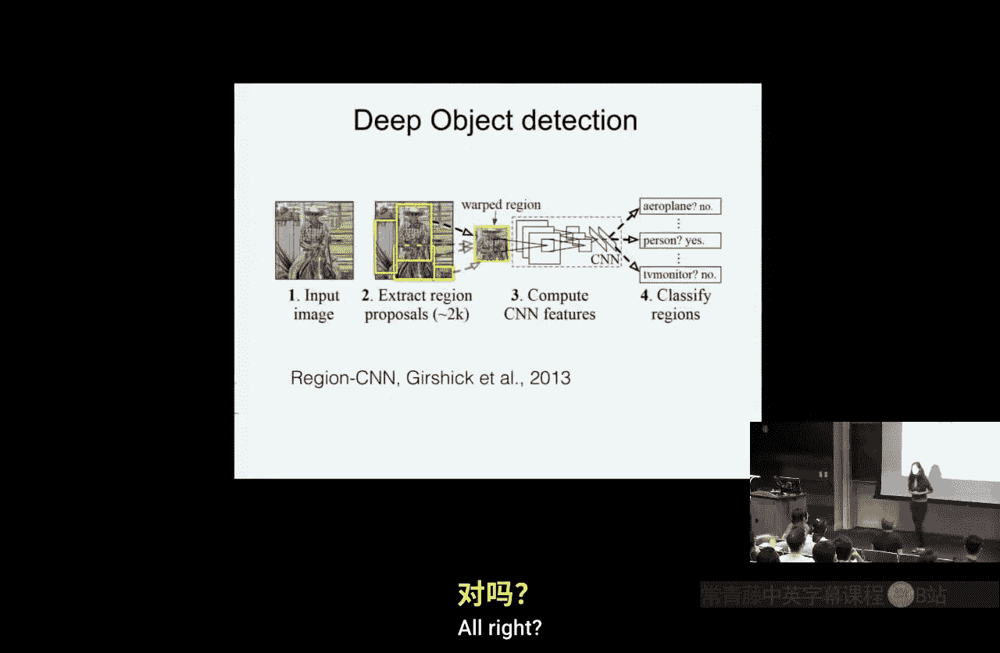

Everything can be done to end， you would just take the features and go outside of the CNN to an SVM and classify in N SVM。

 But in any case， now there is no SVM。 Everything is inside the network architecture。😊。

I want to tell you that there are two losses there。 One is classify this box。

 whether it's good or not， and the other is a small regression。 You try to deformat tiny bit the box。

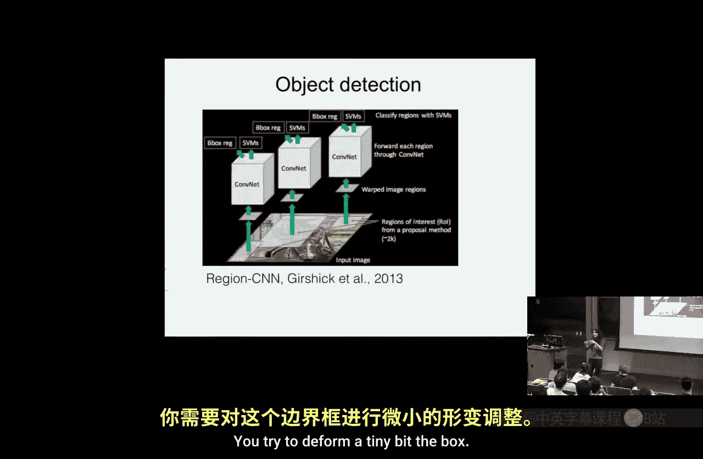

Now， I want to tell you， maybe we should go a little bit more quickly that this was very slow。

2000 times you need to go through a network。 This is crazy slow。 Now。

 the next successor takes a huge image， a whole image and passes the continent through a whole image。

 not through the region。Does this make sense。This is a huge difference Here。

 we would fit a CNN in the region。 Here， we put a CNN in the whole image。So now the whole image。

 what you'd get is a grid of deep features。And。You have a region Pro network。

 It's called R P and Region Propos network。 You have a lot of anchor boxes sitting around 2000 of them proposed。

And there is a classification there tells you pick the 300 most probable ones。 Again。

 high color precision。And instead of taking those and pass them through a deepse。

 then you just pull the features within them， pulling meaning from all these big feature grid。

Of on the whole image。 If I'm a bonding box， which features fall inside my bonding box。

 So I just take select essentially， the features of that bonding box。 Okay。

 and then pass through this couple of layers。 These couple of layer weights are shared， of course。

 across all these different boxes that you evaluate。 And again， you classify and your regress。

 classify， it's a good box or not， If it's a good box， what categories is it and also。

 how can I deform slightly the box to go closer to the ground truth。😊，Makes sense。 So these are very。

 very important architectural biases。

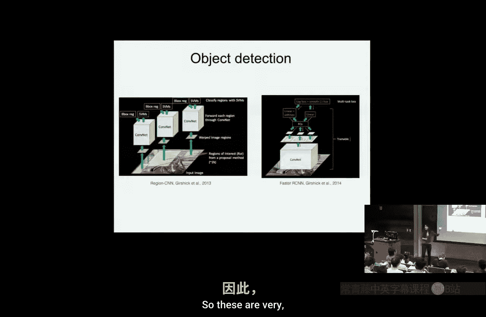

That would allow to generate these beautiful results。Now， here's the question。

The manipulation community and robotics community doesn't use those detectors right now。

And why this is the case， Because we don't have labels for the。

 for the objects that I care to manipulate。I don't have label let say I want to manipulate this particular microphone。

 I don't have a lot of big training of you know， microphones train it on。

 So all this beautiful machinery that could be very useful for manipulation is being unused because it depends on if you have the right label data。

 So I want to discuss with you on method that in fact。

 you can get around without having somebody label you a lot of training data。

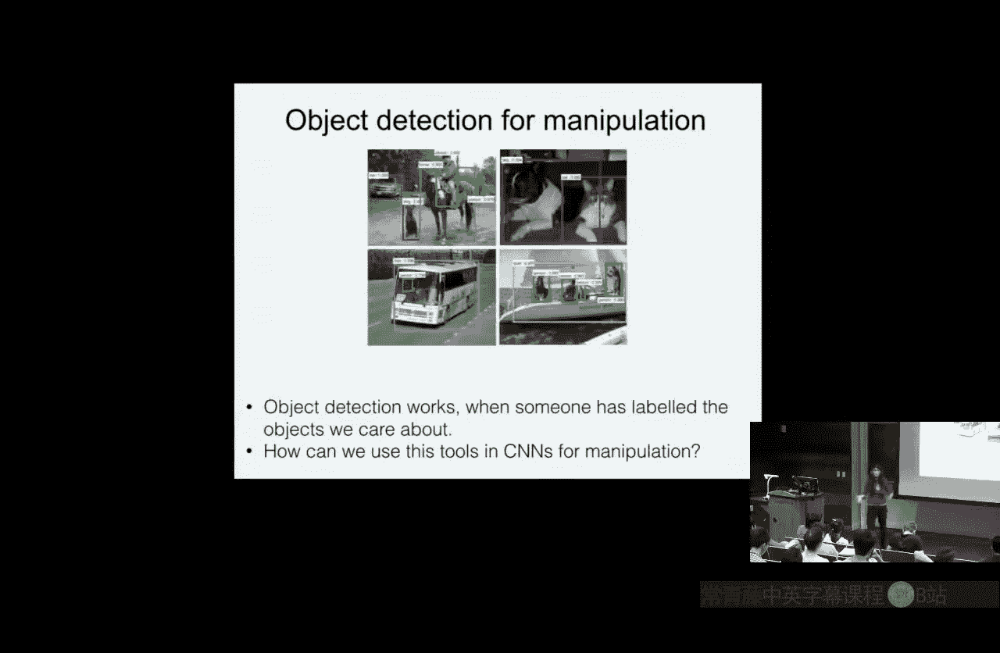

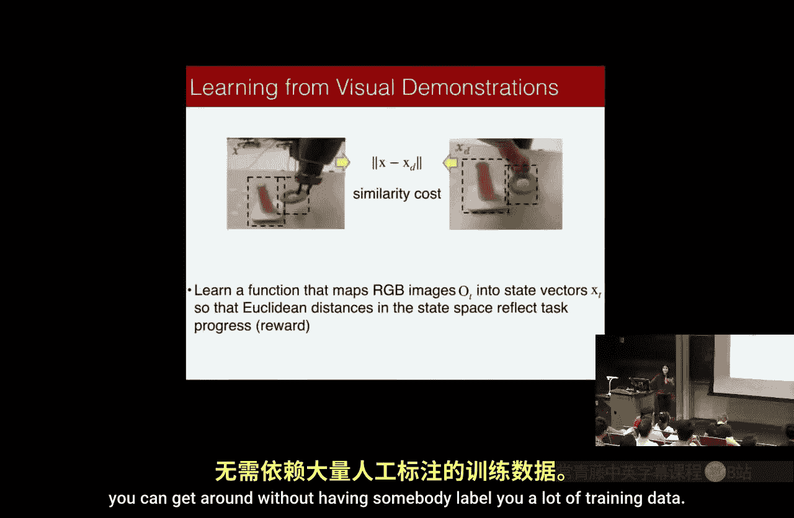

And here's what I want to discuss。 This is the baseline。 You take the input。

 you pass it through vanilla， CNN， you get some。Numbers as you are out of state， alright。

And here is another image。And somebody argues that， you know what。

 It's very useful to detect where the objects are。To detect the objects。

 So I'm going to run an object detector， detect those objects。

 And then for each one of those objects， compute those appearance features。

And then append them and also consider their distance between the detected objects。 Okay。

 and what are you going to do。 So now you have a different state。 The state is as a graph。

 object graph。The state instead of having just full frame features squeezed out of the full frame。

 you have a feature squeezed out of each object。え。There are pairwise distances。

And what can you do with the state， You can do whatever you like。 I'll show you what you can do。

 You can。 The most trivial thing you can do is imitate somebody who is。You know。

 demonstrating a task for you。

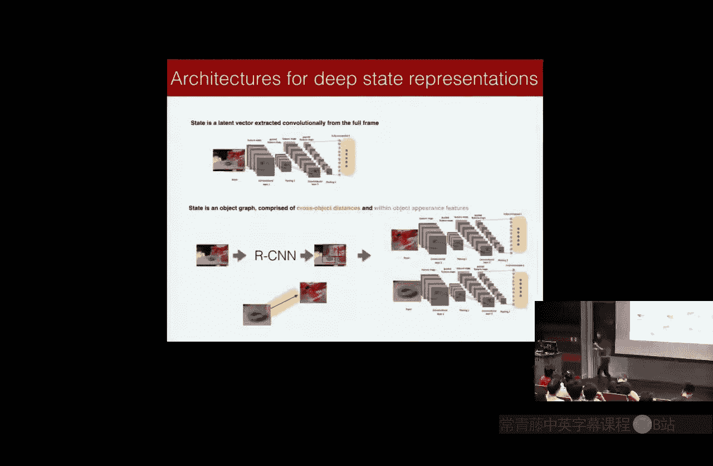

Okay， so， so this is what you want to do。 You want to find good states。

 So if somebody demonstrates something， for example， rotating the yellow pole。

 if the robot rotates the yellow pole correctly， you'll want to have higher reward。

 And if the robot rotates the pole wrong， does something wrong， not like the human does。

 you should have a lower reward。 Do you agree that this is very useful。This。

 then the network will capture what is similar was not similar。And as you see here。

The object centric。Correctly says that look， the wrong thing is indeed wrong。 very low。

 once things go starting being different than the demonstration。 Why the full frame。

 because there are so many things happening in the frame。

 it cannot really focus on the important part。 Does this make sense。 So attention on the objects。

 let alone we know from your sense that ins can attend to objects extremely early or right as opposed to taking all the time the full image。

 you know， computing。So they constantly intend on objects and putting such objects attention into our architecture is going to help a bit is going to help a lot。

 And how can you。

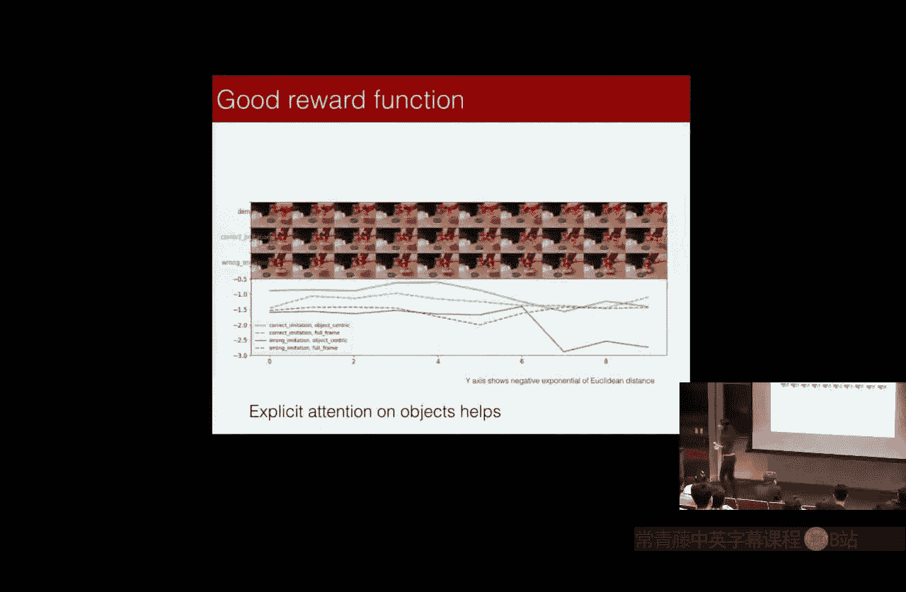

Traraying detectors without having label data。 Well。

 the first thing you can do is background subtraction。 So you get one single example。

 but then you can augment this data in a synthetic manner。 You can just。

Painting masks are all like crazy。 you know， behind the background of the object。

Trying to simulate all possible occlusions， etc ceter of the objects and use the stands of synthetic training data。

 You see many of them do not make any sense， but you generated them。

 and you can use them to train your object detectors。

 Does this make sense only from a single positive example。 And， in fact。

 discussion to work really well right now for video segmentation。Just。

Take something and hallucinate how it would look in different situations and use synthetic data generating this way to train your detectors。

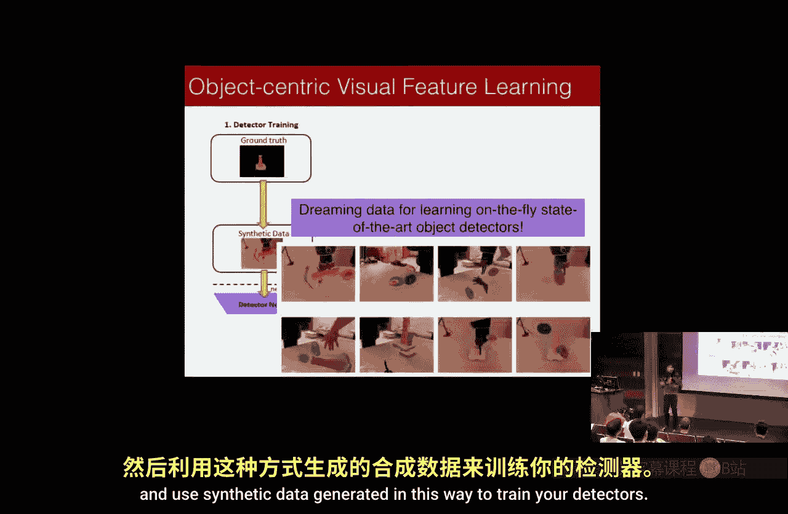

And you do the same thing。And then you put based on this extra distance。 Okay。

 and then you show that very， very fast， you can imitate。

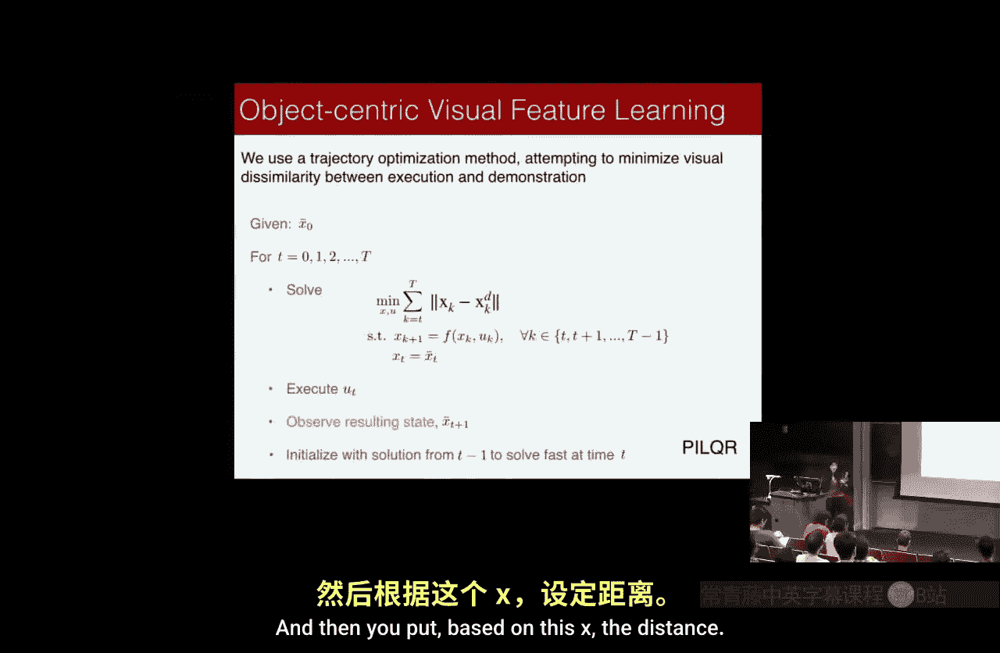

A human demonstrating a task。Okay， after three durations of your trajectory optimization method。

 we'll talk about this trajectory optimization method。 Well。

 if you didn't have that attention in your architecture， you wouldn't be able to do it。

So I had a lot of like not a lot， actually it's just 10 more slides。

 but maybe I'll show you next time。 something very important。

 There's gonna to be a station on Monte Carro research this Friday。

 It's going to be around45 minutes， we'll see a lot of details how it started。

 how it proceeded and how it you know did fantastic last year putting it in the training loop。

 which was a big innovation so if you won't come in the station。

 the slides will also be hopefully available before the station so that you can see if you need to come or you know this material eta。

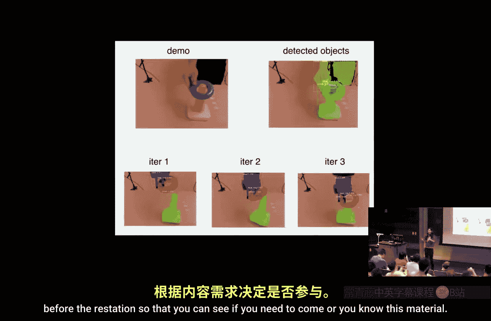