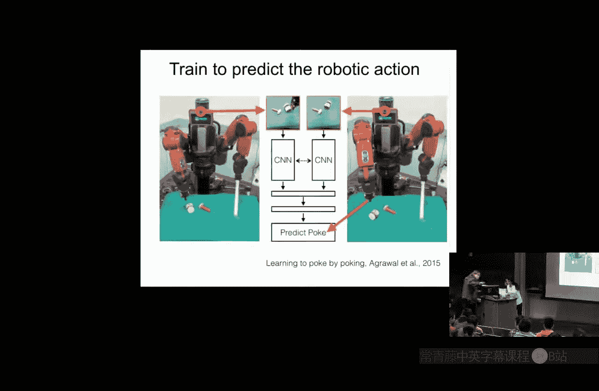
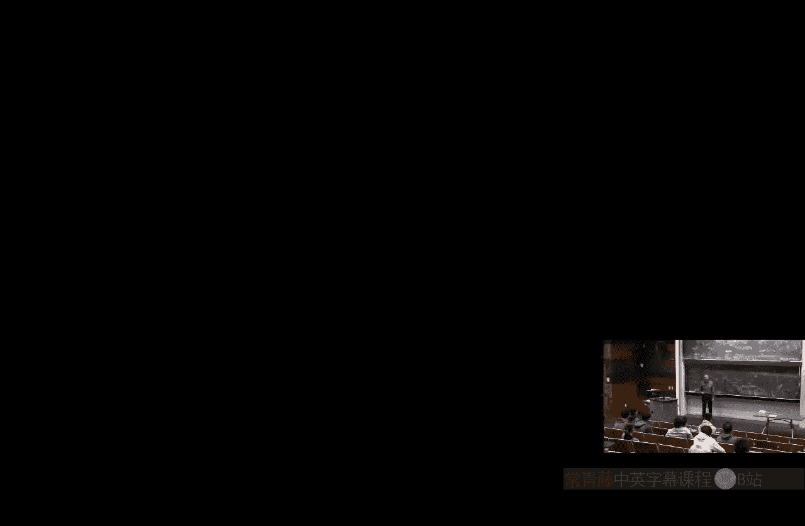

# 卡耐基梅隆大学【中英⚡深度强化学习与控制｜10-703 Fall 2018, Deep Reinforcement Learning and Control】 p08 P8 08  Function Approximation for Prediction -BV1RyqPBbEJV_p8-

Okay， guys， we're going to start for those of you that were here on Friday， I noticed that your book。

 this latest draft has wonderful explanations of Algo and Alphago  zero。

 along with reading the papers。 it's good to take a look at the last chapter where。

Descriptions are given， I think they're very comprehensive。That's number one。

 So today it's an easy lecture。 It's a continuation of our previous lecture。 Okay。

 we'll just start seeing the first applications of fact approximation for prediction and control。

We have said many times in the intro and afterwards that ArL was actually used to solve large scale problems with many。

 many states such as those。Today we will see the main ingredient that allowed this ArL to scale to this large state space。

Double our methods clearly cannot handle this。So so far。

 we've seen that the value function was kept in a lookup table。 Every state has its own entry。

 every state and action for the case of state action value function has， again， its own entry。

This creates a problem when we have too many states。 okay。

 not only it's too slow to the the value every of every state individually。

 but also we don't benefit from the similarity across the states。 And this is the main idea。

Instead of trying to bookke the values and action values for every state or state and action pair。

 instead， we will learn this function。That will take us input the state。

 as well as some parameters and try to approximate。The value function and the state value function。

Okay。And we'll see that we're able to generalize from st states to N states， why this is the case。

Because usually the number of parameters are much， much fewer than the number of states。

 So now what is changing in is not the state value functions or actual value functions themselves as entries。

 What is changing is the W。 okay and the W pass through functional form essentially predicts those value function and actual value functions。

 Each update we will be doing on this parameter W will have an effect on multiple states。

At the same time， right， or multiple state and actions。Okay。

 so this means that if I visit this particular state and I want to update its value。

Similar states will also be updated。 That's why this generalization happens。So exactly。

 this work will replace that table with this general parameterized form。 And this week。

 we will talk about fact approximation for state value functions and state action value functions。

 And next week， we will discuss about。Approxiation of policies where a state is going to come in and a prediction over future actions will come out。

Even for policies so far， we're also been using Tableular for， okay。This this clear。

 and this will allow us also to handle continuous actions。

So this is the policy gradient methods that we'll visit next week。Exactly。

 so the number of parameters data are much fewer than the state does the effective number of states。

 So that's why every parameter of data will affect multiple states at the same time。

There are many function approximators， but in this lecture。First。

 I will discuss about linear combinations of featured and neural networks。

 which are paradigm for differential function proximators。

 and last we will talk about nearest neighbors okay and what is the benefit of nonparmetric Para 3 approximation compared to this parametric approximation and we'll visit a recent paper neural episode in control that blends the two in a very nice way to combine the benefits of both。

 Okay， so please pay attention。Now， why we like the financial fraction approximations。

 Because if somebody gives us an objective J。Which were trying。哦。

Which we're trying to minimize now the truth is that potentially I'm going to change this J J J usually appears when we try to maximize and we use L loss when we try to minimize。

 but in any case for now， let's assume that we're trying to minimize J okay and J depends on this vector W and to be sure it's a vector we show it here bold al right to distinguish it from a scholar。

Then what do we do， We compute the gradient vector。 Okay， it's a vector where at every。

Every location is holds the partial derivative of our objective。 Okay。

 so our objective is a scholar value。 Okay， with respect to every coordinate of the parameter vector。

 Very simple。And exactly， because we're trying to minimize our objective， we want to take a step。

Towards the negative of the gradient， if we were trying to maximize our objective。

 that would take a step towards the positive of the gradient。 Okay。

 this comes from the definition of the gradient vector。And look here。

 we have a small step size alpha。 O， which needs to be small enough。

 white it needs to be small enough。For two reasons， first， for this gradient electrode to be valid。

 usually it's valid around you know， a neighborhood of the current point， W， okay。But also later on。

 another big reason why we need to take small steps other other as opposed to you know。

 large steps along the or the negative of the gradient is because each of those small gradients would be computed。

 not based on the whole example set， which is our whole objective。

 okay were trying to do well on this whole example set。 But rather。

 one example at a time or a small mini batch at the time。

 So once you have your gradient based on a small mini batch。

 This is an approximation of the gradient in the whole space where your your objective seat， right。

 And thus you cannot if even if you try to do really well on this mini batch probably will do really bad on the rest of your training set。

 That's why we need this small sta size。So the idea of gradient in des set is very simple。

 We're going to start from a guess of w 0。 Okay， and then we'll form a sequence。 W 0，1，2 n Now。

 the unfortunate in this slide is the same double N。

 which means the n W as we take iterations of gradient in des set appears here as the n coordinate。

 Okay， but because the context is clear it doesn't matter。 Okay， and because we take this。

We move the the the W in this way。We see that at every duration， our objective goes down， okay。

And hopefully， we' convertverge the local opt。To do that。

 you need to make sure alpha is small enough and alpha doesn't even need to be the same from iteration to iteration。

 This is standard gradient descent。 You may say why do we do gradient descent。

 Why don't we do some more advanced optimization methods Indeed till few years ago other second order optimization was essentially were're being explored。

 It seems to me that now most people use gradient descent， especially for you know neural networks。

 It hasn't been sure that second order methods will do dramatically better okay。For for general。

 for general neural network architectures， yes。Yes， I see。 Okay。

 So this is gonna be changed before we update the slides。 Yes， this is the n coordinate。 Okay。

 and this is just the end as you take iterations， yes。😊，Now， the most important thing we need to ask。

 Okay， great。 So So what we've seen， we've seen that when we have a differentiable objective。

 we integrate in the center and we'll minimize it。 The question is， what is our objective。

 What is our objective。Suppose that somebody in Oracle had given us a true value function。 Okay。

 for all the states， what should be the true value function。

And our job would be to train a function approximation so that we mimic that oracle。

Here is one objective。Let's find the W so that， you know， the approximation。

The square of the approximation from the ground roof is small， okay。

And what is we all know what is the square， what we don't know what is this expectation over pi。

 why we put this expectation over pi， usually what we've seen okay in machine learning is usually we have a summation over training examples right so if we would follow the same paradigm here we should have a summation over all the states in our state space。

Right。Of their true value function。You know， to be close our approximation。

 to be close to the trueval。 Okay， this is standard supervised learning。

 the way we forget about reinforcement learning for now。

 imagine somebody had given you the oracle target value function。Now， why would not have this？

And we have this， first of all。Let's try to understand what means Eex expectation under policy pi。

 We have some policy。 For example， my policy is all the time to leave a room this way。

 I never choose that way to leave the room， okay。So this means that is as if the same form can be written as SM over states。

Where the states are not created equal， some states are weighted more and some states are weighted less based on how often we visit the state under the current policy pi this is what means expectation under pi and this is called the own policy state distribution so in that case that I would always choose this way to leave the room I care very much of getting on those states correct value function and on those states I do not care。

Alright， so this is a beautiful approximation。 Okay， because the state space is huge。

 many states we know will never don't matter。 We've said many times that in many board games will never just take because。

 yes。😊，Sly entered。We added the property that we know where to start。We like。Yes。

 so we're not gonna explicitly find the distribution。 essentially。

 what we're gonna do is we're gonna to have a policy。 Okay。

 this portion will also have as a parameter， some initial state distribution where we will open our horizon this where we're gonna end。

 Okay， for example， my initial state problem is going be around here。 Okay。

 then we will sample based on our policy。 We will update an experience buffer。

 and we will build something states from that experience buffer。

 And essentially the way we will sample this state for our experience buffer。

 we're going mimic this own policy distribution。 Okay， does this make sense very simple。

 It just'm trying to show here that this is the particular approximation we're doing。

 We don't care to approximate the values of all states。

 We care to approximate the values of the states that we visit。😊，Or the more we visit。

 the more we we care。 And this is， in contrast to just。We care to， to。To do well in those states。

So how we would do this with gradienting desent now that we know the objective。Well。

 we would form the gradient vector and then we'll start So So the the interesting thing is that now we know why this one over two appears because very often in the objective。

 we have squares。 if you take gradient of the square the2 goes down。 and then in this way。

 the gradient direction is simplified。Okay， the deelta W simplified。Basically， the two council。 Okay。

 so this is what remains。The error。In the gradient end of the approximation。Do you see。O。

So now the problem with this。😮，Is what。Is to be able to take one single step。

 we need to go through all the states。That we visit。 Still， there are many， okay。However。

 withve discussed in previous lecture。On Wednesday， that this is not in case S what。

 we in case in practice what we do is not gradient descent， but are stochastic gradient descent。

 We grab some examples。Agregate the gradient directions and then take a step。 Okay。

 and we say that in expectation， if you sample well and you make sure that your batches are not very askkewed in the sense that all samples in the batch from the same part of the space then stochastic gradient itself will send you to the same place as a gradient descent。

 In fact， there was some time in the field that we even thought that stochastic gradient descent was even better like gradient descent。

 because it's at the stochasticity and explores more in the parameter space。

 it seems that right now this issues have been settled。

 then we always think that the larger batch the better。 Yes。

 so for using that stochastic gradient decent。 does that E factory。😊，Right。

 so the EI here means that to take a step， you take all this animation with a lot of states here。

 it means that the states that you' sample， you sample from that one state on policy state distribution right So basically you sample states from that particular distribution you just you don't need to compute all of those for all the states before you take a step。

 That's it。 So basically。哪 here。Our ability to be。Yes。

 probably you will sample it again and again and again。 and throughout your training。

 it will appear often in your， in your mini batches。Okay， so now here is the problem。Feature vectors。

 So we have a state， and this is where domain knowledge comes in。

You guys need to sit down and take a state and represent it in terms of features， right。

 If you don't want to use， as we say， end to Android reinforce learning from a row state coding all the way to。

Learning a value function。 in fact， before coming here。

 I was reading how Gerald Tezro sit down and made the state en codingding for TD Gamon。

 So his state coding was 198 elements long。 and he had lots of features about the board position that he thought were important。

 For example， are how many。😊，If theres particular configurations， for example， of the Pons。

 I don't know how they're called Pons or something on the board and how many the opponent has taken and how many you have you know。

 acquired， basically the state and。Can be another description of your state to make it easy for the function approximation later to learn the the value。

 Does this make sense， So you could have described the state with much fewer， much shorter vector。

 But just being explicit on more complicated features will allow you the approximation to be easier to learn the the correct value function。

😊，啊。The same board position encoding was also used in alpha go， right。

 And then we saw later that alphapha go 0， we throw away all these features and just use computer vision。

 We take a picture of the board and you know， feed it into a CNN， and this gives the state encoding。

 alright。In any case， here， if we， if we use traditionalal tele， you need to sit down and think。

 what are the important features to describe your state with。

So if you have sat down and do good engineering， then you can use also a simple function approximation like a linear one。

 for example。 Allright， in which case。The update takes a particular， simple form。Because here。

 the gradient of the。W transpose， we x simple， W transpose X is just simple the feature vector。

 alright。This is a special case。 Why we care about linear function approximation。

 Because a lot of results for convergence have proven for this case of function approximation。

 While if you go to neural networks， for example。Not a lot of things。Can be proved。Okay。

 so then we have this particular form of the update。So far， we have assumed that somebody。

It was handlinging us are the oracle value values of the states that we were trying to approximate。

 We know this is not the case in reinforcement learning， right， We create the targets。

 We interact with the world， compute returns and set them as values as target values for our。

Estimates before our estimates were。State values， okay。Values for states。

 one for every entry on the table。 Now， these become targets for our function approximation。

Our book this uses this very nice word target to describe and to uniform， essentially to to。

 to have a uniform presentation along all the different update forms， Monte Carlo， Sarsa。S is for Q。

 but Monte Carlo， TD 0。So here you see that the target is what。The return for a particular episode。

Here， the target is reward plus the discounted factor and the value of the next state。

 Your essentially estimate of the value of the。 You don't have the。Orracle form。

 You have only your estimate。So you essentially you just plug it in。 All right， in our previous form。

 And now you're ready。 you're just ready to do your function approximation。Now。

So this is the general form。We used before the oracle value here now we don't have Oracle。

 we create targets from our experience， and the tagger for Monte Carlo days is this the return of the episode。

All right， while the target for t to0 is this， the reward that I get plus gamma and my estimate of the next state where I land。

Makes sense。 Now， here is the interesting thing。This is called semi gradient method because this estimate。

 if you notice， does depend on W。If you just form the initial objective。R plus gamma v minus。

 let's say your state approximation。 you should have taken gradient also with respect to that estimate。

 correct， But you do not。 You just forget about it。 You just say I'm gonna set it as my target。Right。

 it very simple。 It's just we need to know that there is something here that we are not doing in the right gradient way。

 And that's why we'll call it same gradient update。😊，Okay， yeah。Use in TV0。呃，这说的来。Why would we have？

有比。一ぱそ。No， it is not the S plus one。 I'm currently on state S and I take an action okay and we know that the beauty of TD methods is that they don't need to wait till the end of the episode like Monte Carlo to get their return to P did。

 but rather even from a small like one single action they see where you' land。

 they see the reward that you get。 they see your estimate of the state where you land and you know that。

You know， by definition of the state value function。

 your current value should equal the reward you get plus discounted。

A factor multiplied with the by function of your next state， okay。Very simple。 Nothing special。Now。

 the important thing。Is that already although the Monte Carlo update G this G。

 the return of the episode is on abiased estimate of the true value。ok。

We just can treat as a supervised learning problem， we take the pairs。

 the state and the return I got， the state and the return of the episode I got。

 the state and the return of the episode I got， remember that Montelo Monte Carlo methods were used only for episodic tasks right so the episode will always terminate and will give you a return。

And then you just did as a supervised learning problem。 And here is your gradient rule。 Allright。

 this is how you should be updating。 W plus equals W plus deelta W。And here is a。

Here is adult Gordon。 When you are given a policy， you want to estimate the value function。

 approximation using Monte Carlo methods。You initialize the value。Function weights。

 right before you remember we would initialize the table。 Now， we throw away the table。

 we initialize the theta， the parameters。 the the and W， you are use is exchangeable。

 You realize that。 So that's another confusing part。 It doesn't matter。 We initialize it。

 We generate episode。 Take returns and update our theta in this way。Very simple。

And the grid and you put here， you whatever function approximation you choose。

 you plug the corresponding grid。Great， now we have seen in previous， yes。

 we said that we've seen in the previous chapter that will I Monte Carlo that is unbiased。

 but there is a huge variance and。😊，In practice， TD methods。Learn much faster。

 despite the fact that they have a biased。 their target is a biased estimate of the value function。

 Okay， and the book has a beautiful explanation of what exactly is the you know。

 their bias and where this introduced。 We're not going go into this。 just to show that here is。

 again， the update we saw before。 Don't forget that we have， in this case。

 the same ingredient method。 We just ignore the dependence of the。😊，Target。

 this is the target on the W， which we're trying to optimize。 Allright， And here again。

 a practical world。 Nothing changes。 Everything is the same。

 The only thing then changes is the update。Very nice。 So so far。

 we discussed about two prediction methods with function approximation。 Monte Carlo and T D 0。 Okay。

 now I want to say that there is a chapter called bootstping in your book。 Allright。

 it's got to read this chapter， The only thing that says is。

 you know what in the same way that we have on the one extreme Monte Carlo updates。

 And in other extreme T D 0。 you can also just。😊，instead of just updating with a single step。

 you can take one to three steps and then set this target being Rt plus you know gamma。

 rt plus 1 plus gamma square t plus 2， plus VST plus4 and set this as your target。

And you can extend this episode the length of using the actual rewards versus you know。

 putting the value function every way you want every two steps， you should have the actual rewards。

 And then the your estimate or you want to have five steps of the actual rewards。

 And then your estimate。 So theres nothing confusing。

 It's just a continuum between T to 0 and Monte Carlo using just the return。 Allright。

 and not any not， no bootstping。 right， No， not using your estimate of the states where you end up。

 I this clear。 Yes。I had a question about initializing。I saying initialize the waist of zero。

 is it there？The weight set。 So let me tell you， when you have a。neural network。

The weights are usually initialized close to 0。 And there are a lot of tricks of how to make them。

Yes， there are a lot of different initializers that you can pick。 Okay。

 you don't initialize them in large values。 They're supposed to be close to 0。 And fast。

 the regularization you are using right for neural network training is that their norm should be small。

 okay。So that'Random， yes， it's a。Soれ they are。Right， so I don't think this potentially discusses。

 they say arbitrarily， it doesn't discuss the particular case of neural networks。

 and I think this's a good point。 No， we should not have a uniform zero。

 there should be initialized random if you are using a neural network， absolutely。Yes。This slide？0你儿。

Yes。ススライス。Yes， one second。 So the boy。Yes， because it's in this case。

 it's a simple quadra that you have， right？ So in that case， we don't have let's say， spurus loamine。

 your lo Iamine is also your global optimum in this case， right。Yeah it's a they're right。Right。

Why is？考えます。Right。No， that was supposed to be for the general case。 For this particular case。

 your local news is also your global opt。Alright。Where I put this local world。

 Like Where is this local thing， Let me。Because this is where the linear one steps。Oh， at the global。

 Yes。 So here was when we're talking about the general fact approximation for the particular case of linear fact approximation。

 you go to your global option， okay。Okay， supervised learning problem。We ignore the dependence。

So this was prediction。 What does prediction mean， We estimate state value function。

 Now we want to do control。 If we want to get rid of knowledge of the dynamics。

 we better estimate state action value functions as opposed to state value functions。

 to be able to control if you state value functions。 Remember that we need one step look ahead。

 which means we need a dynamics。 If you know the state value functions。

 You just take an a max over your Qs。 And that's it， you know how to act。 Allright。

 so let's discuss value function approximation for state value state action value functions。

 exactly the same story。Now， we want to approximate。The state action where you function with。

In factual app， again， we have。诶。Square error， okay， between our oracle values and our estimates。

 Again， we have this expectation under pi， which means that the state action value function will depend on the visitations。

 Okay， is's going be the on policy distribution of state actions。 And again。

 we have the similar form of updating our parameters， W。In this case。

 the feature vectors will concern both the state and the action。 All right。

 here is the case of a linear function appximator。We have again， yes， stochastic gradient in descent。

 We have this particular simple form。M。And here are the two types of updates for Monte Carlo。

 we plug the complete return from a particular episode。

 And here we plug the reward plus gamma and the queue of the resulting state。 right。

 This is the SARSA update。😊，So。嗯嗯。Okay， and again here， sorry we need， again to。

 to notice that this same method， the Q， our target depends on W。 but we just forget about it。

 All right， we just said that that's the target。 And this is a control algorithm of how to use this for estimating state action value functions。

O。There is nothing different than what we saw before。

 apartpart from the fact that now we can choose actions。 Okay， by looking at Q。

 And what is the simplest way to get actions out of Q， which at the same time you exploratory。

 epsilon greedy right with probability Epsilon over the number of actions。

 you can choose any action and one minus Epson， you choose the action that has the highest Q value。

Okay， and here is one example。Of the mounted car problem， which， in fact。

 is going to appear in homework too， alright。And here is how the。Maxim macro。The essentially。

 the optimal state value function looks with different after different episodes and updates， okay。

Now， so far， we've discussed that each time you take an example you take a step。

 Now in practice what happens is that you accumulate your experience and experience buffer you just don't throw it away。

 alright so you accumulate your experience buffer and you sample from this experience buffer because taking one gradient update tiny little bit。

 changes the parameters alright so you better use the same example multiple times to generate you know the change that you want and this is why this called batch reinforcement learning。

 we've seen it in the last lecture okay。That's it。 And now， as your colleague asked earlier， like。

 how do we estimate this on policy state distribution， essentially。

 you plug your experience in the buffer and you sample things with replacement from your buffer。 You。

 you sample state and state actions from your buffer。That's it。

 And so we will look at D Q DQ networks later。 Okay。

 but now I would like to discuss about another function approximation method。

 what could be problematic with this parametric function approximation， yes。的话就。

E of devalue function。哦。How do you do that isn't like your value function？Well when。One second。

 So your value function right now you have a state and then you have some parameters。

 This state has features enters some parameters。 Imagine this is a network， for example。

 and predicts the value。 So now you can estimate the gradient of this function correct and this gradient is evaluated on your current state where you are right now that's how you take it。

 okay your value function is not a number okay， it's a function。

 Now the state comes in and the estimate comes out and you can take a gradient and this gradient you should evaluate it exactly at the point you are in right now and plug it into the equations we saw is the same as。

😊，A normal deep part in case。Absolutely， yes， exactly。 Okay， exactly the same。All right。Now。

 here is what is the problem of those parametric updates。The thing is that， as you say。

 when we have control， we act in the environment based on our Q function。 Okay，Essential。

 we take our cu， and what do we do， We gratify。 We say epsilon greed。

So the worse our Q estimates are， the worst are explorations going to be correct。

 and the problem with having for example， a high capacity parametric function approximation like a neural network to estimate Q functions is that it requires a lot。

 a lot of gradient updates。For the Q result to make any sense， right。Does this make sense。

 So you may get， you know， your mean return and sorry the return from a particular episode and has a particular value。

 Yes， you can dump this on the experience buffer。 But as you take a gradient step。

 the approximation is not going be even close to whatever you ask it to be， right。

 You just take a tiny little step and it will require lots and lots and lot of training iterations till the。

Q， your approximation start making sense。 And because you're acting based on those exact approximations。

 basically the way you acting in the beginning is going be pretty bad。 right， So an alternative。

 the way to paramedic function approximation is parameter 3。What does this mean。

You have your current state。And your targets， the targets can be the return of a particular episode for Monte Carlo。

Allright。Or then， you know， TD 0 target。For the TD updates。

And instead of just throwing those to a neural network and trying to approximate the value function。

 you can also just bookkeep them。Have a table， your memory that has this state ended up having that target。

 This state ended up having that target。 All right， now。

 the interesting thing with having such a table。😊，Is that， of course， the more experience you get。

 the more accurate become your predictions， right， or potentially you care about approximating your value functions in the particular neighborhood。

 So it makes sense to look at， you know， the nearest neighbors that are from the same neighborhood。

 Allright， And maybe you'll do much better and much faster than trying to approximate everywhere。

 the value function。😊，嗯哼。😊，And the important thing is that the agents experience has an immediate effect。

On the value estimates in this particular neighborhood where this experience comes from。

And what is the general form of that done here， is name imagine we have our states。Okay케。

The state comes， it's encoded into some encoded vector H。I will go to my table of experience。

 retrieve the nearest the states that have similar h as me。 this K is essentially a similar function。

 okay。And approximate my value function as a weighted average。Of the value functions on my memory。

And the most similar， the state in my memory， the higher the weight。 Okay， very simple。

 Does this make sense。 Now， interestingly， this is also very differentiable and。

People have used such memories into neural network architectures， right。For example。

 people may have heard of neural tuuring machines。 They just save examples in what they call it。

They trip by content， okay。Read by content means that you send a key。

 you find the relevant entries that have similar keys， essentially H， and you retrieve the results。

 which is the result， the value function。 All right。

 now the interesting thing if you use such a architectural choice is that if you have a state and you go into your memory and you look up the value in that K nearest neighbor type of form very soon after you apply experience。

 you have a very accurate。😊，Estimate based on this experience。

 while the neural network still leak up if approximate the targets in your experience will take very。

 very long time。So there is this interesting paper。Called neural episodic control。

 It came out from Deep Min in 2017。Which had exactly the same。啊。Observation。They said。

We are all sitting and waiting for those huge neural networks to update their parameters so that their Q estimates make any sense。

 Okay， so till that point comes our epsil greedy that is based on those Q estimates of the neural network are pretty bad。

 right， like learning is extremely slow。 they say the brain has also two speeds。

 there are the fast weights， the immediate experience， I mean， for example。

 I mean that if wants your burn from a stove。You cannot wait till your brain adjust all the snapses。

 immediately， you say you cannot。Touch the stove again。 So there is a shortest memory。

 And potentially there is no longer term memory。 which happens when you go to sleep and all the weights and you're learning and you are adapting all your experience and you're squeezing them and whatever who knows what happens then。

 But basically， there is also a short term memory。 Allright， So they say， why don't we do this？

 Why don't we also have hello with those slow changing weights using gradient descent。

 What we saw in this lecture， Why dont we so have a table。

 that is updated really fast which means what。 As soon as I get a tapple from experience。

 I'll dump it on my table。 And I will be， you know。

 in position to retrieve right in the next time step， if I get a state similar。😊，To。

 to that previous one， okay。So how can this be done？Here is a state。

 It's one image from an entire game。 Imagine it can be a four image sequence。

That enters into some convolutional neural network。

And is included into this vector H willll call h the keys。

 so every state will mean back using a neural network to the key， alright。

 keys judge which states are similar to each other and this is the most important thing。And。

 of course， this is not frozen。 This is learned while you're learning your。

As you see the state action value function， you are adapting this H， all right。Now。

 once you have up your state to an H， imagine that you have a table。

 your shorter memory of different ages of states that you've seen recently。

 and there are target cues and we'll see how you'll estimate those cues。

Then you can do exactly the same equation we saw in the previous slide。

 You can five the top 50 nearest neighbor and trucate beyond that。

 you don't need to have like a huge summation， or I just put 50 there。

And compute the weighted average of those top 15 years neighbors。And this number， of course。

 going be huge， right， because you are playing around。 And each time you play。

 each time you visit the state is going to be dumped into that table。

 So you probably need to do something smart to do nearest neighbors like cage trees。

 There are fantastic tools。😊，That can accelerate， you know， near neighbor lit， alright。So that's it。

 So now you got from a state。And Europe put what A value。

Just losing weight average over near his neighbors。

Let's see how we're going to train such architecture。Does this make sense。

 so now your neural network instead of taking a state and having convolutions。

 convolutions convolutions Q， which is what we're going to do in the next lecture on Wednesday。

 standard D Q learning okay？Now we have a state， we encode it into some vector H。

 and we do nearest neighborrieval。Alright， and we have accumulate base on the weight that average over nearests neighbors。

So first of all， before discussing how we're going to train this。

 let's discuss how we're going to yes。F were。And then also storing it。

 how do you doesn it learning a new age and validate the distances so you continually write and write and write and potentially the old ages are forgotten because all the nearest neighbors are retrieve from the new ages。

You're right。Yes。Yes。K文。Like how many neighbors you pick。感染。Here。No， can you Oh， the K。 Oh， yeah。

 one second。 Let me see what you mean。 Oh， the K。 Yes， sure， iss like a one over。Eucliton distance H。

Minus say J plus Dlta， small， tiny little delta is like theverse of Euclidean distance， okay。

Very simple。 It's very simple。 Why you don't need to engineer it because you are because you are learning the H。

 So you better put the very simple similarity function theverse of the Euclidean distance。

First of all， let's see how simple is to write in the memory。Every time you visit a new state。

You compute the H。All right。You are。Based on the experience you compute this QN Now this QN comes from our bootstrapping chapter is not t0 is essentially a mix between t0 and Monte Carro。

 and as you see it uses for capital length steps the discounted words and then it uses the discounted max of of the Qs max interactions of the queues are still look at the localup table now I forgot to mention the following if you have four actions for G on have we go up down left right you need to have four local tables because each local table just hold state and Q。

 what does this mean Q。 well for a particular action。

 if you have four actions you have four different of those tables makes sense。Okay。

 so now if there is an identical age， you just。Update the Q in this way in the same place。 Otherwise。

 you just add a euro of the new state you encounter the Q N that came from experience， right？

 And that's how you grow the table。 So it's very similar to a tableular form。

 It's just that this table grows and grows and grows。 Okay， you don't。

Prety safe space for all states。 You just append and append and append。 and then you index。

That's how you populate that shorter term memory。As many tables as actions， okay。

And this is how the follow group works。We need every memory， our experience buffer。 Okay。

 so that's for sure。 this capital D， we are going have。 they call it。😊。

Differentfferiable neural dictionary， you can just remember it as this table。

 We have as many tables as actions。 Okay， and they start by being empty。

This capital n is the horizonraso for N step Q estimate。啊。

For deep learning is just one and it' just one。 here， they use capital。 And they said， look。

 we got better performance， which makes sense。 Okay， is's not there。

 I wouldn't say it's a big because for now， we haven't really covered it。

 You can just imagine that standard deep Q learning update there。 So now they say for each episode。😊。

Go for each time stop of the episode， receive observation from the environment and compute the corresponding embedding H with your convolutional network。

Estimate the cu of that state。For each of the actions。Using the dictionaries， how you do that。 Well。

 with your nearest neighbor retrieval， All right。Very simple。Now， you have your cues。 So this。

 I think these cues are great。 Why， because experience becomes immediately available。 So now。

 once you act based on these cues， they are not gonna be too crappy anymore。

 as crappy as it was with a deep learning where you wait forever for the gradient descent。😊。

To update the， you know， the neural network parameters of that gigantic Q。

 Okay for the cues to make any sense。 So this is beautiful。 Acting here makes sense。

 This viewss are great。 You take an action in your receiver word。 This is great。😊，And now a bend。H。

You update the corresponding table based on the action that you took with each of the state。

 as well as this Q N， right， The Q N is the end step return。 Here it is。

And then you add this to the experience buffer， all right？This is。

 we're going to see more in the next chapter in the next lecture on Wednesday。Andで。

You sample a mini basketball experience buffer。 We saw this like three slides ago， right。

 You sample the state， the action and your target。 And then what do you do。You just take gradients。

Now， you have your network supplying you your estimated queue。

 You have your experience buffer supplying you the target and you take gradients。

 So you train all this neural network and sorry， nearest neighbor retrieval network。

Does this make sense a little bit？And then you， you repeat。So the ages， of course。

 they change over time。Right。The the state encoings， of course， they change over time。Yes。

 so your only way to predict a Q is retrieving Sanangir's neighbors。 All right。

 the H will control what means similarity between states and your retrieval based on this weighted average better match。

 your target from experience that you retrieve from your experience buffer， right。

Shall we go through it one more time。Explain which line。啊，在。Yes， I can。So， first of all。

 this H Q I that you see there is the tables where you store your examples。 You have four of those。

 If you have four actions。 They start by being empty， Make sense， okay， so。They start by being empty。

 So now we say we receive observation as from the environment。You compute and embedding age。

 the network， the weights of those networks are initialized randomly。

 so H in the beginning will just be eming from states to age。

 So states to embedding with random weight， which by the way， interestingly。

 even this embedding is great for video games， does this makes sense。

 meaning that similar states are going to be placed close by and the similar states far away。

 of course， if you learn this states similar should make more sense， but。

Even random widths you know still maps some you know images to some says yes I didn't understand the we use the same for each episode or the No everything is updated here Everything is learned this convolution how you encode the states to H also is updated right it's constantly updated the encoding of the states is constantly updated right。

Yes， is like a function right No， H is the activations。Or the hidden layer of your neural network。

As the weight that。PPceed that can before age， change。 this age of course changes。Right。Okay。

 so that' this function change。Alright， look at this age there。 Yes。

 do you see it's there the result of one hidden layer。Right。

 what we called activations in the previous lecture on Wednesday。O， the output of the one layer。

 there are some neurons， there are some linear part， there are some some linear part。

 this is the output out of the nonlinear part， okay。

Does it comes with any weight like you have an input。Shu。

Oh I see I see I think youre confused because the H is not indexed by a W of course it's indexed by a W by those ws that sit on these two blue trapezoids in the beginning right so H is not weight itself is dependent of the weights of the first two you know that are sitting in the first two chunks of layers for example Yeah it's an encoder right image comes and you encode it into a vector of let's say 50 numbers right。

And the according of that image to vector changes。So that you approximate well your Q function using these nearest ba。

 right。For each episode， all the ways get updated and then all the encoders has changed all has changed。

 Yeah， all theH change。And but they don't change super fast。 You know。

 the age doesn't change super fast。 There's great in there。

 It takes time to update Well changes super fastst is the table all the time you update the entries。

 the more experience you receive， right。Is this method similar to yourself？

Attention mechanisms in version translation。Why you say that， In what sense。

 there is no explicit attention here。 Po that your uncle learns to attend to say， oh。

 there's a monster here。 Also there's a monster。 Maybe these two states are similar。

 despite the fact that here are some green bricks and here are some red bricks because this don't matter。

 And I have learned that if I focus on the monster。 And I retreat years neighbors based on monsters。

 then my resulting Q estimate is more accurate。 okay。Yes。

 so this is a good question because there is an if there that says if identical H， yes， I agree。

 So this I haven't figured out it's been a longstand question。

 I think there is a threshold there right， that says if below the stressful， you know。

 just update the same else， you know， just error。😊，Will grow all the time。 Yeah。

 they didn't have a problem with this apparently。Mmhmm。Potentially。

 potentiallyally entries on the table that you haven't visited for a quite long time。

 you may want to discard them， right， And many architectures use such members not only write。

 but they also learn which ones to discard or or you hardco some discarding rule。Yourself。Yes。

The advantage， like， in my opinion， like over the traditional deep programming is like your。タゲも。Yes。

 early in training late in training where Q also， the Q weight are also going to be ready and。

You know， will have been updated。 Maybe you you're not gonna have any。 but by the way。

 if you look at the curves。 this super well dominates deep Q learning， I forgot to copy past curves。

 I should have。 if you look at the paper， I think it's very impressive I like to to describe this to you because I like this shortter memory versus longterm slow weight type of comparison。

 And because I think it fit well with this different function approximation near neighbors versus deep networks。

 I would say the reason is that in the beginning， the Q once you initialize the network。

 All the outputs are 0。 You initialize the width to 0 Qs are 0。

 you take one gradient steps still there 0。 Take another still there 0。

 you need a lot of gradient steps till your Q network will start making sense。

 And because you use exactly the same network to act right， I， if you have another way to act。

And a smart way to act as opposed to being hindered by these slow waves that take forever to update。

 Then you don't need this， right？ But the problem is that you trust the same very slow changing cues to acting in the world and acting in the world is extremely if you're a robot extremely。

 you know。Time consuming。 So you really want to do fantastic actions， right。

 You don't want to just sample。😊，A around them。Out was absoluteps gr of some very random queuee。

 let's say。M哼。😊，And you don't have the dynamics because Alpha goes0 also thought like this and said you know what。

 when I pick action I better be very smart。 And they did this Monte Carlo research giving a particular policy and they improved tremendously here we don't have dynamics though right。

 we don't have dynamics， So they say okay， what if we have a short term memory of a recent experience and we retrieve from there and act。

Does this make sense？Oh， here sorry。Here is the training。

 This is where all these gradients that we talk today sit only at the very bottom。

 This is all about collecting experience， right？ And this is， again， grab W of Q。

 The Q is all this crazy thing。 Does this make sense。😊。

Your neural network doesn't need to be image convolutions， convolutions， convolutions value。

 It can be any crazy architecture you wish here。 For example。

 it has a nearest neighbor retrieval built in， correct。Do you see how simple it is again， QP。

This is your target。 this is going to plug your target here， okay。The Q， N。

Because in your experience buffer， you say stay action， target。

 which the target goes into our gradient update rule， right？ I think you're gonna read the paper。

 I'm gonna like it。 Now， I want to， because we have a lot of time to finish something that I didn't finish last Wednesday。

 And it's extremely important and very， very interesting。😊，We said previous Wednesday。

 we discussed about neural network architectures for enforcementment learning。 And the question is。

 what is beyond CNN Ns， right， You take an image， convolutions， convolutions， convolutions。

 And then you want to output your actions。 if you want to approximate a policy or you want to output your queue state。

Vueus if you want to approximate your state value function or state actual value function， okay。

What we said is that to be able to act and essentially to do manipulation， you potentially。

 we said that CNNN are very good encode what is in the image。

 but potentially forget where things are because there is all these pullingings and they reduce resolution。

E cetera。 So the question is， how can you eject where into neural network architecture Last time we said that you can train on the fly of your detectors right。

 and put the state of the objects in as part of your state。

 Here is another way that has been used by many papers。 You take your free channel image， RGB。

 you pass it through the some convolutions。What is the output now？With by height。

 by number of channels。 So these are different feature maps。 And certainly， they tell you what。

 what is the activation， you know， how strong a particular filter of that convolutional filter appears in the image。

So then researchers have thought to do why don't we also add a special softmax to know exactly where the peak of this activation happens。

 What is a special softmax， you take your activation map， okay， your feature map。

 it's two dimensional， you flatten it， you make 1 D， and you pass it through a softboxax。

This means that， where is your。Highest value is going to even dominate even more。

 We saw the softm layer and equation in the previous chapter will dominate even more。

 and the average will go down。And what you're going to do now that you got this picked special distribution。

 You're going to multiply it with x and y coordinates。 You have the grid。 You put x 1，2，3，4，5，10，1，2。

3，4，5，10， The y is here，1，2，3，4，5，10，1，2，3，4，5，10， right， So you can know for this。😊，Soft maximum。

 al right。You， you can multiply point wise this soft distribution in space with x and Y。 Okay。

 so this is going to be a soft approximation of。The xcoma Y pixel coordinate of the arcm of the feature map。

 Is that clear。O， so。呃。Well， you have here a feature map。It is。Some activations。Op here is the peak。

 Here' is the pick。 You're going pass three through a soft Mac。

 So now the pick becomes even peakier and all the others things go down。 Okay。

 so you have a clear dominating peak。 You want to figure out what is the x Y coordinate of that。Pick。

 allright。 now I'm going to say， we go ahead。 I'm going to take our max。 I'm going to go and say。

 I know what is the X and Y， grid and retrieve the X and Y value。 Is that right。

 You want to do this in a differentable way。That's the difference。 Okay。

 so how can we find the xcoma Y coordinate of that dominating activation。In a dependable way。

We can just multiply that probability distribution of locations with x's。And yet。

A weighted average of x's， which essentially could be dominated by the peak because all the other bars are respond。

 Does this make sense。 The sum to1 and no aluminum is very high。

And we're going to also multiply it with wise。And this is what happens they call this feature points。

 and there are 64 y because there are 32 feature maps and this feature map give you two values。

All right。1 for x and one for y。Is that clear the special soft Max is used a lot right now。

 It's good to know what is special softm。Shall I repeat them one more time， Yeah kind of like。

Basically create a probability distribution over the entire picture want to take a single point where you want it to be like differentiable with the probability distribution Yes。

 so how are you going to do it find expected value x and Yes and the x and y is just some grids Okay the x is increased like this and they're the same along roads and the Ys increase along columns are the same across columns。

No， increase across rows， and they're the same across columns。 That's it。So this is a very。

 very tight bottleneck。 you went from width by hyp by number of channels 32 to only 64 numbers do you see so this just does a huge huge supert bottleneck allright and potentially that was one reason that this paper and to end learning visual motorpoli was able to train from let's say only real experience of course it was also pretraining from imnet of the visual features etc。

 but this supert bottleneck plays a very important role and this special sub interesting also has been used a lot recently in computer vision to find parts。

 key points for different objects in nonsupervised ways so special sub is a way to go from feature activations to localized of those peaks in those feature activations okay。

I can explain one more time。 it's good to know special softs because now in the papers。

 they just use special softs and they don't explain what it is。Does this make sense， Yes。

 is there any benefit doing pooling to me like there region pretty high。But there's one。上面上。家分。

This whole reason， even though， lookss like lots and lots。That's right。 And this is one problem。

 For example， What if you have identical objects， right， and they are all gonna pop out。

 if you have green bottles in many green bottles， Yes， that's， yes。

 that's why I prefer object detectors。 Do you know what I mean， but that is something that， you know。

 it has been， you know， used a lot in the literature。 I suppose。 And is is good to know the trick。

 Allright， A lot of tricks in the neural network architectures。😊，嗯。Yes。

 I even say what to do here for each feature map， you flat computer soft masks。

Texasco bes and compute corresponding weight averages。嗯。All right。

The last the other thing that we didn't have time to do on Wednesday was we have all these CNs。

 it's only 103， so we have a lot of time and how to portraytrain those visual features okay so once you go to train for a task and you have a lot of weights。

 you don't want these weights to be initialized to zero you want to already be informed as much as possible regarding your domain so what with a little experience you are able to do well and fast okay so the only thing I want to discuss is few of such unsupervised losses。

1， Huxar task is autors。Another auxiliary task that people in robotics do is the following。 They say。

 heres the image。 I know where the key points of the gripper of the robot。 Why I know。

 because the robot knows。It's 합 it's。Join angles。 and then you can do forward kinematics。

 You know where your x y is are。 You know where the camera is。 you project。

 and you often know where the key points are。 and you don't。

 they don't even need to be super accurate。 You're gonna just use them for pretraining。

 So you ask your network instead of focusing to the unrelated table cloth to focus on the super relevant gripper。

 Okay， So you ask the network to predict where the gripper key points are。 makes sense。 right。

 This as a way to focus attention of your。In your own network。

And this we're going to discuss right now。 So auto encoders like this。 You take your images。

 You compress them， and then you try to reconstruct them completely supervised。

 You just put the Euclidean loss or L 2 or L 1 between your reconstructions and your input RGB images。

What is potentially the problem with this vanilla encoder。

There is no reason that the compressed internal latent presentation will focus on the griper versus the tablecloth and the tablecloth may dominate the image。

 You know what I mean。 So if you remember well the tablecloth。

 you are able to reconstruct the image very well while the grip and the object are tiny little points。

Even if you completely forget about them， you're still going to be able to reconstruct the image。

 So the loss here does not essentially encourage the network to focus on the important parts。

 Does this make sense ideally， when we're about to manipulate something。

 we want the network to know about objects， know about the gripper and forget about the random background noise。

 the auto code loss， the Vanalto codeos does not do really this， okay。

There also been this what we on encoders in the literature where essentially you do this special softm。

 You see， how do you go from a feature mark to a very tiny little point。

 right this after the softm everything has died apart from the highest peak。

 even the second highest peak died。😊，Okay， and you try now from those to reconstruct the full image。

 Again， the same problem with the standard of encoders。

 There is no guarantee that the network will focus on the important parts。Of the image。 Okay。

 And last， which we're going to see probably in later lectures。We train our visual features。

To predict our actions。 We have one frame。 we where are the robot。 we act。

 We get the second frame because we are the robot。 We know exactly what we did to act。 Allright。

 so then fitting the two frames with our CNN that we want to portray， we try to predict our action。

 Okay， so we call this inverse model。 The forward model， given a state and an action。

 you want to predict the next state。The inverse model， given a state and the next state。

 you try to predict your action， all right。And this also can potentially help you to learn some useful features。

 and all those voice are still say unsupervised。 Okay， unsupervised。

 you supervised from your experience。 Allright， and they don't require any goal。

 you just act randomly。 you predict your actions。 So it's 107。

 I think it's a good time to stop also because the slides are ending on Wednesday。

 we're going to see deep learning。 And next week， we're going to see policy gradient both on money and Wednesday。

The project， Tom is going to talk in one Minnesota。 Just don't know。

 So the project will be announced。 the details of the project will be。Released by Wednesday night。 O。

 the homework too， hopefully we try to send it out by Wednesday。 I think， yes。😊，And。

I think that's it。 Yes。 one second。

Technical experts are dealing with this we're in the middle of talking about。😊。

Changing from tabular representations of Q and D to using function acrossroators。嗯。

I want to just bring up one point to kind of compliment that， which， oh that's great， that's fine。

His cha would be even better。啊。Which is let's think about。

The convergence guarantees that we proved earlier。About iterative application at the domainmin updates。

For the tabular case。And if you recall the proof that things would converge。

 it depended on us showing that we had a contraction map， that is that our。Maximum error。嗯。

Between two functions， if we applied this iterative update and a full sweep covering all state action errorss。

 then every time we do a full sweep。That maximum error would reduce by a factor of gamma right。

 and we showed that。Assuming that we are very careful to state that this is assuming we have a tabular representation。

😊，So I want to just kind of think through together。

What happens if we replace that tabular representation by an approximate？Approximation。

 that's parametermetized。And so let's case of an incredibly simple case where my say is just a single number。

And suppose I'm interested in the value function。とさて。Then。

If I have a tabmbular representation and I have some experience where I know the value of this state is。

There there you。And the value of this state is staff value。对。Let's say this data is。This value。嗯。

Then here's my question。And of course we can have other states that we haven't seen yet。

 so they still have their initialized random value in the case of the tabular representation of the function。

Okay。And。Now we know from our proof that we did before about convergence。

 if we do a full sweep and we go through all of the state action pairs by the time we're done。

Will be the error between。Our estimates in the table。And。The truth will be reduced by him。Okay。

 so if we have a function approximation make。And let's start by assuming it's just a linear function。

We're going to represent via as a linear function。Yes。Then， for example， the these are my three。

Point， I might， if I have a good linear function approximator， it might estimate B to be this。

Now one of the problems？In if you think about the logic behind our proof。

One of the big problems here is。If we see some state values， then we do an approximation。Like this。

 we really can't bound。😔，We really can't say anything about the value of the function。😔，嗯。

Once we update our function approximation， we can't really bound what the value is going to be for other states。

And if I had， instead of a linear function， I had a polynomial approximation。Who not you know？

It could be kind of anything。And so if you actually try to make that proof go through。

 that on every sweep。Our air will reduce by a factor of gamma。

One of the things that will prevent you from carrying that through。

Is that with a function appximator， you really can't say anything。

After you do the full sweep and how is' going to approximate the function？

And even if it's as simple as a linear function， it could go up to infinity somewhere。

 and there may in fact be no state with it。Infinite value。So this is one of the problems。

So here's my question for you， brain teaser。Is there a function appator？That you can think of。

Which has the property。Then no matter what training data， I give it。

You can guarantee that it will never assign。A value to any state。

That's greater or less than a value it has actually observed。In other words。

 given these three things， can you think of a pun of power？That will guarantee。That for any state。

It's going to sign a value in this region。If you could give me such a function across。

Then this would remove one of the difficulties in redoing our proof that after every sweep。嗯。

Our errors would reduce by ga。So anybody have one？Are we about to be。Infinite parameters。呃。Okay。

 you're thinking in the right direction， non parametric methods。

So you could do like some sort of earlier。Through seoid that's bound to scale your sway。

I say two in act that you've ever seen。And then you guarantee that any negative or positive。

Oh yeah yeah it right， you're saying you could take an arbitrary function pro and then clip it it that's pretty interesting I was thinking of something much more obvious and much more recent in your short- term memory Ca near his neighbor。

Think about it， Ca nearestra steam has exactly that property。

Kerris neighbor will never assign a value to any state that's outside the max and the min of the neighbors you're averaging over。

So。There is some work which went unfairly unnoticed。By my former PhD student， Jeff Gordon。

In his PhD thesis， that pointed this out， it actually is pretty interesting result when you think about it。

😊，嗯。The degree to which we now rely on function of pros and reinforcement learning。

 so there's my five minute。End of lecture idea。See you next time。

