# 卡耐基梅隆大学【中英⚡深度强化学习与控制｜10-703 Fall 2018, Deep Reinforcement Learning and Control】 p09 P9 09 Value Function -BV1RyqPBbEJV_p9-

In this precise definition today， we're going to talk about how we can estimate Q values using deep neural networks。

 Okay， and experience Q under a policy P is the expected return。

 So what is a return is the cumulative discounted future reward。

The value function satisfied the Belman equation， which is precisely what we're going to use to optimize using our D Q learning rule。

 This expectation understandstate and actions essentially understands the。

Means that you need to follow the dynamics of the environment。

 And when we have an expectation and directions is because， you know。

 our policy is not deterministic， okay。So we， we have seen those。

 Then we talk about optimal value functions。 And these are the relations between them。

The model we're not going to use So I'm going at the end of the lecture。 So please pay attention。

 So in the beginning， I'm going to discuss about tipQ learning。

 Then we're going to see after the main paper 2013， what extensions have we proposed。

 Which of those extensions are more important。 There is a very recent paper called Rainbow。Again。

 coming from Deep where all the extensions that will present are evaluated against each other and there are nice applicationss。

 And at the very end， I'm going to present a paper that I like very much。

 which is how we learn to play at our gaps while a training time we're using a Monte Carlo research planner okay so we'll see what is the difference between using a planner a training time versus you know。

 just forget about them all of the environment just model free DQ learning。

 All right so let's pay attention there's going to be some nice questions and the end we'll see before we give the answers how people understand what the effects。

 So based on your expectations， we'll see how much we have understood okay。From the course so far。

 So all those we know gradient deent here we go。 So did you networks， D QNs。

 we're going to have a network that this although before we had the tabular form that we have state and action and we would bookke the Q now we have a function approximation and neural network where you're going to fit in the state and the action is going to speed up the state action value。

 if you remember two lectures ago， we said why should have if we have a small set of discrete actions。

 why instead of putting the actions input， don't we have you know just fit the state and have the output being all the Q values of all your action set。

Why this is preferred， because then to be able to， you know。

 evaluate all your actions and take the arcms， you don't need to fit multiple times and do multiple you know。

 forward paths through your neural network， right， You remember this architecture。And in fact。

 this is what we're going to be using。 The state is going to come in。 and neural network comes here。

 The output is the Q values for all your actions on the current state， okay。Great。😊，So。

 we said in the。Function approximation lecture that always there's going to be a target。

That we are going to be trying to approximate with our network。 Okay， that's what we said。

 The target in this particular case is the reward of the next step plus discounted factor and a maximization across actions of the queue of the next state and action。

 Who gives you the cu of the next state and action。Precisely。

 the function you're trying to approximate。Correct， and then we said， let's forget。

 Let's forget that the target depends on the W， which is the weight we're trying to estimate。

 because if we had not forgotten this。And we were trying to take derivative who should have taken derivative of this as well。

 That's why we call it semi gradient， O， method。And to be honest， under this， you know。

 kind of umbrella of and and methods， everything becomes extremely simple。 You just have this。

F to error。 You have your target。 You have your estimate。 And by switching this target being。

 you know， the SArsa rule or the SArsa expected SAa。

 the summation over all possible actions or the Monte Caroror， whatever you want。

 you train your function approximation， correct。Very simple。 Now。

 I want to ask you why particularly we decide to take。You know， we take one step。

 and then we see the reward。 And then for the state where we end up， we use our estimate。

 Why didn't we just consider。You know， since we areroll an episode， correct。

 Why don't we take R 1 plus gamma 2 plus gamma square r 3 plus。Bax over alphapha Q of S 4。

 where we landed。Comma8a w。Why do we particularly choose this update rule that is step one？😡。

Looks at only one step ahead， as opposed to you know， use the reward for M steps。 Okay。

 the discounted rewards。Exactly what you put plus your resume。

So this is called a multi step update rule。Great， so there is no particular reason。 in fact。

 if you use the multistep update group as you'll see in a little bit， you will do much better。

 Okay that's it。 that's why in the previous lecture。

 when we discussed the neural episodeic control there we consider multistep returns Okay I'll show you the equation in a few slides from now。

 it's extremely simple right you understand it now there is no question here but you understand how it works。

That's it。 So nothing special here。 The only thing that has changed the lecture with respect to the previous lecture is that now we have this new update rule。

 okay R plus gamma max over A cube。😡，Great， so we know that this converges to Q optimal using the table look at representation。

 Let me remind you how Q learning used to look。When we were using tabular methods。

We also call it of policyity control， why we call it TD because。This is very different。This is。

The next time set， and this is your current estimate。

 and you're trying to make your estimate of your current state closer to your r plus gamma next day。

 Okay， so that's why it's C， Y it is。Control well because we estimate the state value state action value functions and straight away we take our maxs of those and we act in the work。

 we don't just care about estimating those values， we also derive policies out of those Q under the epsilon greedy formulation that's what we're using our WebQ and we say okay。

One minus epsilon will use the art max of the queue epsilon divided by the number of actions with sampler random action and why it's called of policy。

Because our policy is greeding， right？😊，Okay， eventually what we're going to do at test time。

 we're just going to take the arc maxs of the cube， so it's a greedy deters the policy。

 but how we collect our samples using Epsilon grid， we also put exploration， all？That's it。

 so then we said， okay， initialize your table， your Q S QA。Some options here is the update room。

 okay， does this make sense， so this update room now that used to been tab a form is in this functional approximation form。

Although we had convergence before now we don't there's nothing to guarantee that things will converge and in fact that was a big problem till 2013。

 these things were diverging why because for two main reasons according to the authors in this 2013 publication the first reason was that as you up in the world and you collect experience。

 the experience you will collect will be very correlated so if you，Pla those into your。

Budgegies and take gradients。Your cu that you're trying to learn will actually will try to approximate very well what you're doing now and we do really really about on other parts of the the safe space and once it go bad。

 then we cannot bring it back basically that what so there are a lot of correlations on samples like look at these all these actions here that I'm taking。

They are extremely single， Okay， the agent doesn't tell it work， right， just act exactly where it is。

So and the second is the following， as you change your cue。

Let's say you take a gradient then you change your queuee Now in the next iteration， your target。

 the blue thing has changed okay， so you're trying to approximate something constantly change and this makes it very difficult。

 okay。Alright so。Very two， very simple solutions were proposed in this。Paper， okay。

 the title of the paper is playing a target with deeper reinforcement learning。

 but people refer this paper as DQ Learn， okay DQ networks。

 that was the first paper that showed how to do DQ learning in a stable way and it showed that the resulting policy you're going to train it is similar to a human play。

 all right。And real time performance， so that's very important， so we act very fast able。

 this policy is very fast to evaluate， right， you just do one forward password with a network and new play。

 so it's playing real time。So what are the solutions to these two problems Well probably many of you know already because you are very excited and you have read those papers right the first thing is instead of taking you know as you act。

 you take the example you throw it in your gradient decent first， you throw it into your replacement。

 you have a big experience buffer， that is one million capacity， you throw there。

 your experience and what does it in experience this couples， qua couples state action。

 the reward you got and your next state。A small detail is that you don't really save the state。

 you also past the state through the neural network and take the top layer features。

 Why you do that so that you don't need to estimate those features again and again if that makes sense because this sample may be used many。

 many， many times so you can save also the features otherwise you need to pay the cost of you know propagate through network again and again it doesn't matter So here are not tappoing your experience buffer and then you go sample for those uniformly with replace。

And create any batches and take gradients， so now your gradients are decorelated， this is great。

 okay， they're derelatedlate because。In one way， if I give you1 million budget。

 hopefully you're not going to stay over time in the same place so the state space you will also go in other places。

 okay。By the way， I want to tell you that later， we will see that there are other ways that you can derelate your experience of your resulting ingredients。

 for example， instead of having one agent acting， you just have tons and tons of agents acting each one in different parts of the state space。

okay so creating essentially topples extremely correlated because each one is exploring different parts and you just aggregate tap from those different agents and propagate the gradients。

 so that's another way to solve it， but let us from now you don't have many core。

That's what you should do。Another thing， as you see， is the following。

 we don't just have one network， we have two。What is it that for you。All right。

And the other is the W minus。While I'm taking gradients to update the W， the W minus stay fixed。

 so it's not that each time I take gradient my targets here this cube changes periodically。

 I will update。These are W minors。オッケー butノブグなって。That doesn't make sense。

 so essentially the training progresses into stages， each stage has a lot of gradients。Okay。

 a lot of gradient text， once the stage terminates。

 then I take my weight to the value and update my W Min， so now all my targets have changed。Okay。

 make make sense。Alright， so now I repeat now one thing to mention is that once you throw your topple into your experience buffer。

 not only you derelate your gradient， but those you are able to use one couple multiple times。

Instead of just using it one and throw it the get away。

 so that's also more efficient because of the data you are collect。Okay。These are the two solutions。

 that's it。So here's the experience Re， so we have experienced state value。

And we sample from the buffer， and then we apply stoastic gradient in decentral， that's it。Yes。

 so this is just a repetition of the previous slide。 Are there any questions on these two solutions。

 yes。So when you say you're storing the states by running the state through the network first are those weights also getting updated Yes。

 so you need to throw them so you throw away at time right because once you change those you listen the right so like you get a new experience by。

Allright， which you don't need to， you can just also just savor all the state and then just pass it to the network once you create if you want okay。

So what is W exactly representing in the？Yes， so W is exactly what we're trying to learn。

 W is what is updated。 W is where we take our gradients， right with w U equals w plus delta w。

 This is what happens at every gradient update， correct these are our parameters。

 that if you know those ws and you fit the state， you get your cues， right that's all we care about。

 W is all we care about to learn。 we initialize random。 And then by， you know。

 something from buffer taking this type of update that we discussed。 the Ws are updated mixing。

Very simple solutions that made a huge difference on stabilizing the training right of that DQ network。

 Now， importantly， the way this。Paper was motivated it like you 20 years ago Diinty Gaum was trained okay and beat the best human player of Bagamon Now it's been 20 years of progress of hardware。

 can we train directly from raw observations original observations as opposed to features。

Okay so this was the first work that trained all the way from visual observations to your state action value function。

Okay， and correspond policy， yes， so when you're updating the I， you're doing that using Y。

 what do you mean I Can you go to the。Previous slides， Yes， I can。嗯。Here is the eye。

so if you're updating that， are you doing that like one qua or two at a time？

So you just put in one qua twople and then you update that。So this is our post function rate。

 This is just an mild error， you need take the summation over， let's say 16 or 256。

 whatever is your batch size， and you take gradients with respect to w of this。

 you try to minimize this error。So after that， you update I using that batchge to you update the W after update Yes the I is not update。

 the I is just the loss function， you don't loss function， not update， it is being minimized。Right。

 we don't have the loss。 We minimize。 We say this is what I want to minimize。 Make sense。

 The only thing that is a to minimize is。第四证据。Okay， so after one batch， you update the W Yes。

 the W is updated after every batch that's correct。 All right。

 if you have gradients for every example with the batch， you celebrate the actionss。

 you take a step and the W you get the UW Okay and you repeat and you repeat and you repeat and you repeat and then you say okay。

 great enough， let me update now my target network W minus copy it away。Okay。

 so now the two ws are identical， and then it's okay great， let me continue to playing， okay。Yes。

 it's the number of batches that you take before。a hyperparameter or somethingYes。

 to be honest identified in the paper， I try to write it down to tell you exactly what it is and they don't say。

 Yes， I think it's pretty important to mention。嗯哼。Yes。Using moment basement methods。

Like if you use Adam， which contains some history of the gradient Yes， yes， so does that affect the。

Right， so what you're saying is that you know this pocketcate gradient set considers only the current batch。

 If you take momentum， right， you will also consider previous batchges even better。

 there's nothing wrong with this。 Now， once you change your targets， then you're saying。

 are we going to mix previous gradients giving new targets， I don't think it makes any difference。

Right， I don't think it makes any difference。I'm not sure， but I wouldn't。Be careful one on。

 you know， the writing of your gradient me。Starting to time up to the dark。Yes。

How many gradient D tape could you typically do for every batch like。

ACon times the site of the experience buffer。 And if so， what constant。

The right so every batch is one gradient every batch is one gradient。

 I think potentially you meet how many such gradient steps we need to take before I update my W minus。

Allright， okay， great， so I haven't figured out the sc around there， I havet locate in the paper。

 I'm going to search again and let you know in any case you will need it because you will implement the core。

 but yes。Yes， in some experiments， we found thousands， like five to 10，000 steps before updating W。

Was the number we use。Experience and was successful， that's not to say。

You couldn't do better by updating W awareness more frequently right。

 and probably depends also the the on the application， Right， right， on the domain， right， yeah。

Sorry， question yes， so you were saying that by updating on this W。With W minus。

 it makes it more efficient by doing it。No no， it's not about efficiency。

 it's about stability of training， it's about stability of training。

 so in practice it was shown that if you keep it fixed if your targets while you're learning。

 for example， for supervised learning， your targets never change。Makes sense。

 so this image will always be should be predicted like there is a cat。

In reinforcement learning here with the target， your target here is because the blue is the target right because the cube。

 the Q is constantly changing because you're taking gradient steps， the W is changing。

 Q depends on the w， so the Q is changing。So this makes the heart the learning problem part， okay。

 in our homework right， we were doing synchronous。If you were to update W every time。

 that would be likeking A。And I thought we said that that would。

But here we have a function approximation right if we don't have tabler forms in a tabler case， yes。

 you don't have any problem。 The problem here is that there is this W， each type got D of the W。

You don't only change the state action values of your examples in your buffer， but matter many。

 many states are changing because the same w touches many， many， many states。

So this causes this to divert， okay so in practice。

 basically you should know keep this target fixed and update it slower than you obtain your value。

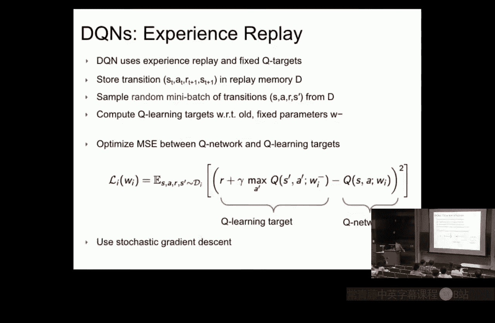

Coerfect， so it looks like this。 We have the agent。It takes observations as input。 if you remember。

 the observation was a stack of four frames。 Okay， if you remember the four frames where， you know。

 reside sizes to 84 by 84 random crop passed through the network。They call this the state。

 I call it the observation。 It doesn't matter at this stage。 the brain is the neural network that。

 you know predicts the cues of the different actions。 You take an arc max。

 You do your absolute grid based on the the cu。 You act。 you receive the word and you it， right。

 This is how。

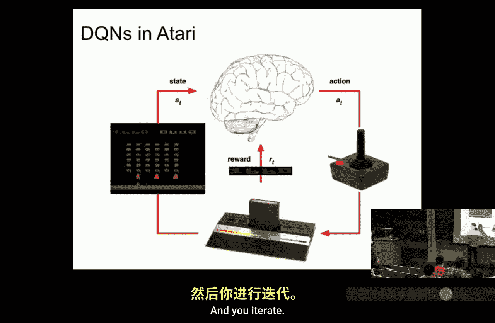

It looks like。This is the exact architecture。😊，Of the network， right， Does this make sense。

 So these are four images here。 Very shallow network。And here are the values of all your actions。Yes。

18 different actions。Now the interesting thing is that if you want to write a paper here and compete there are multiple games and you're supposed to use the same architecture hyperparmeter for all the games。

 this is very important okay this is very important because people very much like to tweak their hyperpar version on the game so I think this standardization here is very very nice you can find DQ and source code as well as the resulting policies online。

😊，Now， a number of extensions have been proposed over this 2013 paper。Here are some of them。

The first is double Q learning for fighting maximization bias。 This is what we're going to see next。

 Priitize experiencely play。 Why should we sample uniformly form replay memory。

 Why don't we just try to prioritize in a smart way。 Okay。

 which topples we're going fit in our batches and take gradients with。D all in Q networks。

 you are also going to implement this in the homework。 Multistep returns。

 This is exactly what I described earlier。 We're going to see it a little bit。Vio distribution。😊。

Is a very interesting paper， I would say highly technically evolving。

 which we're not going to discuss today。 but given how important it is in the result curve。

 we probably will spend one of the future lectures and see the main idea is that instead of having a。

😊，Estimation of the value as one number。 You have the estimation of the future return as a distribution。

 okay。And stochastic networks for exploration。 instead of using Epsilon greedy， this also。

 we're not going to discuss simply because we're gonna have a future lecture exactly on exploration。

 different exploration strategies。 And also because it didn't show that it always does well in all the games in some。

 This helped in some games didn't help。Okay。So， let's see those。extensions。

Here is the maximization bias problem。😡，Imagine there is a state。And all the ground truth。

 state action values are 0。 Okay， that's the if we had the oracle， it would tell us it's 0。

Imagine yout know you don't know the ground values you are estimating from experience。

 so some of your estimates are positive and some of your estimates are negative for those actions。😊。

If you take arc max， you try to find the action that maximizes the Q。

 you pick an action that has a positive Q and you're going to use the same action that give you the arc maxax to estimate what is this you know the corresponding value function。

 and this actual value will always be positive。So although the ground truth。😮，QSR max is 0。

 You will always estimate a positive value。 Okay， because even if one of your actions is slightly positive。

 this is what you're going to pick。And you can see here how this a working example with a very。

 very simple MDP。😊，There are two non terminalminal states A and B。 Imagine we start on a。

 This is a deterministic of 0。 Okay， because the deter deterministic you very fast realize that oh。

 yes， going left is a 0。 the Q is 0。 Now the problem is that sorry。

 going right is always 0 going left。 you end up in this B state where the reward is stochastic。

 and sample from a normal distribution where the mean is minus0。1 okay。

But if in some of your experience double， you will get some positive reward there。 Okay， I mean。

 sure， the mean is minus0。1。 but the when you're gonna to get some positive reward。

 and you take ab maxax， you will always think that you should go to the left。

 Okay does this make sense， although it's clear that going to the right will give you 0 reward an expectations。

 And if you had the ground value， it should tell you going to the left is minus0。1。

 So just go to the right all the time。So people have realized this and。Okay。

 we called it the maximization bias。And they try to solve with W learning。

 which is not a new idea in 1990s， it just the recent extension is based on the deepQ learning right so people have done with Table forms and now will do it with functional approximations。

So how we're going to solve this problem？😮，We are going to train。😮，2 action value functions。

 Q1 and Q2。 me use the first one to find the agon max。O。

 what is the action that gives us the highest Q value。

 And we're going to use the second one to evaluate the art max。Does this make sense。

 So this maximization bias comes from the fact that you're using the same Q。

 you have the same function， both to find the maximizing action， as well as to evaluate it。

 So now we're going to use one Q to find what is the best action and the other Q to find okay。

 what is its value。And this is how it looks like。You use the Q1 to find the arc max。😡。

And you use the Q2 to evaluate it。And how do you update this Q1 and Q2， well。

 at each time you use different experience to compute them， all right？And you say with 0。

5 probability， I will update my Q1 with 0。5 probability， I'm going to play my Q2 Allright。

 and when I'm about to act， I'm going to average。😡。

And I'm going to do absolute grid over the average queue。

 and you're going to have this in the homework from what I know。😡，Probably， yes。Very simple。

So this is TleQ learning in Tular form。Well， actually， it's not that the 1990s so that said 2010。

 it looks， but it doesn't matter。 Okay， and now the interesting thing is the following。

 Now you're gonna be saying how many neural networks you need to keep track。 Remember， we had two。

 We had the W minus。And we have a W。 Okay， so now I need another W to give me the extra Q that I will be using。

 Does this make sense？ So the thing is that。researchers propose you don't need another W。

 just use the W minus as your Q2， let me show you how it looks like。😡。

So this is exactly the thing that I showed in the previous lecture， the previous slide。That's it。

 So you will use your current job you。To find the a max， and you use your w minus to find your Q。😡。

Okay， in your target。😡，So basically we said the target should not use the W but then we say you know what it's okay to use the W to do the a max and let's just use the W fixed just to evaluate it。

 still you know things are not going to diverge and we're going to have the benefit of fighting the maximization bias。

😡，Okay。Okay， great， so just you just need to remember this because we're taking all the archrcax of estimates all all algorithms we're doing。

 so it's always good to keep an eye on this type of bias。😡，Now。

 the second idea is also a very general idea。 prior prioritize replay。

 How should I feed my data when I'm training a network， What data to use。

 This is a very very general question。 It arises in all deep learning problems， okay。

And here what we say is the following。😊，Some of the topples， you you， you know you。

Interact with the world。 You collect experience。 You call this quadrant topples。 Okay。

 some of those tuples will generate large error。 La error means large gradients。

 So you'll update your W a lot。 And some of those you really know they are not going to generate any gradients。

 So sampling them doesn't give you any value。 Make sense。

So what we say here is we better consume the examples based on the expected learning that I'm going to。

 how to say benefit from for my W。Of course， I cannot estimate what means。

 you know how much I'm going to benefit for a particular example。

 But the proxy to this quantity is how much error did I measure Last time I used that example。

And don't think that oh， I have this example here is the error。 the target minus the Q。

 And because I took a gradient that  error now went to 0。 Of course not。

 the gradient is a tiny little step。 Does this make sense So whatever is hard in this iteration will probably be hard in the next iteration。

 So just remember the error that different examples induced and this very general in computer vision we also do this we call it hard negative mining we want to mine the examples that give us large gradient updates。

 a lot of examples， we will know some of them are going to be hard and I want to be able to select them。

 if you just rely on uniform sampling， you you will never get to those examples and even if you get them because let's say your batch sizes  hundred and let's say there are two of those in there and the gradient is divided by hundred is going be such a tiny step that without oversampling them you will never gonna improve Does this make sense this is very important and makes a huge difference and indeed you will see in the ablations。

Priitize experience the play made a very big difference if you don't include it。 All right。

 so this is all an important idea。 Now， it's very important detail， because is a matter of。

Implementing it's only the devil is on the details is is the following if。

You there's no stochistic the way you choose the tables and you always choose the tableple with the highest priority All right the highestd error。

 oftentimes you will over fit。 Oftentimes you will forever forget some examples that have lower error。

 So basically what it says there is add a little bit of stochasticity。 That's it。 That's all it says。

 So PI is proportional to that error quant that we said。Alpha controls the stochasticity。

 So if alpha is 0， then we just have uniform sampling。 Okay， for higher values， we have， you know。

 we bias more and more towards， you know selecting based on the TD errors。 Okay， so just say。

 you know， sampling based on the error is a good idea。

 but be a little bit stochastic as opposed to just you know。

 all the time choosing the one with the highest TD error。Great。

 so how do we implement this on hardware we're using a priority queue。

Wch data structure do we use a prior？Okay。So this is important。 Now let's go to another update。

 dwelling networks。So the authors here argue oh。 let's discuss here first。

 So let's discuss some definitions。 we know what is the Q is the state action value function。

 We know what is the V is the state value function。 So the advantage is Q minus v。Is。Essentially。

 it tells us how much more you're going to benefit by choosing this particular action。

Over just acting in expectation， the particular state， all right？

Some of the advantages will be positive and cell will be negative。 Okay。

 some of those advantage for the actions will be higher than the expected value function scam are going to be。

 you know， lower。 Alright， And the advantage tells you in this particular state。

 if you pick that action， how much better you will do over， you know， the expected case of。

It choosing options and expectation。Which is the state value function。

 So the authors here claim that this is a better architecture than Van DpQ network， yes。

Value is that。嗯。Sorry， W， of course， W， I apologize the state and the weights， right， excellentt。

 Yes， it's a typo。Very nice。 Actually， it's double typo。This doesn't exist in the next slide。

 Just wait a second here。Okay。But however， we switch to theta。 So that's the interesting thing。嗯。

So they argue that instead of having one network that consumes the state and spits out Q values for all your actions。

It's better to have these two streams here at the top layer， two fully connected layers。

 one that generates one color， which is what。The state value function。In one that generates a vector。

Okay。One place of the vectors for each action。 So this is as long as the output of the DQN that spits out the advantages for your actions。

 and it says that the Q should be computed the final Q because that's all we care about the final Q should be computed by adding V and alpha and they say。

 you know what that's all we're going to do We're just going to change the architecture。

 We don't need extra supervision。 I'm just going to use exactly the same DQN training algorithm。

 Does this make sense so far， So we don't know if it's better， but does this make sense。

 I just make this little the composition of the very top layer。Now。Why would this be beneficial？Okay。

 well， the thing is that as the authors note， the value function in a state is in a different。

How to say range is the range around 10， 15， while the advantages are very， very tiny。

And they say that in some states where， for example， there are no enemies。

 how you're going to act is irrelevant。 It doesn't matter。

 You only need to know if this state in general is good or not。

 for other states where you know on left you're going to save life and on the right。

 you're going to die， it's very important to know your Q values。

 but it's not the case for all the states。 right and many times when we play video games in some states which just relax right。

 we're not all the time pressing buttons in some states just doesn't matter Allright。

 so they say that if you decompose this in this way is's better。

 Now here's the problem with this equation。If you know the Q。

 you cannot identify what is V and what is a， Because you can always add some quantity and V subtracted on a and have the same result。

 okay。So how can we restrict A a little bit？ So they say what it worked for us is。

To make its average。Be  zero， okay。So this is how they combine V and alpha。 Basically。

 they make sure they subtract the mean and then they add them。

 So the V is as if it gives you the D C component， right， And then the alpha gives you the。

Tiny little fluctuation on top of the v。Which is a。

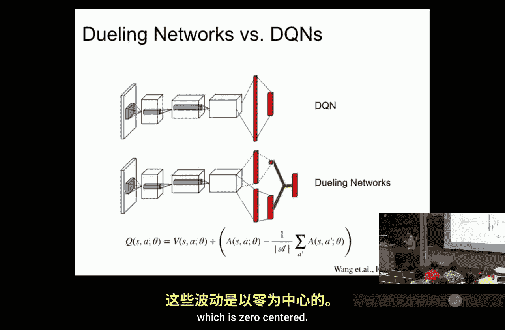

Zero center。And。Then they visualized， they visualize their value functions。

 and they visualize their advantages and we'll discuss how they did this visualization。 So basically。

 the value right， we remember there was an output of the network with a value there。 Okay。

 the state value， that scholar。Essentially， pays attention to the road。While when there is no enemy。

 the advantage attention doesn't pay attention to any particular part of the image more than other。

 While when there is an enemy， then， you know， the action really focuses on you know this particular enemy。

 for example。 So you see that the ceency maps that you get from the two streams are different。

 And now I're going to ask where did the sency maps come from how they're computed。

 they seem like a good idea each time I train a network with a visual input to compute those cience maps to see what my network is learning or where it's paying attention to。

 right。Did't seem like a good idea， yes。

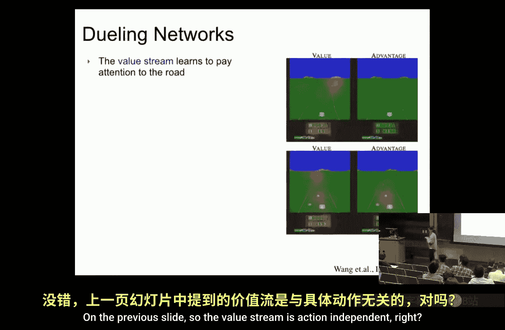

Maybe it's like of the value stream。Is action independent， right。

 but the formula VSA like it depends on。Action。So should they not。Sorry， so this is VS F。

 this only depends on the state。 you see， it's one scholar used for all the actions。Absolutely， yes。

Okay。이걸 아 빌게 똑똑톡。You tie it and you sum。Great， excellent。 So I'm I'm gonna to collect thistys。

 This is great。

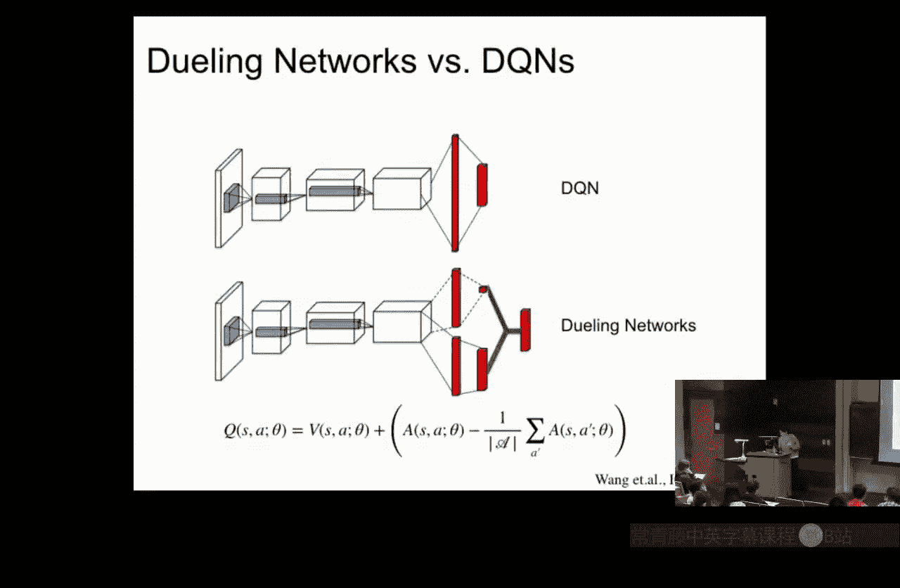

Okay， so I want to discuss， let's see。I want to discuss five minutes， guys。

 how when you train networks， we can visualize the siliency maps， Okay， just five minutes。

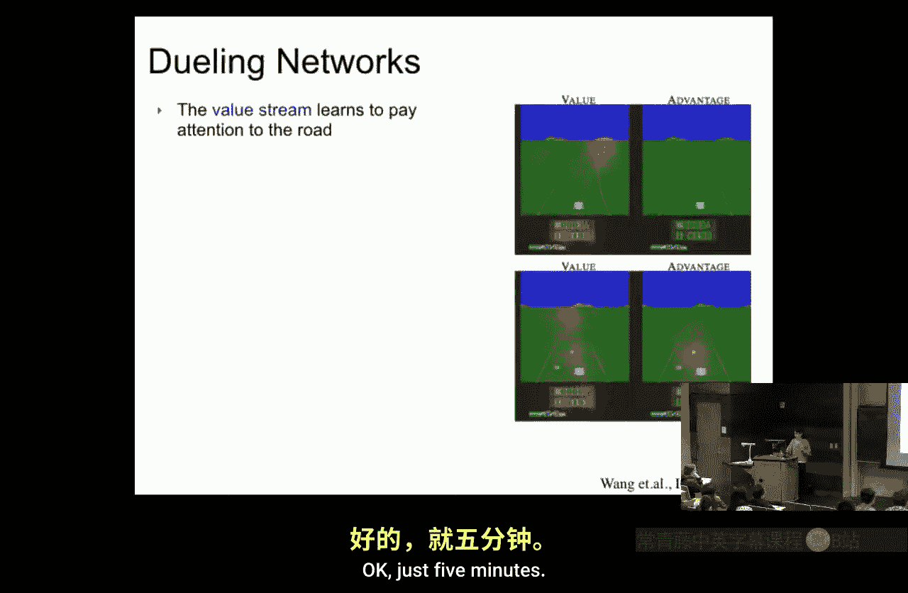

The authors used the techniques presented in this paper， deep inside convolutional networks。

 visualizing image classification models and seeency maps。 So what do the authors。

Proposed in this paper， they say。You go on image and you train an image classification deep network how they show how you can do to task。

 The first task says generate me an image that will maximize the classification score of my network。

 either this classification score being chair or cat or dog。

 what does the network want to see to say， oh， I'm sure this is a cat， okay so that's the first task。

😡，Before we discuss how to do it， let's see what is the second task。

 So the second task is generate a seliency map， given an image okay and a score of a particular category generate a sency map for that particular category show me okay。

 which part of the image if it changed a little bit will have a huge impact on the classification score okay。

So how do we do the first task？So once you train the network。

 now you need to stop thinking of w use as parameters。 The ws are now fixed。 Okay。

 you just have a function。 You are not going to update the function anymore。 Okay。

 think about as a function of the input and the output。

 The input is the image and the output is the classification score。

 And you want to see how the classification score changes as the image change。 So this make sense。

 So that's so the w is now frozen。 I want to investigate an already trained network。 Allright。So。

 think of this now。Deep network as a function of two the weights and the image。

 The weights are frozen。 So forget about those。 So now it's function of the image。

 So how can we generate an image that will maximize the classification score。

 We can start from a zero image。 I mean， you don't need to start from a zero image。

 You can also start from an arbitrary image or you can start from a real image。 Allright。And then。

Try to find that that image that will maximize the classification score with some regularization。

 meaning that the pixel values， their， their magnitude， like their norm should not be too big。

 That's it。 So we just need to perform this maximization。

How will perform this maximization with gradient descent，However。

 now our updates will not be on the weights， the weights are frozen will be directly to the image pixels。

Allright， so how do we do gradient then， we initialize our variable。 So here。

 we initialize the image。 Let's say to the zero image， and we propagate updates。All right。Great。

And at the end， once you are done with your you process， you need to add the mean image if you want。

 because you started from the zero image。 I mean， this mini image doesn't expect something important。

 some gray thing。 that's it。 So this is the mean image from Igenenet and you'll end up having this type of images。

The dumbbell， those different dumbbells and cups。And there are some dogs there， Dalmatian dog。

 So the image doesn't need to be， of course， a natural image。 but this image。

 if you feed it into the train network， the network that train will have a very， very。

 very high classification score for Dalmatian， for example， Does this make sense。

So I think these are very little how to say fast to implement techniques that you can do at home。

 I think it's super fun。 now let's go to the second more useful way， simply because the dueling。😊。

Network authors used it， okay。So the task here is given a particular。Cgory， all right。

 particular category， I want to generate the s Sap。 What does the s Sap mean？😊。

I want to find the part of the image。That if we change slightly。

 you have a very high impact on my output。 Allright。

 And the output for them was the classification score for the dwelling network paper was the value function and the action the advantage function。

 okay。So how we're going to do it？Well， again， we consider this big network and the ws are frozen。

 So it's a function of the image。 so we can compute the partial derivative of this output with respect to the image。

If we can approximate it to being like this simple form， all， so if it was like this。

 then by looking at those ws， the I is essentially the pixels imagine that the image has been planted。

 the ws that have the higher magnitude is indicate which pixels will have the highest impact on the classification score。

😡，So how can we compute this derivative of the output of the networkque respect the image using back propagation？

😡，All right。So what do I do is I go to the top。 I pick the derivative with respect to the output I care about。

 I set this to one。 I set the others to0 because you say I want to focus on how this particular derivative of this output score propagates back to my input I do the back propagation because of course it meanss a very complicated function how I'm going to write。

 Of course it's all colorss。 There's no problem It just weights right but you know I will use the。😡。

Autommate derivatives in there。And then once I go to the pixels， if this image is grayscale。

 then the whatever values I get， I take their norm。 and this is the sill image。

 If I have three channel image， RGB for every pixel， I will have three numbers， right， because。

For every each pixel on top of it sits three channels， RGB。

 and the weight kernels on the first layer touch on all of those。 So the seniorC map is。

Should consider all these three channels。 So what do you do， You take the maximum。

 So if the red channel is very important for that pixel， you say， okay。

 that pixel is still very important。 or if the G， then that's fine。

 Still the pixel is very important。 So in any case， this is how they general the C maps。

 potentially we can have another because it's very important。

 Intertability to neural is very important。 So potentially we have have a electro later to see some other ways of computing s maps that people use potentially simpler。

 But here is how the c map looks。 So here is， you say dog show me which part of the image is let's say。

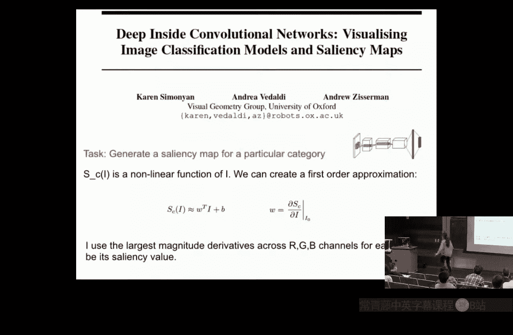

Responsible for the dog response and it shows here。

 and this is what the authors you see this red on top of the image。

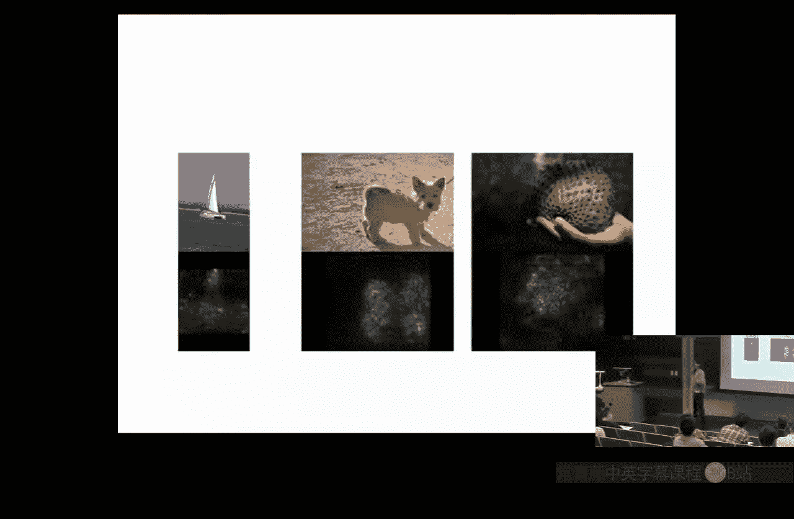

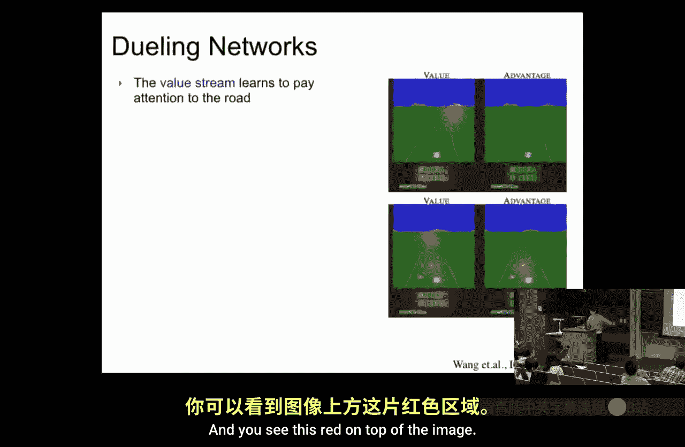

So these are the multi step returns， Another very old。

 nothing you hear instead of just using a single step， you can use N step return。

 What is an next step return is the discounted。Reward for the next N states。 Okay。

 so you use this as your target plus the discounted gamma max across a of the Q of the resulting state after n steps rather than right next state。

 Okay， This made a huge difference。 in the results。 That's why I want to mention it。And， you know。

 just you vary the end and you have different targets。 Nothing special， extremely simple， right。

 Is't this extremely simple， extremely simple change。Now， let's go to rainbow。

 a recent paper that says。People have been proposing updates on the Dqui Nal garden。

 which of those updates and extensions are important and which are less important， all right。😡。

So here， I want you to forget about A3C for now。😡，Because we're going to sit later in later lectures。

 but the QN sits here。😊，This is as you collect the experience。

 and this is how well you're doing in the game。😊，And by adding the different。 So， for example。

 let's look at double cure learning。This is fighting the maximization bias。😡。

Let's look at prioritized experience replay， This is the green， even higher， very， very important。

Let's look at the dwelling DDQ N。 Now I want you to remember that the dwelling network used both the experience replay and the WQ learning and these two streams。

 So it combine three。Extensions and we'll do Applationations in a little bit in any case it sit somewhere here。

 the big important unknown in this graph is this distributional DQN which we haven't covered。

 we're not going to cover this lecture but we may take a look at later lectures okay。😊。

And in any case， if you combine all those extensions， you get much， much， much higher， all。

 both in the speed of learning as well as in the final policy， because you may say， okay， yes。

 I learned faster， but if I let the other algorithm with enough time will they reach there where it seems that no。

 they are not going to reach there okay？😡，So here are some ablations。😮，嗯。Yes。

 so the ablitions are here。So here is the rainbow。 And what if from the rainbow。

 which combines all those extensions， you remove。WQ learning。Is almost the same。

And now you should ask if it's almost the same， why we have it done the homework？😡，Well， there is。

 there is an explanation in that paper， and they say the following。

 the reward was clipped between -10 and 10。The reward。

 you remember the target the equation this are I？啊。That was where it was clipped。

 They said the actual reward。Was always higher than this was beyond-10 in1。 So basically。

 we did have the maximization bias because of the clipping。

Does this make sense if you would clip in larger values。Potentially， doesn't make it because you。

 you don't allow your network to， to overshoot because you say， okay， that's。That's your word。

 and that's it。If you would make these distribution higher， potentially。

 the WQ learning would kicking and play an important role。😡，Let's see if we remove。

The prioritized experience replay， well， this is a huge drop， right。 Do you see the blue here。

That's pretty big drop。Then let's put no dwelling again， not a big difference。😡。

So they don't comment on this。 they say， okay， it didn't help。嗯。Yeah， normal to step should drop。

And it's such as an easy change to make， right， the multistep type of targets。Yellow。

 and then no distribution， huge drop， but I hope to to get back to this paper in few few。

 because it's a little bit more technical， maybe we should see it in like few lecture formula。

 alright。Yes。Yes。I'm wondering what the top legend means like the number of games super right。

 So this is the number of games where the human performance was surpassed by that percent。

Let's say number of games where we surpass the human，20% of the human，50% of the human performance。

100% of human performance，2200% of human performance。 We play much much better than the human。

That's a measure of the number of games that this has played yes and one over the human。

 so you see that's why we have much fewer games here because in much fewer years we were able to beat the human by that much percent。

 well it much more games were able to beat the human by just 20%。Okay，20% human performance。So。

 so are， we compare against human performance。 That's one way to put the score there on the Y axis。

The number of games where the performance was 20% of the human performance， one fifth。

 and here you see that all of them had that many games。😊，And。You know， as you go here。

 like fewer and fewer of them。All the to do wait a second。

 the games have to do with the games available in this AOE arcade learning environment。

 there are 57 games in total， so then you show in how many of those games you are able to beat the human。

That， that's the question。 Does this make sense。Different。

 like one is this particular atary with this。 The other is the ping pong。 The other is。

 I don't know how it's called。They have this weird names。 Okay。

 so this shows in how many of those environments you are able to beat human performance。Okay。

 not how many games you played， not how many runs you did。ok but。okay， great， great。Yes。

So for the visualizing the image classification model and the s maps， how is that useful for？

For the D。Is not at all useful。 It's useful for us for debugging。 We see。

 does the network focus on a relevant part， Does it focus on the enemies or it focus up right left on the green corner。

 which is completely relevant。 So it's a sanity check that your network is learning something relevant for the task。

Yes。Red。Again， it's a matter of stability of trying the same way we clip the gradients not to overshoot。

Again， the same graph great。 so now we go to the last part of the lecture。😊，Which is？

Comparison of reinforcement learning with running from from a planner。

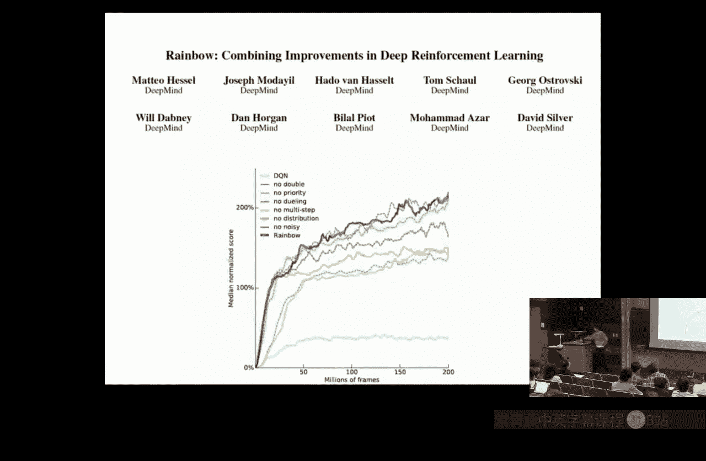

So the first question is the following。Imagine we have access to the internal state of the attire simulator。

Good online planning， for example， using Monte Carro research。Outperform the trained DQan policy。

What do I mean by this？ I'm mean the following。 Imagine we have a game。And we have a human playing。

 Yes， now we have the DQN playing the trend DQN， yes。

Let's think for now for the vanilla Diquian that came out of 2013， as opposed to the rainbow。

And on the third part， we have not a learning algorithm。

 but rather a planning algorithm that doesn't really learn a policy。

 The only thing that does is that each state， it as a tree and tries to pick the best action。Okay。

This Montecar research is the most vanilla version there are no di nets to help it okay you haven't played played anything at home you just play right now with the opponent and the only advantage you have is you have the similarimulator to that you can unroll forward and see the rewards by the way here we don't have terminal states like go that you really need to go to the very last step to get win or lose here as you play the game you all the time either k enemiesies or you save some people and all the time you get rewards or not so if you unfold 200 levels your three you will get rewards of these 200 so this is a big difference with。

Alpha go playing。 So here is my question。 who would win you think。Or don't understand the question。

 We can repeat the question。 That's also。Howhall we repeat the question。Okay， great。

 So what I'm trying to say is the following。 We sit down and we trained at D Q N。😊。

We train this DN in this way that we described in this chapter。 you start playing。

 initial initialize your ws， you collect experience， you keep the W fixed， etc cetera。 You swap。

 you have your experience buffer。 every thousand5000 gradient updates this。 you swap the Ws。 Okay。

 you copy the weight。 It's continue playing， playing， playing， playing till you reach convergence。

 Okay， you convertverge。 You say， okay， that's the best I can do。 Here's my policy。 Now， of course。

 you can use this post to play a game。 correct， Great， So that's one competitor。

 The other competitor is a nonlearning competitor。It doesn't learn anything， but it plants。😡。

Which means that given a particular state， I have my simulator。

 I know all these 18 actions for each of those 18 actions。 I do a lot of simulations。

I unfold the tree。 actually， we can go and revisit what this multichural research is if you want a small review。

 okay。And I pick all the cues that I estimate come from rewords during those online simulations。

 and then I pick the action that gave me the is most visited if you remember。

From those 18 in the root of the tree。 And then once I go the next step， again。

 I again unfold and plan ahead。Which of the do you think it would win and under which conditions。Yes。

Or they。Once you make a few moves， It's very easy to undo them。 So once you do the random rollout。

 you kind of lose all information of what actions you took earlier。 So I think the DQN is better。

 I didn't understand your explanation Like with the multicolor research。

 let's say you're playing break you move your panel like three blocks to the right and then you do a random policy you might just move three blocks to the left and everything。

 every fact about the。Right is lost。And so like why it's lost of you' book keeping everything on your tree leavess。

 right？Every random rollout from most of the leaves gives you basically the same value。

It's kind of like mostly schastic。Does people understand this explanation？No。

 so you need to explain it better。Yes。啊诶啊听啊诶。Yes。if you played well for a certain number of terms。

You know guyss not the environment is not the stochastic。 In fact， it's deterministic。

 It just depends on an initial random seed。 Okay， and can I tell something。

 I give you access to that initial random seed， Let's assume the environment is deterministic。

 okay Is this what you're trying to say， Let's assume the environment is determined。 And in fact。

 it is right， The only thing of stochastic comes from this initial seed in any case。

 that's how this where simulator works。 So imagine you would have access to this seed。

 then you know exactly given this action what's going to happen next。

I'm just saying like the game tree as you unfold the multicolor tree search basically goes back to the group。

Yes。Oh yeah， yes， I think the DQM policy would do better assuming that the Montecar research doesn't get to look ahead sort of an infinite number of steps or log steps。

Because the D herean policy can learn long term strategies to maximize those。They right。

 what Victoria says is that it depends on how many steps you will allow your motorcolor to search to unfold。

I don't see any problem with this thing that you're saying。 Okay yeah， sure， we unfold。

 And by the way， there was some question the other time。 Oh， what if it goes back， Well。

 it turns out the bookkeeping happens not per state， but per step and depth。

 So this state was met in this depth 3。 And if this same state comes out in this depth 30。

 that's completely new estimates are going to be computed for that online manner。

 At least that's how it was in the original paper。 Okay So even if the state is identical where it's encountered how deep it is book differently。

 This doesn't mean that it is not markov。 but just this how the bookkeeping happens。

 So I don't understand your explanation， but we can discuss it more because it's important for all of us we have an answer from Victoria。

 do have other answers。Yes， I guess my answer is kind of this。でだす。Rearch for when one。

So that's kind of saying the same。Right， right。 So I want to remind you that Monte Carlo is not just about the depth。

 It's also about how many simulations you do， because if you do one simulation， you get some rewards。

 right， If you do another one， youll have a different。Once。For this particular situation。

The deep Q and may out。こい弁年ですけど。right， yes。 So basically， yes。😊，てチーズ。

What I'm confused about your question is whether or not we training both of them converence let me tell you so DQN is strength of convergence。

 So that's for sure， correct What do you mean by training the Monte carlo research。

 There is nothing to train multiural research that has any parameters。 Oh， very nice。

 So So what I didn't say is how many resources did you use to the Monte carlo research。

 And let me tell you the more sure， And if you give actually that's exactly right exactly he it with enough resources Monte caral research will be DQN。

 And can I tell you if you put more extensions in your DQN what I would do is give more resources to my Monteural research and still I would beat you So it all depends how many resources you will give to the Monte carural research to unfold the particular depth and to do enough simulations。

 It's a planner。 it knows about the environment， the value is schasticity。啊。

I want to say one more thing。Oh， yes。And then why dot we use multic research？

Since it will always win。Because we will not have real time play， right。

 It will take days for Monte Car to finish a game。 if you don't have this Google TPus。Right， days。

 right and here we're trying to compete with humans on equal basis， real time play， okay。

So the answer is yes with enough resources， yes， which is both a number of simulations and a maximum out depth。

 exactly what you said， will outperform the learned Dan policy。

 why we do not use it because by the way， we're talking about vanilla Montec research here。

 there's no deep net nothing is very， very slow。And now we go to the other question， what if。

We use Monte Carlo research at training time， All right。To suggest actions。

 remember a multic research is used to suggest actions on the root state， right？Right。

 that's what it is。 And we take these suggestions and we try to mimic them。

And we train and network in this way， as opposed to training with reinforcement。So basically。

 since I haven' an access to a simulator。Why don't I use it to train。 And then at this time says。

 sure， I'm going to deploy my reactive policy， okay。😡，No， look ahead nothing and really， really fast。

Do you think this makes sense？It makes sense。 Okay。

 and that's what exactly we're going to see right now。

Very interesting results from that paper here it is deep learning for real time Atri gameplay using slow offline Monte Carro research planning alright。

 so we will use the planner to train。😊。

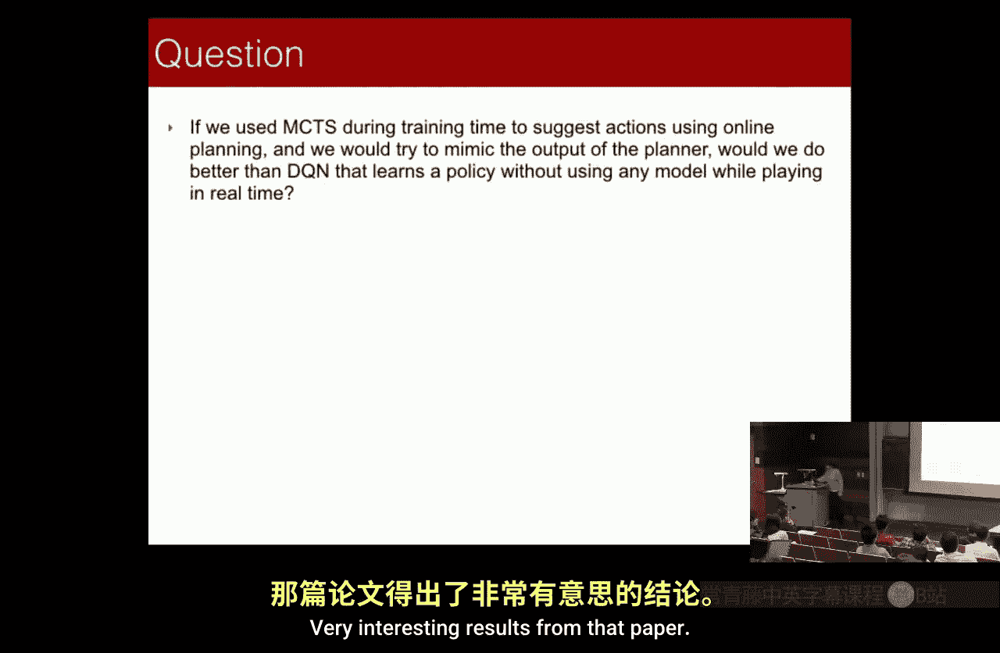

And we saw last week。Two programs， one was Alphago that train policy and value networks at training time and combined them with Monte Carlo research at test time then we saw Alphago0 that was using deep nets and Monte Carlo research both at training time and test time and now the paper going to see is going to use vanilla Monte Carlo to set without any deep nets but only a training time。

😡，A test and we'll use this multic research as a supervisor for the networks。 But at test time。

 we're just going to use a reactive policy。 Of course。

 if you were using a test time multichural research or multicural plus plus within that you will do better。

But then you will need to invest on tons and tons of hardware to be real time。 That's it。 Okay。

 look ahead， we'll always do better。In any case， I like a lot this paper because I want that we see how planners can be used as supervisors for us。

And we'll come back to this topic for manipulation later in the lectures。

 so this is a small division of Monte Carro research。

 we have four stages I want to show you the figure we have this UCB upper confidence ball how we select the actions we saw this last week and here is a simulation。

😡。

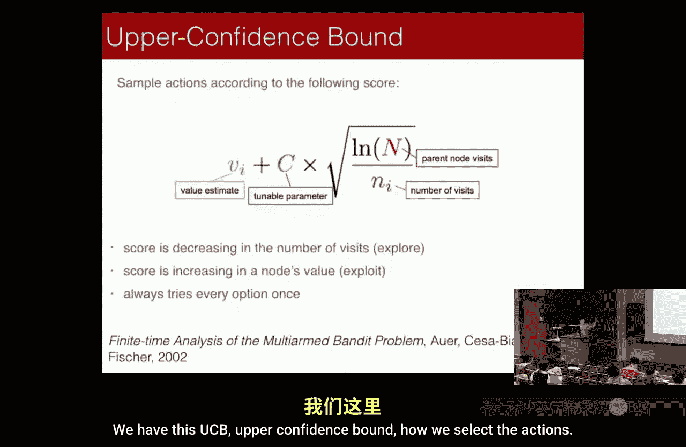

You have a search tree。During the search tree， you pick actions based on this UCB criterion right trying to balance exploitation and exploration。

 if you remember the visitation counts and the queuees that you've got so far。

 you go out of the tree and you just have a around overall policy you get the reward。

 apologies this reward has to do with the final state of the game here the reward is going in because we're in Ontario it is in every state action you can get the rewards。

 Okay so that's the only change we need to think and then we back up。

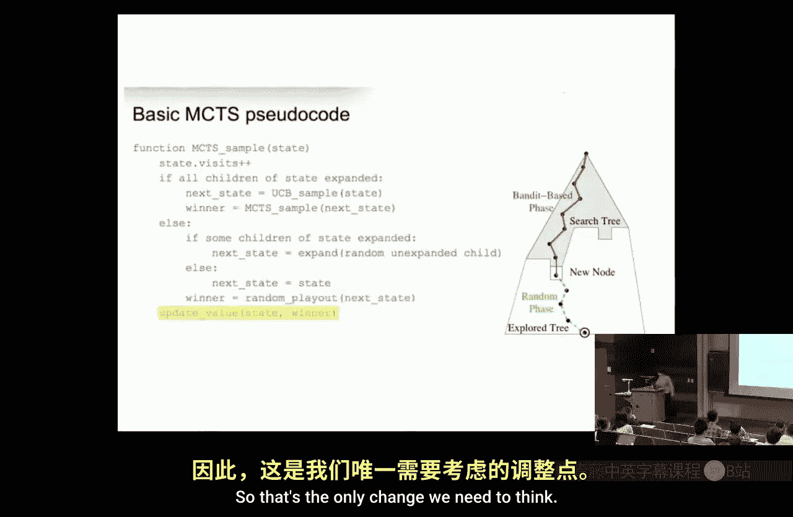

So here exactly what they did， so let's see it's very interesting。So they said， first of all。

 they sat down and said how many resources shall we give to Monte Carlo' search。

 and they estimated exactly how many resources to give so that it outperforms theQN。

 they could have given more， but then would take longer to write the paper。

And no and then still the go say， okay， we had performed D Q。 does this make sense the same result。

 So they did two things。 once you use the planner for every state to give you。Qes， state commma。

 right， that that's what the planary returns for every state。 You have queues， right。

18 long vector of state action value functions。 You can do two things train a regression network or train classification network。

 So the regression network。😊，Given two frames tries to regress to this cube and the classification network。

 given four frames predicts the best action using a standard multiclass classification。

 which is what the soft makes， which one you think it does better。😡，This is not obvious。

 but I'm just wondering。I somebody to say one or the other。Which one we expect， yes。Why。😡，家未さ。

SaI just don't trust the multiclass classification， I'd say regression。你佢都解讲。I see。

 So let me a look in 2013， I was a postdoc， and they would started training deep net。

 and everybody was， oh， everybody can train classifier。 It's so hard to train regression。

 It doesn't converge。 I don't know how to。 You know but I mean。

 anyhow we eventually learn how to train regression。 So here。

 the reason that regression does worse is because。😊，Eventually。

 what you care about is just to pick the best action。

 So trying to squeeze the network's capacity to predict values。

 which at the end of the day you don't care。 you just care about the relative ranking that this action is better than the other。

 Then you're just wasting capacity to an estimated values， which at the end of the day don't matter。

 so that's why the classifier did better。 Now a very subtle point is the following。

 which is going come back again and again and we should pay attention。 The state distribution。😡。

If I'm going to use the Montecarro to search to train， okay。

 which means to play a game against itself。You will see some states。And then you say， yes。

 I'm training a classifier to mimic the Monte Carlo research。 So probably if I deploy it。

 I'm going to visit similar states， right？No， this is not the case。

 and we will see this aggregation or aggregation in the imation lecture in like two weeks from now。😡。

You make tiny bit mistakes and you attempt up in different states and in these different states。

 you really don't know very well so you make even bigger mistakes so you end up in even foreign states and so the error is not bound like in the in the supervised learning case where the different examples are decoupled here once you make a mistake in the beginning。

 then your next action dependent of where you end up in the previous one and things go by in fact this result came out from CMU from Jeff Cordon's lab and we'll see it in two weeks。

So they had to do something to fix that state distribution mismatch。

 What is the simplest thing you can do to fix the state distribution mismatch。😡，Is Twitter it。

You train the Monte Carlo research planner。 It gives you some supervision。

 It tells you from these states， use those actions。 you train your you know classifier。

 then you deploy the classifier， you correct new。Data set， you combine it with the preview。

 You ask again， the motorcarro research planner to give you answers。

 You mimic them with your classifier。 You use it to generate data。

 So this is called data aggregation dagger。 So we'll see this in。So three weeks。And yes。

 so they call it here UCT to classification interleaved， Everything is called UCT。

 UT is essentially a version of Montecarural research。 Let's not go into this。

 It's very similar to what we described。 so here are the results。😊。

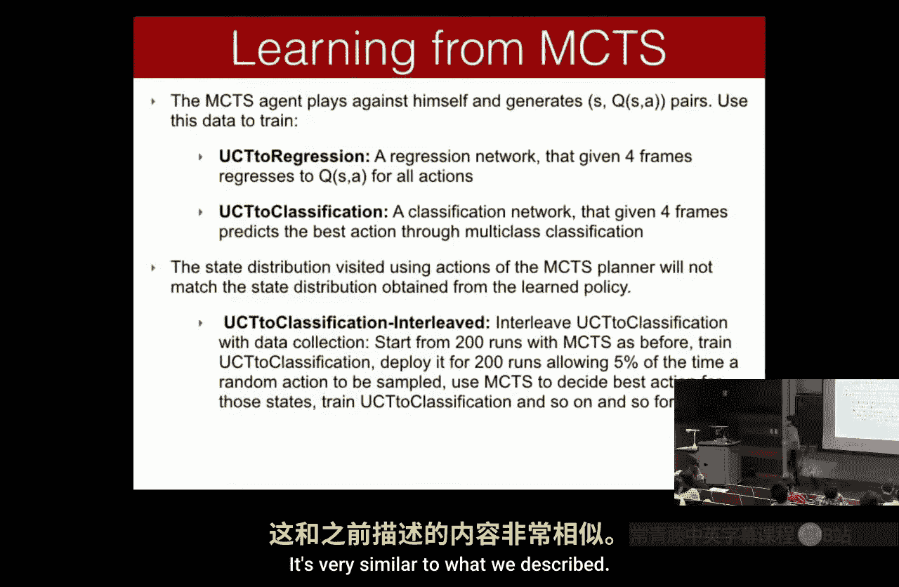

The first result is the following。On online planning。

 without edit by any neural net so the vanilla version outperforms the reactive DQN policy。 Okay。

 it takes though a few days on a recent multi corere computer to play the game。 so it's very slow。😡。

All right， so if you would deploy straight away the planner， there。

 there's no parameters to train here， you're just going need the resources to do online planning。

 then you're just going to be slow， but you'll do better。😡，Now。

 classification is doing better than regression。 UCCC， by the way， is the classification。

 UCR is the regression。 R is regression。😊，So， yeah， it's doing much better。That's it。

WeWe training exactly what we care about， and interling helps。

This UCI means Monte Carro research classification， interl。

 while UCCC means Monte Carro research classification， no interl， so interl helps， all right。

And the other thing that these people showed is that if I give more resources to my planner。

 then the resulting policies， they're going to do even better， okay？😡。

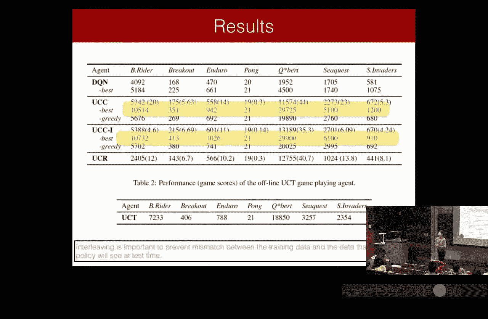

So this is good。 So here we're ending。And， oh， here's one problem。 We don't save the divers。

 So let's focus on the diver problem。To save the divers， if you save two， you don't get the reward。

 you need to save six divers， so to save six divers。

 you need like depth more than 200 which was allowed in this multicarral research。

 so the multicarural research never had the chance to see that if it's going to save six divers is going to get huge huge reward so the divers are completely ignored here okay。

😡，So the question then Kanan is the following， why don't we just use planners to train and we train for reinforcement。

 or at least why don't we combine planners with our L to train。

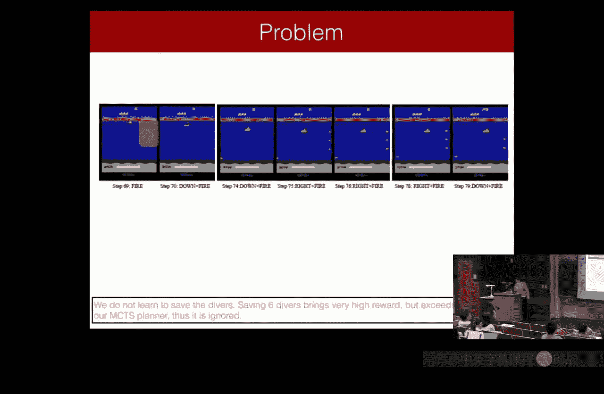

Sometimes we don't have access to the dynamics so the planners cannot be used。

 but we will see in later lectures when we go to control。

 and manipulation how we will see trajectoryor optimize essentially planners that learn the dynamics on the fly and we can use them as supervisors to train policies so a training time will be slow because we will have these optimizers at test time we will have distilled the knowledge of all those planners into some reactive policy that we' deploy will be fast and collect well and everything is going to be great。

we're going to end here and we have five minutes。😊，4our。To。

Finally kids lecture a lot because it's really talking about more tools for the toolbox and you can see these different approaches。

 how they're being mixed and matched in different ways。

 So I just want to make a comment on one of these ideas， which was。😊，诶。

The idea that instead of learning。The Q function is a single。

FunWe could learn it in terms of the advantage， the value plus the advantage function。

Remember that slide？We're saying thatq equals the old diameter plus sum presumably smaller。Delta。

 which is due to committing to a particular action。

And I think that's an interesting idea and the question I wanted to ask is where else can we use that idea？

The generic idea is this， instead of training one neural network。For some function， F of x。

 we could break that into two， some G of x plus some delta where G plus delta gives us。

F ofex and in the case of Q， we were breaking it down in that particular way。

So where else could we use that， think about， for example， learning the next state function。

 what we call the model sometimes。The transition。Which is a function from the state we're in and an action that we take。

2。Let's say the net state or the probability distribution over the next state。呃。For example。

 if I have a robot application， I might describe the current state in terms of this picture。

And then if I take an action like this。Thats this。But the truth is this picture looked the whole lot like this one did。

And so maybe we should use the same kind of idea。To。

Learn the next state function not as a single thing。That is。

I could represent alternatively the next state function as the current state。Plus。

 some delta to all the pixel values。For example。Or if I knew about optical flow。

 maybe I could say it's the delta between the other state。

 the previous state and some optical flow calculation plus some delta that I'm going to learn。

So anyway， just an observation that this idea。Breaking the Q function into some baseline estimate plus a delta that would be smaller。

 and therefore we might have a better chance of learning a more sensitive。

AMore accurate version of that。Quickly， it's actually a more generic tool and there might be cases where we could apply to other things。

 so it's kind of fun just kind of go through all the functions we've been talking about， Q function。

 next day function， value function Does it make sense。

To represent the value function somehow is the sum of the deelta plus a baseline line and so forth。

 so something to think about， good shower topic。😊。

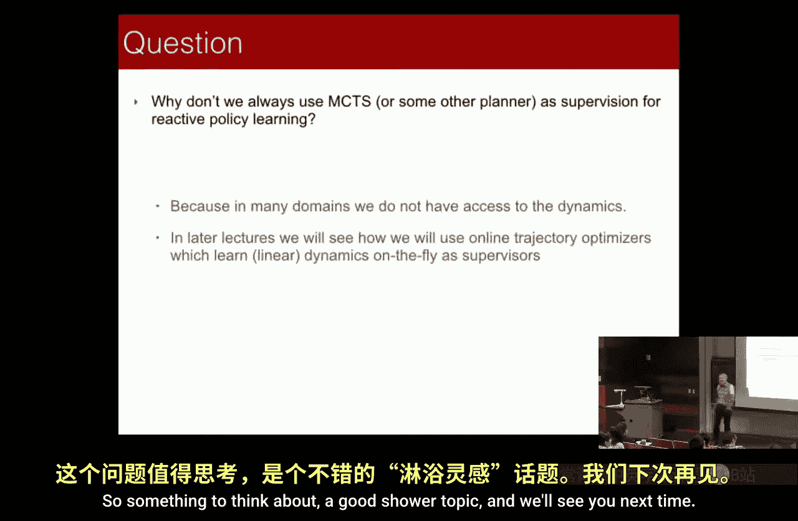

And we'll see you next time。