# 卡耐基梅隆大学【中英⚡深度强化学习与控制｜10-703 Fall 2018, Deep Reinforcement Learning and Control】 p10 P10 10 Policy Gradient Methods -BV1RyqPBbEJV_p10-

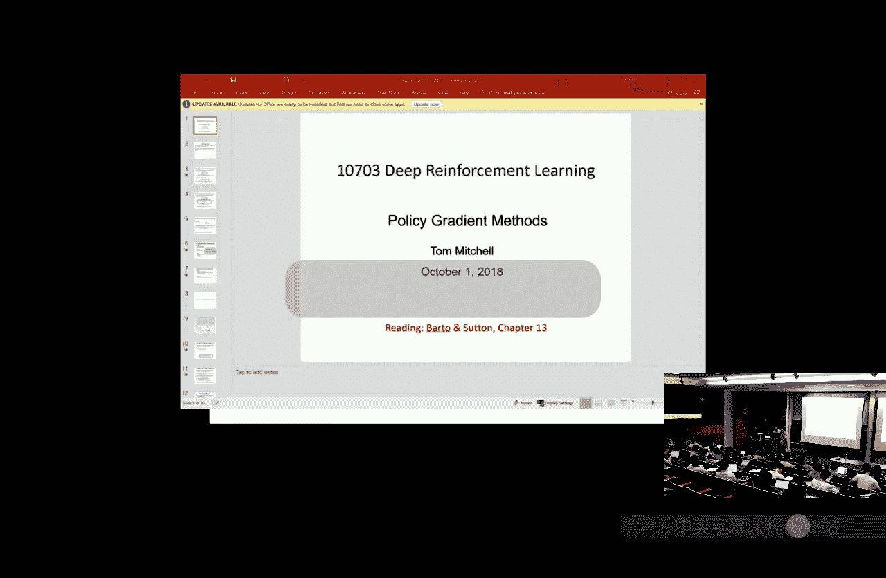

Oh。Whoa， thank you。Every time I teach， a course， I learn something new。

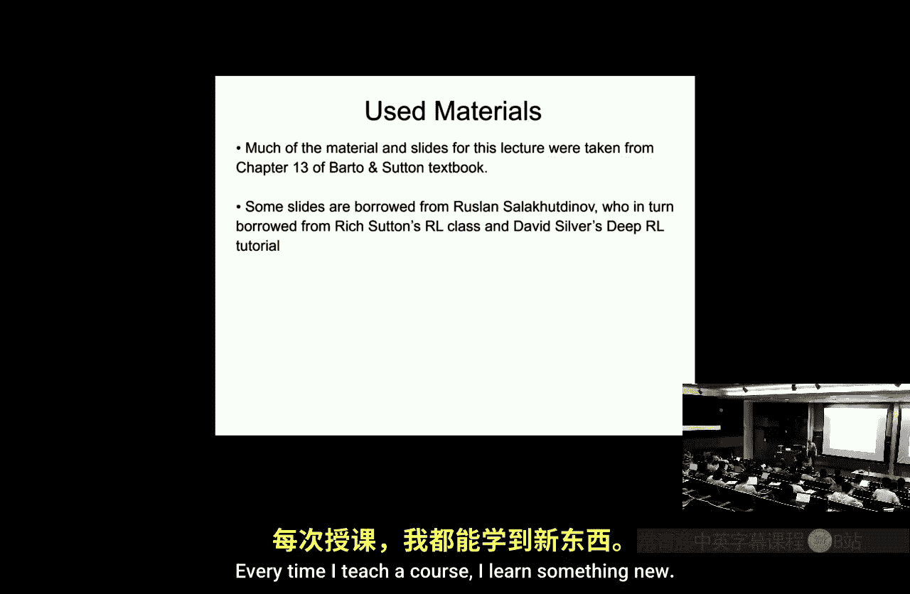

Okay， so as I was mentioning， we're going to talk today about policy learning。 And the idea is this。

 so far， when we've talked about learning policies。

 we' really talked about doing it in an indirect way。

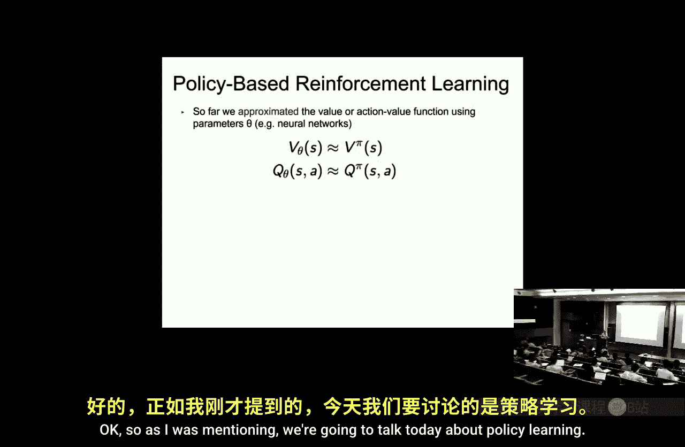

Instead of learning pi directly， we've been talking about learning these different value functions。

 V and Q， and then using those learned value functions。To choose actions。

 So they if you have a particular V or a particular Q。

 that entails the policy and when you follow it。But of course。

 we could just learn the policy directly。

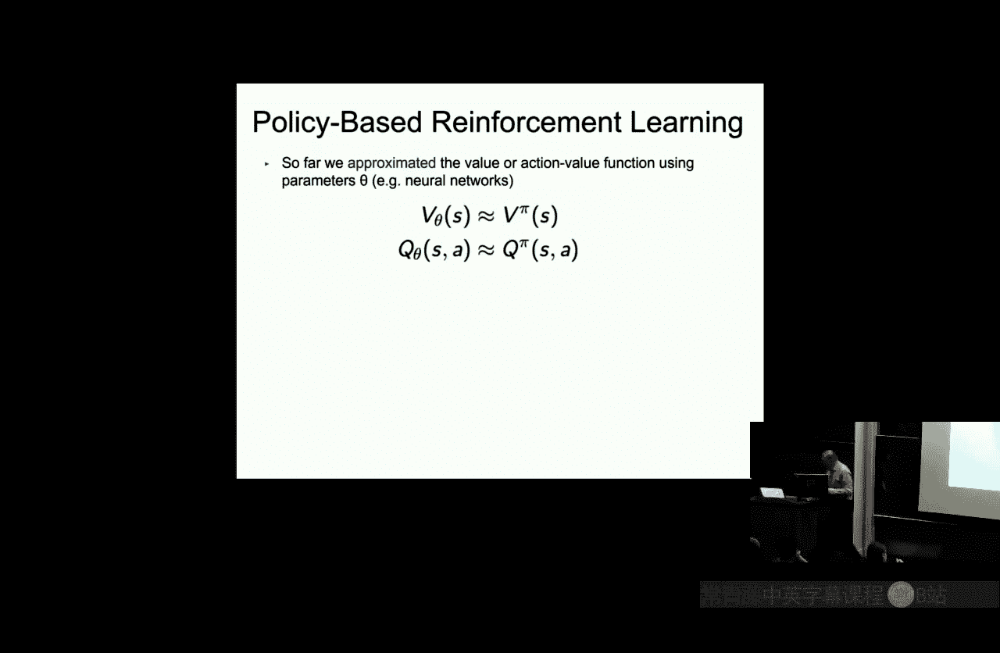

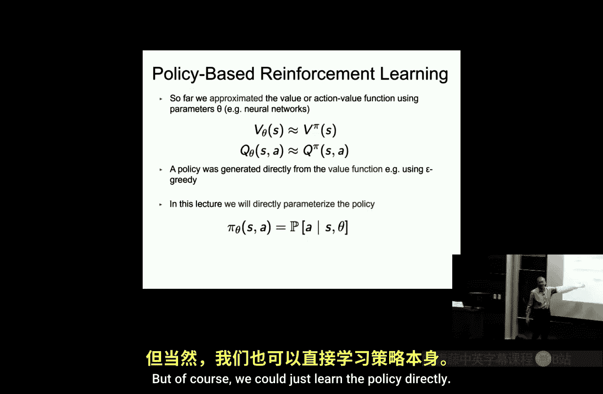

The policy， of course， is one way to describe it is given a state in an action。

 it tells us the probability that we should take that action。Another way to describe it。

 we've also said pi of just S gives us a probability distribution over all the possible actions。

So we'll go back and forth between representing it。

 writing it this way and writing it as a function of S。

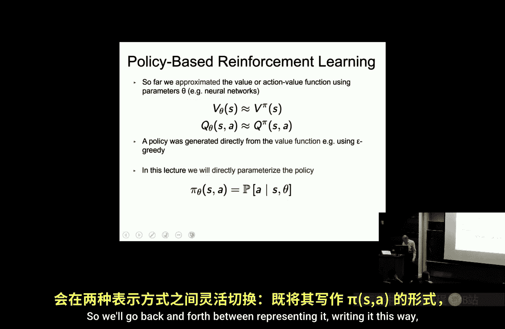

The notation is going to be easier for us today if we represent it this way， write it this way。Okay。

 and we're going to be talking today again about model free reinforcement learning。

 And if I had defined the field of reinforcement learning， I would not have used the term。

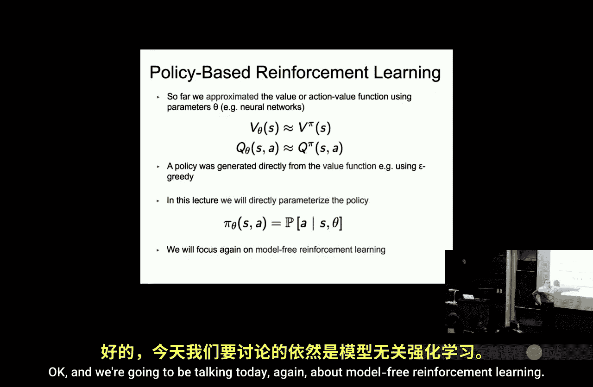

Model based and model free because model could be anything。

 But just remember that when we talk about it in the context of reinforcement learning， of course。

 what we mean is a。

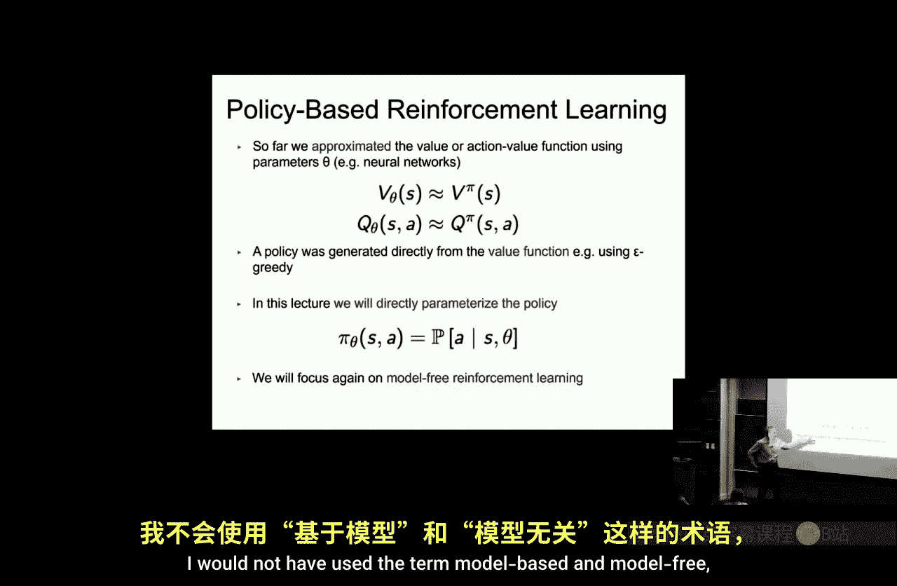

A model here is a function that goes from the current state and action to the distribution over next states。

So we will be assuming we don't have that available。

And sometimes another notation thing will also sometimes just represent this as the conditional probability of inaction given a state。

 same as this。

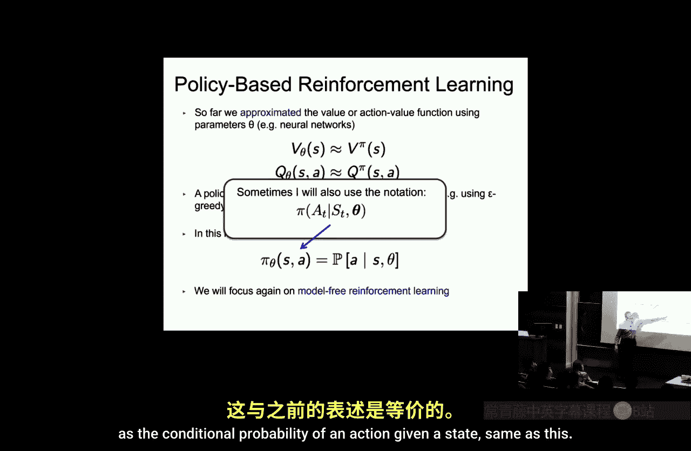

Okay， so。It's actually not very hard to think through。

 if you think how would we represent a policy so that we could learn it， one way， of course。

 would be to make a neural network where the input to the network would be some representation of the current state。

And the output would be probability distribution over actions that we can take， and in fact。

 the most common way of setting this up is to use the self mapps function， which you know about。

Where basically if we want to represent the probability of taking action A。

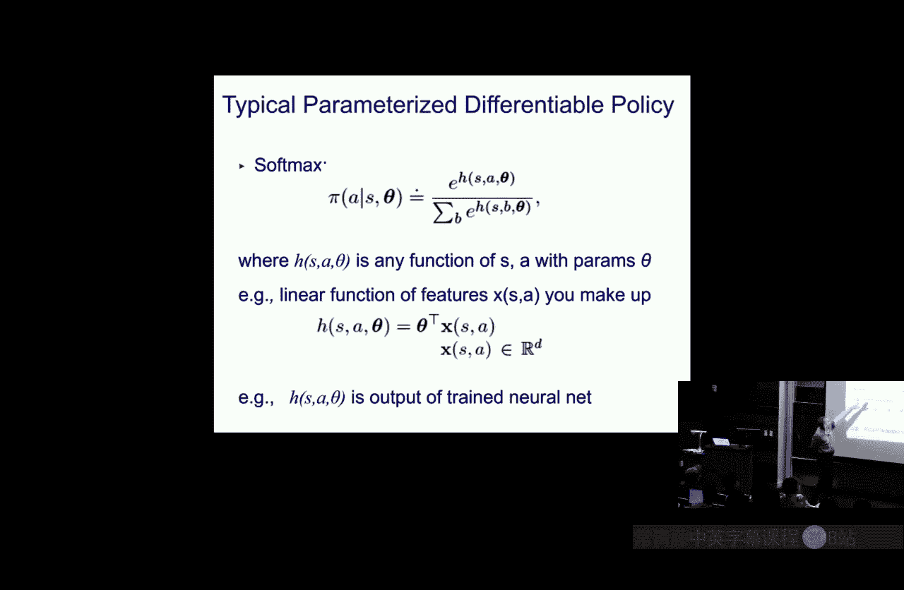

Given state S and a set of learned parameters datata willll generally refer to。

The parameters that define the policy， the things we're learning by the vector's theta。And so。

Softmax is simply this equation that says we can represent。 this is like a logistic function。嗯。

We can represent that probability by E to some function H that we're going to end up learning because it depends on our parameters and then normalize that by the sum overall possible actions。

 suming over B to represent the possible actions。OfThat's in quantity。And so this， you know。

 that denominator， of course， just assures that the probabilities over all the actions will add up to one。

Okay， so there's the softm function， and we can then represent H。

The actual function that's doing all the work any way you like。

And one simple way would be to make it。A linear function of some features that you make up。

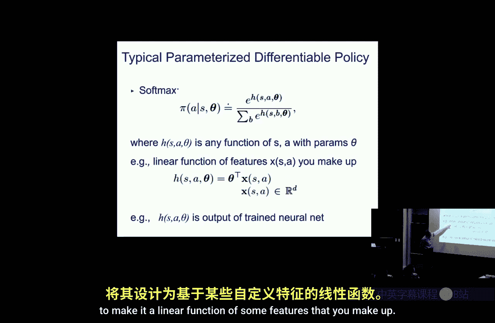

So for example， if you have。嗯。A grid world， kind of。呃。Sceario， you might say， well。

 the state is the X， Y coordinate and the grid。And the features I'm going to use。Could be。

Those coordinates plus I could also talk about the direction。That the action is taking。

Those can be features， but whatever you think is appropriate， this is the engineering part。

 this is where the art， not the science。Of reinforcement learning comes in。

If you make up a feature vector that's computed from the state in action， then we can say， well。

 H is just the linear weighted sum of those features。

And we could learn the parameters for that linear function。Alternatively。

 you can go as complicated as you like， H could be instead a convolutional neural network that's looking at the pixels in the camera that the robot is holding。

And。The output of that train neural network could be our H function。And in fact， you know。

 the common way of training neural networks if we want them to output probability distributions is。

 in fact， to train them with as many layers as we need and then make the final layer simply a softmax layer。

Which is applying this fixed function to。The output of all those of the n minus one layer。

 which we could think of as just computing these features。

Computing some features and getting the age function。Okay， so。Again。

 this is kind of where the art comes in and in your projects。

 you'll get a chance to experience that art directly。

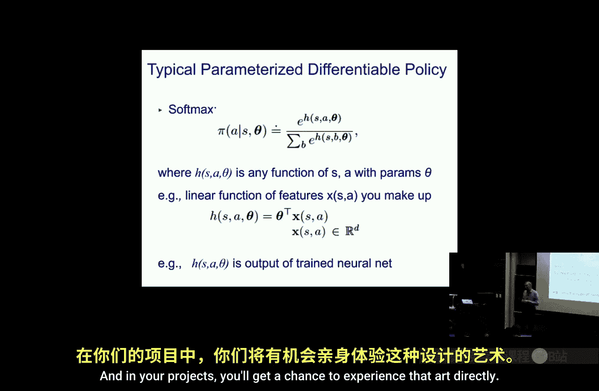

嗯。So just to take a kind of quick look at the big picture。

 we've talked about learning value functions。 Now we're talking about instead learning policies directly。

😊。

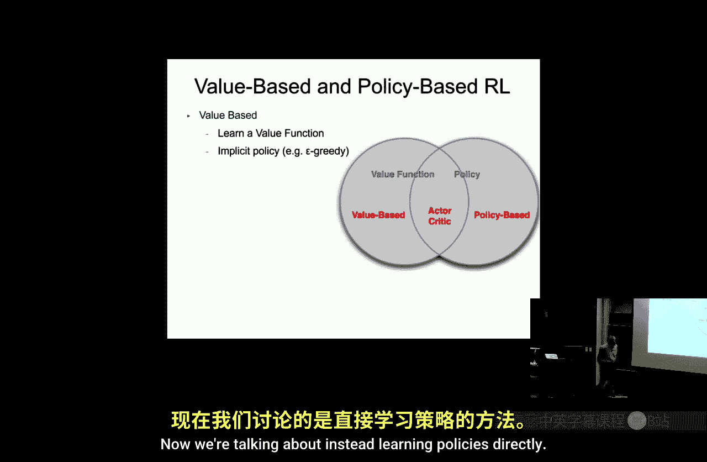

In fact， there is a class of algorithms called actor critictic。

 which we've mentioned briefly already， where we have the agent learn both。

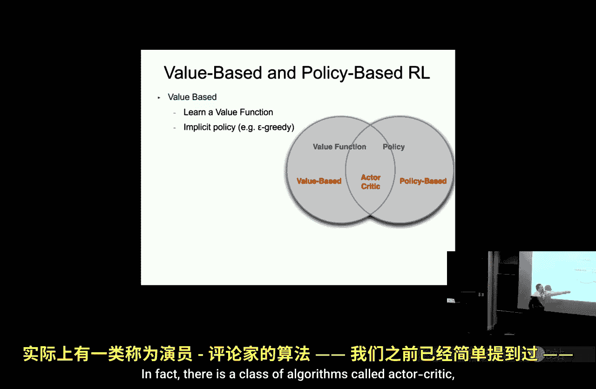

A value function and a policy function。 And use that value function to bootstrap the learning of policy function。

嗯。And the policy， in the case of value functions is implicit。 Here。

 we're going to be learning things。 The policy directly。 And as I mentioned。

 actor critic is a combination a blend of those two。 Now。

 why would you want to do such a thing One of the。

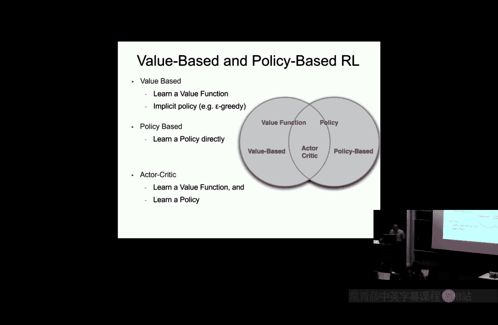

I mean， it's kind of。It's really like the first thing you should think of if you're thinking about reinforcement learning。

 We want to learn a policy。 So let's learn a policy。 Learn value functions。

 we justify doing that instead because。

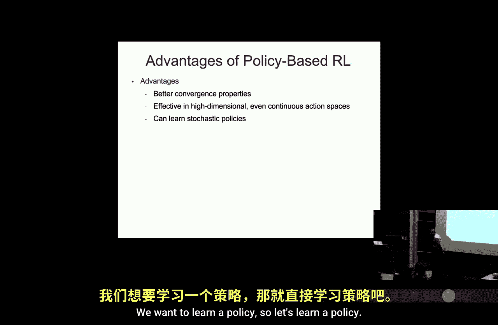

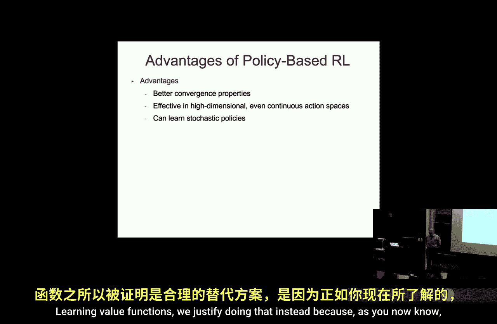

As you now know， it's actually sometimes easier to learn the value function。

But the advantage of learning a policy directly is it will turn out we can。

Make pretty good guarantees about convergence properties just based on if we train the policy with。嗯。

The right sample of data， we'll say more about that as we go。And also， if you think about it， if。

 if I represent my policy as a neural net that goes from a state to an action， then I could。

 since neural nets have continuous outputs， I could also。

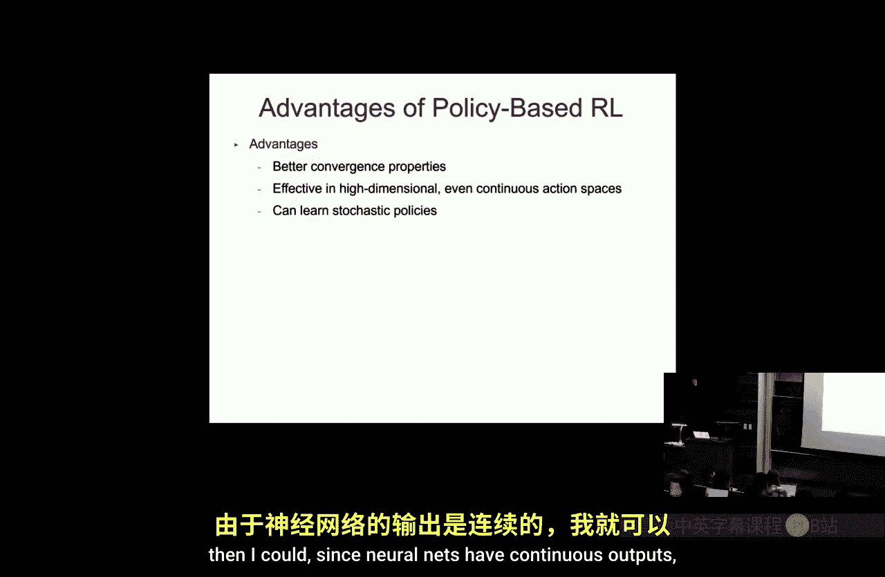

Think about continuous actions。So instead of saying is action one through n。

 which action should I do， I could say， well， there's a continuous action。 I'm a self driving car。

 What's the exact angle that I should steer here。And there are an infinite number of angles。

 so it's nice to be able to represent continuous actions。

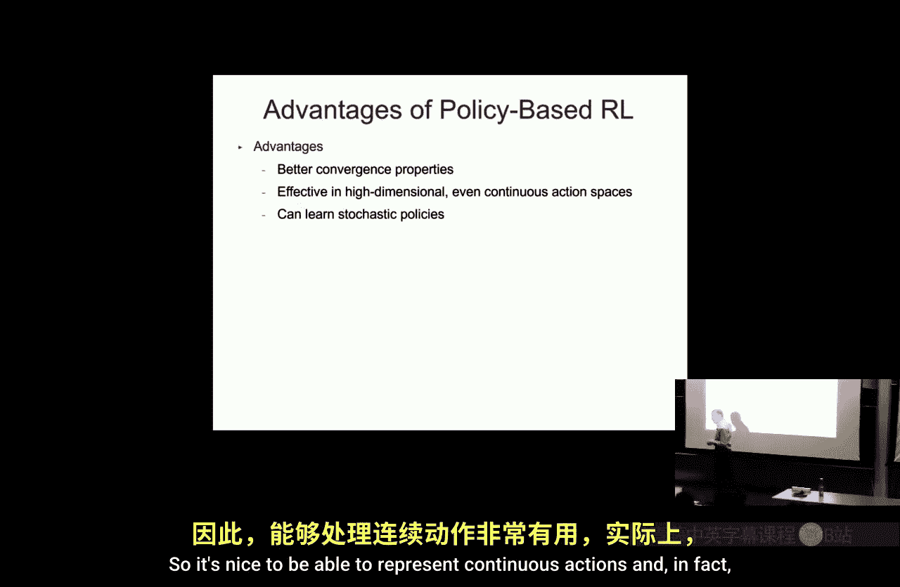

And in fact， work on continuous representations of state too。Like pixel intensities。Also。

 we can learn stochastic policies， the way we've been talking about using value functions。

Is not very stochastic。 Well， we talked about epsilon。嗯。呃。

Using a parameter epsilon to define what's the probability that we'll take a random action versus the action recommended by the policy？

But in fact， there are cases where we want to learn。

Non deterterministic policies that aren't just choosing random actions， but doing something。

More sophisticated and we can do that directly。The main disadvantage is that because we're going to end up using our old friend gradient asscent。

 gradient asscent search。To learn the policy， then we have the normal pitfalls of gradient decent search。

 which is that we might end up learning a local。Finding a local optimum policy。

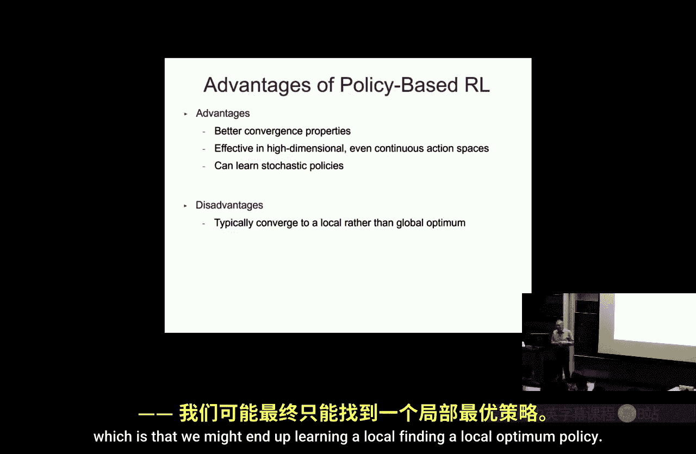

Okay， so let's look at one example， by the way， a lot of this lecture。

I looked at a number of different ways that other people had presented this material。 And I decided。

 far as I'm concerned， Chapter 13 of our textbook of the Bartux and Sutton book is by far the most。

Cl presentation， so I strongly， strongly， strongly three times recommend that you read chapter 13 and in fact。

 many of my pictures in this lecture come from chapter 13。😊，So here's an example of a simple world。😊。

And reinforcement learning problem that illustrates why we might want to be able to learn stochastic policies。

 So in this case， it's a grid world with an absorbing goal state。

We have a reward if negative one every time we take in action until we get to the Gulf state。

 then it's over。So basically， we want to minimize the number of steps to get to the goal state。

There are two available actions。The actions I could call them L and R。And in these two states。

 the L action makes you learn step left。😊，And the R action makes you step right。

 But in this other state， the L action makes you actually go right and the R action makes you actually go left。

开设置。The state dependent action outcome， like。Most action outcomes are。And also， there's a。

A poity of sensory data here so that the agent can actually not distinguish。

This state from this state。They look the same。And so in this case， if you think about it。嗯。

If we learn a。Value function。For this， then we're going to end up。And。

 and then we follow an epsilon greedy policy。This learned。Then。Basically。

 because these states are not distinguishable， the optimal。Policy will either be an epsilon greedy。

recommendationcommendation to go left or an epsilon greedy recommendation to go right。

But because of this。I'm sorry， I shouldn't say to go red， I should say to take action R。

But because the action are here， actually may should go left。

The problem is if you almost always execute the R action， then if you're over here somewhere。

 you're always just going to be looping here， you'll take the R action， take you to S。

 then you'll take the R action， it'll take you here， then you'll take the R， you'll get the idea。嗯。

Whereas if you always try to go left， it's not so good either because if you're here。

 you'll just keep bumping into the wall and not getting anywhere。

So a deterministic policy has this problem。 And， of course。

 the idea of epsilon greedy policies is to add some randomness into the actions so that eventually you will escape this。

Otherwise， unending， banging your head against the wall。嗯。Or looping。

But even with an epsilon greedy left or an epsilon greedy R。

You don't do as well as if you have a stochastic policy that simply goes L。

Half the time and R half the time。And so this is a nice example that illustrates。嗯。

I guess it's not quite half the time that would be here。 so it's closer to 0。6 of the time。

 you'll go R and 0。4 the time L。But the point is that you can easily see why it would be much better to have a probabilistic policy here。

Where the probabilities of ANR are much much more similar than。

T the almost deterministic policy that we'll get if we use a value function。

Because the randomness will let you sometimes choose a L instead of an R when you're here and so forth。

Okay， and this is， in fact， the。The value of the starting state。Under the learned policy。

 in the case that we have an optimal stochastic policy versus an optimal epsilon greedL and epsilon greedR。

Okay。

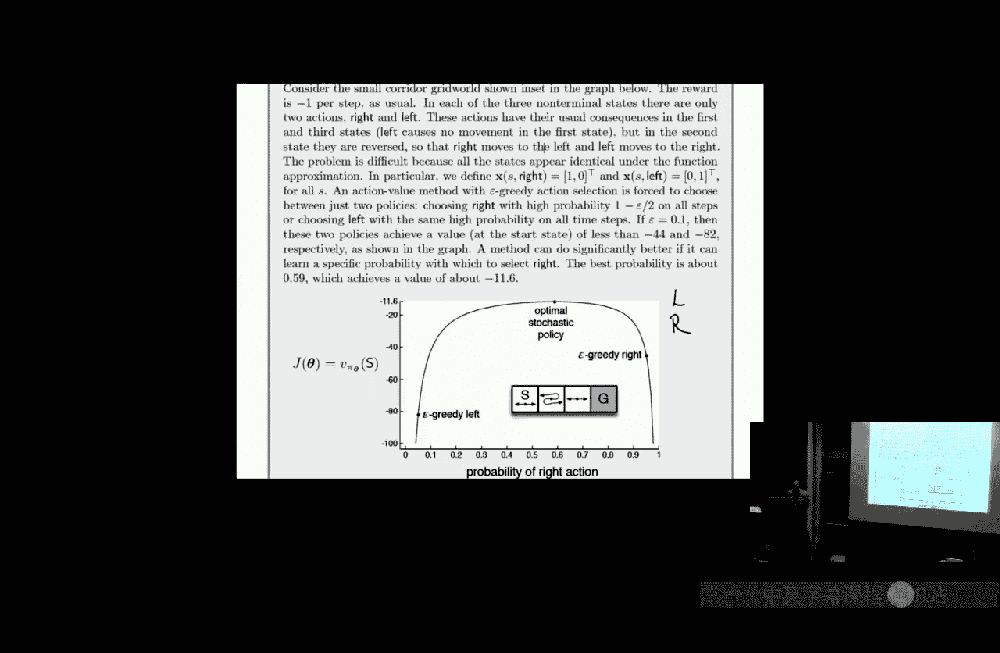

Allright， so this's just by way of。Making it as clear as we can that stochastic policies can be useful。

 Okay， now that we're committed to learning policies， maybe even。

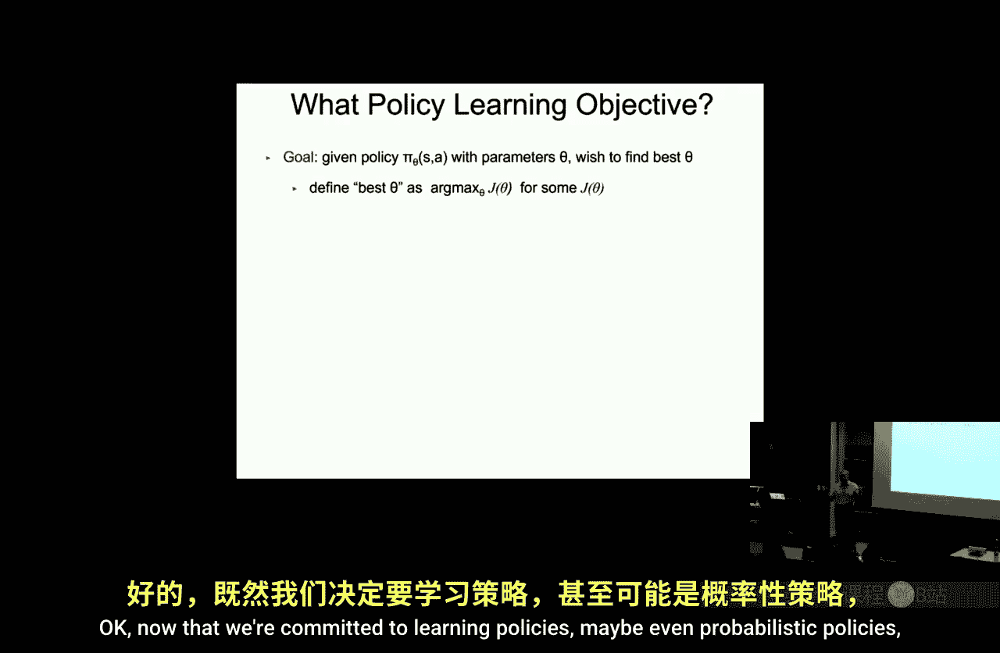

Probabilistic policies。The very first question is well。

 suppose you want to represent this policy by a neural net。Or some other function appximator then。

What would be our training objective function， What should we be optimizing when we train that neural net。

And。In other words， we're learning parameters theta to define this policy。

What does it mean to be the best policy？ What are we going to say。

And if we're going to train a neural net， then we need some objective function to train that on。

And it turns out if you think it through in episodic environments。

That means environments where we have an absorbing goal state that ends the episode。And。

To make it as simple as possible， if you'll always begin in the same start state， S1。Then。

Optimizing this quantity。Defining theta so that we have a policy pi theta where the value of that initial state is as high as possible。

嗯。Is what we want to do right We want to maximize the expected discounted future reward。

And that's what V of S is telling us。The value of V。For pi theta。In that state。

 is simply the expected。Discounted future reward under the policy P theta。And so we want to。

Pick a theta that maximizes this quantity。If we're not always born in the same start state。

 then we could take a sample of the it would take the mean of this over the different start states that we're actually born in。

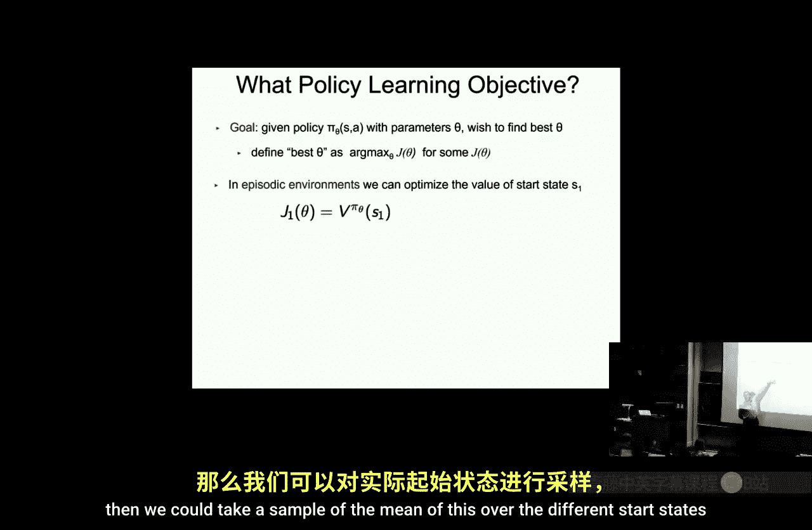

If in fact， we know a prior probability on the birth states。

Then we could even just get the expected value of this quantity under that。Distribution of states。

And it would be the right thing to do。Okay， so that's pretty straightforward。嗯。

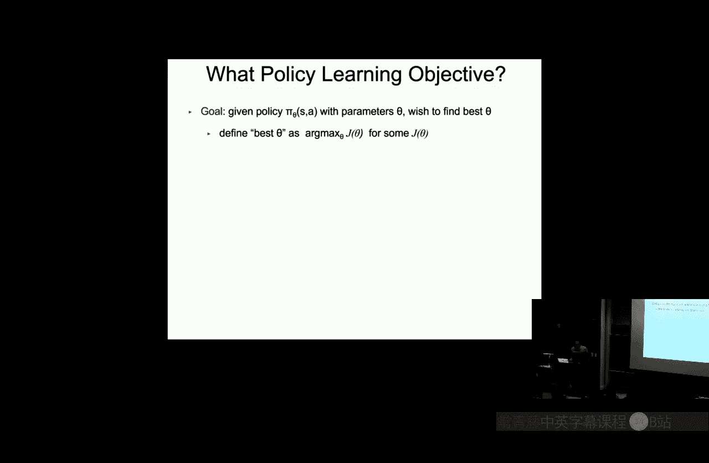

The next。Question then， well， well， before we go on。

 and we're going to start with this example of a single of a episodic environment。

 But before we leave this question。If， instead of having a。Episodic state。

 we have no absorbing goal state。 You just live forever， and still you want to maximize your reward。

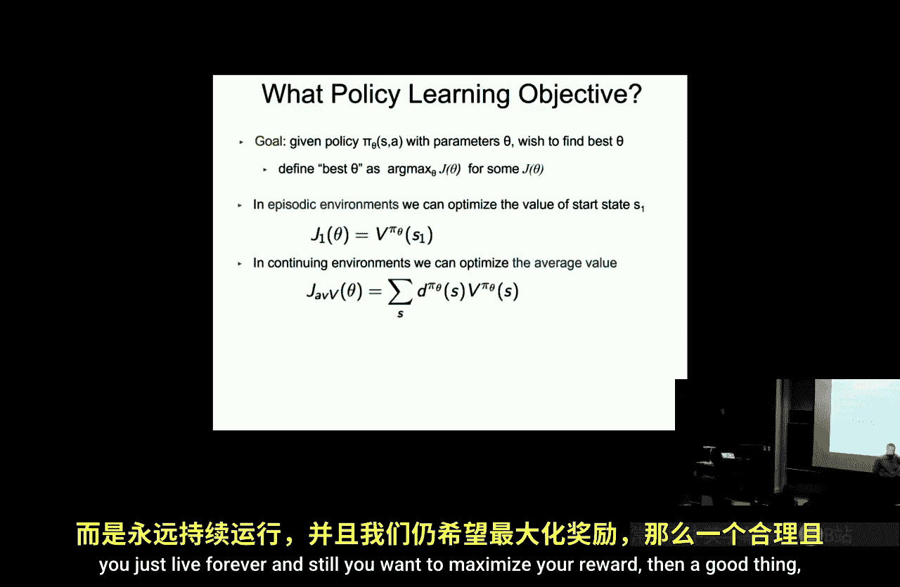

Then a good thing， a reasonable thing to do， which guarantees that we learn the optimal policy。

 is to pick the theta that maximizes instead this quantity。So what is this。

 It's just the sum over different all the possible states。

Of the probability of being in that state times its value function。So it's the expected value。

Of this same quantity。Taken over the distribution of states。That will end up in。Notice， by the way。

 this distribution of states is also a function of theta。If you change your policy。

 you're going to change the distribution of states that you visit。

And so this is a common objective to optimize when we have continuing。Not episodic environments。

And another one， which will give you the same policy。

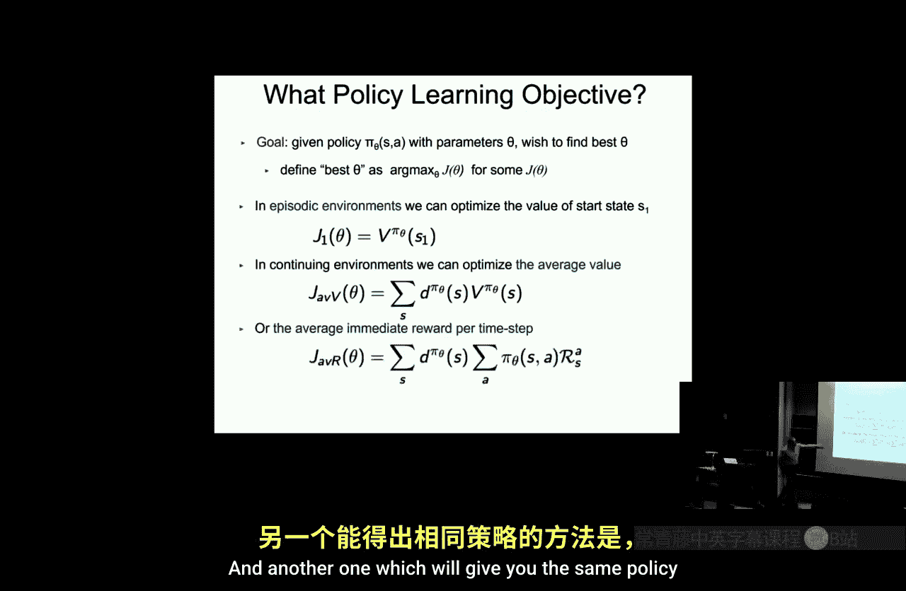

Is to instead just maximize the average reward per time step。Which is， again， the。

Expected value over the state distribution。Of。The reward we're going to receive。

 if we follow the recommended。Polic and so this is an expected value over state' event。

This is actually an expected value over actions under the policy of the immediate reward。

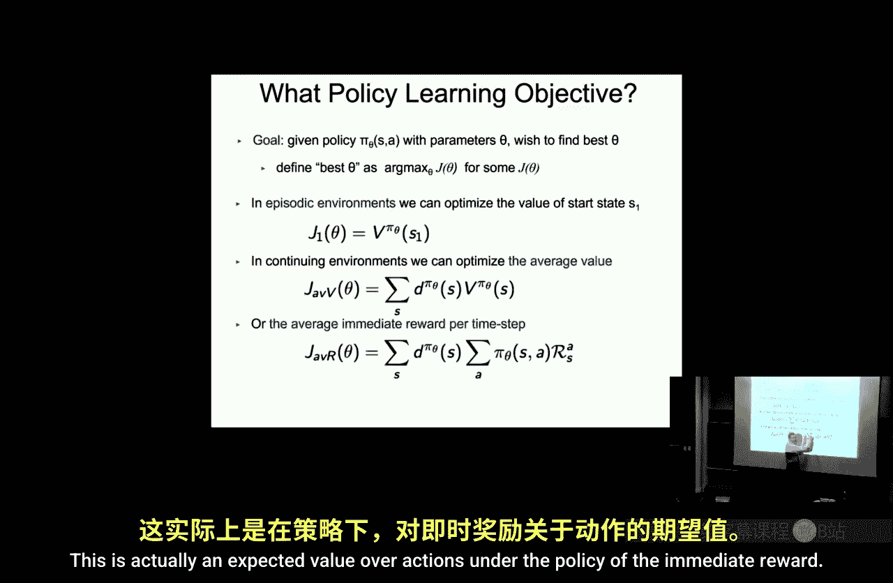

So this quantity is basically giving us the average reward per step。对。Okay。

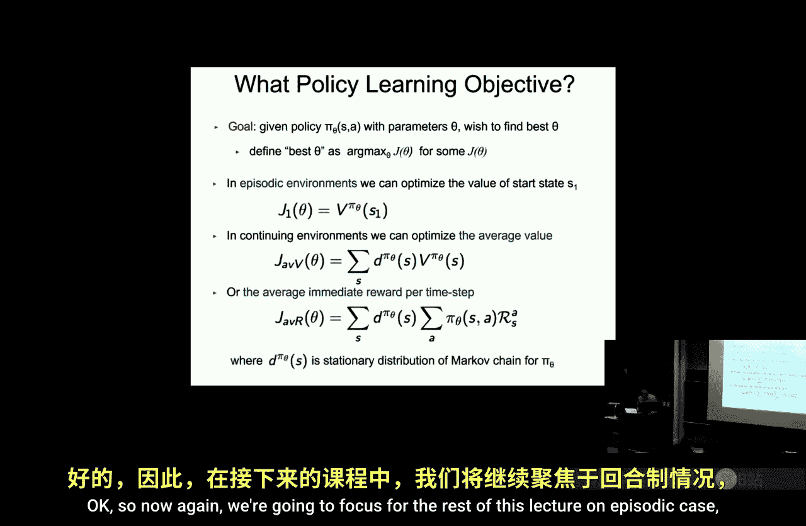

So now again， we're going to focus for the rest of this lecture。

On episodic case because it's easier to think through。

 but really all the ideas we're talking about transfer pretty directly to continuing environments。嗯。

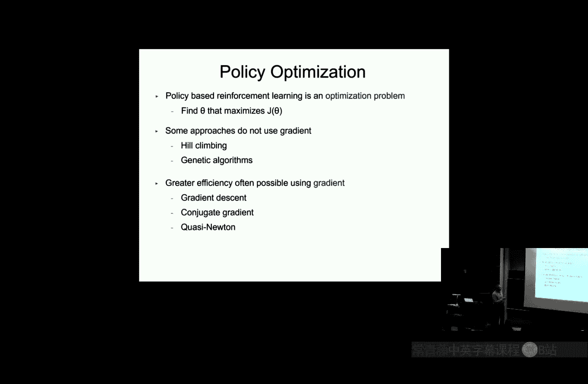

And so now that we know what the。Objective function， J of theta is。 we just saw。

 How are we going to optimize that， And then we have the usual available。

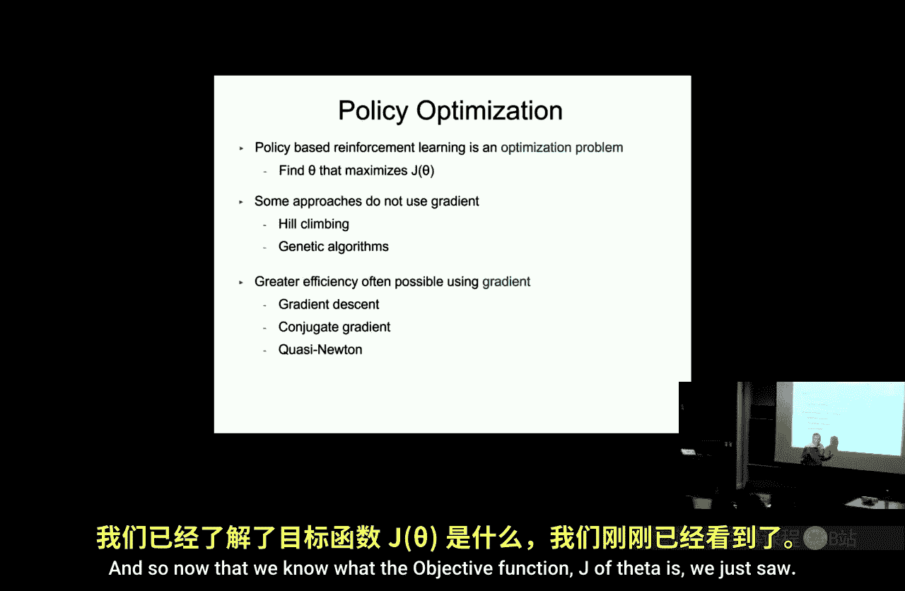

Optimization algorithms that we see throughout machine learning。 We can do hill climbing。

 genetic algorithms， evolutionary approaches， or gradient based methods。 In fact。

 we're going to focus here on gradient based methods。

 They've been the most successful in recent times。😊，嗯。

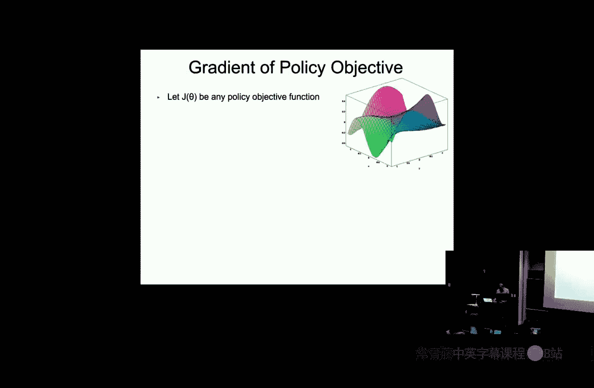

And so in this case， our。Graient methods are going to look like this。

 We have some set of vector of parameters theta that define our policy。

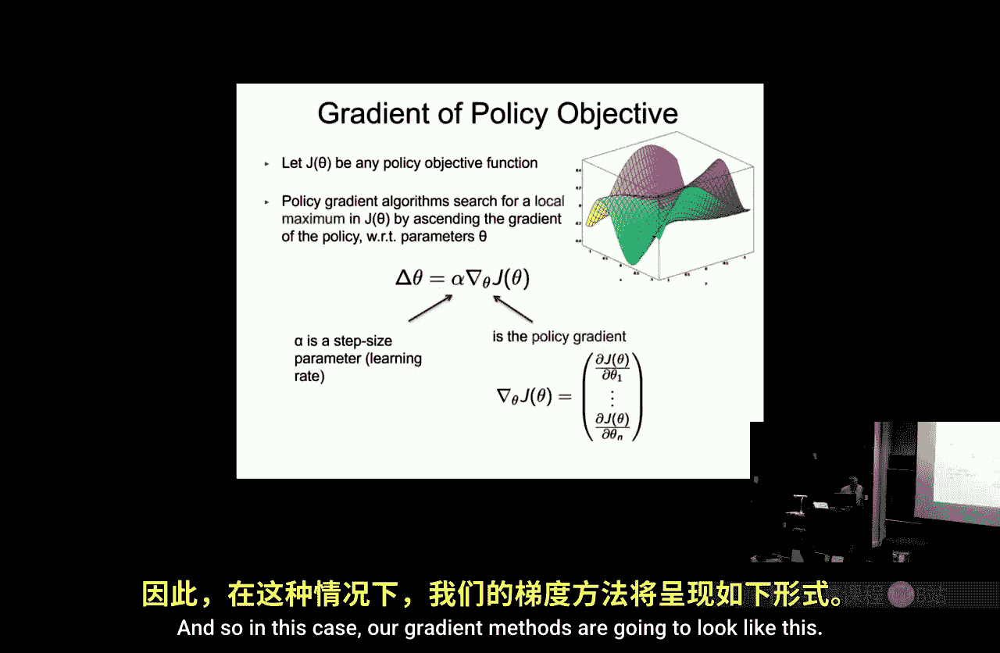

We've talked about the objective we're going to try to optimize， which in our case。

 we agreed for episodic。Worlds could be just the value of the starting state。Let's maximize that。

Expected discounted future reward under the policy pi theta。Of that start state。

And so we're going to be doing gradient ascent。 We want to maximize the future of reward。

 not minimize it。And。So in vector notation， that just means we're going to get the policy gradient。

 which looks like this。The gradient is just a vector of derivatives。

So if we have a vector of parameters， theta。We're going to。At each step。

 each update step do a gradient ascent by first calculating the derivative of our objective with respect to each one of those n parameters that are in our vector。

And then take a step in that direction。 how big a step will determine that'll be determined by the learning rate alpha。

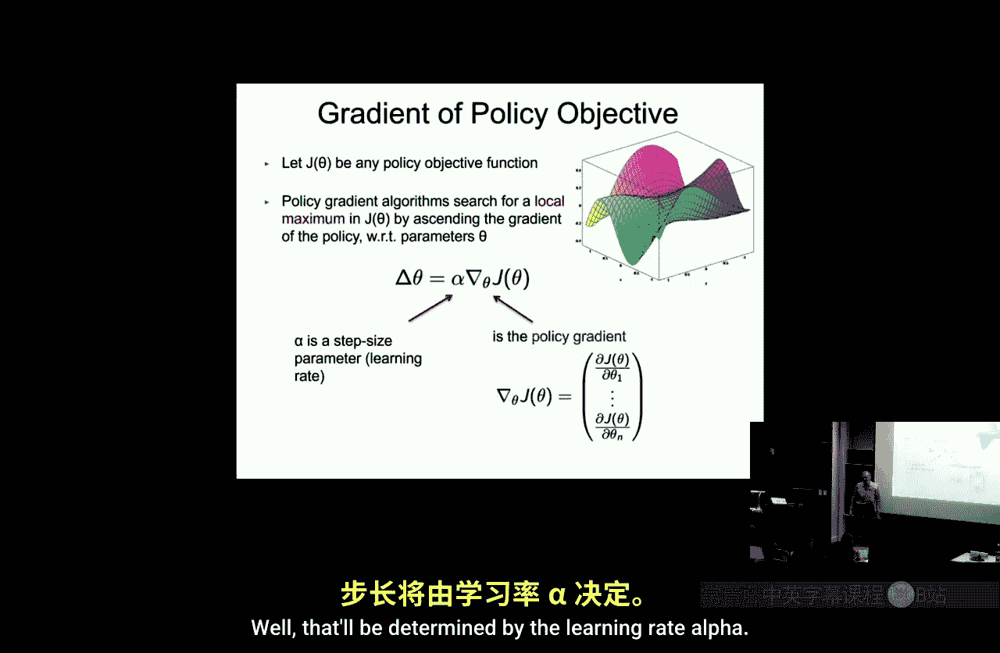

The same gradient descent descent that we've talked about forever。

There is one kind of cool idea for computing gradients， which is sometimes overlooked。😊。

But I love this idea。 And sometimes people do this。 But， you know， if you have any horrible function。

And you don't know how to analytically compute the derivatives。

 You can always just wiggle the inputs。

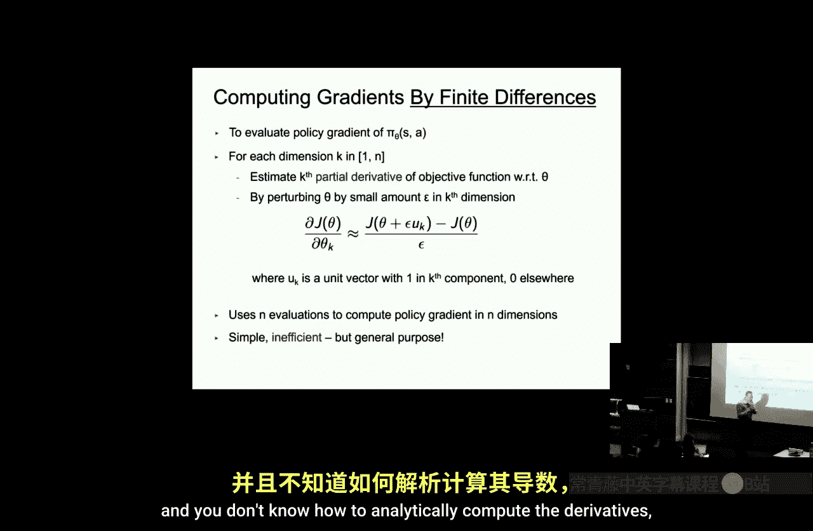

And see how much the output wiggles。So， for example。

 if we're interested in the derivative of derivative of J。With respect to the k parameter， theta k。

One way to find that is just to wiggle take whatever value we have for theta K and add。Epsilon to it。

嗯。And then see with the new。Value of J is。 And， of course， if we added epsilon to it， then。嗯。

This ratio， the difference between J of theta and J of theta plus epsilon。

Normalized by Epsilon tells us。A very good estimate of the derivative。In fact。

If we make epsilon smaller and smaller in the limit as epsilon approaches 0。

 we have the definition of the derivative。So this is just something to keeping your toolbox of tricks。

 don't need it all the time。 And if you're using。A function app where you can calculate gradients in closed form。

 Then you don't need to do this。 But it's a good thing just to。Keep in mind。

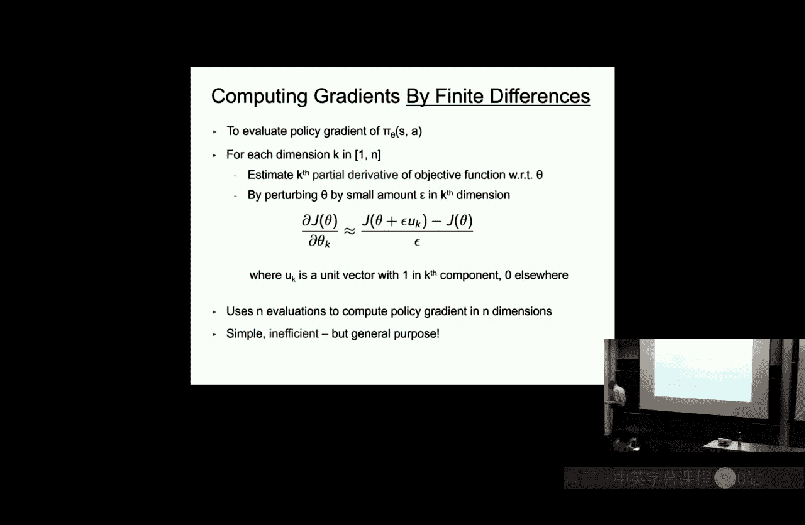

If you have some crazy representation of the policy。Because this really works for arbitrary。Policies。

 even things that aren't differentiable。Then when you wiggle it， you'll just see what the change is。

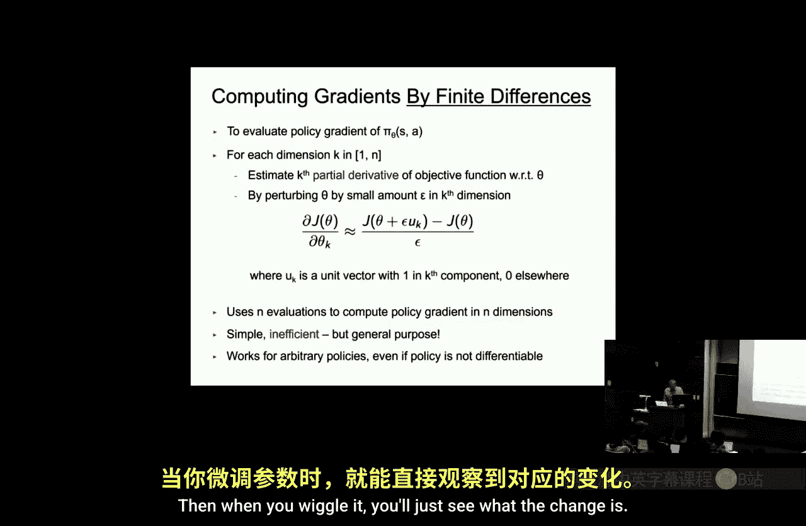

Okay， so now given that we're actually going to use a closed form for the gradient。

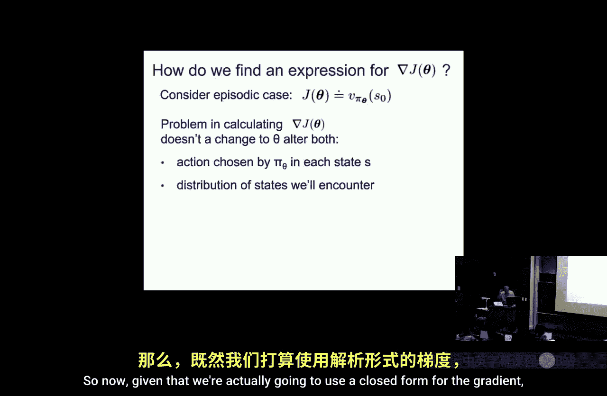

The question is。How can we compute this？And here's a key problem， if you think about it。J of theta。

 again， we're gonna to define it as just the value under the policy。Pi theta。Of the initial state S0。

And we want to pick theta to maximize that。And one problem is if you think about computing the gradient of J。

 which again means how much will a small change to theus sub I。Alter the value of j。

Then you notice that there are actually two very different influences of theta。On what's going on。

 One， of course， if we change data， then we're going to change the recommended action in every。

State or at least in some states we may。Or the probabilities of those actions。 That's obvious。

 but also。If we change theta， it's going to change the distribution of states that we actually encounter。

And that distribution influences。嗯。Could make changes to the value function， too。

So you might think because of this， it's going to be a horrible thing to calculate this gradient。

 but it's not。 it turns out there's a wonderful thing。Which is that。

A wonderful thing called the policy gradient theorem。Which tells us that actually。

 the gradient of J with respect to theta。Is proportional to this quantity。

 and let's look at what that means。Here mu of S is the probability distribution over states。

 That is if we follow policy。Pi sub theta。嗯。Starting， say in the episodic case， starting in state S0。

Then mu tells us the relative frequencies， the probabilities that will end up in any given state，s。

At a randomly selected time。嗯。And so here we're taking basically， this is an expected value over the。

States that we might encounter。啊。Times what Time the。Actuallyly， this is another expected value。

 isn't it？嗯。呃 that。A helpful way to think about it。

 This is just the sum over the actions we could take from state S。😊。

Of the probability of the Q value for that state。Times the derivative of the probability that will actually take that action。

So it kind of makes sense if you think， for example， the gradient， which again。

 is just the vector version of a derivative。If this is positive for a particular theta。

 that means theta sub I。 That means if we increase the value of that theta sub I。

 we're going to increase。J of theta， which is the value of。 It's a good thing。

 It's going to get us a higher value for the initial state。 And this is saying if。

 if this is positive。Then。嗯。What's going on here is that increasing that theta will make more probable。

The action A。嗯。And。You can see that would be the case if， for example。

 if a was the highest Q value coming out of status。So this kind of makes sense。But we can prove it。

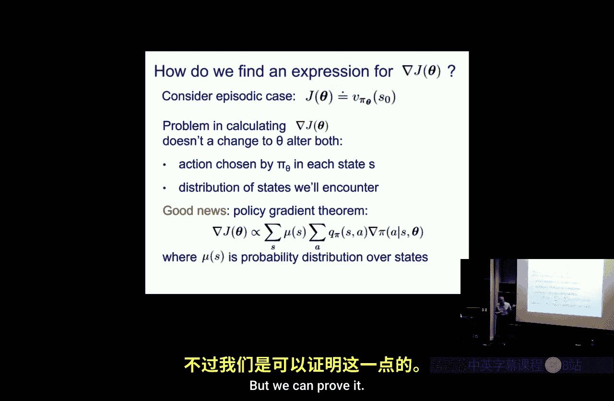

And let's。I'll go through this a little quickly because it's in the book， as you can see。

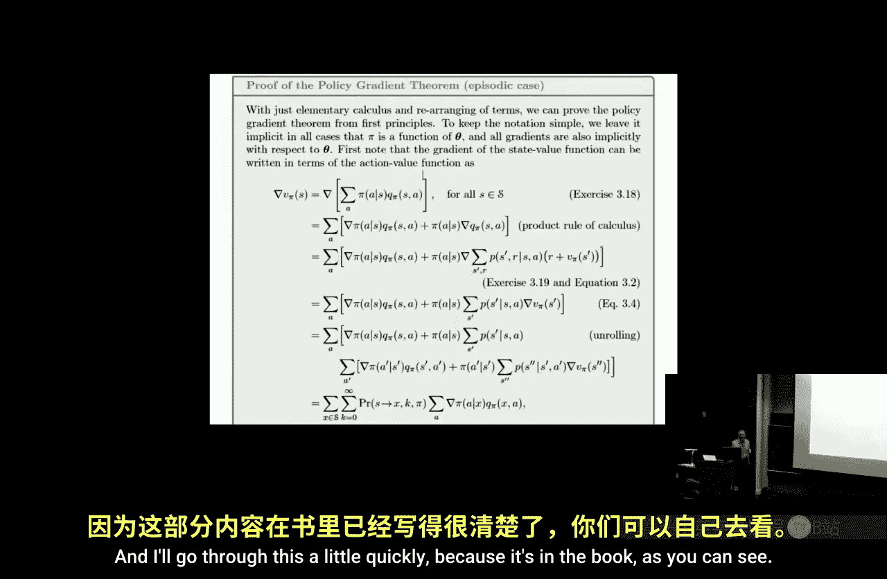

And it's actually not a hard proof。But I want to go through it。To convince you。

 it's not a hard proof。 And also because the steps in this proof are now the kind are based on the kinds of。

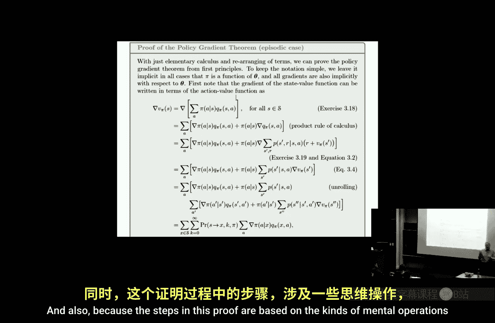

Mental operations that you could not do before you took a course in reinforcement learning。

 but it should now be second nature to you。All of these expressions that interrelate V and Q and R。

And their expectations。 So let's take a look at it。 We want to compute the gradient of J of theta。

 which we agree is just the value of the first state S。And so we can write that in the standard way。

 V of s is simply in terms of the Q function。嗯。The sum over the possible actions。

 Can I write on this？Yes， the sum over the possible actions of their Q values。 So it's the expected。

And。Value we're going to receive。By taking the next action。

Under the distribution given by our current policy pie。Okay， and then we can。

Take the derivative of this， using standard calculus。

So that the derivative of a product of two things is the derivative of the first thing times the second thing。

 plus the derivative of the second thing times the first thing。So it's just a standard calculus rule。

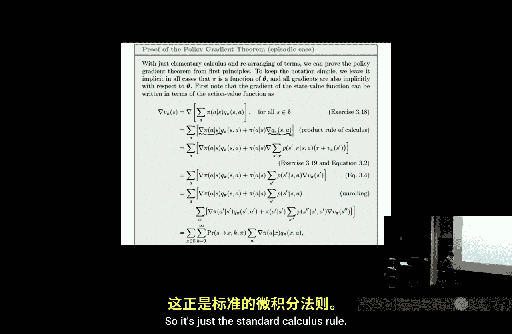

And now at this point， we can rewrite。This part， Q。Of course， the Q value， you know what that is。

 That's just the value we're going to receive in expectation。 If we take action A from state S。

So that's the sum over outcome states and possible reward values of the probability of ending up in that state with that reward。

Times。That reward。And。The value of the subsequent state。

So this is just the expected value over the outcome of our action。Of the usual target that we use。

 in fact， this is the definition of Q of A。Okay， and so now we can again， rewrite this。By noticing。嗯。

That this final quantity。Is。Oh， I'm sorry。 by moving our derivative inside。To。

Ignore anything that doesn't depend on theta。 Remember， our our derivative， our gradient is with。

 with respect to theta。 So I could have。

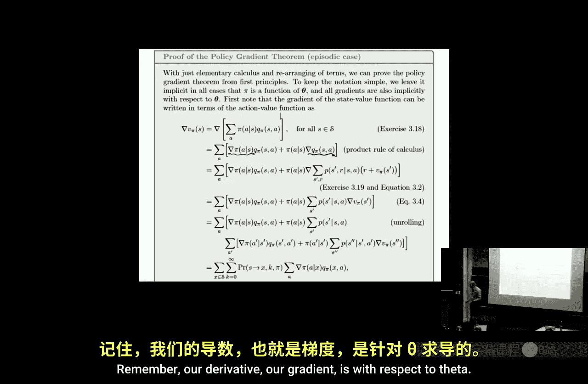

Put a little theta under here。Just to make it clear that we're taking derivative with respect to theta。

 And so if we want the derivative of this quantity with respect to theta， obviously。

 this is just the current probability。 The thing that matters here is the value function。And。

 and this part is just a function of the world， not of the policy。

So the only thing where theta is involved is here。And so now we can， again， rewrite this。

Keeping it all the same。 but expanding this V of theta。

 because that's what we've got an expression for。This is v of theta。I'm sorry， v sub pi theta of s。

So we can。Use this whole expression to substitute for that。As this is。And now you see。

 we end up with recursive definition。And if we expand that recursion。We eventually get。

The sum over states。X。Times the sum over K here ends up being how many steps into the future we go。

 because you can see that as we start expanding this， we're expanding one step into the future。嗯。

And then。A second step。And a third step。So we have three states already here。

 And if we unfold this further， we'll end up with K states until we hit the absorbing goal state。

And so K here is really the index into the case state after we begin。

And we make that sum up to infinity， assuming that once we hit the absorbing goal state。

You just stay there forever with no more reward。Okay， so basically， this is telling us。

This is the probability that beginning in S after K steps will actually end up in state x under the policy pi。

And so we want to take the expectation over this state distribution。Of the derivative of。

Pi of a given x。Times sits Q value if we take a and state x。So again， intuitively。

 all these things should make sense to you。 And this is really an exercise in。

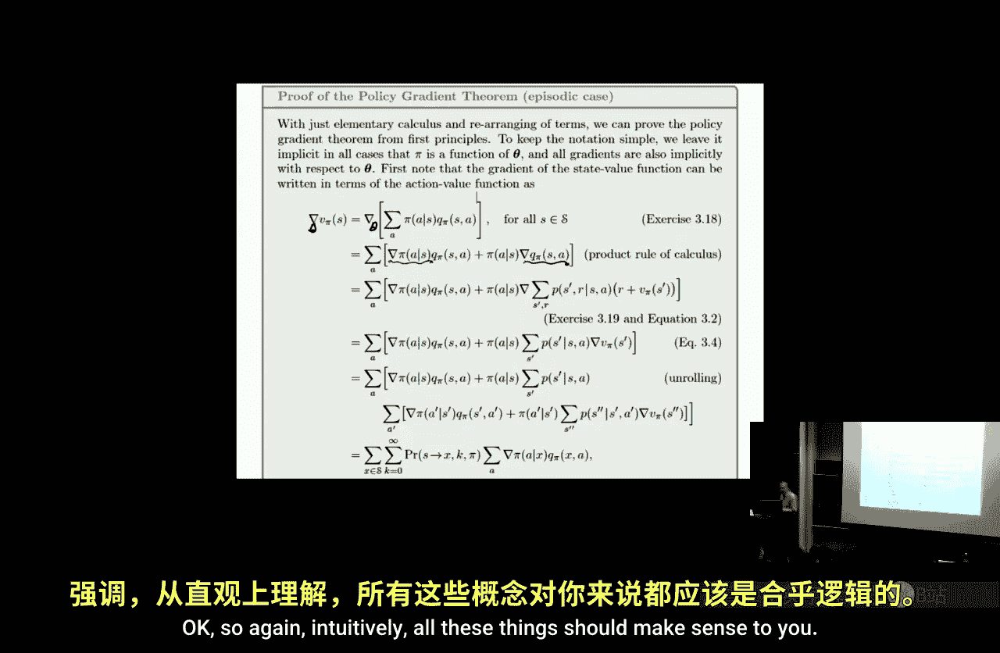

Flipping back and forth between our definition of V as the expected sum of future rewards。

And Q is our definition of the expected value of future reward if we take action A and state S and V as a definition of the expected future discounted reward if we start in S and follow policy Pi。

😊。

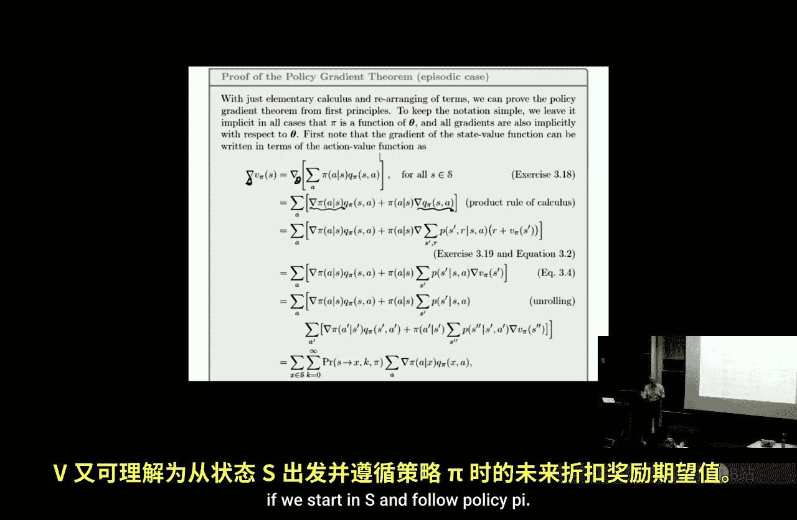

Okay， so then to finish this off。

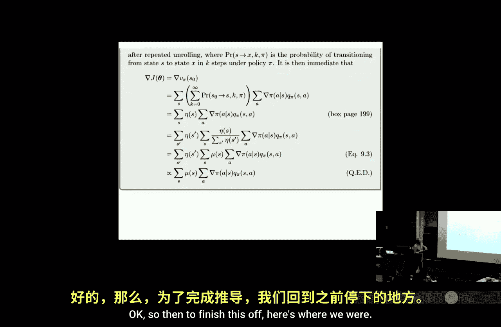

嗯。Here's where we were。Take this quantity here。Which is just the sum over。嗯。Steps into the future。

K steps into the future for K from 0 to infinity。 and just call it some Greek symbol whose name I realize now I don't know。

 How do you pronounce that。Ea， Eda， O， I was going call it N。 Eda is better。If you're Greek。

Thank you。So Eda here， we just means。Basically。This is the relative frequency of different state of the states of state S。

If we follow our policy all the way through till we get absorbed in the coal state。So that。嗯。

And then times this other quantity that we already had。嗯。Here。

 we're doing a little trickiness by multiplying and dividing by the same quantity。

But that's just so that we can actually match up this count of how often we're going to end up in state S。

With by normalizing it。So that it becomes actually the probability。 Remember， mu before we used。

 and we use it here again as a symbol to indicate the state distribution。Entailed by policy pie。

P theta。So basically， this is， and now we have some constant。Times the state distribution times this。

But the beauty is now you can see the gradient of J that we wanted。Actually。

The gradient depends on that state distribution， just like we hinted， could be a problem。

But it does not depend on the gradient of the state distribution。

 It just depends on the state distribution。This is a wonderful thing。 Why is this a wonderful thing。

 who knows？The reason this is going to be wonderful is even though we have maybe a neural net representing this。

 so we can calculate gradients of the policy if it's a neural net。 We don't have an explicit。😊。

Representation of muos。 We don't even necessarily know it。And so it would be really big。

 serious trouble if we had to calculate its gradient。But all we need to do。

Since this quantity is the expected value over the state S of this stuff。

We can go back to our Monte Carlo sampling methods。All we need to do is sample this。

And do stochastic gradient descent。And that's how we're going to end up handling this。

Depends on the state distribution， but we will sample the state distribution by following the policy pie。

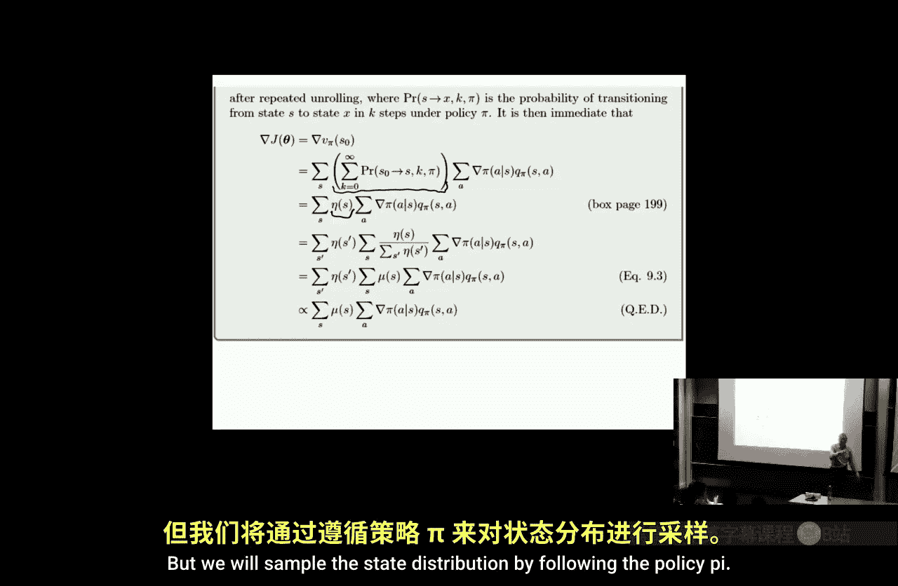

And。Under the normal rules of stochastic gradient descent。

 this will give us the magic that we need to have an algorithm。

So that's why it's important that this， even though it depends on the distribution。

 does not depend on that。Derivative， the gradient of the distribution。Okay， so now it's easy。嗯。

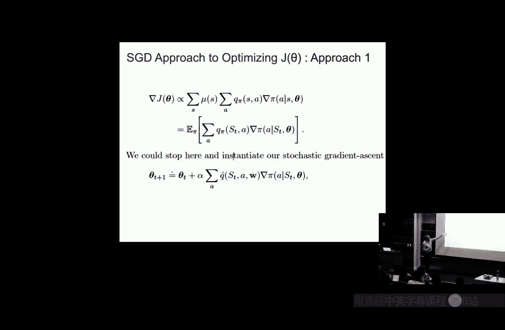

The derivative of J， according to the gradient theorem， is just as we wrote there。

 it's proportional to that。 There's this constant。 but we don't care about the constant because we're going to have a learning rate anyway when we do a gradient step。

And as I mentioned， you can think of that first term as just the expectation over the state distribution implied by the policy pie。

So their quantity is really just the expected value。

Overts generated by following pi of this quantity。And so if we want to do。Gradient descent。

 one way we could do it is this。We just say I'm going to update on each step from T to T plus1。

 I'm going to update our policy parameters。By ascending this gradient。嗯。Bai。嗯。Summing over。

 if I have an approximate， if I'm learning sorry， this assumes we're learning both a policy with parameters data。

And a Q function with parameters， W。Then I could implement this by。

Approximating the true value of Q with my。Function appromator。

And using this directly because I can calculate that if policy pi comes from a neural net。

 then I'll just do that prop to calculate that。

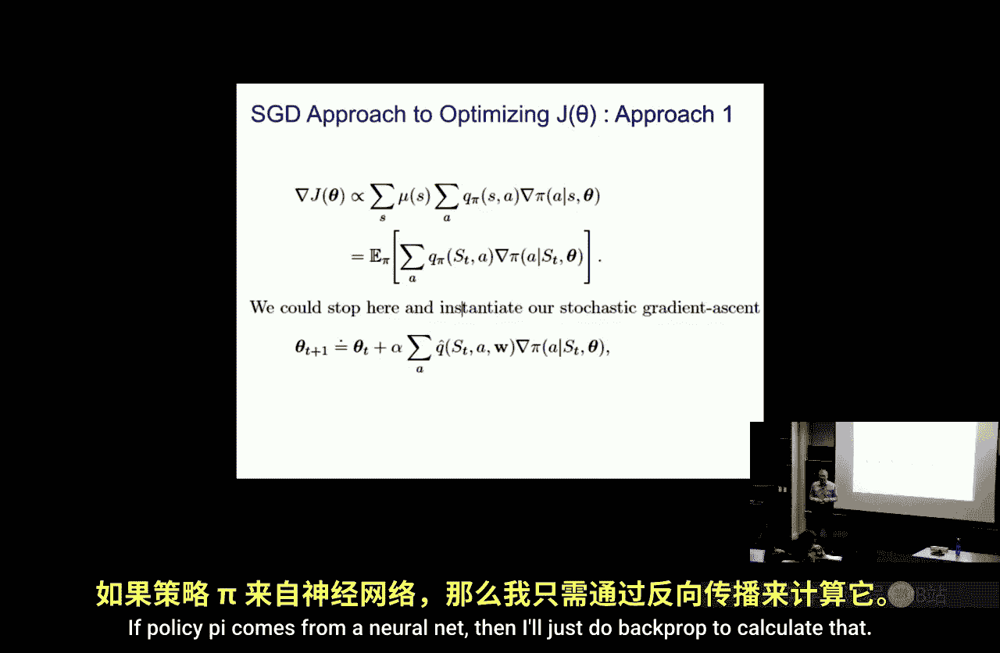

So， there's the direct。Mampapping from this policy gradient theorem to。Update rule。In fact。

 as the book points out， this is not used very much， although as the book points out。

 maybe it should be。Hasn't been explored too much。Hint project idea。嗯。

That that's one thing we could do， or we could continue。And say， well。

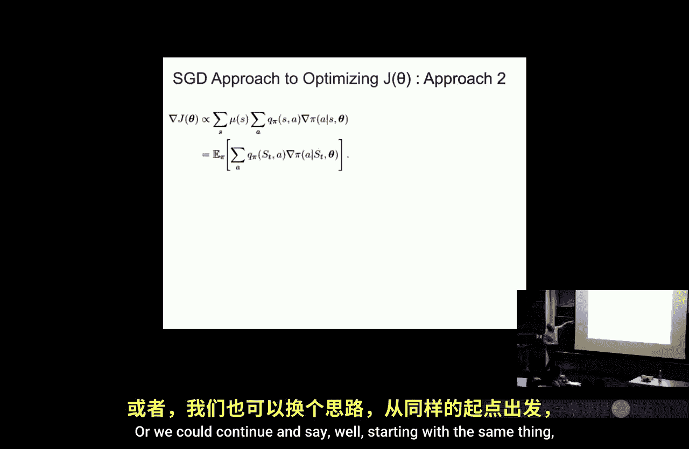

嗯。Starting with the same thing。Let's rework it this way。嗯。

The first two lines are the same as the first two lines of the previous slide。

 But instead of stopping there to write our gradient descent rule， we could do this instead。

We could say。This is the sum over actions a， so this is the expected value of over actions recommended by the policy。

Of the Q value。Times this quantity。 and you'll see this quantity is really the same as the above。

 except that I've multiplied by pi and I've divided by pi。And so。嗯。If I do that。

 then you can see that this quantity I can sample。By taking the actual state and the actual action that I。

Choose with pie。And the state that I'm actually in。 So basically， I can sample this by two。

By sampling an A instead of taking the expected value。And I still have this left over。

And so if I do this。I can I can approximate， estimate。

Qe of some particular state in action by just the sum of cumulative rewards I receive。

When I Monte Carlo sampled the world。And so that leads to this more frequently used。😊。

Graient update rule， which is， as I go from the to T。To step T plus 1。

 what I want to do is I want to update my。Prameterters， according to the reward。

 the discount of future reward I actually sampled when I did this Monte Carlo。呃。Single trajectory。

Experiment。Times the gradient divided by the policy value。So that's what we get。If we derive it。

So this is more frequently used。In fact， it's an algorithm called reinforce。

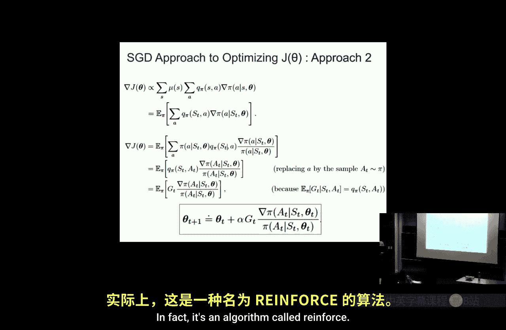

Here's the three and four algorithm。So to put this all together。

 it's a very straightforward algorithm。We input a differentiable policy based on theta。

 That would be like a neural net that defines the theta function。 I'm sorry， the pi function。

I have a pi Theta， I have Greek litter， dyslexia。嗯。And then we input a parameter。

 which is just our gradient step size alpha。Iitialize our parameters and then we just run episodes on each episode we follow our policy pie to generate a sequence of states and actions and rewards。

And then at the end of each of those episodes。We take G。

 which is the sample of experienced discounted future rewards at each step。

And we update theta according to that rule that we just saw。 almost the rule that we just saw。

The rule we just saw had a ratio here of the gradient of the policy divided by the policy。

 here I wrote that instead。As the gradient of the natural log。Of the policy。

Why can you do that。Here was our gradient rule that we had before。But， in fact， this ratio。

Equals the gradient of the natural log of the policy。Because if you remember freshman calculus。

 the derivative of the log of x with respect to x is just1 over x。And using this plus the chain rule。

 I guess。The derivative of。嗯。Well， you could expand this。

 The derivative of the log of the pi of x is then just going to be the derivative of pi。

With respect to。If this is with respect to theta。Then this is just going to be the derivative of pi itself with respect to theta。

Times one over。Pai。Right。So this just follows directly from the fact that the derivative of the log is1 over x。

Now， usually people write the algorithm this way。Does anybody see why？You might want to do that。

The policy usually computed， but lot difficult。Exactly， so if we， for example。

 represent our learned policy by neural network。Whose output layer is the softm layer。

Like that very first slide where we showed the softm function。Then in fact。

 the outputs of the network going into the softmax layer。

Are proportional to the log of the probabilities that we're going to get out of the softm function。

So this makes for a very straightforward implementation can just。Train a neural network。

 put a fixed softm function and its outputs。And then use those outputs that are going into the softmax as logs of the probabilities。

 and then this gradient is just something you can turn over to tensor flow。Or p torture。

Or your own software， whatever bad propagation you're doing is actually computing。Those gradients。

 So this makes it a very straightforward algorithm to implement。Okay， so there's the idea。

The key steps here was。Weir。Interested in learning a policy directly。

So first， we had to figure out what's an analytical expression。

For。The derivative。Well， first we had to say what is the objective that we're trying to optimize and we agreed the answer to that in the case of episodic training is just let's maximize。

 let's pick theta that maximizes the actual value of the starting state that that's the best policy。

And then we said， well， we need an analytical expression for that derivative if we're going to use。

B prop， the derivative of that objective。With respect to theta and the gradient。Policy theorem。

Gave us a generic expression， which you see we can manipulate in a couple ways to come up with algorithms。

And in coming up with these algorithms， we're relying on the toolbox that we've been talking about all semester。

Of， for example， here we're using Monte Carlo sampling。

Of the experienced reward for a particular trajectory。

And we're using that as our estimate of。Let's go back and see what it's an estimate of。

We're using that as our estimate of the actual Q value for in state T taking action AAT。

And if we don't know that Q value， at least we can sample it by actually。Running forward。

 the experiment and seeing what the sum of discounted rewards really is。

 and the expected value of this over the state distribution given by our policy pie is exactly this quantity。

So， this。Trick of。When we have。An expected value of something。 And we don't know how to compute Q。

 We don't yet know Q。 At least we can sample it。 And in this case， we're sampling it in a way where。

The expected value of that sample is equal to this。

 which means that if we collect a lot of samples and average them together。

 then as a number of samples grows， that mean will actually converge to this。

So that's one of our toolbox tricks that we're using。

case of that's。

The reason I love covering this stuff iss at this point in the semester， just the right。

W of kind of thinking about pulling together these different tools that we've talked about。

Learning V versus Q， learning them with bootstrapping versus Monte Carlo sampling。嗯。

Driving expressions that are based on transformations that interrelate V and Q and R。

And samples of those。

And。It gives us a very nice， easy to implement the algorithm in the end。

Let skip there because we said it。 Now， what if you actually apply this。

 So if we go back to our simple。

A corridor learning problem that we talked about at the beginning， the one where。

We used it to convince ourselves that a stochastic policy would be a good idea。

Here you can see three different runs of the reinforce algorithm， of this algorithm。

To learn the optimal policy。And these different runs differ only by the learning rate， alpha。

So each color， each curve here is a different learning rate。But you can see that after hundreds。

 but not thousands of episodes in this very simple world。嗯。

Those algorithms are reaching some interesting。Policy， you can also see that。

The choice of learning rate matters。So if we use two to the minus 12th instead of2 to the minus 14th。

 it's not clear that we're ever going to converge。😊，嗯。To as good a policy as we get with。

Two to the minus-14。So there is a bit of an engineering art。

And experimentation involved in picking these kind of learning rate hyperparameters。

But it works。Okay， so。Theoretically， there is also the good news that I hinted at before。

 which is that。

Because the expected value of the sampled rewards over pi is equal。To queue。

Then we can prove convergence。Toward that， especially if。而。Well。

 if we use the gradient rule that we talked about。嗯。So the good news is that the bad news is that。

The variance is high。 And we talked about this initially when we talked about Mar Monte Carlo sampling。

 and it's the same story。 It's the same reason that the variance is high。

Now we said that in kind of an informal way。Before。嗯。And in this case， with this algorithm。

 we're actually going to look at two ways of reducing that variance problem。

 one is adding a baseline， one is actor critic model。😊。

But嗯。Let's look at the first of these， adding a baseline。嗯。So up on top is our。Gradient。

Policy gradient theorem that we've proved。嗯。The idea of adding in a baseline is this。

 We want to make up some function， B。Which。Is。A decent estimate。Of。呃。Of Q。嗯。And then。

What we're going to learn is the。Difference between。Q and B。So we talked about this。

 Ketterina spoke about this earlier。She talked about， I think she used the term advantage function。

For learning， instead of Q or V directory， directly， learn the difference。 Well， there。

 I guess we define the advantage function as the difference between the value of the current state and the value of the next state。

But here we're going to do something similar。One reason the advantage function in when Kaarina spoke about it。

 it was a good idea is that the values of those differences。

Vary a whole lot less than the actual values。嗯。from state over different states。

 so the difference from state ST to T plus1 is generally if you collect all of those samples。

 you have a sample of a much lower variance than you have if you collect all the actual values instead of value differences and it's the same thing here so。

😊，The idea of adding a baseline that captures the prior for S。Is to do that。And。

The question you should be asking yourself is or me。 Well， Tom。

 what makes you think that just arbitrarily adding in minus B of S will。Let us use that gradient。

And the answer is it will because of this。If you think about expanding this out。Then we have Q。

Times the gradient of pi， which we had on the first line。Minus b of s times the gradient of pi。

But the cool thing is。呃。That negative term minus the sum over actions of B times the gradient in of pi。

Actually is equal to zero。Because。The policy doesn't change our initial。

 We just make up a B of S function。 Policy doesn't change that。

So it's B of s times the gradient of this， but the gradient， but this quantity。

 the sum over actions of the probability。Assigned by pi to that action。Is just one。

You have to choose some action， so every policy is going to recommend。Probabilities on actions。

 which sum to one。And so actually， the gradient of this constant one is0。So you see。

 what I can do is I could add any constant offset。In this case， B of S。That doesn't depend on theta。

And my gradient update rule will be unchanged。And so when we do that。

 we have this gradient update rule， which is precisely the same as before。

 except that instead of looking at the。Sample discounted future rewards per episode。

We're looking at that minus b of S。And if B is a good。Estimate。Of what Gs they're going to。B。

Then just like the advantage function that Kaarina talked about reduced the variance in the sample of training data that we have to fit。

This is going to do the same thing。So any suggestions what we should use for B of ST？正品多的话。

Something close to the value function， right， because what is that is the definition of the value function is the expected value of G T。

 right。

So， in fact。B equals our approximation to the value function， is the usual。Approach people take。

So we can basically say in our case。

Let's let's use B of S is our estimate of the value function。

 And now this gets us into a scenario where we're learning both。Pai。Which has parameters theta。

And we're learning a value function estimate with a different set of parameters， W。

But if we do those simultaneously， then we can use B equals our current value function。

And this does indeed reduce the variance in this。 So to be precise。

 what's it the variance of that I'm reducing。

It's the sample of target values。It's the variance in this quantity。

Over my different training examples， the value of this quantity over different training samples。

Is much smaller if B is a good estimate of G than in that up upstairs。

 gradient descent rule where I'm now looking at the variance of G T itself。

Instead of the difference between GT and。

What my value function tells me， it probably is。

And indeed， this leads to， again， a very straightforward。呃。Extension to the reinforce algorithm。

Again， we're computing。We're generating episodes so that we can sample Gs。

We're then computing these deltas， which are the difference between the observed G and。

Our value function， which we're using as that baseline。

And then we're using that difference both to update our estimated value function。

And our estimate of pie itself。Okay， so that's the idea。

And， in fact， this does work here。 if we go back to our。Earlier experimental results。

 alpha equals 2 to the minus 13 was the best alpha we saw before when we had the reinforce algorithm without a baseline。

😊，Converging to the optimal policies function of training episodes。And the green line is what we get。

 if we instead use。嗯。If we instead use。A baseline， which is learned。Value function。

 So you can see in this case， it significantly improves the convergence。

And I would guess that if we looked at。The sample of G values that are actually gathered by the algorithms。

We'd see that the variance in that sample was indeed much larger than the variance in the G minus value function。

Values that are used。To train the green line model。

Okay， so again， to go to pop up to the top， we like to reinforce algorithm because it converges to a local optimum。

 but we have this variance in the training data。

Problem。And that really is a result of this Monte Carlo sampling。

 you can see how you have high variance， if one path gets you high reward another path you might get gets you low reward。

 you're going to have high variance in that sample。嗯。One remedy was to add a baseline。

 The second is to use an actor critic model。 And we'll look at that in a second。 But first。

 there was a question。

他要。fact something from。But I realize。

ペースマイですけ。Exactly， yeah， subtracting a constant won't change it， but this is a function of state。😊。

And in fact， it's not even an arbitrary function。It's our estimate。Of the value function。

 which is in and the true value function is actually the expected value of G。

 So it's a very carefully considered。Baaseline。Yes。We're right to wearing something。

The previous library we had two graphs， now you have two hypopars。😊，Yes。That。

费。Well， yeah， let's you raise a very good point。 If you look at the fine print here。

This is reinforced with alpha the learning rate set to2 of the minus 13。The green line。

 the fine print， says， here alpha is 2 to the minus9。And also， alpha W。

 the learning rate on our value function， is a different number2 to the 6。And so I'm sure， well。

 I haven't talked to the authors。 I'm guessing when they wrote the book and created this plot。

 they searched over different values of both hyperparameters to make this plot look as。😊。

Good is possible in to be fair to them， though， they did use the red line there is the best of the plots from the previous。

嗯。Experiments， so they are using an optimal。Or as good as I think they've probably found alpha for the red line as well as the greenwood。

But， yeah， there could be。Whenever you do that kind of hyperparameter search。

 you're also opening yourself up to possible overfitting。嗯。If you reran this experiment。

You might not get exactly the same optimal hyperparameters and so it is an issue and the more of this kind of stuff you do。

 the the bigger that hyperparameter surge can be。It makes me think。

And then we're going to stop for today because I want to give Kattery a chance and pick this up next time。

 But it makes me think that。The difficulty of doing that hyperparameter surge。

嗯。Here's a hypothesis that might be true or false。 I think the more functions you。

The next idea we're going to talk about is bootstrapping。

 which is the same idea that we talked about before it's in our toolbox already of instead relying on Gs。

 let's rely on。Qs and V's to calculate the target value。嗯。And not even use Gs。

Here we're still using G， it's just our target value is G minus6。

Our approximation to its expected value。My hypothesis is the more redundancy you put in the system。

 as in have it learned V and also Q and also a policy， the better they're going to。😊。

Robustify you to air these kind of overfitting issues。

Including the ones in choosing hyperparameter。But that's just a hypothesis。Hint project idea。

Okay， so let me turn it over to Kaarina and。I'll sit down， person。Okay， so I like。

I think I heard this tweet before this type of。Derrivation。What of the mostest gradient。

The only thing I want to mention is the following。 like few slides ago。

 we started from this summation， US， the on policy distribution of states， sumation of our actions。

 a log of the policy multiplied with the Q function。 And this is where we end up a slide ago。

 So in the beginning， we said。No， not many people use Q。 So that is historically historically。

 Yes we started by using the Monte Carlo estimate instead of the function approximation for Q， right。

 But right now， all these actic methods， they all use function approximation for Q。 Now。

 why would we need to go to advantages versus Q。 Imagine that I choose my reward to be at every step and 200 till you reach the end goal or to at every step or 2000 till you reach the end goal。

 how I choose my reward function will very much your Q。 But if you put advantage。

 then you are not impacted anymore， because you only care about the relative have say benefits of different actions。

 Allright， So you don't have this hyperflation of your Q as someone is changing the reward function。

 So that is one way to think about it， But we will see also numerical examples。 Well。

 you see what happens without advantages and what happens with advantages。 Advs， I mean。

 you see here the baseline in the next lecture。 So that's why you should not be stressed out or I really didn't get it。

Because the whole lecture next lecture is， what approximation should we use with Q。

 How should we estimate the baseline， how we' stream the advantage functions。

 Each tiny littlevari has its own name in its own paper and comparisons， but they are all extremely。

 extremely similar。嗯。And yeah， so this is the whole thing we're going to talk about in the in the next lecture。

 So you should not worry about this。All to be disentangled right now。Interestingly， historically。

 yes， although this beautiful formula shows Q， we were using Monte Carlo returns where somebody could say you know。

 straight away， we can start with using the function approximation for the for the Q value there。

 right the same as this formula was suggested for the policy gradient theory。😊，That's it。

See you on Wednesday for continuation on those。

