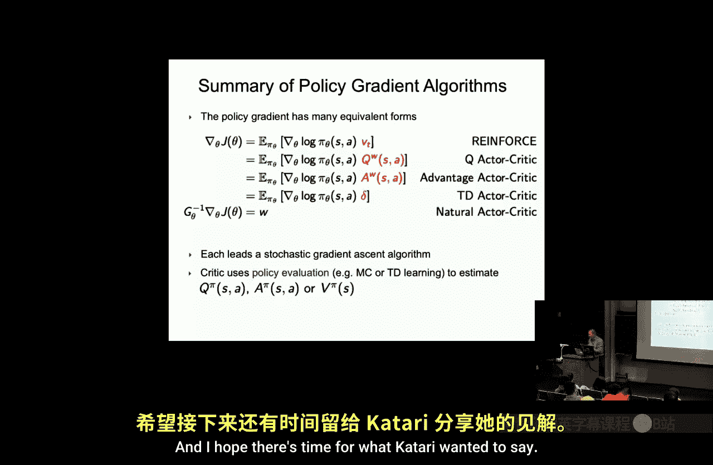
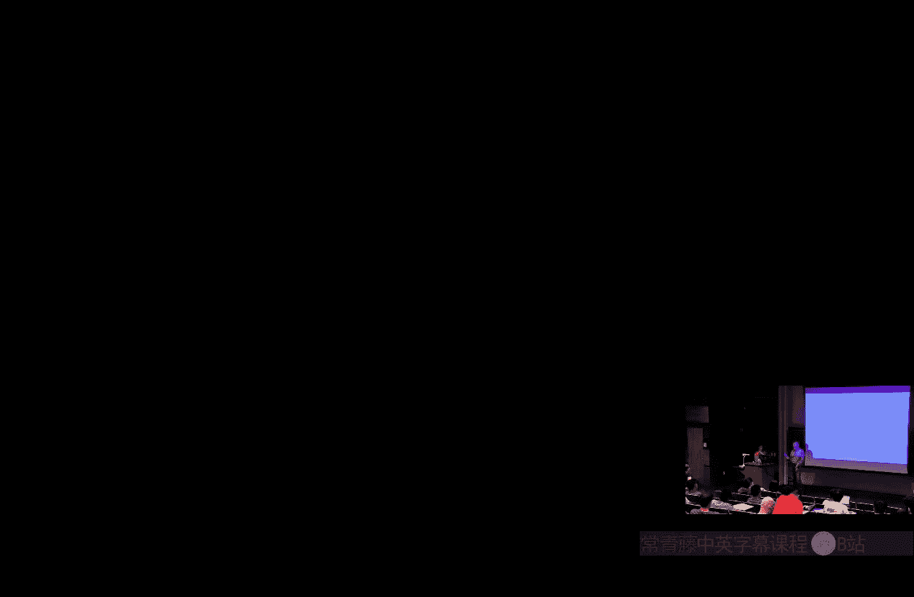
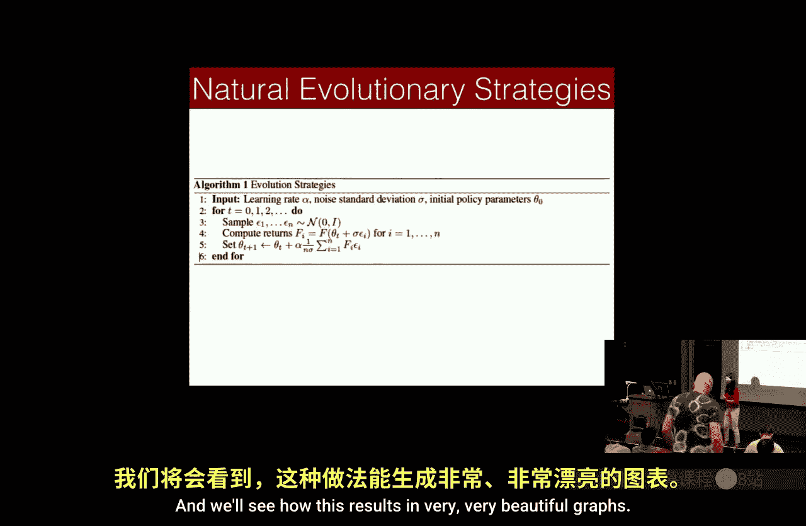

# 卡耐基梅隆大学【中英⚡深度强化学习与控制｜10-703 Fall 2018, Deep Reinforcement Learning and Control】 p12 P12 12 Policy Gradient Methods  Part 3 -BV1RyqPBbEJV_p12-

Okay， today is another double header lecture。And。Today's material that we're covering。

I think maybe for both parts of the lecture， but certainly for the first part。

 is not covered in our textbook， the Barton and Suto or Bartto and Sutton book and so。Here， I've。

mentionedent several readings that I think are very good for the material that we're covering today。

 and so I urge you to read those if you want to really understand this material。By the way。

 all of these are accessible if you're on the CMU network。

 so we have library permission to all these， they shouldn't have any trouble finding and downloading these。

Okay， so we're going to talk about policy gradient again today。 And just to swap us all in。

 Remember the policy gradient theorem。 That was the key's up there at the top of the。

Screen to allowing us to figure out how we could。Use gradient asscent to optimize our objective for reinforcement learning。

 which is J is our objective。 And， of course， that's to。

One way to define is that we maximize we want a policy pie that gives actions that maximize the sum of discounted expected future rewards。

We can also define J in terms of average reward or the episodic reward in the case of。嗯。

Episodic trajectories。 but this policy gradient theorem holds in all of those cases。 Okay。

 so this is really the thing that tells us， what is the derivative。

Of that objective with respect to the parameters theta that define the policy。

And I want to start by noticing that we can write this in several forms。 For example。

 I can take that top thing。 And this is just a review。 We did this before。

 I can multiply by pi of theta and divide by pi of theta over here。And not change anything。

 But then if I do that， now I can write this noticing that the first terms up to here。

Are really just a way of saying we want the expected value of this quantity to the right。

Taken over the distribution of states。And the distribution of actions。

That will be generated by the policy。Pi Theta。RightSo then for simple thinking and for simple notation。

 we can simply write this as the expected value over pi theta。 That's all this。Of this quantity。

And then， as we noticed before， this quantity is simply equal to the。Graient of the log。

 So this will be actually the form that you'll see mostly。In。In the lecture today。

And I like this way of thinking about it because then you can say， well。

 it's the expectation over the state and action distribution generated by pi of that。Okay。

 so given that。We've talked about actor critic models before。

 One way to define actor critic algorithms is that。They maintain two different sets of parameters。

 You learn two different functions。 One is what we'll call the critic。

 which is an action value parameters。 For example， we might learn an estimate using parameters W for the Q function。

 And then the actor is the policy itself， which has its own parameters。Theta。

 and we've talked about algorithms for actor critic in using。嗯。Using them both。To update。

To learn a good policy and to learn the corresponding Q function。And a typical way to do this is to。

Update the policy。By using our approximation to queue， that would be one way to do it。

Then it's only approximately correct， because， of course。Any function approximation that we use。

Could be wrong。And the actual policy gradient rule requires that this be really Q。Q of pi。

 not some guess about what Q of pi is。 So this would be an approximation to the gradient。

And if we follow that， then it leads to the update rule。

 notice the upside down triangle is the gradient symbol。

 the correct side up triangle just means how much we're going to change our parameter vector theta on each gradient ascent。

 And so if we follow this gradient， it leads to an update to theta。Which is some learning rate times。

Just that cr。Okay， this is all review。And we've also talked about reducing the variance in estimating。

嗯。These things， for example， by noticing that we could add in a baseline。嗯。To our。Quantity without。

Without really changing the gradient。 And so we mentioned that a good baseline to use is the value function itself。

And that allowed us to define what we call the advantage function。The advantage function。

For some policy。It's just the difference between the Q value。And the。

 the value of being at the state。And so you can think of this as。

The advantage of taking action A from state S。Okay， and so given that we can think of。

This is exactly one of those possible baseline B of S functions。

Then we see that we can actually rewrite。Our。Policy。Theorem。Instead of writing it this way。

 we can write it using the advantage function itself。Because it's just totally equivalent to saying。

 well， we're treating this value function as a baseline， B of S。

And we knew that we could add in any baseline。 And again。

 the point of doing that was to reduce the variance in the training sample that we're going to get。

Because these advantage numbers will be much smaller。Than the actual values。And they will vary less。

Okay， so again， that's kind of review。So today， we're going to look at it really two questions。

 One is。The key question is。Given that we're going to use function approximation。

What kind of guarantees， if any， can we even provide and under what conditions， The good news。

 there are some guarantees， but it does require very specific conditions。

 And we'll see what those are。😊，The second thing we're going to look at is something called the natural gradient。

Which is a form of the gradient， which is independent of the particular parameterization that we use for pi。

And that we'll get to the details of both of these。

So let's start by talking about estimating the advantage function。 If we're going to do that。

 then you notice that our standard temporal difference error， which is just this expression here， is。

 in fact， a perfect signal for the advantage function。 It is the value of the advantage。So。We can。

See that。Delta pi theta， which is just the observatory reward。Plus， gamma times the downstream。

 the value of the downstream state， minus the value of the up upstream state。嗯。

Is a good estimate of the advantage function。Because it's expected value。Breaks down to。嗯。

Only not depending on the upstream state， but only depending on。

 if you think about what is this expected value taken over， what's the nondeminism here。It's。

Dation reward， which might be that we experience， which might be nondeterministic。

And the outcome of taking an action， which might be non deterministic。

And so the expected value of this quantity is really the expected value of the observed reward plus gamma times。

The value of whatever state we actually end up in。But。

This is effectively a constant that's not influenced by that nondeterminism。

And then we do know that the expected value of this is the definition of our Q function。

And so you can see that this is actually the expected value of this quantity as we sample it is exactly the value of the advantage。

And so， if we want to。If， it turns out if we want to train a function appximator。

To approximate some function， like in this case， the advantage function。

It's very good if we can prove， as we do here。That the sample of training examples we're going to collect。

Is an unbiased sample in the sense that the expected value of that。

Is the correct value for the function。Of course， it might the sample of data might。Very。

From sample to sample， depending on the particular non deterministic reward or particular non deterministic transition that we end up。

Making， but it's expected value。Is what counts because what we're going to do is in all these sampling algorithms。

The key is to find some quantity that we can sample such that it's we can characterize its expected value。

Okay， so this' is just a simple。Proof that。This quantity here is a good unbiased estimate of the advantage function。

 If we keep sampling it， it'll be a good set of training data in expectation。Okay。

 and so this leads to。Another way to rewrite。Our policy gradient theorem。Remember here we could。

 We originally put Q of essay。Then we， in the previous slide。

 replaced that with the advantage function of S。And， in fact， we can just use this sampled。Quantity。

 deelta。Whose expected value is？A。And again， since what we really need to prove is that the expectation of this over the state and action distribution of pi。

Is the objective then by sampling。This quantity。By taking steps in the world， for example。

We can see that it'll be an unbiased sample for this。That's the kind of line of reasoning。

That we're going to be reusing。Okay， so in practice。

 despite the fact that we know deelta pi theta is that quantity and its expected value。

Is the advantage function In practice， we often are learning some value function。And it's， again。

 not the same as v of pi theta。 It's our estimate of it based on some parameters， say V。

 And so again， we end up often approximating this by instead of using the true。Delta of pi Theta。

 which is hard to know if we don't know the exact value functions。

And so we often use some approximation to it based on our estimate of what the value function is。

So the key today is to keep a distinction between the true value or Q function。Which we。

 the agent usually doesn't really know。And the quantities that it can sample， which it can observe。

And in what cases， can it substitute one of those for the other and still succeed。Okay， so。

It turns out if you look at the literature， here's a paper from ICML recently。

 people use different ways of getting at these quantities， for example。

 one way is to learn two approximations， one is to learn function approximation for the value function based on parameters V。

 which get learned and to learn also an advantage function based on some other parameters W。

 which get learned and then to calculate Q is needed in this way。And other people do it other ways。

 you could sort of learn any two out of these three and hip。The third。

 and that leads to different kinds of algorithms。嗯。Here's， in fact， the advantage aor， Cri algorithm。

 which is。1 that we've looked at before under another name。 But you can see what it's doing is。嗯。

In this case， this is for episodic。And so。What we do is we keep drawing in action。

 observing the next state and the reward。And if you think about this quantity。

 this is really our estimate of the advantage。 This is our deelta。Based on a parameterized。

 learned value function。And then， given that。Delta。

 that temporal difference error estimate based on our approximate value function。

We use that to update both the parameters， W。Which are going to refine our approximation to the value of function and the parameters the to which define the policy itself。

So this is an actor critic algorithm in the sense that it's learning both the policy and the value function。

嗯。And in this case， it's using that estimated temporal difference here。Okay。

 so what we've seen then to summarize。Whoops， is this。

 So you've seen that we can write that policy gradient。In the reinforced algorithm。

 we just sampled the total。Discounted future reward until we got to the end of the episode called E G T。

And we just saw just now that we could also substitute the Q function。

Or just the advantage function by subtracting out the baseline value or just using these observed temporal difference error deltas。

And they all give us stochastic gradient ascent algorithms。So now， the key question is。

Will things converge in if we， if we use function approximation， And if so。When and how。

And the nice thing is that。There is an answer to this。It turns out that。Of course， in general。

 if we have someone parameterized by W estimate of the Q function， that's not right。Then。

We can't really guarantee that anything that this is going to converge。

But it turns out if we choose this in a particular way， we can avoid introducing any bias。That is。

 we can。Make sure that our training data is。Unbiased in the sense that in expectation。

 it gives us the values we want。And in that case， we can still。Follow the exact policy gradient。

So what are those conditions？Here they are。 This is the whole story。

 although itll take some time and slides to Kent。Figure out the consequences of this。

So it turns out if we're trying to do， let's say we're trying to estimate a Q function。

 which is one of the forms that we can use to get the policy gradient too。

Then if the following two conditions are satisfied， things are going to work。

The first condition looks a little weird。 We're saying that the gradient with respect to parameters W。

Of the Q function must be equal to the gradient with respect to a totally different set of parameters。

 theta。Of the policy function。The first time I saw this that blew my mind。

 I thought there had to be an error。So think about that。And the second thing is。

 we're going to train the Q function。To minimize the mean squared error。

That is the objective we use for our function appmator is minimizing the squared error。Now。

 if these two things。Hold， then we're going， then we're able to show that the true policy gradient。

 which， of course， is this quantity based on the true Q function， Q theta sorry， Q pi theta。😊，And。

 of course， that Q function is not known to the learner。 So it wishes it could use this。

 but it doesn't know Q theta。 But it's going to turn out that under these two conditions。

It suffices to use。The estimated approximate Q function parameterized by W。

And this policy gradient is exactly this。 That is the expectation of this quantity is the expected value of this quantity。

K now will prove this very easily。嗯。So one thing to notice is this， suppose。

So there's my definition of error up in the right corner just copied over from the previous slide。

 we're saying the error we're trying to minimize is just the squared difference between the true Q function。

 Q pi and our estimate Q sub w。And。So， if we want to。Proves that this is an un。

 This will give us an unbiased estimatea。 All we have to do is notice that。

When the function appximator converges。To minimizing that squared error over its training data。

Then the gradient of that error with respect to the parameters will be 0 because， of course。

 that's what it。What's going to happen at the maximum as we vary the parameters W。

 the slope will be0 at the maximum。And so。We can rewrite that error。Or sorry。

 the gradient of that error。By actually taking the gradient of that quantity up in the right。

 you see the gradient of that with respect to W。Will be。Two times that quantity。Times。

Minus the gradient of Q W with respect to W。 right， It's just freshman calculus。

 And so if I write it out， I get this。Second line。RightIt's just two times this quantity。 Oh。

 what happened to the two。 Well， it equals 0。 So I just multiply both sides by one half。嗯。

So it equals this quantity times the gradient of。That quantity， which in only the second term。

 QW depends on W。Okay， so now， now that I have that。From the other condition。

I can substitute this quantity for the gradient of Q， W， why。Because remember。

 what we said was our first assumption was that the gradient of QW equals the gradient of the policy。

So under that assumption。I can。Just substitute this quantity for the gradient of QW。

And once I do that。I'm home free， because。Then if I just multiply this through。

 I get that Q theta times that gradient。Minus QW times Z gradient。

Which I just shift to the other side at the equal sign equals 0。

 And so those two quantities are equal。So， that's a proof。That， instead of using。

This form for the policy gradient。We could use the equivalent。This form。Yep。Yess。

Where this holds after。The function appmator has converged。mean have you ensured that the Q function。

 the gradient of the Q function is the same as the gradient end of the log of Oh oh yeah， yeah。

 we're going to have to come with that。 That's what I say。

 It's not obvious how we arrange for that to be the case。So just stay with me for a minute。

 just kind of。Put that doubt aside。But if it is the case， and that was one of the requirements。

Then you can see if it is the case。 then we can replace our。Tried in true。

Well believed version of the gradient。policylic gradient by this quantity instead。

 using our approximation acute。Okay， so。So we can just do that。 Now， here's。A couple notes on this。

Notice。This proof did not require that the error be 0。

It just required that the function appm converge to the best error it can get。So maybe we have。

 let's say， like a linear function appximator that's not sophisticated enough。

 not complicated enough to represent the true Q function。That's okay。We didn。

 if you think about this， we didn't。We didn't say anything except the starting assumption that it had converged that the derivative is 0。

Second。It turns out we only need this。Other condition to be true within a constant。

 And this will make life a little easier when we go to do things。

And you can see it only has to be true within a constant。

 because suppose there is some constant C here。That's。Some constant。 And it's not on this site。

 So this is only true within a constant。 Then you can see that。

The constant C will show up when I do this substitution。 But again。

 just like the two that I multiplied through by one over 2， because there's a0 over here。

 I can get rid of any constant。Those with dimensionality of W and the are。

But we only need them to be like within a major chapter。If they are different。

 then it's hard to arrange this condition to be true。Okay。So now， let's look at this other。

Assumption， how can we really achieve this， It sounds crazy。So， first of all。

 it's going to require that。The dimension of W， the parameters of Q be the same as the dimension of theta otherwise。

They won't be equal。嗯。Here's one way to achieve it。So， suppose we make。

We're trying to learn a Q end of pi。Suppose we take our state action pair。And we make up features。

 We engineer some features。To describe that pair。 And let's call that feature vector phi。Of essay。

It might be like。The pixels in the camera。And the name of the action。For example。

 or any other kind of features you want to define。But let's say we have some feature vector that describes the pair essay。

And then let's suppose that we decide to approximate Q as a linear function of that。That is。

 if this is a D dimensional feature vector， we learn a D dimensional weight vector。

 parameter vector W to get a linear combination of those as our approximation to Q。

And we do the same here。 We take the same features。

And we learn a different linear function of those to be the log of the probability。

Of taking action A givenon state S。Well， in that case， we made it true。Right。

 because now the gradient with respect to W。Of Q is just phi of S。And similarly， the gradient。

Of the log probability here， with respect to theta。Is also。Here have essay。

So this is a way in which we can guarantee that this is true。And if you think about it， you know。

 if I say y equals w times x， what's the gradient of y with respect to W。6。Right。

 so the gradient to Q with respect to W is just the input features。Well。

 this turns out to be very handy because。If we combine this。With， say， a deep neural network。

Let's say， has some complicated state。And we use many layers in a deep network。 And then at the end。

 we have some features that describe that input。Then we can use those as our phi of s。

And learn both Q function and。Log probability function。Here， notice I went from phi of S to phi of S。

Ca here I'm suppose， for example， there are two three possible actions。 keep going straight， go left。

 go right just to make it a discrete set of actions so that thinking about this is easy。In that case。

These are， this is some D dimensional feature vector describing the input scene。And。嗯。If I want。

 for example， for my three possible actions to learn a different weight vector， that's fine。嗯。

And similarly， a different policy vector。To assign。Logged probability to each。 That's fine。And。

So now basically， the Q function。And the policy are both defined。

In terms of linear combinations of these features。 And again， the。This will hold。

The gradient of this will be equal to the gradient of this， because it's simply that。

So now you see how cool this is。 I think it's very cool because what it means is we can put in here any kind of。

😊，嗯。Any kind of neural net we want。And we， furthermore， we can train it to optimize。

I guess the minimum squared error for this and something for this。And get some features。

And then strictly speaking， given what we've said so far。

 freeze these features and learn the appropriate weights。In which case our proof will carryover。

The questionestion。I was just saying that like we didn't it depend on either data nor W I how。

Do you explain more about how you've been in my career there？Oh， well， let's see。

 So what we said before was。That if we minimize the sum of squared errors。

And if this condition holds。Then we proved that we could substitute for the policy gradient rule。

One that was using our approximation。I'm just saying that doing the policy gradientding would only optimize that data that's multiplied density speed。

 it wouldn't actually change the deep neural network。would if we do bad propagation？

if I pick an objective here， an objective here。Then I'll learn the W's。

 but I'll also have a derivative of that objective with respect to this quantity。

Which then in the standard back propagation way， I can use to retrain。

The neural net like training both Q and。Right。Right。

So this gets trained as a subset of this overall network。

But if I look at this network in the right way， then I can see， oh， yeah。 this actually is exactly。

This situation where the derivative of this quantity。The gradient of this。

 with the respect to W is the gradient of this with the respected theta。 and， in fact。There it is。

So this is why it's so cool， because now we can， basically。

 it's not like we have to make up by hand these features。😊，We can train a system。

In this where the overall objective is to。To learn。One or the other of these。And。

Still make this weird looking situation true。How much of a limitation is it？では。

Like guess a deep on that。And the feature is able to。That's the right question。

 and the answer is roughly your mileage will vary。Depending on the problem。

 But it's certainly an argument for making。You know， the state encoding of the input。

 a very sophisticated function of the initial sensor data。Because that's a way， in fact。

 it's hard to think of。Forms of these two functions other than linear。

 where you can make this the case。 And so if that's what we're forced to do， then， okay。

 let's make a very sophisticated。Yes。So， I'm curious about life。B of？traditional policy agreed there。

Saay it again yourself next。嗯哼。T出。At each action。So so so in this kind。要不。The pot is the branch。

I he lot。Right。Right， and so if you want to， so this is very compatible with using a softm layer because you think about it if what I can produce are the log probabilities for the different actions。

Then if I input those log probabilities to a softm function， I will get out the probabilities。

Previousビサ。阿咖个子 gradient。Is this the applied。You can， yes。Well， let's see。 I mean， strictly speaking。

 the only thing I。Remember， the proof that we said said that after the minimization of Q is achieved。

 then the gradient of Q with respect to W is 0。 That was a key step in our proof。

 So strictly speaking， the only thing we've shown is that。If we train this to optimize Q。

If we train this entire neural network to optimize Q。And we get to a fixed point。

 We get to the optimum， the minimum possible squared error。Then we can freeze all of these weights。

And。Tra this。Using policy gradient， where we substitute our approximation of Q。 So strictly speaking。

 that's what we've proved so far。 But in fact。A lot of these things converge in practice， if you。

Don't do it in that strictly staged way， but just let Q and the policy be jointly learned。

Or as we talked about Fort， in practice， we'll often use the advantage function here。嗯。

But you get the idea。 So now you see even that even though it looked crazy at the beginning。

 its not such a crazy condition， as long as you do something pretty sophisticated to get your state or state action features and then just take linear combinations of those feature vectors。

😊，For the functions。Okay， so this final idea I want to introduce today。

Is the idea of a natural gradient。 And I think we will say more about this as we get into more robotic kinds of applications。

But the idea。Of a natural gradient is based on observing that。

The gradient we calculate depends on how we parameterize。The policy。嗯。And。Its。Well， for example。

 as it says here， if you even take something like a softm policy。

And change the score for all the actions you can change。嗯。The gradient。Another example。

 which is in one of the readings that I suggested， compares polar coordinates with Euclidean X。

 Y coordinates。And shows how those gradient with respect to those。

Policies based on those two coordinates。Systems give different gradients。And。The reason informally。

 that this can happen。Is that we have a set of vector of parameters。

The gradients with respect to these different parameters， are not necessarily really uncorrelated。

They're actually correlations。嗯。In the derivative of our objective with respect to these different parameters。

 if we're unlucky。So the idea of a natural gradient。Is that we want a notion of gradient that's not。

Depened on what the actual parameters of the policy are。And we can define one。In the following way。

The natural policy gradient。Is parameterization independent？And it's defined this way。 We'll say。

 you can take the。Gradient with respect to the parameters that you have。

But then you want to multiply a bio matrixtri defined here。To get the。Pramatterization， independent。

Direction。And what is this matrix？This matrix is called the Fisher information matrix。

 If you took 702， you know all about fier information。嗯。But。Let's look at this。 What it is is， well。

 here's a vector， which is the gradient of the policy with respect to pi。With respect to theta。

 And now we're just multiplying it by the same vector trans post。So then what you tell me。

 what will be。The Ijaith element of this。Of this matrix。

So the I J element will simply be the I element。The J element out of here and the if element out of here multiplied。

So it's going to tell us。嗯。And if I take the expected value of this over the state action distribution。

Given by pi， then what is this going to tell me is how correlated。Is the derivative。

Of the policy gradient， of of this gradient。How correlated is this gradient this， the gradient of。

Log pie， with respect to feature。Or parameter I and the derivative with respect to parameter J。

So it's basically going to give me a measure of how correlated those two derivatives are。

And the natural gradient。If you want to know what the natural gradient is， think about this。

We happen to have a parameterization theta。Where G is the identity matrix。In that case。

The natural gradient will be equal to the。Gradients that we get from the current parameterization。So。

What that implies。Right， in order for。If， if we happen to have a parameterization that gives us by default。

 the natural gradient， because G iss identity。That what that means is that。G is a diagonal matrix。

And all of the off diagonal elements are 0。 So all of the derivatives。Of log pi。

 with respect to parameter I and parameter J are uncorrelated。 Those are all zeros。In the G matrix。

So this is the idea of a natural gradient。 It's a way of saying。Given the gradient that we have。

We can transform it into something that's as close as possible。

 given that we're still using theta as our parameters to a system where those individual derivatives and the gradient are uncorrelated。

Over。The distribution of states and actions entailed by pi。Seems like。An okay thing to do。

 but does it really help。 And the answer is， it does really help。嗯。And， in fact， it leads to a。

Kind of surprising。Algorithm called the natural actor critic。Which goes like this。嗯。Suppose were。

 we decide we're going to learn an advantage function instead of Q。And so we set up this problem。嗯。

Then the natural policy gradient simplifies this way。

Here's our original expression for the policy gradient。

 which we agreed we could use the advantage function instead of Q。嗯。But now。Because。

We know the gradient of this with respect to its parameters， W。

Must equal the gradient of this with respect to pi if we're setting up our system to achieve those conditions。

Then。Then this quantity itself is just its gradient times the parameter of vector w。Okay， so this。

 this step from here to this is just using assumption one that the gradients of the。

A function and the log pi function are going to be equal gradients。

And now once I've written it this way。😊，You can see that this quantity is actually what I defined is the information。

 the fiser information matrix。And so， now。I can target。

The gradient with respect to pie is just going to be the information。

Fishture information matrix for theta times W， which are the parameters of the advantage function。

And now， if I want to transform this to the natural gradient。Then， as we said， what we do is。We。

Multiply that gradient by the inverse of the fissure information matrix。And so if we do that。

If I multiply this by the inverse of G， I just end up with this。Which， again。

 is kind of mind blowing。But we're saying is that。We can update the actor parameters in the direction。

Of the critic parameters， the critic in this case， is the advantage function a。

And that will give us the natural gradient。If we。Again。

 the theta parameter vector and the W parameter vector of the same dimension。

And so what this is saying is we could use this as the vanilla gradient。

 But if we want the natural gradient。Well， we can use this as the vanilla gradient。

 But if we want the natural gradient， what we should do is update our。Theta parameters。

 you see in the direction of the。Actorritic parameters。 And this is a consequence， again， of， of。

Having。This equality。Which is the same as the equality of the gradient of A being the gradient of this。

So we get a lot out of this。Shared linear dependence。Of pi and the value function。

On the same feature vector describing。SN A。And this is one of the。Things would get out of that。Okay。

 does it help。 Well， here's。From the Peters and Shawl paper that I recommend。

 here's one where they applied。normalmal gradient shown in blue and the natural gradient shown in red。

To the cart pole balancing problem。Where the actions are basically to exert horizontal forces on the cart to try to keep the pole in balance。

And you can see here。The time in training minutes。And the vertical axis here is actually the， the。

Some of discounted future rewards or the average reward。 it's the policy objective。

 And so you can see that the red curve， which is using the natural gradient。

Is converging much more quickly to a good policy than the one using the vanilla。Standard gradient。

Okay， so you do see that this can make actually a big difference。 And this is particularly useful in。

Situations where， for example， robotic actions are controlled by multiple joint angles and so there could be a complex relationship between the parameterization of pi and for example。

 the feedback that we're using visual feedback using to。Describe the describe what we're seeing。Okay。

 and there's another example from another paper， one of the other papers I recommend that again。

 shows。嗯。Faster learning curve。 Here's a simple Markov decision process shown in panel B。

 One thing I find particularly interesting is that here there are two parameters pi I and pi J in the policy。

 And here you can see the trajectory during learning。Of those two parameters。

 they're converging towards similar directions。 But you can see that the dotted line。

 which is using the natural gradient， is converging more directly。Allright。

 so let's I'll end on this。 So if you take a step back and look at all the things we said。

The policy gradient theorem was really the starting point for much of what we did。

 And what we've seen is that there are different versions of this that all have the same policy gradient。

 because the expectation。Over theta pi of all these quantities is the same。

And so we can design algorithms using。Any of these things。

 And then the last one we saw if we're going to use the natural actor critic algorithm。 Then。

 in fact， the interesting thing is that。嗯。This quantity is just。W。The advantage function parameters。

Okay， so that's what I wanted to say。And I hope it's there's time for。

What kid do you want to say but while she's getting set up， any questions， comments？

I really encourage you in this case to read those papers that are suggested on the second slide。

Cause this stuff is kind of subtle， but。Obviously， it's important。Yes。还有。原告。Of these methods。

I think they're growing in popularity， actually。So the papers that I mentioned against somebody。

More recent paperss， I think， rely more strongly on the notion of natural gradient。

So it's still a kind of。A research question that exactly。

When that can help and not in the experiments people have reported。

The outcomes are not unanimously in favor of natural gradient。

But in the published ones and of course that's a sample biass right there， they are。

 so I think it's still open， and so it would be an interesting dimension to explore in your projects for example。

So if you're using the parameters that you for the queue as like your ingredients for updating your。

Policy parameters， how do you then' I can't see how that would converge to something because the parameters are probably not going to be serious anymore。

So。I let do the printer eventually go to zero， and then your policies is conversionver or。

How does that work？They' like this swear。first。I think that was what。

So then I think it was really important that we have to minimize the。Yeah。

 but would the parameters then be zero？But suppose you do let it converge and then you freeze it and train the policy。

It will tend toward the policy having parameters proportional to W。

 Now ask yourself this if the log probabilities。Were set equal to the Q values。How bad would that be？

What would be the most probable action for one with the highest Q value？

The short answer is I don't know the answer to your question， maybe Kaarina does yes。

 so actually maximumim Mentro reinforcement learning， which hopefully will see on Wednesday。

 but it may be that we see coming Monday。I is exactly this The long of the queue gives you the action。

Okay， so we'll see a very strong connection between Q and actions， right。

So maybe we'll revisit your question on Wednesday， okay。嗯。We have 25 minutes。

 There are two important things I want to discuss。 The first is。

The intro to the second as synchronouss reinforcement learning。

 what can we do when we have multiple threads。 And in the second part。

 I want that we discuss evolutionary methods to understand what reinforcement learning is。

 It's good to see what it is not。 Okay， and contrast on alternative， let's say， policy optimizations。

 I think this will allow us to understand better of these policy gradients that we've seen so far。

So we have already said that the fact that the data is nontanary， okay， was a big problem。

 which for many， many years prevented researchers from training stable neural networks， right。

 deeper reinforce learning。And we said that the big contribution of the 2013 paper from Deepmind was to introduce experience buffers。

 where the experience from the single threadded agent who is exploring the environment。 And yes。

 his sequential taps are correlated。 will all be thrown in this experience buffer and they're going to be sampled and the sampled mini batchs from this experience buffer will be more stationary。

 right， because some of them are going concern this place。

 theyre later where the agent went this way and this way， Okay。

 and this will allow to will stabilize training of， let's say the queue。Function， app。Correct。😊。

And the problem， though， with this is that with using experience buffers is that you can only use off policy methods。

 Okay， because tops that are in the experience buffer were collected with older versions of the policy。

Own policy methods require that the chaels you' are going to use to take gradients have been collecting based on the current parameters of the policy。

 Okay， that's what I call own policy。How can we do scalable on policy learning？嗯。Here。

 this is the paper we'll discuss a synchronmeous methods for deeper information learning， which said。

 instead of using experience Ma， let me parallelze the collection of experience across multiple threads on the same machine each thread is an agent and they explore the environment in different parts and they contribute。

They contribute their experienced apples altogether to train a shared version of the network parameter setup。

 does this make sense and there were previous works whereas a paper gorilla which had multiple agents which were in different machines and this make communication harder this paper proposes put the different agents and different threads on the same machine so communication is easier and is more scalable and well go into details of what each agent needs to communicate to the other agents for them to manage collectively to train。

A D parallell algorithm with what type of dip parallel algorithm this can be used with any type you like。

 both value function pro DQ learning。Srsa， as well as policy gradients。 And in fact。

 the most successful， let's say algorithm that the result from this paper was what is called A3 C。

 an advantage aritic method and synchronously trained in multiple threads on the same machine。😊，Okay。

Right， so another important point is the exploration， because we have different threats。 Always。

 the exploration will be better than epsilent greedy。

 because different ages are in different parts of the environment， okay。

This is pretty straightforward。 so let's see how an asynchronous version of TPQ learning looks like。

 this is the pseudogoat that runs on each agent。In each thread， Okay， so remember。

 we have two versions of the network， Theta and theta minus。

Because the one is the stable one that is updated periodically。

And the other one is which when we the one that we compute the targets from and these periodically。

 And the other is where we take the gradients。啊。What does a synchronous update mean， This means that。

Every agent collects experience estimates its own gradient and updates the shared version of neural parameters Theta。

 Now this theta parameters sits somewhere and the agents send their updates and there you can apply different logging protocols like if I'm updating and you send me。

 maybe you should wait before I update because if you don't wait then you're going to see all versions of theta。

 So I think the different communication happened without loging and it's still totally fine。

Does this make sense， It's okay if once in a while。

 one agent does not see the latest version of parametertta， okay？

The other thing that is good to keep in mind is that it's not that we take a step and then we send the gradient。

We also accumulate information across multiple time steps。 We estimate a gradient。

 and then we said it， we try to minimize communication。 we communicate like extremely。

 extremely frequently。 This is a pose problem。 We're all the time going。Beig bumping on each other。

 okay？嗯。Let's see if it's worth something here， too。

So this is the periodic update of the theta minus， right， yes？Mion that。

It would be fine if one of these work defects had an updated data。

 would they then make a wrong decision？かた。Yes， so they say in the paper that they didn't use walking and it's okay。

 So basically we are eight threads，8 agents， and there is a shared data and you sent an update and if this update is completely I have to say。

Has been completed before the other agent since then the other agent will indeed take the latest version of theta and move it to its own direction。

If there is。Without lockging， potentially this new agent will override what the previous agent updated doest make sense。

 So even the simplest without lock type of communication still still it's fine All right。

 because in any case this gradient are are stochastic it's not like they're golden， okay。

Okay so this has been used quite a bit and here is the electroal critictic version and why this is important because this is an old policy method。

 so it is absolutely necessary to do multi traded to have a reasonable speedup。

We have two types of greatest One is for them。Volu function and minus for the policy。

 exactly what we described in the right previous sub lectureture。Here is the speed up。

 how is the speedup defined the time required for a single thread to reach a reference score of the game。

 this is averaged across multiple games divided by the time required by n threads。

 ideally the more thread， the higher。The harder speed up right and the whole wall gra in those it's a synchronous method to show that you have very good you sell very well and the more thread you put you know you see ideally linear are how to say。

😊，Speed up a linear how to say increase performance and usually this doesn't happen because at some point the communication between the engine becomes a bottleneck。

 what do the agents communicate to each other， we'll see it in few slides later。

 but could you tell me what do the agents communicate？Very long gradient ins。

Dending on how many parameters you have in your neural network， that many values you need to send。

Okay， to perform this grade and update this so quite a bit。

Communic that the buses are going to be pretty dense， yes。So， I mean。

 the algorithm advantage to this algorithm。何にすまあの。I don't know if they ran this on the target。

 which was like a 40 year old game system， and so you can run many instances。I guess是这样。

Out things for the network。That's right versus the actual size of your sitting。

If you've got a huge simulator you can。Right。Because they're sense， because they're expensive。

 so maybe in that case be。るせですか。using。One second。 So each one of them needs to have its own simulator。

 right， which query in different points。 So that's for sure。 Okay。

 and each one has its own version of。コピュセットンをシェアたライでザてでコミュニケートしたの。Place right to update the network。

 so I didn't understand what you said with the size of the simulator。

 let say we have a very heavy simulator。And so then you can't run 60 of them。し。In which case。

 you don't talk about a shared memory structure where you put。Instead of network。

 then the whole grain industry right now is how do you train？啊Let's see。

D learning models in multiple machines and who's going to show the best scaling。

 like the more machines， the faster you train okay and yes， this is a very， very important I suppose。

呃。Point that you're making。 So what you're saying is that it previous paper already showed that you can do it with multiple。

Work or sitting on different machines， What is the big importance of this particular paper？

Especially if they're using something like a。basicallys。It's a very cheap symbol。Co right。

 so I that this can also be used right now in a program for robot farm， with amount for robots。

 Again， each one is。Exploring different parts of the space， in particular。

 different objects in their beings。 They compute gradients。

 and they send their gradients in a global policy， who is learning to grasp。

 So this gets individual with 15 different robots。And short， it becomes is completely independent。

I totally agree。 I don't think I know the details between within machine cross machine you know。

 bottlenecks。 but my point here is that。Yes， in real life。

 we have one agent who' is exploring where you go in simulation。

 you can totally paraological experience。 Okay Paraization real is much harder。

 but this still impossible Okay many people have taken this and they try to coordinate between researchers in robotics or matter whatever tops cycle call that way I can share them in the robotic lab you can take those examples and also your network interpret like the layer。

If there's multiple threats， then they run closer to。the把。打表。

So we'll show some curves here over the time。Right here。So。

The yellow curve is the one that has 16 threads。 Okay， and， of course。

 it takes the slowest time to train。 Now， what you're saying is that how do I interpret them。

 let's say super universe。😊，It says more than 16。Right。

But it also doesn't get stuck enough because it's not just about how much data you get。

 but also what type of data you get。 So they also get very diverse data。So it's not。Easy to say， oh。

 I use1 million frames and then you use two million frames。

 so probably you're going to be twice as fast， it depends on what types of frame you use if you use way more diverse frames than me。

 you should be way way faster。Let make sense so the diversity of the data counts。

 not the size of the data。So like if we have a single current simulator and itll like awesome。

ButBut you cannot how are you going make to， like kill it them both time dies in。

two different simulators， but only use one of them。哦维 c yes s b诶入。Okay，s。

That being not the same place， right？Yes， but this is very important。

 The diversity that data all count because many times people said， oh， but。

10000 actually this is 10000 money boxes and they are all connected from the same town that is happening out on the same place。

Trackking the same bicycle and the politics are all about the same let's say bicycle。

 so the number of data is irrelevant， the diversity is what count。Okay， so evolutionary methods。嗯。

So far， we've discussed we have this following optimization problem， right。

 We try to find the parameters data over policy to maximize the returns。 Okay。

 imagine that zero is some initial state distribution。 Okay。

 what tells you which states are the initial states and you try to maximize the returns from those states。

Okay， so that's what we're trying to solve。 That's how we have motivated so far。And。😊，Well。

 reinforcement learning methods exploit the structure of the problem， they say。

 you know this reward of a trajectory， a trajectory is a sequence of states。

 there is an agent that sequential visuals the states and updates rewards。

 and can I use this structure to try to optimize my objective better？😡。

And we'll see what I mean by structure， by comparing to methods that do not exploit such structure。😡。

We have seen two sets of methods。😡，On the left or on your right are。

Methods that try to estimate value functions， state value functions or state action value functions。

Essentially theyreman applying the Belmon updates and essentially are all versions of dynamicy program and on the left we have methods that directly try to optimize the policy。

 as is shown in this objective and then with also those a。だた in the middle。

Of these two sets of methods that both try to estimate the value function。Use it to update the a。

 which is the policy。Do you like this categorization of methods？I think it's very clean， very nice。

All of those have broken those returns into time steps， or many of them， at least into time steps。

 and they try to take gradients。What we're going to see in this lecture is that there are methods which。

Here go。 There are methods that just。Consider the following black box max。

 Here is the parameters of your policy network。And here's a black box and here is the return like how good is these parameters for your policy and then don't exploit anything else about the structure that this return is comprised of different states that that have together。

 okay you're just trying to search over parameters data of your policy network。😡。

So that they achieved the highest expected returns。O。And now you're going to say。

 but I think in Monte Carlo sampling with the same thing right。

 well there we were keeping track of states here， we forget about states。

 The only thing we think about here is the parameters of the policy network。Okay。

So the general algorithm is extremely simple。First。

 we'll initialize the population of parameter vectors。 What is the parameter vectors。

 This long vector， for example， of my neural network weights。You initialize it。

 So each one of these in the population is like a genotype。

 That's why they're called evolution because they have connection with how natural evolution works。

 Evol works。 The second thing we'll do， we're going to do random perturbations。

In those parameter vectors， okay， which is what mutations， this is what call mutations in biology。

Then we will evaluate each perturb parameter vector to see if we ended up in a better place than what we were before。

 so we will evaluate the thickness of that parameter vector。😡。

We will keep the perturb vectors that have highest fitness in this called selection。

 and then we will repeat。And because， you know， this is the most biologically plausible algorithm。

 because it's very important now to say that oh my algorithm is biologically plausible。😡。

Let's see a very simple version of this。Imagine that we have the dimensional parameters of our policy network。

 okay？And we'll describe them with a Gaussian that has Mine。And some constant standard education。

So it's an isotroppic ocean and its the sigma sticks。 So the only thing we'll update is the mu。

So first， we'll initialize different mu， so we'll sample different parameters from this mu。

For each of those parameters， we will try to evaluate。It statements， how will do that？

Each sector gives us a policy。To evaluate the opinions on the policy。

 we need to essentially sample rollouts trajectories。And compute their returns。

 the return of which subject to either episode or discounted and the traged discount。

And then we'll keep the top K%。😡，Of those parameters。And to those were will fit。哎妞 new。

And we'll update。ok。I think here we also update the sigma is just this isotropic ocean while in a little bit we'll see that it doesn't need to be an isotroppic ocean。

 you can have a book of various metrics， okay。And there has been many。

 many algorithms in robotics that do exactly this。And they vary on how exactly they update this parameter mu。

 but most of them， they consider such Gaussians， they consider the parameter vector。

 which is represent this Gaussian policy， and you try to find the best parameters of this Gaussian。

 which if you sample， if you sample。You will end up with good parameters for your policy now。The big。

 confusing point here is the following。 So far in the course。

 we've always have been talking about action distributions。 Okay。

 distribution of our policy and actions that we're going to sample actions here we're never going talk about this。

 This distribution is a distribution of parameters。 Allright， so instead of giving point estimates。

 we have a distribution。 And if you sample， you instant the neural network。

 Okay so the sampling is in the parameter space。 It's completely different。 I mean。

 it's not completely different。 In fact， that's the whole point of the lecture that it is not completely different。

 that you have to set of methods policy gradients with sample actions and evolutionary methods with sample parameters and you know try to see that similarity between them。

 okay。So， this is the。The problem you try to solve。 And so because we don't have much time。

 another version is covariance。 You don't need to have an exotroppic ocean。

 We can also have a full covariance matrix。 How does this work， Well。

 you sample against some parameter vectors。You evaluate them， you pick the top performing ones。

 you update the me， and then you update also the covariance matrix and you re and this is called covariance matrix adaptation and has been used quite a bit in the graphics community to optimize their policies for making characters that move around and these policies are usually very low dimension like 22 or 100 parameters okay。

And usually whenever we talk about CMAS Com matrix adaptation evolutionary strategy。

 we use the word embarrassingly， it works embarrassingly well because if evolutionary methods work so well。

 then there is no reason to teach our enforceal learning course， does it make sense。

 we will just conduct box optimization to estimate a beautiful policies okay？😡，Does this make sense？

And the good paper， too is this paper。Essentially， the abstract says that look CMAS so far has been so good in petaries。

 all havexay attempts of dynamic programming have achieved much smaller scores than just CMS and for the first time with some smart engineering of features。

 we are able to do better using approximate dynamic programming。Okay。Now。

 what is the big question that is in your minds right now？😡。

It is the following that since evolutionary methods have been used successfully to train low dimensional。

😡，Policies， can we use them for high dimensional policies。

 policies that are neural networks that are encoded from a neural network， okay。We frozen of frozen。

Just doesn't make sense if I can do this then why do I need to do aC。

 I'm just going to do a black box optimization and we know that black box is important because the most generic is your optimization。

 the more people will do research on it， the more code will be available online and is much easier than being a domain specific。

So before going to this。So this is a big question。We will consider a very particular， have say。

 evolutional algorithm set of algorithmal algorithms called natural evolutionary strategies。

So we they will consider a distribution of our policy parameters。

 we said that before that now we're trying to s make parameters for NRM。

 so consider a distribution of those， which is parametertrans graph by a mean menu。It makes sense。

 So you have the mu now you have some sigma， you can sample and you specify different policies。

 Does this make sense。 Okay so the question is， how do we shift this distribution new。

 so don't get confused now because it's a distribution。

 if you are confused with this just think of the mu the mean and you try to find the right neural network parameters okay just this is the most general way to think about it。

 All right， now we're trying to shift this distribution。To do well and to maximize that objective。

 let's see how to do it。😡，Well。Let子 so。What is E ofthetta。Theta is some neural networks。

 some neural of a policy。 Okay， is the neural network weight of a policy network and。

That's how good is this policy， All right， is is the expected number of returns。

 you do a bunch of rollouts。 you aggregate and you say， okay， here is。

 this is how good is this policy makes sense。And。We need to take now a gradient which spectrum new。

Of this expression。So。Whatever we shown here， we have seen this proof before。Where。

 when the distribution pi was not over neural network parameters， but over actions。 Okay。

 and it's exactly the same steps here。 You want to make the grade number new。

The gradient goes inside， youll multiply and divide with this distribution over a neural weight this time。

This can be written as a grand law。え。Now you have an expectation of this score function。

So the gradient deal of the expectation is the expectation of this score function， okay。

 same as before。So natural evolutionary strategies consider this gradient。To update the parameters。

 and we will have a very concrete example。All right， but the next slide。

So imagine that this distribution of a neural network weighs a Gaussian。

 so I have some mu's how long is the mu as many as my neural network waits。

 and I have a covariance max sma square I it's isoropic it doesn't matter。

 so let's take the lobe of the pi， how it's going to be。

 well if you remember how the Gaussian distribution， the equation looks like。Essentially。

 the exponent goes away the little this is what you're in up with。 Does this make sense？

And then if you take the granted it will respect to mu of this quality， you end up with this。

 isn't this very a symbol？So this makes a lot of sense so far。No。Let's try。

To draw two different samples Theta from that new。 Okay。

 we said that we're going to sample parameters。 We're going to fit them。

 keep the best in update date。 That's what we said。 So let's sample two set， stepta1 and setta 2。

To evaluate those fes， each one of them instantiates a policy network and going to do a rollout。😡。

Do you think I should give up on trying to explain this because it's 122， or I don't know？Yeah。

 I don't know， I think it's really important guys， let me fast forward。

 but on Wednesday I would like to spend 510 minutes on this。嗯。😊，Essential essentially simply by。

Replacing on the above my identity， this is what I get。O。Where the fat is sampled from this pie。

 right？ So now how you sample， you did only two samples。 Well， that's fine。 Here you go。

Now the interesting thing is how do we sample fetas。

 how would you sample the theta from the Gaussian mu if I tell you here's the new sample me two parameter vectors。

 how would you do it， Well， this is how we sample from Gausians， We have the new。

 you sample epsil epsilon， this epsilon comes from E Gaussian， which is zero centered and has unit。

Yes。And then you do mu plus sigma epsilon 1 for theta1， mu plus sigma x12 for theta2。 Allright。

 epsilon2 is as long as your neural network waits makes sense。Very nice。 So now here is what happens。

 If you put this data one there， then new pencils。This sigma cancels with the denominator。

 so what we are going to end up with is this okay and here is the general algorithm and here we're going to stop and we'll continue next time。

You have a new， you sub Epson 1， epson 2 Epson N as many。Samples you want to generate。

 okay then you get the fetapl mappsson， these are the new policy networks。

 you evaluate them using rollout and trajectories， and then here's how you update the theta。

So the interesting thing is that these natural evolutionary strategies have a smart way to update the datata。

 which does use this exactly the score patterns make that we have seen for policy gradients so now the interesting question is if both of them use the similar identities。

😊，What is the difference between sampling in actual space very subling the parameter space in which one of the two is better okay so we'll see some results of this in the next lecture and in the lecture I hope that we'll get to excellent excellent last year I would say very very recent how to say progress on stochastic policies and maximum metropy reinforce learning methods that instead of just using the objective of maximizing returns they also maximize the entropy of the policy essentially they say maximize returns but to not overcom to a policy if two policies give you the same returns keep both of them okay and we'll see how this。

Results in very， very beautiful quas。

