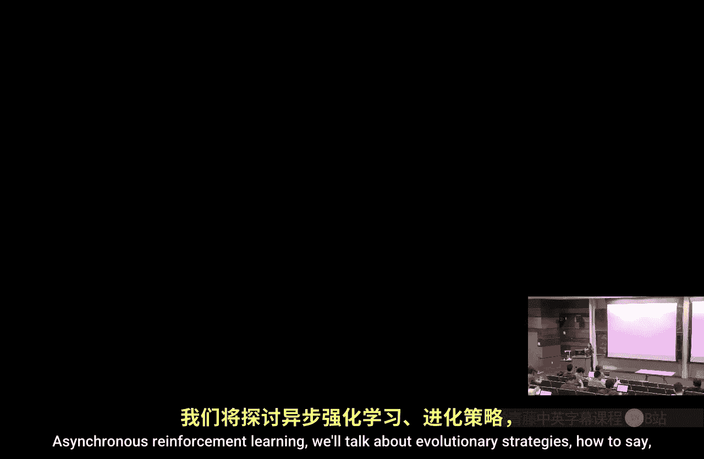
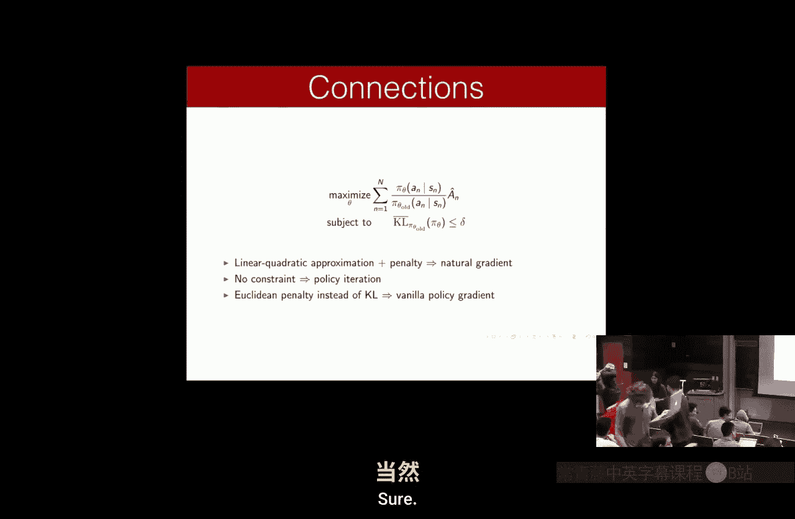

# 卡耐基梅隆大学【中英⚡深度强化学习与控制｜10-703 Fall 2018, Deep Reinforcement Learning and Control】 p13 P13 13  Asynchronous RL -BV1RyqPBbEJV_p13-

Okay， welcome。 We're going to start by fixing some things from the previous lecture and moving forward。

 If you remember So there are going to be a lot of topics is going to be pot today。

 A synchron's reinforcement learning， will'll talk about the evolutionary strategies how to say connections between policy gradients and gradients in the parameter space。

 So we'll review our likelihood ratio gradient estimator。 So you don't need to worry about this。😊。

Then we'll talk about natural policy gradients in detail。

 and we'll touch on TRPO and proximal policy optimization， which are two。State of the art。

Reinforment learning methods， which essentially are policy gradients plus smart choice of the step size。

 Okay， and they are very， very。Connected to natural policy gradients。 Okay， so hopefully。

 a lot of concepts will be， you know， kind of。Clear our up today。 Okay。

 we'll clean them up in our minds。嗯。Last time we discussed why when you have on policy methods it's good to have multiple threads。

 multiple machines， multiple agents to collect experienced tableples in different parts of the environment。

 So this is very natural。 Okay， we all understand this is， of course， it speeds up， Of course。

 stabilized training。 We have way more diverse data to take gradients on。

 There is no confusion there。 Then we discussed about this method。 this particular paper， which。Said。

 okay， forget about experience buffers。 Let's have multi thread， one agent per thread。

 And let's put them in different exploration strategies。 And this is how we're gonna to parallelize。

 There's going be a global network。 okay， with parameters。😊。

A policy and the value here in particular， we show the actual critic version。

 which is the most famous method that came out of this paper iss called A3 C。

 So we'll see it in detail。 And then we have the different workers。

 So how does the communication happen。Each worker reset its parameters to the global network， okay。

remember that， you know， you may need to have two versions once you're doing C estimation。

 the same tricks that we have discussed about how do you estimate value functions， right。

 using function appximators。 you have a target network。

 the targets should not change at every direction to stabilize training。So you copy these parameters。

 Then the worker interacts with the environments。Compute expand apple。

 compute gradients and sends the gradients to the global network。 Okay。

 then a gradient of this step is done。 And then again， the worker copies the parameters。

And because this gradient step happens without locking， it might be that different agents。

 different threads may have slightly different versions of the policy。 Okay。

 so it's called as synchronous updates。 They don't altogether synchronously collect their gradient steps average and take a gradient step。

 as if we had， let's say， eight times or 16 times more data，16 times larger batch。

 not from a single thread， but for all the 16 threads that we have in our machine makes sense。So。

Then it was hypothesized that potentially the fact that different threads。

 different changess get slightly different policies helps in exploration。

 okay and helps collect even more diverse data。 So what people did after that they said， okay。

 what if we don't do a synchronous updates。 what if all the workers， once they compute the gradient。

 they accumulate them average and take a step synchronously， and then altogether they copy。

The parameter weights。 So right now， we're sure that every agent has the same neural network。

Does this make sense。 So now the same， everything is the same， multi threaded distributed。

 but its synchronous as opposed to as synchronous。Okay， and this。

The aritic version of this is called A2 C。 So you may be seeing in the literature A 3 C A to C。 Well。

 it's just aritic methods。 One is with synchronous updates and the others with synchronous updates。

 And the synchronous updates always showed similar or better performance at the anti synchronous。

Because indeed， I mean， okay， these are all empirical findings， but overall， once we take a step。

 we like to have a big batch and diverse enough batch。 Okay， so of course。

 if you aggregate all your data， okay， your gradient direction will be way more informative than doing potentially 16 sequential updates where each batch is you know kind of biased because it comes from one agent。

Do you think this makes sense。Nothing special。 is just I'm replying to some questions from previous lecture。

Now。I would like， because of your homework， you will have potentially to you know implement an aritic method that will go a little bit more details on the implementation side。

 We can forget for now about multith。 We just need to focus on how to implement it， alright。Now。

 one question is following。 we've talking about policy gradients and atoritics。 When is a method。

 a policy gradient， where well call it policy gradient and where well call it an ato critic。I mean。

 it doesn't mind。 It's all terminology， but I mean， it's good not to be confused。 Okay， not to have。

Who what do you think。If we only get the action its policy agreement。Yeah。

 so the police gradients also have a baseline， a computer baseline， okay。

 which is kind of supposed to be the one function。 but this baseline may not be stay dependent。

 It may just be an average， right， or it may be， yes， an average of your reward so far， okay。

Does this make sense once you make this baseline stay dependent。

 So every state has an estimate of that baseline， which is the value function。 and you do。

 you estimate that using a big neural network， Either with Monte Carlo， either with TD updates。 Okay。

 two different things。 So we do backup updates or just Monte Carlo fitting。 Then you can say， okay。

 I have an actor critic。 And this guy is the critic。 Okay。Does this make sense。 I mean。

 I can have other estimators for this baseline。 That's all I'm trying to say that， for example。

 averaging the works would be one。Kind of not very good estimate。For the baseline， but it's cheap。

 And this will go go under the， you know， policy gradient methods。 Allright， so that's clear。

Let's look at this to the code， okay。Now， my question here。Was。

 what is the exact implementation for the critic network， But let's start from the beginning。 So， O。

 sure， we have multiple threads。And what happens is we say T star equals T。And then。

The actor is gonna。Perform actions in the environment。

 So the first thing we see is that it's not like we take a step and we send gradients。

 It seems like we take multiple steps。 How many we take。啊。Well， until t minus start equal tac。

 So we have。A parameter deax that tells us how many steps will do before computing gradients。O。

 is this simple enough。 So we just made a smaller rollout， which is dem step long。

What are we going to do now？Let's discuss about these two lines。 What is the first line。Well。

 first of all， both look like gradient updates。 That's what I see here， okay。So。

 you accumulate gradients。It seems to me that here， here's a score function。

 So it seems to me that these are gradients for the critic。 And this seems sorry for the actor。

 And this seems to be gradients for the critic。 Do you agree so far。Okay。嗯。Okay， great。

 So let's discuss what are we using for the critic network， What is our， you know。

 estimator for the advantage。 Okay， you remember that we said that here we have the score function log of the policy grid log of the policy multiplied with the advantage。

So。If you see that here， imagine that this Tax was 4， which， in fact， is not 4， is 5。

 but it doesn't matter because didn't fit in the page。嗯。The way they compute。Here。

 the rewards is the following。 They start from the end。

And then they say that this R will either be0 if you reach a terminal state or will be your value function。

 okay？And then as you go backwards。You add to these reward。Gamma。

 the previous one plus this cent reward。 Okay， so this looked like this for the third state。

 Let's say you ended up at 4。 For the third state， you will have。The value function of the fourth。

Plus， are three。Do you agree that this is a pretty cool target for。啊。So。

 so then to get the advantage for that third state， you'll subtract for this。

 which is the reward you got minus the baseline， which is the value function。For that state， okay。

Now， let's go one step。Earlier。Okay， that's what we do。 We are moving backwards。 We went to the end。

 and now we're going backwards and we accumulate in this are those values。 Okay。

 multi the step returns。 Okay， one step2， step 3， step four step。

 All the steps will compute gradients。 So if you did five steps for each of those four states will compute gradients。

 Okay， and what will be your target will be the reward beyond that state is not that you have one allowed。

 You estimate the reward of the full trajectory。 and then you plug it。

Makees we exploit the fact that there's some temporal consequence。 Okay， And if I am action 3。

 I should be， my grade should be move according to my reward。On time onward。 Okay。

 I'm not sure if this detail was mentioned in previous lectures。

 That's why I wanted that we see it in more detail。 Okay， if you remember previous lectures， we said。

Gradlock of the policy multiplied with the reward of the trajectory。

 What we see here is this reward of that trajectory is broken into different time steps。

 and we accumulate from each step or words， and we take the gradient steps。Does this make sense？

We can spend time here。 It doesn't matter。Okay， so here is this， what we say， the baseline。

 So what how good we think this state is。Then we see what reward we actually got。

 So what indeed that state was under our current policy。 Okay， so this is the advantage。

 And here this is standard training of that critic like standard regression， right。

 where for every state we try to predict， you know。The expected。Discounted return， okay。

Using this Belmon backup operator， using these multi step returns。 Okay。

 so the multi step returns have different forms， depending on if you're state 1， state 2， state 3。

 state4 or state 5。Over the unrolld trajectory。I wanted to understand this because were going have a homework with advantage a critic。

 So now it's the right time that we discuss about this in detail。Okay。Okay， so。

Does this make sense to everybody？We have seen multistep returns before。Okay， we。

 we take the exact word， the exact morory word till a particular time step。 And beyond that， we say。

 okay， the episode terminate are approximate it based on by estimate of the value function。ok。

And then I'm going for the advantage， I need to。Subtract the value function of the current state。

 not of the terminal state。 Very careful right。 So this is I'm state 3。

 This is my estimation of my future discounted return。

 and I'm going to supply not the value function of the fourth。

 This is simply to to get my estimate of the word。 rather my value function of the current state。

 of course， okay。So this is a state of the art， arocratic method。 we don't have。

 there are many other variants for advantage that you can use。 for example。

 if you wish you can have another neural network estimating the Q function and another one。

 estimating the value function。😡，Here。This method chooses to have only one neural network to do value state estimation in particular。

 the one for the state as opposed to state action。 and then uses the Monte carlo rewords of the current rollout to estimate advantage as opposed to having a targeted neural network for the advantage or for the Q and then to subtract Q minus B to get advantage。

 but all these possible combinations are how you know all these combinations are possible。

 but this one is something that work really well。 And based on the results from the paper。

 this version of acrtic did better than to say a synchronous version of the N step learning。

 a synchronous versions of one step to learning， a synchronous version of sarsa。

 one step and step so。You know， it is a method of choice。Does this make sense？Okay， yes。

 so if this is all like one network， then some of the parameters and A of V are going to overlap some of the parameters of。

They are right So when you just like update them both like add the gradients。

 I guess both and do it like at the same time or so here that's a good question。

 So here the way we have to present the pseudocode， it appears as theta and theta B。

 which is the actor and the critic have completed this joint parameters in practice。

 this wasn' not the case both of them where the same network and they had two heads makes sense So you just add the gradient from both Yes gradients you the same values both yes。

 the one that that head and the other of that head right so you don't throw both gradients in both head。

 Does this make sense， but yes， the backbone will accept gradients from both。Okay， so let's move on。

 evolutionary methods。I want that we discuss what are alternatives ways of optimizing。

Policy functions， okay？Imagine that for policy is a neural network。

 how do we find the weights of that neural network so far discussed about policy gradients。

Can we do something more black boxing？So far yes， we had we assume that this reward and we just described an algorithm that did exactly this when you take a reward from a trajectory。

 you don't treat the trajectory as a black box， you think that the trajectory is different states。

 you even bookke things about your different states using the environments in FP and I can compute statistics of those states。

 the black box weight of doing it is just that you get the reward from your trajectory and this is the fitness。

 the utility of your current parameter theta， and you try to move your theta。

 the neural network weights so that these utilities。

 this trajectory returns become higher and you forget about states。

 you forget about the value functions， the only thing you care about is how parameters of your network map to you。

Here， how parameters of your network mark to expected returns and you can do one or allowed of opportunities expected or you can do multiple ones。

 then they are going to be more have to say， accurate， of course okay。Does this make sense。

 So the methods we'll see right now， they don't assume anything about the structure of the environment。

 They don't assume anything about state。 They just have one neural network that parameters the policy。

 We change that policy。 We do roll out。 We estimate the reward and we tried to figure out how to move those status。

 We saw that。😡，Yes， so then we discussed about the evolutionary methods with the general method it's extremely simple。

 you start with the population of parameters， you pertu them， you fit them， you select the best ones。

 you iterate， it's extremely simple， al right。😡，Now。And indeed。

 the things that have been tried in the literature till 2013 are extremely simple。

 One is this crossenttropy method called crossenttropy method is how do you fit a multivariate isotropic oceans to your data。

 Okay， you initialize menu and standard deviationvi。You sample from this ocean， different parameters。

You do out with your parameters because every parameter corresponds to the policy。 Okay。

 so every parameter is not just some policy。 you do allow。 you you took the top K percent。

 you fit new news and sigmas and you update。 And then we said， you know。

 there's no reason to use isotropic ocean。 You can also use a full covariance matrix。

 And this is going to be called now covariance matrix adaptation and you update both both the new and the covariance matrix are updated at every iteration。

And we said that this works really well for low dimensions， okay， 2000。

 can we use this method for thousands or hundreds of thousands of dimensions。

 That was the question we asked， all right。Now before we answer this question。

 it would be advisable to understand the difference between those methods and the policy gradient methods and I'm going to say but these are completely different well it's not exactly completely different in both cases we're sampling okay in both cases we're sampling in evolutionary methods we're sampling by vectors。

😡，In policy grades， what are we sampling？With sample actions， we keep the same parameters。

 but we say， you know what I'm not going to trust those parameters。

 these parameters give me some particular set of actions， let's say in particular distribution。

 I'm just going to add noise to that out to distribution and sample， okay。😡，All right。

 so to understand this connection， let's first go and check a different derivation of that likelihood ratio gradient estator。

嗯。Our objective that we're trying to maximize is how to sample trajectories。

 so that we maximize their utility， the utility of the resulting trajectories，And okay。

 let's take a gradient， we say a gradient of it of that expectation of that expectation of trajectories。

 now don't worry though you're going to say， oh， but now we talk about expectation of trajectors。

 I know about expectation of batch， what exactly right the policy because the sample actually those are sample trajectory sequentially you will sample the trajectory and you see how we can varies we go from this to you know。

不 video watch。But for now， let's see how simple it is to get to this。Do this。

 this should not be how to say。Its scary。Equation， because we can derive this equation from all different or all different circuit points。

 Okay， so we have an expectation。 We to take the gradient of the theta。嗯。Okay。

 of the policy that influenced this expectation。And。Well。

 the gradient of the sum is the sum of the gradient。 so we push the gradient inside。And there。Well。

 this is set， right。 Not new。 New is going to happen later。

 And then what we decided to do is to multiply and to divide with the same。

Distribution of trajectories be of tau， All right。And then we set to observe that the graph theta of P divide by p is the gradient of respect to theta of the log of that probability distribution of trajectories。

 do you agree？Great， and here is the reward of the trajectories and here is a P。

 so here again I have an expectation。And so now the sun came back as an expectation and why I like expectation。

 well， because I can estimate it simply by sampling， all right？And okay， so it's the expectation。

 but what if how do I estimate in practice well I generate samples and that sum。

 and then the intuitive way to understand this is Garlo of pi。Is a particular direction。

In the parameter space， okay？Well， the policy is going to be there and you weight those directions depending on the is a weighted sum of vectors and the weight of each vector is based on the utility of the trajectory of that policy。

Policies that generate good trajectories were going to move towards。

 They're going to try to maximize their grid log。 I mean。

 because the gradient here is exactly by definition。

 the direction that will maximize that log over by。 Okay， and will minimize that。 So So okay。

 we've seen all this。 But this is another alternative de。 Now， the interesting thing。

Is that very similar thing can happen when were trying to sample directly parameter vectors as opposed to actions。

 potentially it might be easier if we have them next to each other like this。So， no。A objective。

Is not that word will maximize， iss over new。Is the parameters of the distribution of the neural networkal weights。

 The simple thing to think about is that our neuros are sample from the oceansian。

 so this mu is as long as our neuralnetal weight and tell us the mean of those weights。And。

I have expectation over thes， network weights， sample from that Gaussian。 Okay。

 and I'm trying to maximize the utility of those parameters vectors， F of theta。

 And I don't care how this would build This we doesn't itable。 Okay， with respect theta。

 And of course， it's not differentangable， right， And that's the whole discussion that we help score the ratio I would est time because we cannotgrade this。

 We cannot。Take minutes of the reward all the way with respect to the action， given the action。

 the only thing we do to get the word is re，The point of this nature is not understand that this is just like in this is very similar to。

啊。You may on of studying a gradient。 you say a sample。

 what these or mar on this to make my gradient numerically and。はい。

Computer lock approximation migration by Pakistan time。 Okay。

 because I don't have to way to estimate this rain。

 And this is great because Apple that now can be whatever you want。 Now， how are you going to do。

Again， the greater view of the expectation。The expectation is always helpful to put either summation or integral so that we make it explicit。

 we push the gradient inside again here we do the trick that we multiply and divide by this distribution。

 with not distribution。오블 요런 네트워크트폴 안 주드 어라이？And we notice that this is the groundlock of that distribution。

Do you agree with this and here is again an expectation and now to estimate this quantity。

Which is just awaited some of。Vectctorors， the ceiling。I'm just going to sample from my parameters。

 So here I were sampling the trajectories。 Now I'm sampling parameters。 Okay。

 and here is the sample estimate。 Do you see how simple is。 We're just going sample that。

 Just to compute this and and we'll see concrete examples to make this like a super。有呢。第个。

One thing that I was wondering， are people confused that here we have trajectory as opposed to action？

What would be the next step to rewrite this equation here so that we don't see trajectory loose actions because our neural networks？

Right， take states and predict actions。 They don't predict traject。

 going to sample to get trajectory。 Okay， what is the probability of the trajectory。Yes。

 it will be the product of the transition probability in housing。 Yes， that is exactly what it is。

 A trajectory depends on what actions you took。 Okay。

 and then where the environment sends you under this action。

 but your fat that don't touch the environment。 The environment is exactly what it is。

 You cannot change。Where a trajectoryor is going to go。

 the only thing policy can do is choose trajectors that are more likely than others that are less likely。

 Does this make sense， we cannot change the physics which。

to find trajectories that have high likelihood。 And let's see how this。Is written here， okay？嗯。

Uses a simple estimate。Gra log， P of trajectory， multiplly within the of the trajectory and。

The probability of a trajectory under theta， Theta are the parameters of our policy network is。

A product of a。Time steps， capital T is the length of the trajectory or the dynamics multiply with the policy。

The log of the product is the sum of the logs。We're remembering that we're taking ground risk theta that I just don't。

Depend on theta and so they go away， and now you just have a gra of theta of sum of those actions。

And。This is what you have。Okay， very simple。嗯。So now this objective that we saw in the previous page can be expanded in this form。

 and now instead of this probability of theta trajectories。

 we have the probability of theta of alpha given S， which is exactly our neural network。

 our policy network。😡，Now you going to say， oh， what happened to there？R of T。

 what happened to the reward of the trajectory。 Well， remember what we did in the AECC。

 we multiplied。The， the ground logo probability human option with the utility。

 the reward that we get or the advantage that we get beyond that。Okay， there's no reason。So。

 there's no reason。To keep the utility or as a black box because I the last action you took。

 why should I take credit for rewards that previous action generated。

 if you got a huge word in the beginning of the episode plus 500。

 why should this reward count towards you me boosting my beauty which on the last action？For meと0よ。

Dis disation。 So we explored that demo more special day， okay。これですね。ok。Again， this are。

 let's not confuse， it's not the Stan change reward is the advantage from that state and action and on。

😡，Right，You remember what we wrote in the previous in the previous algorithm。 All right。

 so this is it。 That's what we have next to each other。

Now I just put here the provisionvin of actions。And I think this comparison。It's good to have。

 because。There is nothing magic about this， in fact。

 there is so much no magic that essentially very rarely works without having here an estimator。

 let's say， but just using the vanilla reinforceal version。

 essentially what we end up doing is finite differences。

For and now we're going to see this connection。In more detail。 But so far。

 do we kind of understand this de so far， What do you think， shall we yes。Yes。

 so what is the main reason to choose it， Well， first of all， it's extremely used to parallellyze it。

And then we're going to see this in a little bit why and what the workers need to communicate in case of。

Bization按笔记回去。Paking knowledge right， will compare those。

It's completed black box so it can be used with anything you want I sure it's so easy that you know if it would work with。

 I would use it definitely because then you don't need income don't need。正なで。

Some of parameters vectors， and you can put any objective， one differentable， no problem right now。

 we are sweating so much。Okay， to me， our objective is differentiable。

 The reason we're sweating so much is。Currently， once you have a fully infer objective， okay。

 always using the grades will be better than just。上回。Okay， derivative free。

 what we call derivative free optimization。 Now， other time say that for supervised learning。

 there's no reason to use。Evolutionary strategiesate。

 because you kept the brain take the great interest and we know that in highly dimension what you。

 course very exponential you have whats point。你不然给不好别大多是成活。Now， once we get to policy gradient。

 there is this lack of derivative between your actions and learn words。You have options。

And then what do you do， you start the rest get work。 This is not the deter of the course。 I cannot。

There is even no reward to respect option right that's exactly our problem right if we could do that。

 I would just take the event all the way if I knew the reward function analytically I would just。

拍生テールグレートの。Do you agree with this， I would just unroll a little bit on time and to be honest。

 it's called Pa derivatives you work have and lecture exactly on those。Now， ideally。

 and then when we get to that threshold we say， guys， here was the light of theg eximator。

 here's something that is not the light ofgestimator because it can backro get all the way through from your rewards to your parameters of your policy network。

Right now， we don't have such a thing。 We do not know the environment。 We don know dynamics。

 We do not know the reward function。 What we know what to do is you give me a policy。

 I have trajectories， and I estimate returns of those trajectories do you see what I mean。

 So then since this what you plan to do， since you plan to be model free。These people say。

 you know what all this so many papers coming out at the end of the day， if you just do a standard。

 yes， no fear or nothing。You are not going be too far from the state of the art model three。

 sampling based。Methods， does this make sense to you， what I say。Okay。Other questions。Yes。

It that multicon。Of the policy yes policy。That's what it up。Exact， and now what you can say is that。

 oh， but it is not the cargo。 Can I there are maybe a critic。 Yes， good question。 let me think。

 I think， yes， there are some papers that try to combine those two， al right。还没 think。Now。

 if you have a critical though， it's hard to paraze， I suppose。

 because this critic needs to be coordinated among the agents， except if every you know thread。

 because by the way， I want to say that for E to work， urre re have lot of threads。

 not six and6 like thousands of threads。 Does this make sense to talking about lots and lots of threads。

 and we'll see how this is possible because parallelization becomes extremely cheap。

 the communication between the threads becomes extremely cheap under some choices。

 let me think exactly on this question， because I'm not sure if in practice。

 this is possible exactly good through the communication overhead。 Okay， all right。Great。

 so let's go one level deeper if you don't mind， if you don't mind what is the simplest thing。

 the simplest thing is new to parameterize the ga ocean distribution over neural network weights。

 and then the weights are sampled from that distribution。

We all know that the normal distribution has some exponent， some parentesis x minus minus square。

 right， divided by  two sigma squared。 So if you take the log of this， you get this。

 What is in the exponent。 Does this make sense。Plus， constant。

 Why constant because it doesn't depend。我没有。Okay， it doesn't depend on you。

 Then let's take the gra of the log。Now don't say why we take the grd of the log because we're trying to do this expression。

 We try to go ahead and see how this expression is going to look like in practice。 Okay。

 let's go one little deeper on that expression and I'm saying in the most obvious in general case that everybody' is using is Gaussians we have Gasians to parameter neural networks and then the gra of log looks as simple as that and then if you try to do the sample estimate of this expression is essentially one over two why2 we only have two samples if we had then we will put n here right of。

The return of the trajectory multipied with exactly reason right。

 the turn of the trajectory multiply would grab them all PMm。Does this make sense？Great。

 now let's discuss how we're going to be sampling。Those fes， how we're going to sample， we say， okay。

 we have a Gasian。 But how in particular， we sample fes in practice， What do we do。

 What happens computationally， Well， what happens computationally is that you have access to。

A random number generator， Epsilon， who is sampled from a multivariate Gaussian distribution that has zero men and the coly identified map。

And。So if each time you sample this excellent vector。You go and do M。 M is pretty long。Plus s Epson1。

 youll see that if you take the expectation of this， you're going to get new。

 so the expectation is good。And if you take the variance of this。

Because the variance of this layer den the matrix is going to be sigma squared。 So indeed。

 your set one set two set three samples。 and look this very simple part of the position。R。

You know here that the desire to dream。That's what you want if you want example from this Scotian。

 that it mean mu。And。The gomatic is where， okay？啊先问都。I'm forward recording。

There's always reason something to be the say。O this in fact parameterization is exactly what is used in all those VAs。

 variable encoders where they do sample and they try to back out for the sample。

 they they add this equation there and this probable so the only thing to do is use sample the optional but we may be able to see this in。

Other lecture， is was supposed to be for this lecture。 But what to do， there is some stochasticity。

On on the topicsピク。It doesn't matter， so heresump thethe does。

So now if you plug in those data into your expression， what's going to happen， Well。

 the muse are going to cancel and the sigma is going to cancel。

 and the only thing you're going to get is this。The epsilon vector， the random vector， example。

 multiplied with the utility of the injectors。What does this remind us of？嗯。We are looking。

 before we say what this might of。 this is the general algorithm。 Now we know what it is。

 It's extremely simple with sample epsilons。 These are the。

The e that we're going to use to mutate our fetas， Okay， we evaluate those new thetas。😡。

With computer returns that is the utility of the theta plus epsilon， plus mappson。

 These are the new thetas， okay。And then we update the that。O。

 we aggregate over the details of all the。And then we take a step。Okay。ブ。Say yes。

We only need to know the epilson。So what you're trying to say is that if I want to compute this。

 I just need to know the option。 You don't need to send me the Theta。

 That's what you're trying to say。 Yes， you don't need to send me the theta now。

 And this is gonna be extremely Sa tone Marar。Yes， that's exactly the idea。

 that's exactly the main idea behind that paper that we're going to talk about。

 the fact that we're all generating tons very long random seat in the very beginning。

 we're going to share it to all the workers it's not going to communicate back the forth anymore and we all know where each one is in this random seat and the only thing the work is it to send to each other for them to estimate this expression is what。

Let me bit， the epsilon is going to be generated by this random number generator in the very beginning of the training。

Each one， we will know how many workers we are to collaborate to estimate this。 let's say 10。

 So I know where each one of my thousand friends。99。

9 friends is with respect to this random number generator so。All of us need to have the latest。Theta。

 we all need to have the latest theta。 So the question is， how can we all have the same theta。

Without communicating too much between us， okay， what is that each one of us needs to communicate with the other。

😡，I agree。 And this has been from the very beginning。

 So communication means while we're computing what we need to send to each other。

 This happens in the very beginning， so it doesn't compute any overhead。 It's pretty big。

I mean that's fine， so now we all know the excellences that everybody's doing the music。

 if you go to the end， you're going to start from the beginning again。Okay。

 so this has been shared now to everybody。 I know that X neutral isus。

 So the x is going need to be sent and it's good because that are pretty long there as long as the networks。

So but what we needでも。Communication that happens between the workers。

 why do we need multiple workers to do this onward？Thats。Computer returns。Yes， they can。

That's what happens each one of us using this data that we have and you know what's my data and I know what's yours。

 but what you do that I cannot do is you have experience based on this data because if I have to do your work。

Sle thousand times more because where each she that up on road。

So we share the burden of something from experience。Proposed different ts。

 okay and then each one of us will evaluate this differenttatapl maximum for different x vector。

 So now we have thousand numbers， right， Scs but tell us this mutation is that what the mutations are good。

 Then we send them all to each other。 It's so easy， right， The only thing this communicates one sc。

From me to everybody else。え那ちょっとだ部目ピテです。And we all have the same datata without they were sending the datata around or individual。

Right， so this is dream work。不发了。O。Now I'm going to say yes， of course to have a simulator， I mean。

 you to have multiple robots， and said that， it is biological words。

 but in the sense that you know we a population， that's what we call the evolution world values of population。

Every person needs them that has different mutations， different people survive。Okay。

 but this is good。But let's think about the following thing now。

 see a connection between this and find a different methods。Yes， do they alter the same quantity。

Right， we all start from the same fety， actually， do you want that we go a little bit down to see this one？

Like I have a particular slide so here we are distributed sastic gradientd descent。

 How would you do sastic gradient descent distributed manner？

This is what we used in both as synchronous and synchronous reinforcement learning in the first slides okay well。

 we all need to compute gradient vectors and send them to each other right and send them to a central server。

 those gradient vectors are pretty big arere very big you have one value for every parameter weight now in evolution。

 yes， we need dramatic。Distributed compute。But it's much， much simpler。

Because if we look at the algorithm， based on exactly what you said。

 what do we need to send to each other？😡，The setta is big。So ideally。

 we don't want to send the theta because if you have00 people sending theta to each other。I mean。

 there's going to be lots of communication right there。The epsilon， yes。

 is the random city generation， which we can all agree from the beginning。

 So the only thing when you say is this art。Okay， Rta is wrong。 our theta， Okay， or theta。

 we call it here。 So I'm going to change this， but basically the fitness of our parameter vectors。

 And this is how the algorithm looks like。Initial policy parameter theta 0。

 we all have the same theta 0， okay？Right， so you see。

 so with no random seeds and initial parameters theta 0。

 So we all have essentially we were involving all the same theta。

Inside each one the us is the same data that's being involved。 Okay。

 and the only thing we said to each other is the fitness of the different mutations of the datata。

 Okay， why because we already know each other exc。 So if you send your。If of your set。

 I know how to multiply video apps。 I know what your apps。Okay。嗯。That's it。

 iss like trivial to parallellyize。 That's the beauty of。Yeah， evolutionary methods， let's say， okay。

一你闹。So we broadcast tiny needle scholars。And look at this。If you have 14 course。

 it takes you 700 minutes to learn how to walk， if you have a 1500 course it takes you 10 minutes to learn this。

 you going say okay sure you have more courses normal。

 but the truth is that we don't achieve similar type of speedups when the communication is big because the communication becomes at the above work。

Okay， well here you time that the。Okay， now at the same time， just to close this chapter。

Despite how this faster， the experience is wasted All right there is this trade up between。

 yes it's fast， but we waste so many thousand workers of computing experience but if you're in a simulator。

 that is fine if you're in a robot yes each。You know， it costs course electricity。

 you know wear and tear the robot model， but if you're in a simulator。

 it costs you nothing to something to do。Okay， so it does make sense if you have to use a domain that simulate。

 eta。Okay， great。 So we close up chapter now。Yeah， so let's think a little bit about this。

 so far we sampled yes。Are there any characteristic differences between valuesary？

Yeah like you're saying exactly what happens。They are slightly below the state of the art vectorritic methods。

O。I mean， they learn how to walk， etctera， but they work a less good as it to go the acroic methods Now this all depends on how much compute you are allowed to give Does this mix it Also this paper。

 I want say that there is a lot of cupick。Tricks， implementation， tricks that we need to do。

Those things to work What does this mean， It means that if you just grab a vanilla neural accordingtic texture。

 you download， let's say some model for amerold story and this model works really well to forecast gradient in the sense this model will not work well if you just dump it to do this method。

 even if you have a lot of workers what the offers。So is that once you start。Mutating thete。

 many headers would end up in the same policy and doing exactly the same actions。

 so this is pretty bad the whole point of original methods that once you mutate。

 you explore well they were not able to do this simply by mut the parameter status because a lot of different。

你 up to加 the simple。Something that was for them very， very important。

 they call it vitro bus normalization。They say that。

It's very important to make the network output very sensitive to the input， does this make sense。

Very like so， so essentially this virtual batch organization is another way to normalize your input。

 Okay， so that slightly things change， you know， there is a few change between the。At the outcome。

 Allright， So there are these implementationation tricks that came from this 2017 paper that said。

 okay， here， evolutionary methods do also pretty well。 So I would say8。Open research question。

And for low dimension spaces， we already know that the line levels be great right。まじで買しページ。

And by the way， what talking involved in tracing dimension， like if。

De increase the dimension I call to space， I mean， if you put the then in your core widths。

 I mean if this is the same problem， you didn't change the the dimensionality of your space。

 but basically。Yes， so I would say it's an ongoing research question。

 We're often ahead of homework where we need to implement， I mean。

 potentially we may have some load them as。Cro central method of CS， okay。

 just to get an idea of how this works because these are being used even right now， Okay。

 we'll see later papers that do that。 my reason of showing this is to understand better the policy gradientd methods and what do they do and not to think of this。

Score function is make are something very exotic because at the end of it。

 they've totally doing finite differences， so that's the reason that we are covering。Okay。

 and you guess。 So so far， we were sampling this episode silence completely random。

 what if instead of sampling。Round of the so vectors， we just sample one， and then we sample it。

Andテ혜ticはマイルス。The you sample one then you put minus button Okay， like those guys。

 So then you have these two thes， theta plus theta minus， Okay， one goes in the one direction。

 the epsilon direction and the other goes in the completely oppositeing direction of the epsilon vector that you sampled and then。

有。Sure， you evaluate ignore your two mutations， get rollout。

 and you go to estimate your score estimator， sorry yeah。Degrade in this maker。

 which we already know that is the reward not with this kta minus mu。

And we already know that the FEta is going to have this particular room U plus Sigmaon so the new Council and Sigma school Council。

 so eventually you have this and what does this remind us of？This is an。A numerical， you know。

 way' esttating the gradient， right， And we know finite a difference methods， What do they do。

 They perturb one coordinate at a time。Okay， this particular J coordinate， for example。

 you try to estimate。The gradient of around the vector in the J coordinate。

 you will sample plus exception1 AJ minus exception to AJ。

 what is AJ Well is the vector that has all zeros and one in this particular entry， all right？

So in our case， the way we sample in practice。😡，It is not going to be based on each coordinate。

 rather with some one epsilon direction and another antithetic epsilon direction。

 and we try to see how。Let's say the utility of our changes as we change these parameters along that direction。

 Okay， so we sample different directions， and then we average based on the utility and we take a step。

That that's all we're doing， right， Do you agree with this same thing also for。You know。

 in the action case， right， we take actions and。So the difference then between evolutionary methods and policy gradientding methods is where you put your noise。

 if you put your noise in your parameter space and we call it here， its your parameter。

Then up and then size the noise and this you input noise， you know sample from that。

Zero mean and the identity magic。I didn't mean being the covarias and this is gives you the output theta right is and here is this epsilon grid。

 for example， we have an epsilon and we have an alpha probability over actions and then you have also the a parameter that control the noise so you fit the noise and then you get the alpha okay you sample this is how you get samples from actions and sample from parameters basically。

So the only thing we're doing is wese。We evaluate。They you give you our samples。Allright。

Here the sample is on theta， but every theta what does it do， it instantiates a policy。

 How do we compute the utility， we just rule all out there， if you change the actions directly。

 you sample the trajectory and you estimate the utility build So the external signal Now the question is what is the right space for noise okays。

ten you have a very long episode。And you know， it's very hard send work。 basically。

 you model this structure， but this structure is not formal。 Yeah， sure you we have3。

And give that they only got very plus。St give you an word。

 which somehow you need to figure out how to assign it to different options。

 you don't have any hint on how to do that。And then potentially exploit the structure is less useful。

As opposed to rolling where。Every word so you have much better idea of which actually gave me that reward word。

 Does this make sense for the time， the correct assignment problem is easier in that case。

 So then yes， it would make sense to exploit the structure of that trajectory。

And there are some very recent papers that try to acknowledge noise in both phases。

 action and parameters and try to see， you know how can we search in the best way right for our desired policy does this make sense what we're saying here？

Okay， great， So the important thing is to know that in all cases， we're just sampling noise。

 evaluating returns and taking gradients based on。You know。The samples that we collect。

 there is nothing。More exotic， yes， I just curious easier and na to add noise to the snake。

But what do you mean by， how we are sustainable stay？你说。そばして。

Like where are you result people it's it？那坚是在那间面。Try to change the dynamics of the environment。

 right， because of policy。A policy， no matter how you change it。

 you will never change the dynamic to the environment。 Does this in make sense。

 The only thing we hear is I have some data， I have a policy。 How can I get it better。

How can I change the theta so that the utility gets higher？Okay， so the states。As some stuff， I just。

他了不就出。稍了你全。Right， so we cannot change trajectories。

 We cannot change if this imagine there is the state and given this particular action will always go to that state。

 this is the physics of the environment。 There's no way you can change those dynamics。

 No matter what as you push this pen to the left， this pen will always go to the left。 Now。

 if for you going to the left is a horrible state， the only thing you can do is not to take that action。

 So you choose which trajectory stick， you cannot change the trajectories。

 you cannot change the physics of the world。 The physics is what it is。 you got does this make sense。

てられな。Yeah， you better learn something extremely， you know， accurate， right， because otherwise。

 I can maybe the model the environment to get me tons of reward， right。

 that would be extremely maximizing my reward， but it will never happen because the environment is what it is。

 Does this make sense。嗯嗯。State one more time， please。So here exploring more of the space。Yes。

や hereです。Yes， so this is very important。 You need to be able to explore different parts of the state of the space。

 If you're stuck on this particular part of the space。

 there's no way you can figure out what happens in the other part of the space that you'll never explore。

 Does this make sense， So those all a condition that you are exploring。Efficiently， does this。際です。Oh。

 I see this what you mean noise。 Yeah， like add noise in the initial states。

 That's exactly what we do with these multithreadd agents， right。

 Yhuan wakes up with his he opened his eyess in different parts of the environment because we do want to sample all parts of the environment。

 okay。那でそ。啊。😮，For the evolutionary case。No， for they start from the same parameter vector。

Is different， right。でさで。And no， different natures don't need to start。

 they all explore different parts right you are trying to go up the stairs and I try to write on the board。

Right。Where thisDid we see this on some slide or？Let's see嗯。I think maybe let's see here。

 Maybe we see something。 Let's see。Here we saw something。Initial parameters， fit to 0。

Does this make sense。た？啊喂。Yes， you need to run an。 You do。 Yes， it should all start。Right。

 so that's a good actually question， guys。 So here we're all talking about the policy who controls in which state of the environment I am to start exploring Okay。

 the whole point of multi trading is that every agent is going to end up in different states。

Does this make sense， Okay， and indeed that's what we want。

 We want different agentss to explore different environments。 Otherwise。

 whatever all if they all explore the swimming pool， all myre gonna to be about the swimming pool。

 I go outside of the swimming pool and I don't behave well。 Does this make sense。

 So the state where I'm going to throw you in the environment the initial is random。

 Now once I throw you there， the dynamics you cannot change。 Does this make sense。

 And so this all has to do with exploration。 So I think what you're trying to say is the following The most important thing is exploration。

 And here we're all talking about， you know， forget about this。

 forget what is the initial state distribution， what are we going to do onwards。 there's gonna be。

Special lectures and exploration。 I think the first will be coming Monday from Professor Mitchell。

 who is going to go into details about this UCB that we took for granted when we were doing the sampling on the Monte College research。

 and we will talk we also have advanced exploration。Lectures， okay， that will talk about how do you。

Take care of this。 But I think we're trying to say that we put an objective down， okay。

 which the most important part of the exploration doesn't appear in the objective， right。

 So I would like to say that when we cover the maximumtro reinforcement learning。

 which hopefully will be coming Wednesday。AndWe will see that will explicitly ask for the policy not to overcom the policy should。

 if there are， let's say 100 different policies that all give you the same word in this little environment。

 they should all be equally probable。 Okay， so that you don't overcomit the policy in your current environment And because you post stochastic potential。

 you will also explore better。 Okay，Right。I think this multi thread is all about， you know。

 diversifying the states that you're going to end up on， okay。

Now the question is once you are in particular， say how do you improve your policy so let's assume here we assume we took care of the exploration using this multi threadreing and in fact the evolutionary paper says。

 you know what with so many threads， I might explore so much better。

 you know what I'm trying to say so much better than this epsilent gradienting because I change the vector statustas and dramatically different policies result and so I can explore a lot while if you're in the absolutepsilent grid and you change an action with an absolute probability you don't essentially explore your potential stack there okay。

Right， so the state transitions we cannot influence， but the state initial state distribution， yes。

 can be whatever you like it to be。Okay。All right， so we already talked about this paper。 In fact。

 the way they discretized their continuous actions is just to explore better。So all the time。

 this exploration is hidden in all the papers。 All the objectives about how I'm going to degradationgras on my。

 you know， policy and neural network and the exploration is a a side effect。

 But I say that it works on simulate later lectures。 It's an ongoing topic of research。

 how to unify exploration and。You know， just exploitation。

 which is taking the best gradient right now based on what you've seen okay？wish saw this。Okay， so。

How would we go to implement。Owned by thr orten flow。Some standard pole great enough。 Okay。

 you're definitely going to go to go there and write the sum over trajectories。 How How will the。

You know， automatic， you know， this differentiation of software figure out how to put the gradients and that you want to use this particular gradient this。

 What you're going to do is you because you know you want this gradient test。

 you want this particular gradientest or what you're going to do is you're going to write this voice function。

Okay。You see， there's no grad there and the grad will come out from。

The algorithm just trying to take to， you know， maximize this loss function。 Does thist make sense。

 That's how I would write it。So now we're goingversely。 So we had an objective。 We say， ideally。

 that's what I want to。Maximize， then we said， okay， unfortunately it's not differentiable。

 so let me use this gradient estter and I would say okay， this is my gradient estim。

 what should I write into my deep learninging package to you know take gradients based on this gradientest。

Okay， that I decided。これ？Now Hu is another。Equation。And you sayly， equivalently。

 this objective right here that came from inversing the greatestest method is equivalent to this objective。

 Why this is the case。 First of all， that's number one。 and now why would we care about it。

 Why do we care about it。Well， we care about it because。

We care about it because when we update the policy， we update sequentially。

 So we'll always have a theta old and we try to see where we're going to step to get the theta new。

 Okay， so we will be using。This type of objective。啊。

Few methods that we're going to see next use this type of objective。

 why this type of objective is identical to the previous objective， okay？Well。

 here is again our objective expectation with respect to trajectories。

 trajectoryject sample for my policy of the utility of the trajectories， yes。

 I can write the expectation explicitly using a summation over trajectories and probability of those。

And now what we know from important sampling， okay， is that。

I can rewrite this in the following form where the trajectory is and sample now from an other policy。

 I care about the。Poolice set up， but imagine I have a older policy hitta old， okay？

And how can I the same objective？While having steel and un biasased。

 I haven't changed at all the expectation。So I multiply and divide with a speed if it old。And。

Do you see what I need， this is how we derive the important sampling equation。

 which just what happens from row2 to row3 is we multiplied and divide it with a probability of the trajectories to an alternative policy。

 okay？Now， we see that this looks like an expectation。 It's a summation with the probability。

You can just remove this probability from there and just put it here on the sampling。

 So we're saying a summation over a trajectory sample from the old policy of this guy， Okay。

 we have this ratio of probabilities。And shortly some can also be written as the expectation。

 and here we go。Do you see。 So this is the So and now it could take the。Great end of this objective。

 the gradient end of this objective， how it's going to look like。😡，Well。

The gradient with respect to theta， the only term that depends on theta here is here is die。

 we take the gradient respectto theta with the specto theta all。Essentially， what is this？

If you look at oh， this is the grid of the law of the probabilitybialate trajectories。

Evaluated that thresholdhold right， because this is one over。

 the function evaluated at this particular point that I care to take the derivative。まで怖でなてるイテ。Okay。

Do you agree with this？Let's look at it a bit more。

So the first set of equations just red deriveive important sampling so what we see is that when I care to take an expectation of a particular quantity。

 here which quantity I care about。Which one they care about？The returns terms of my trajectories。

 all right？And I don't have access to this particular distribution which is current the policy theta with parameters datata。

 I don't have access to this， I have access to another policy with parameters status old。😡。

What I can do is I can sample from the thetaol， get trajectories， look at their utilities R T。

 their returns， but make sure I weight them using this ratio。 Okay。

 How probable is the trajectory enter theta。Vus， you know， divided by whole problems from that old。

 So if it's very problem their thatta， should wait more。 All right， this is just important something。

 And given the homework we have to。You have， have the homework too somewhere。

 This should be kind of yes， sure。 It makes sense。 I mean， we don't know yet why we're doing it。

 but yes， it goes through。Right。嗯。Great， and again。

I'm just saying take a gradient of expectation here， by way， yes。😡，So you。

You know what data and selected the old occurring？是。Yes。

 you do not know you just know the analytic form of the policy right。

 and you have it evaluated in a particular theta old point and you don't know what theta is theta is just a variable right now。

 Allright it's a variable， theta is a variable。Okay， so then how do you know the ratio？嗯。

We feet here。Our gradient is just gradient of the log of this。So it's an analytic form here。

 do you agree that there's an analytic form， imagine it's a neural network。

 there is some new Gausion， the log going to kill the expectation。

 just the output of the network here evaluate a it old， right。

 it's just the gradient and then you evaluate the gradient that it old。Right。Right。

 so if we just focus on how can we maximize that objective， this what happens， all right？It is a ver。

 and I need take the grain respect to Teta。And。I'm going to sample trajectors with the adult and value the with adult。

Let's see， maybe if we move a little bit forward， maybe it's going to things that will make more sense。

 let's see。 So again， nothing happened here is just I went from trajectories again to actions。😡，啊。

And again， the advantages here are temporal， there is no criticitique here as you see these advantages。

The estimation of the advantage from teeth onwards， No critic。 There is no critic here。 Great。

 So since the two are the same， let's consider， we say yes， equivalently， sounds good。 Now， for now。

 we'll forget about it somehow。But let me tell you what we're going to discuss。

A big problem to whatever we've said so far is that we don't know how to take a step size。 Yes。

 we compute the gradient。 but how much do we need to move on that gradient。 Okay。

 and then you going say yes， but it's always like this I mean supervised learning。

 so I don't move forever。's you know， it's not a complex objective you need to make small steps。

You have a learning grades， you can schedule your learning grade。 you also have to say。Very you。こです。

the normal step size， there are different optimization methods。

And probably this to help you to obtain good set sizes。 So the problem is that here。Here。

 the choice of the step size is more critical than the supervisorvis learning。

 because as long as we make a bad step， you're going to end up in a bad policy。

You're going to collect bad data because you are on policy， right？

And you are not never going to in super advanceded learning， wherever your weights are。どてもと。

Get your data like X。And labels is the same。 The Data is the same。

Here because the data depends on your model in longer for a job， Okay。

 so that's why how often take step size is a big deal and people。Baly。啊。So by the， for now。

 forget about that politics， just think about we have this first for rewards。

And people have seen the beauty that if you do not exercise size and you try to before whole decision is no。

I'm going to say， okay， what the detail。 I'm just going take tiny steps。 Okay， yes。

 you can take time steps。 but then you are not going to use your experience efficiently。 Okay。

 so you're going to go very slowly。 And because when you are the paper， you show。Performance。

And samples， neuro curve is going to be available， designate to try to push this here high， okay？

All right， so here is HD， Nathantan you， it's all about this e here now now we know the G。

 we discussed a lot about G now we're going to talk about the step。🤧。So， this is。Sorry about this。

 So this is gradient descent in parameter space。 You have some lo。And you try to minimize the loss。

And by definition of the gradient decent， you try to find a direction D that if you step along this direction。

 whether you to step Theta plus D， you change your horizontal on one direction。

If you stay within a room excellent。Things are not going， you know。

 you're essentially going to minimize your objective。 Okay， so it's a smallerpoliticization you do。

 Allright， this by definition of this。You knowSest descent direction。

 this is the definition of the simple system direction。

 So what do you see here that the Eucliidean distance， the parameter space influence yourization？

Does this make sense how far your parameters are to each other influences。

 is this the right way to do it？And no， it's not why， like look at these two oceans here。Their means。

Are both four like this Dx is 4， but because there are very different distributions。

The change of the distribution is very different， so if you have some parameters。

 this parameters has some distribution， for example， are falses。

The has change and the policy changes。And what gradient descent tells you if brought to space。

 the standard gradientcent is。知。complete on your project this kind of smoke。

 but the thing is that we don。How far the ground is between each other。 Why do get this。

 The only thing you get is the resulting distribution should not be too far away from each other because if the result distribution is too far away。

 then。我把这个 advanced房的之序。Clit will not be at all called for the next。

The three responses do not hold at all for the next policy。

 That's why we don't want to degrade the parameter space。 That's why they say， oh。

 it all depends on the pro of your distribution。 We want to take steps in distribution space。

Does this make sense as a motivation， why we don't care to do standard gradient descent。

 but rather are we going to think how my distribution is going to change？你从。你总是帮我掏。

Your probability of your distribution。Okay， great。 So this motivation， I think makes a lot of sense。

 Now， the question is， great。 in parameter space， you have eucl distance in distribution space by distance we're going to use。

Yes， how do you know Can That's right。 Very simple。So basically， what they're going to do。

Instead of defining the step size in terms of this Euclidean on the parameters， which makes no sense。

😡，Like in tweet sense， because I make any tweet sense。

 as you change the parameters network piece complete it can be small， big， you don't know。

 All right a lot of tweaking you need to do to get this right right we're trying to make things automatedmate。

 we're trying to to take things from the characteristicsuristic and the implementation details to the algorithm now to have you a way of how to take your gradients that will not go into the implementation title of paper and the scheduling anda。

 ettera okay。So you will instead define the D so that the K differencergence between the previous theal and the new is equals to c y equals to c no smaller than C because you want to be able to make some progress。

 let's say okay so one minimize objective， otherwise we do stay in the same way I mean， no。

 because you are trying to minimize this so even if you put。Smaller or wrinkle to sea you。 be fine。

出きアテブ。The KL divergence is not exactly a metric。 A metric is supposed to be symmetric。

 KL is not symmetric。 You see here at zero when the two distributions。Are the same。

 otherwise positive。 However， if the two distributions very close to each other is almost symmetric。

 So it's okay。 Let's just take it。 Okay， let's just take it。We'll take it。 Okay。

 now what I'm going to do now， Let's see It is not that difficult。

You take the constraint and you create this unconstrained objective because you'll put this as a penalty。

Start on the grand multiply。 You should put this one。Yeah要 my6 okay。

And you're going to start digging。Gs， with respect of this subject using Newton method。

 in particular， we are going to approximate both our losses and our KL in terms of first order and second order approximation。

😡，Right， this is standard gradientding descent。 Here' is the first order approximation。

The loss in current。P plus the grid， the first gradient multiply D。

 D is what we're trying to find plus。This supposed to be the second order， the other expansion of KL。

 And is what we're going to look at now， how do we write the second order。

The looks function of the KL。 For now， let's assume we have it。 Okay。

 and let's assume it looks like that。There you what， this is the fisher matrix， amazing。No。

If we had this。So that we try to demystify this natural gradient， what would you do to pick the D？

This is a quadratic problem。 Okay， what they're going to do， set the grade is to 0， right。

 Then you know， you found the minimum。You agree with this。 Okay， let's take a gradient set to zero。

Is your intuition。诶。One second， what do you mean， so what you're saying， for example， let's see。

First of all， that's what we always do in optimization， right when we have an incomecom。

 we try to do some approximation first on the second order。N there's nothing the there。 Now。

 what you're saying is that where did the second order thermal be go where it's ne its very small。

 Okay， is's very small level alone that it takes。Sa with the official letters， by the way。

 but the fantastic pres 2017 excellent。I think somebody asked here this natural gradient use nowadays yes。

 there is this I'm going to again that one a very smart way to estimate the methods very fast or approximate it very fast and then because you know it's a heian like number of parameters by numbers of this is huge to estimate to store that's why we lack first order methods so that we don't need to have these big mattress now so we throw away the second order of the law。

 but's okay。あるなな。see any exotic thing here。 We just take that one expansion。 That's what we do。

 We have a noncongress objective。 We take some second order approximation。

 We take gradient step for done Do you agree you mean。The二。Go over toラ。嗯全。Oh。

 this one forget so this is going to be a whole fight that explains this。 Okay。

 so this guy is the taillor expansion。Of the KL term， there's a whole slide about this。 Okay。

 so we take the KL。 and what do we say we say KL of Beththeta。

Condition paththeta plus D equals what the k oftheta condition paththeta where we are right now How much is this0 plus expectation of this the first order plus second order。

 The first order， it turns out it's also0。 And the second order。 It turns out it is like this。

 Do you simulate it。 So we are gonna go this。 Okay So just the only thing I want to say is that this guy。

 and I'm gonna to make potential singles。 So this guy goes here。

 this is the first order taillor belows。 And this is the second order tailor of the k。뭐기에。

And somehow the first two terms of the Tayloror expansion of the GaL are zero and disappear。

 So you have only the second order term。 Okay so there is no choice there。

 It's just the math works out like this。Great。And then why do you do this， just。

 I just want to show to the end here。We at the Brazil， we take。Right， the gradients。sorry。

 this is our to dealer。Yep， argument with respect and。So the gradient direction ends up being this。

And it looks like that。 And here is this fier matrix。 and this is called the natural gradient。

 Do you see how nicely it's motivated。Do you see how nice is motivated Its motivated by the fact that you don't want to take steps in your parameter space。

 you want to take steps in your distribution space。

 so you want the conditioning this ball should be measured in the KL on distribution as of opposed your parameters and the only thing we need to discuss in the next course is where did this we're going to go through the tailor expansion of the K don't worry about this we will have a lot of things Well okay yes but the only thing this is not going take at all long time the next lecture。

 but here is the RPO。 so probably you hear on the1 TO or theRPO right there are some nice theoretical results that under some know if you take a step now you increase your policy which eventually at end the practical doest follow the theoretical results that it doesn't matter。

 but it is exactly。What we discussed， there is a clear constraint， there is this objectiveive， okay。

 which we saw because it's a quiball that be right。Does this make sense。 So very simple。 one second。

 I want to show you。Okay， that's fine don' worry we will go through it in the next time。

 but basically all this TRPO and PPO is about step sizes will continue。

 We'll take five minutes in the the Wednesday lecture to finish this and they will go into max centroppy I think a lot of things became more clear today。

 hopefully right we will go through this 10 minutes in the next lecture。

 So don't worry and we'll see the KL P expansion to see why this detropo blood D came out。 Okay。こち。

Oh， this is why this is the fisher matrix and how the KL became the fisher matrix， blah， blah， blah。

不 sure。

