# 卡耐基梅隆大学【中英⚡深度强化学习与控制｜10-703 Fall 2018, Deep Reinforcement Learning and Control】 p14 P14 14 Natural Policy Gradients, TRPO, PPO, ACKTR -BV1RyqPBbEJV_p14-

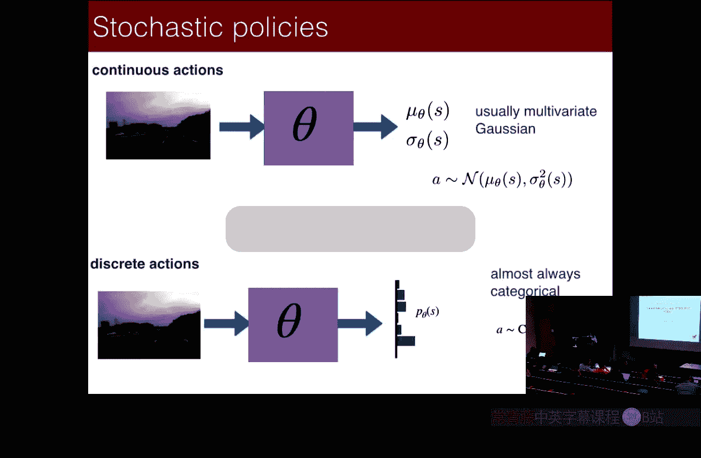

Okay， so we'll continue this week with Model 3 reinforcement learning。 Last week。

 we talked about policy gradients。

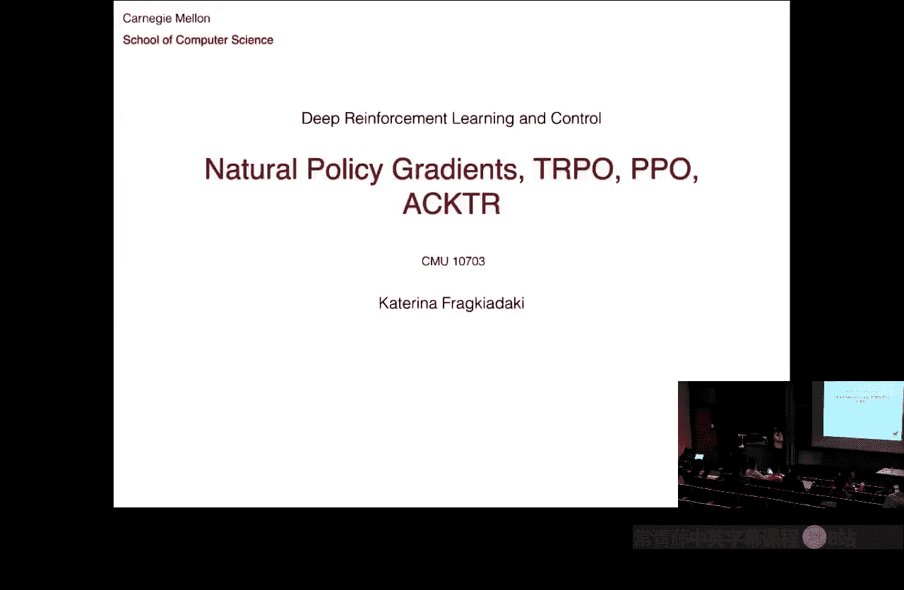

Okay， we can use it both in continuous in policies with continuous actions and discrete actions。

 I noticed that we' never mentioned what happens when we have continuous actions essentially still you can have a neural network。

 your functional appximator and the output will be。The mean。Okay，And the standard deviation。

 one of those mean values and standard deviation values for how long is your action space。

 And here we just have a categorical distribution of standard soft maps that could be using for deepQ learning okay。

And。

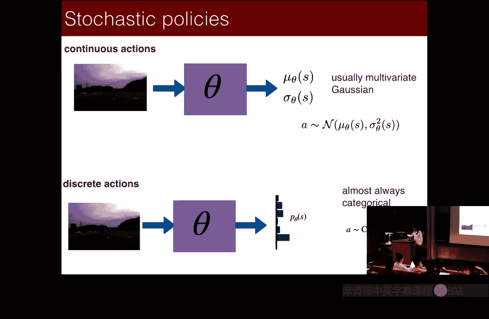

Alright， so this is what we know from last week。We talked about this likelihood ratio gradient estimator right that we would estimate from sampling would have a policy sample trajectories。

 estimate the advantages， okay， and estimate the advantage with Monte Carlo or we have a separate advantage estimator。

 for example， a state value function and we would subtract from the reward the state value function estimates。

 correct， we would use single step returns， multi step returns。 youll remember this from the。

Socode of the A3 C algorithm that we saw in the last lecture。And then we say we have this procedure。

 We collect trajectories using our current policy， estimateimate the advantages using Monte Car or。

 or your're a critic。 All right， form the gradient and take a step。Correct。

 but we didn't talk about how big of a step you can take。 Okay， and there is an abundance。

Of successful model free methods that are all about how you choose the step size。 Okay。

 and they come under names of trust， region， policy optimization， proxima policy optimization。啊。

Chronic care factor， approximation。For actor critic。

 these are all recent methods since 2015 that try to。You know。

 basically give you informative step sizes beyond 2015， already from 2002。

 there are papers from Shankkacadi， which talks about natural policy gradients。

 The idea of a natural gradient is not new for reinforcement learning。

 It's known from general machine learning， but it becomes particularly important in our case。

 And I will explain why because。For us， in contrast to supervised learning。

 the step size is of way more critical importance。Because dramatic degradations can happen。

If we take wrong step size and and we'll go this in a little bit。

 But basically today's lecture and a little bit of the next lecture is all about the step size。

Does this make sense。 So we'll dive into a lot of details about the natural policy gradient direction。

 how we compute it。Okay。

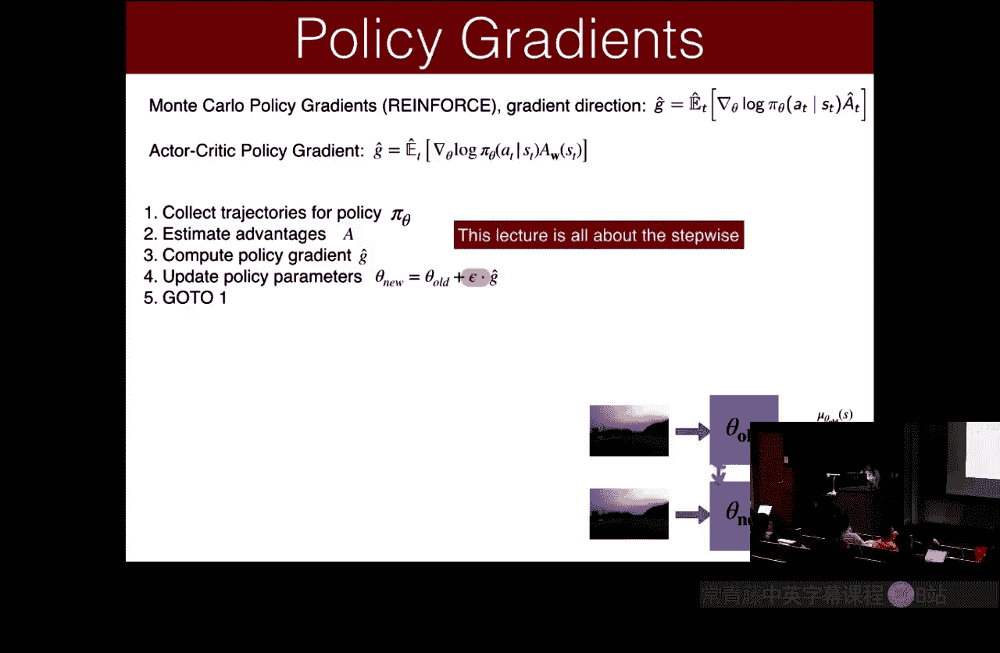

Now， aside of the fact of this practicality， what should be the step size。Another thing we'll think。

 which is a little bit more。Let's see。Not as practical， but rather。Conceptual。

 the conceptual question would be， we started from an objective。Future discounted sum of rewards。

 Okay， and we said that's what we're trying to optimize。 That's what we're trying to maximize。

And then you remember， we put this gradient gradient of the estimations。

 the estimation of this log score function multiplied with the returns。

 And now the question is now that you have this gradient estimator。

What exactly cost function this maximizes， Okay， so this is the gradient is dimension。

 So now you trivial will say， well， this essentially comes from just taking the gradient of this expression。

 Okay， so why don't I just set this as my objective。Does this make sense， guys。

 So how would you implement policy gradients。In an autoDfi like Tensorflow。

 you would write down that objective， right， The second one and just say， okay， gradient in descent。

Now， and then you need to make sure you put this outer loop， right？

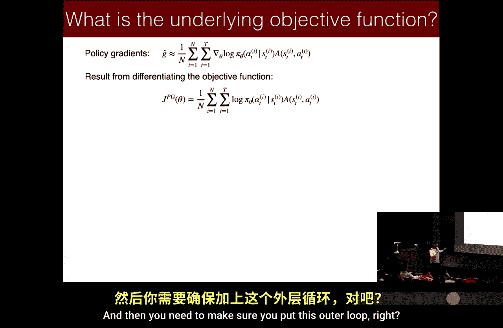

Because you remember 1，2，3，4，5， collect trajectories， Take a small step。

 You cannot just let this objective， you know， fix the number of trajectories and take gradients of this objective forever。

 right。

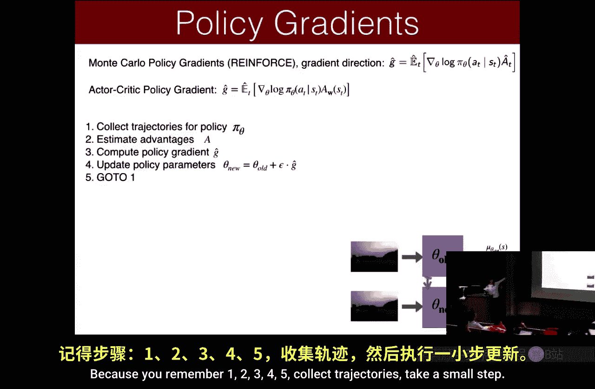

Does this make sense， So basically what is capital N？

And the number of trajectors that we collected based on this number of trajectors。

 we estimate some advantages。 Okay， based on these advantages， we estimate that。

That gradient direction， correct， like， like this one。Now it's not just taking a lot of steps。

 taking a lot of directions of step four。😡，O， you need to go back and collect new data， etc， etc。

 Can we write an objective。That if we try to maximize that objective， this procedure of 1，2，3，4。

5 will come out because if you just。Right down。

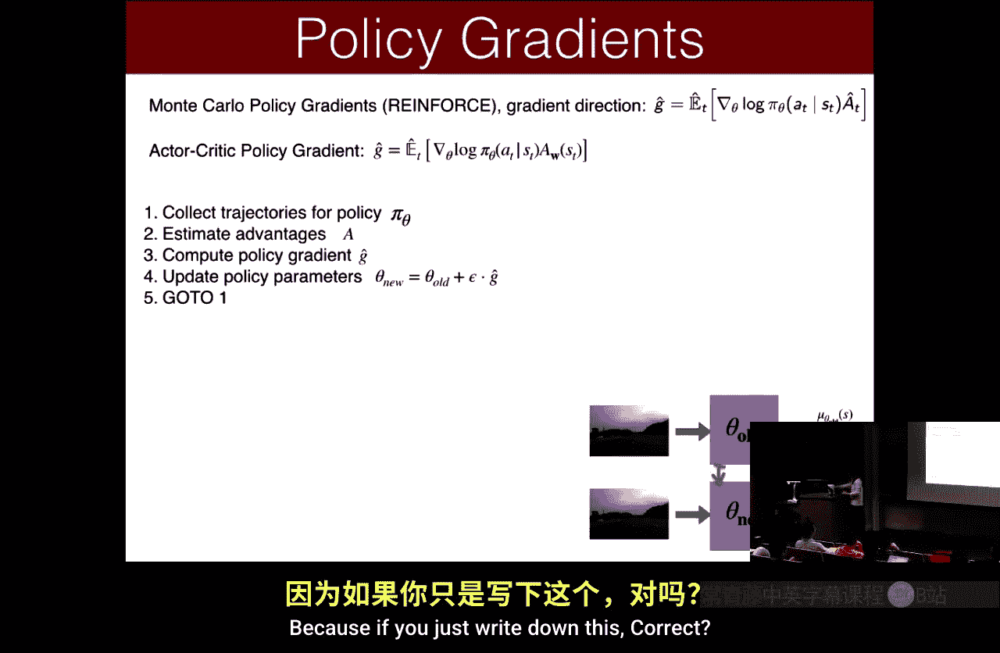

This。Correct， this doesn't tell you that， you know what， you cannot optimize this forever。

 Those advantages are noisy。 Okay， and you're going end up in something really bad。

 Does thist make sense。 So conceptually， this is dissatisfying。

The the constraint that you cannot optimize this long enough is nowhere on that objective function。

And to make this more clear， let's compare with supervised learning。 So how what comparison will do。

Imagine that instead of trying to find our actions， O， find our policy。Using reinforcement learning。

 just trial an error。Imagine that we had asked an expert。

 and we will have later in the course lectures exactly about im learning， how you query an expert。

To tell you what to do。 Okay， so imagine we had those ground truth actions。 Do I make sense。

What would be our objective that we would like to maximize to end up with our policy？What will be。

Right， standard maximum likelihood destination。 Google will just try to take our training set all those expert demonstrations。

 as it's called these expert trajectories。😮。

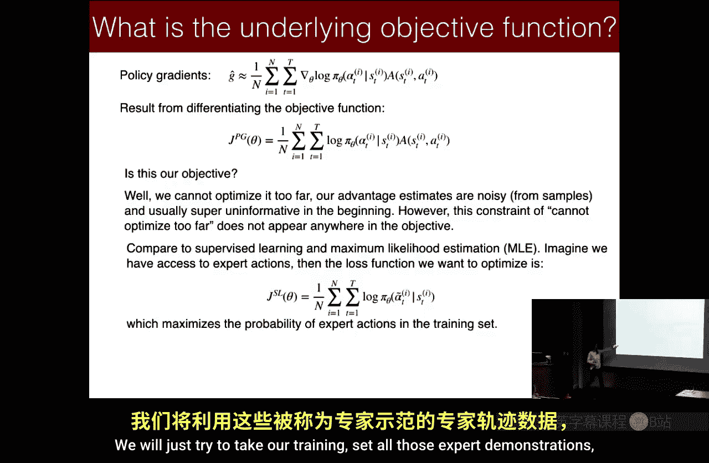

Take the actions from those trajectors， which now I denoted as a tilde because they're ground truth and we'll try to fit。

A policy， a parameterized policy。 And we would fit those parameter set so that we maximize the likelihood of those expert actions。

Right， and that's it。 Is this a good objective。 Can you optimize this forever。I mean， do you see。

 I'm trying to to show you the R problem。And the fact that we haven't put down an objective。

 Well in the supervised learning case， there is a well defined objective that you can put down。

And optimize。Now， my question is， are you satisfied with this supervised learning objective？

If I would give you。A paired， fully supervised training set of states paired with ground roof actions。

And you would like to fit a policy to it using standard supervised learning in this case。

You could do something like this， right， Imagine you have discrete actions， then we have a softm。

 right， that will put a standard log loss to try to maximize the expert actions。

Do you agree with this？Now because the whole training set does not fit in memory， right。

 you would do batches and youll take small steps， but if the full training set would fit in GPU memory。

 then you would just take you know gradients using the full estimate， let's say okay。😮。

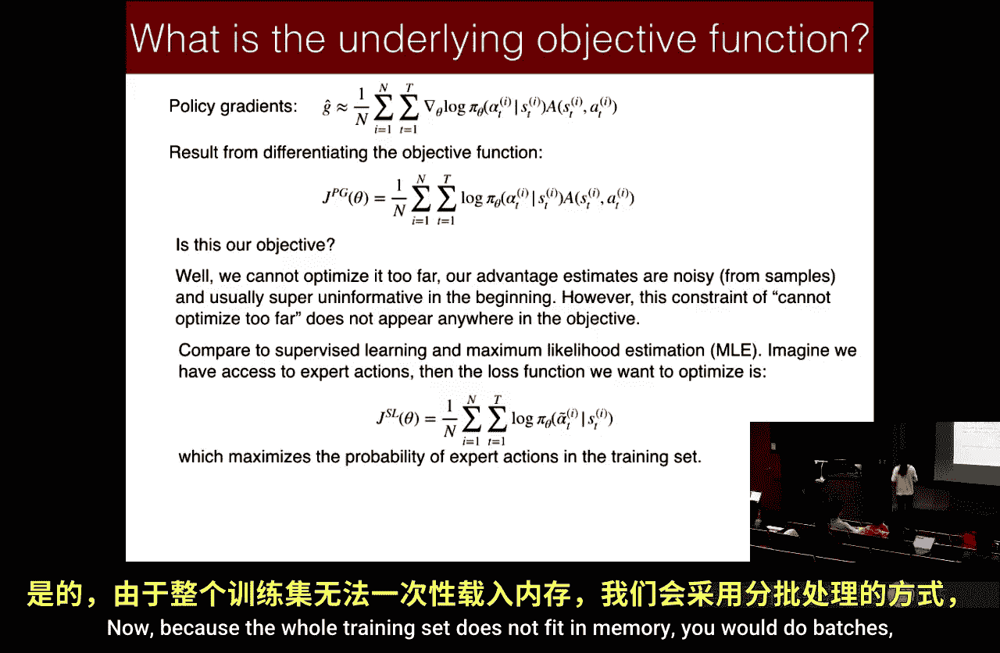

And the。You just optimize。Very long。 is this what we usually do？Are you happy with this procedure。

Ideally， what are you trying to maximize the probability of the expectations。Here。

 we're trying to maximize the probability on the training set。 Ially。

 what we hear is not the training set is the test set， correctect， There is a test set。However。

 if you just add the small regularization， right？😊，Many， many。

 many people are very satisfied with this。 They just write it down what would be the regularization。

 I want， for example， the weights of my police network to have small norm。 That's a standard1。

 In fact， it's so standard that most of you may not even know your're using because it's default in the in T F。

In terms of flow， right。And what I'm trying to say is that this is a wellform objective that you would write down in your tensorflow computational graph。

 just put it there， let it to it。 and youll just go。 Does this make sense Well， for Ar。

 we don't have such a thing because if you write down this and you start taking lots of gradients。

Then because you you need to iterate between updating the policy and recollecting data。 Okay。

 so the question is， how can we write an objective that if you try to maximize this。

 the natural this process of collecting data and optimizing collecting data and optimizeable come out。

 Does this make sense one Im saying。So basically， in supervised learning。

 we have ground reflection that don't change。😮，With iterations， while in reinforcement learning。

 we have noisy advantages which change with iterations。 Okay， and we find better。

 better advantages as we collect better and better data， okay。

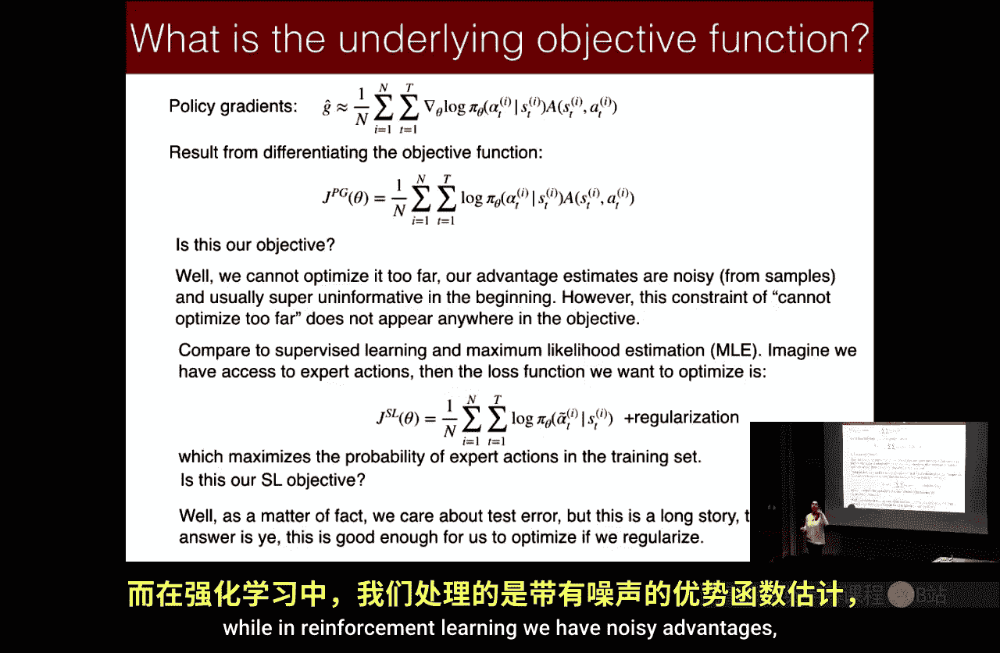

In any case， this will become more clear also， but you see the difference。

 is this difference clear now that we wrote these two cost functions down between a supervised learning cost function and the reinforcement learning cost function。

That in supervisorvised learning with grant reductions in here， we have just noisy advantages。Yes。

 okay。Any questions on this。

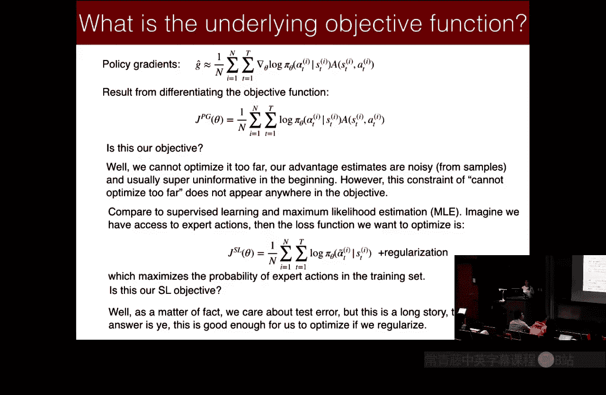

Okay， so basically this lecture is all about the step size。

 but at the same time it's about writing down an objective that if we try to maximize that objective。

 this process of  one，2， 3，4，5 will come out naturally， okay。😡。

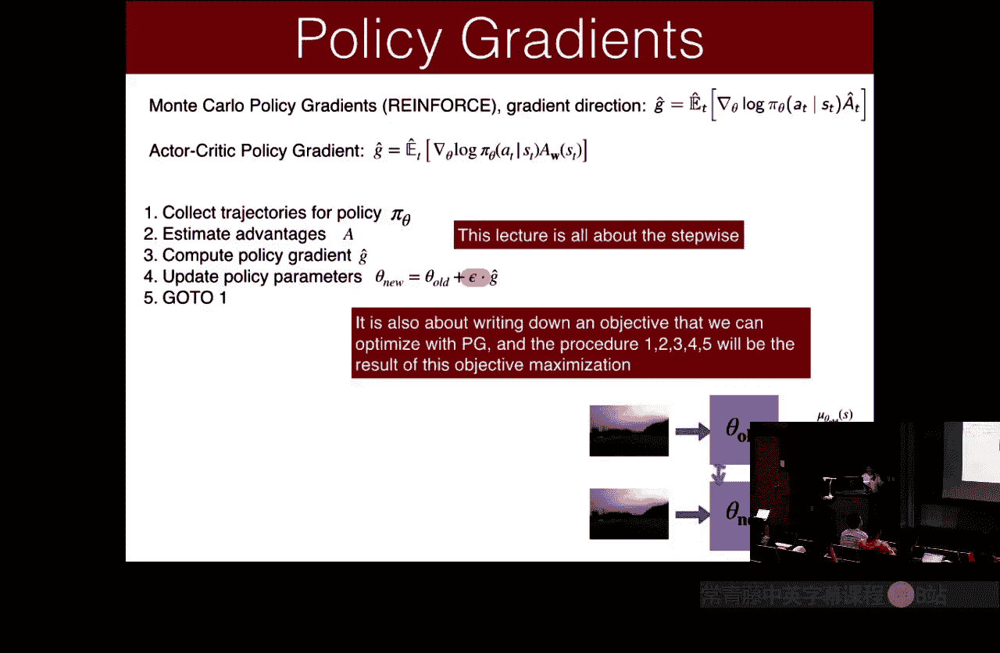

So let's start with what are the two problems of the vanilla formulation of policy gradients and what is the vanilla formulation of policy gradients。

 whatever you see here as the one， to 3，4 five duration。Well， the first problem。Heres to do。

 exactly what you said。 It's hard to choose a step size。 And what you're gonna say is that。

 you know what in supervised learning is also hard to use the step size。

 That's why we there are so many optimizational gardens and Adam momentum and R M， etctera。

 It is true。 And if you use all those will help。 But still， the problem is there。

 and it's very hard to choose a step size that is correct throughout the whole learning process。

 Now you're going say supervised learning。 Also， we have a schedule of the learning rate。

Here the problem is aggravated， basically， whatever tools we're going to use。

 they have been used for supervised learning。 But even if you don't use tools in supervised learning。

 still you'll do well it's just maybe you're gonna be slower， right， Well， in our case。

 if we take a bad step， we may end up in a policy， which is pretty bad collecting data under that bad policy will never allow us to go back to a good point。

 Okay so we're in a more difficult situation。 Okay， because the labels， the advantage is essentially。

 the so labels change based on the policy we have。

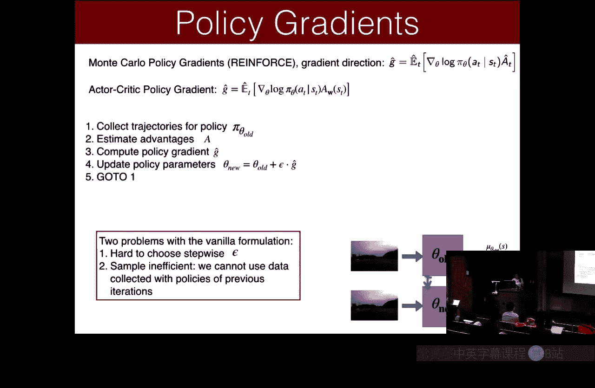

So what is the problem with the step size。 Well， if the sta size is too big， as we said。

 we will end up in some bad policy， well collect data under this bad policy and we won't be able to recover while in supervised learning the labels do not depend at all in your neural network weights。

 they are the same okay and if the step is too small。

 So now you say I'm just going to be as conservatives as it gets。

 the problem is that if you are on policy。 which means that each time you change your neural network weights。

 you need to collect new data， then you really going waste a lot a lot。

 a lot of data So it's not that simple。 It's not just that you are slow。

 it's also that you waste a lot a lot of experience。 okay。

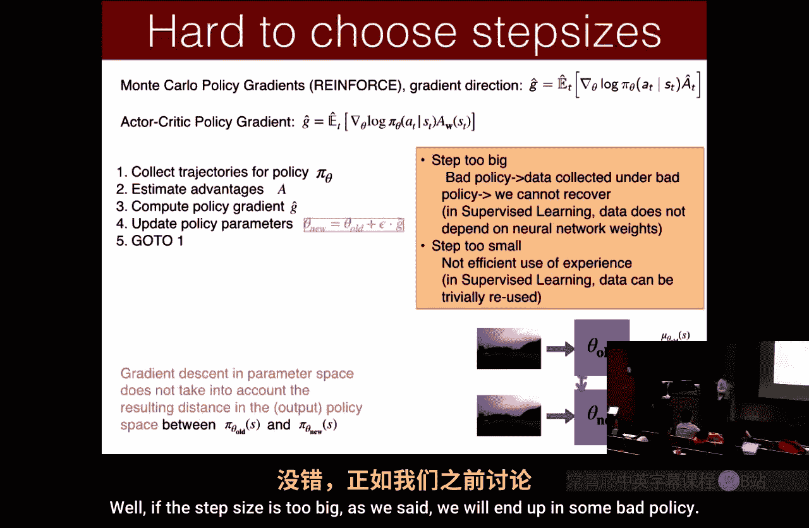

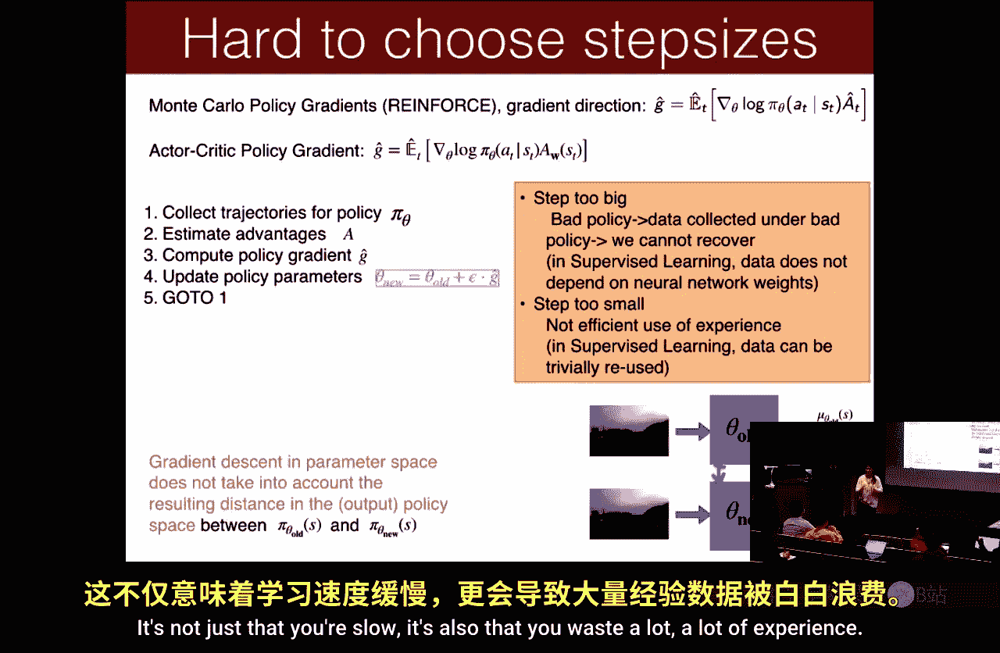

Is that clear， yes。好。Yes， in the beginning， how to say the progress is slow In the beginning。

 you know the advantages are all probably going how to say。

Landscape where you don't have any rewards。 If you start randomly poking around。

 you're not gonna hit in a particular object at some point， though， you will find something useful。

 Okay， and then your policy gonna start improving。 Now， if this puts you back in the bad policy。

 this may be repeated forever。 So again， you are now in the bad regime， again。

 you need to spend tons of time till you see the light and the aant tunnel somewhere。

 you may try to make progress， you make a bad step forget about the light。

 I need to you need to search about the light taking forever。 Does this make sense。 Ideally。

 when you find the light， you really need to to you know。

 can continue following it and trying to improve。 Does this make sense。 Yes， when you initialized。

 Things are pretty bad。😊，And you will see it in your policies right in the beginning。

 they do crazy things。That is different。It's not different。

 It just tells you that if you are all the time， you start from something bad。

 and if you are every now and then you are back in the beginning where you started。

 you will never make progress。Does this make sense。

Do you see so that you're going to be sent again and again in your but initial point。

 then you will never make progress。Yeah， if you find a good point， you better have some， let's say。

 guarantees that once you take steps with your gradients。

 you will be improving as opposed to you can be randomly sent back to your initial and informative policy weights。

has a higher objective advantages， yes。MYes。Okay， so the question is。Why this is the case。

 Why choosing a step size is so difficult。You remember what we said in the last lecture？

Whatever step you take in your theta in these neural network ways。

It's very hard for you to predict if I tell you， okay。

 here are your initial fes and here are your final fes。Look， I changed the set very little。

You shouldn't have a bigger difference on this。 Then I'm going to tell you， no。

 there is no guarantee。A very small， depending because there is such a complex function approximation。

 depending on where you are on that fact approximation。

 remember the sigmoid for a big part of that sigmoid curve there is saturation point。

 no matter how change the theta。 The result doesn't change at all。

 But if you are on the part of the sigmoid function That is， let's say close to vertical。

 a tiny change on your parameters can completely change your performance。

 Does this make sense completely change the output。 Thus。

 is very hard for us to predict how changing the weight will impact the policy。

 And this is where the problem comes from。By taking steps on your parameter space。

 you have no clue right now in the vanilla version of policy gradients of how your policy is impacted。

 That's why we cannot say anything about whether we're going be improving or we're gonna be sent to a random point。

 right， You're gonna be climbing， climbing， improving the performance at some point。

 Hope jump to bad performance again。 Does this make us as measured by collecting data and evaluating the advantages。

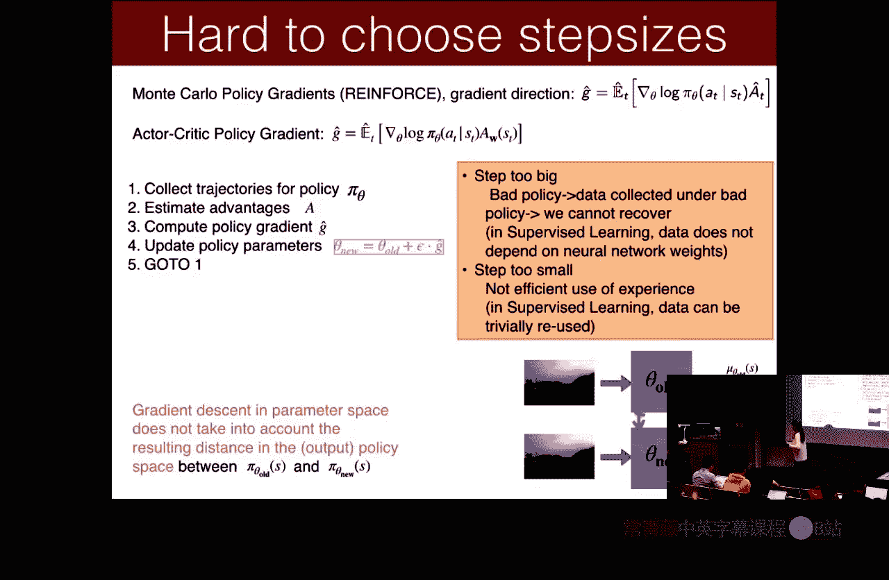

And actually， here it is。This is the sigmoid。Sigma here is the standard syn that everybody uses in their network architectures。

 And you see here that we're changing the theta。 There is only one parameter here。

With the same same step size from 4 to 2， from 2 to 0。Between 4 and2。The probabilities。

 the policies have not changed still。Action 1 is much more probable than option 2。

But once the theta becomes from 2 to 0， then the policy has changed dramatically because and the way to understand this is that depending on where you are on the sigmoid。

 things may change very slowly。 That's why they call it the saturating part。

 Nothing is you change the input。 Nothing is coming up to the sigmoid。

 or they change dramatically like in the linear part of that sigmoid function。 Does this make sense。

So now we know what the problem is that we don't know how to relate step in the parameter space with steps in the policy space。

 Okay， in the space of policy， different policy functions， okay。Great。

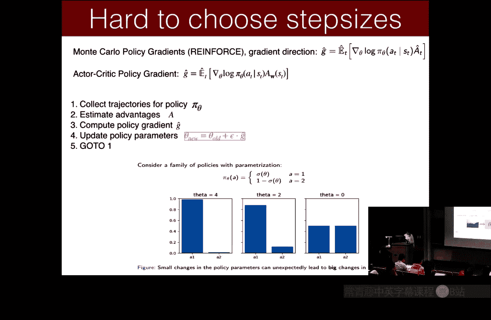

嗯，哼。😊。

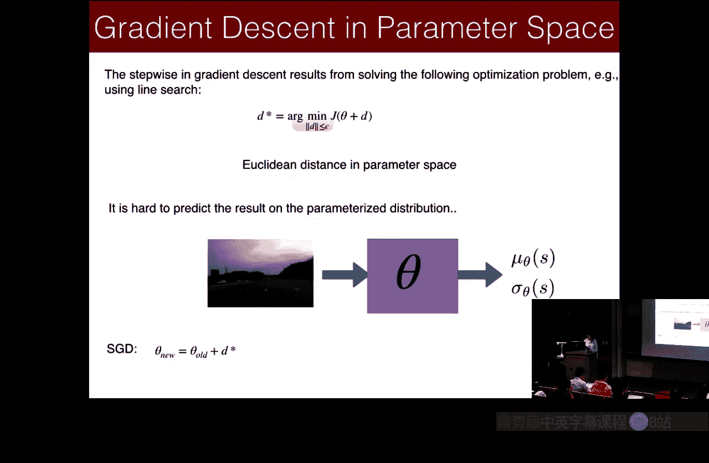

That's exactly what we said。So， then。The reason what I'm showing there is that there is an implicit。

 you know， the norm of the gradient should be smaller than epsilon。

 There is this implicit such constraint when we do a gradient descent。 we take our objective。

 we can be super complex， right we linearize it and we say， you know what。

 make sure the delta that you're searching the gradient direction B within a ball of epsilon。

And we just discussed a big problem of this vanilla gradient descent。 let's say， optimization。

And here we're saying that maybe the right constraint that we're missing is this KL。

Since we know that the theta has parameterized distributions and in particular。

 distributions of actions， that is policies， why don't I just try to estimate how my policy is changing？

😡，As I change the theta， Okay， is that clear。So still， I'm trying to maximize my objective。

 the objective of the policy。Okay， that's the like， if you remember the the grid。

 these lack estimate made are still trying to push the probability of the traors that had at high advantages and。

You know， make probable trajectories with low advantages， right。

 that's the interpretation of the likelihood ratio graduate estimator。 but at the same time。

 I don't want to change my policy too much。Isn't this great。It may be as simple as that。And。

So do you agree that this is great。Great， now， the next thing to think is don't。

 don't get stressed about how to optimize this。Why。

 because I'll show you how state of the art methods。They don't do fancy math。

 The only thing they do is they say， okay， let me take few steps。 Let me check my constraint。

 How do I check the constraint。 I take trajectories， samples。

 I compute the Kl divergence using samples。 And if the KL has changed a lot。 then I say， oh。

 let me increase the penalty of the KL。 and let's compute now the gradient step with higher KL。

 It's essentially it very， very we can say hack， But at least now we have this good constraint that we take into account instead of just the log probability of actions multiplied with advantages。

 Does doesn't make sense。 So。TheWhat we need to be very happy about is that we have a beautiful constraint。

 How you are going to optimize it。 I'm going show you a lot of different ways。 One way is， okay。

 let's put now the constraint as a soft penalty。 Let's form a tailor expansion of this。

 try take the gradient step。 Eimate the step size。 do a line search to find the rest step size。

 The other will say， you know what， forget about it。 Let's not put any second order information。

 I'm just going take graudian descent。😊，Okay， and and measure。

 make sure I never violate that constraint sample。 Basically， that's how we estimate things。

 we just sample， estimate the K L。 Once we see that when things are not changing too much。

 I continue。 if I see that my。Probability of actions for the same state change a lot。 Then I stop。

 Okay， I'm going show you a clipped objective that tries to do this implicitly because we can at the very。

 So basically， now we are happy because we have a constraint that tells us how much steps styles to take how we're going optimize it。

 Don't worry about I'll show you And the very last part of the course。 We're going show how to。😊，嗯。

Yes， in any case， we'll show exactly what is the right way to do to take to optimize this。

 we'll show why this is expensive okay because there is some matrix inversion。

 this fiser matrix inversion， and then we'll show what people do to approximate essentially this part and the only thing I want to tell you is that the very end of the lecture which we may not have time to cover make cover next time is some very fancy。

 very recent approximations of that fissure matrix。

 particular for neural network architectures that are very fast。

 very good approximations can be now even compute in distributed manner and may signal the death of gradient descent and maybe the second order methods may be so how to say fast and easy to compute that instead of choosing vanilla gradient descent first order methods to optimize your neural networks。

 you will be using the other。啊。The other method that takes into account the curvature。

 essentially that fier metrics that we described and what is going be your gain。

 Your gain is going to be that you're going need much fewer updates than if you just use creating de momentum。

 Allright， because each of your updates will be way more informative。All right。That's it。

 but basically the important point is here is this KL constraint。Great。

 so for those that would like to， to remember is this is the K L。Drgence between two distributions。

 P and Q。This is discrete distributions。 These are continuous distribution。And the is always。

Positive or equal to 0。 However， it's not symmetric。 So it's not a distance metric。 However。

 when P and Q are very close， we say it's O， it's almost symmetric。 It's a distance metric。 It's O。

 We're going to use as a dismatic between policies anyhow。

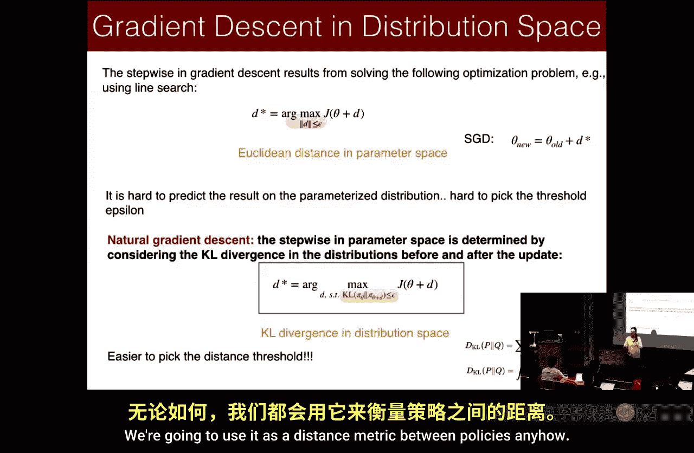

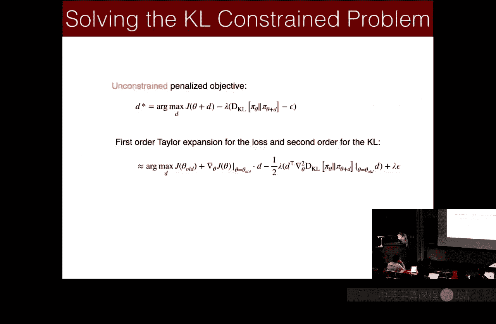

Okay。Cool， so now what we need to do for the next few slides， we're just going to solve。

This constrained objective， al right。

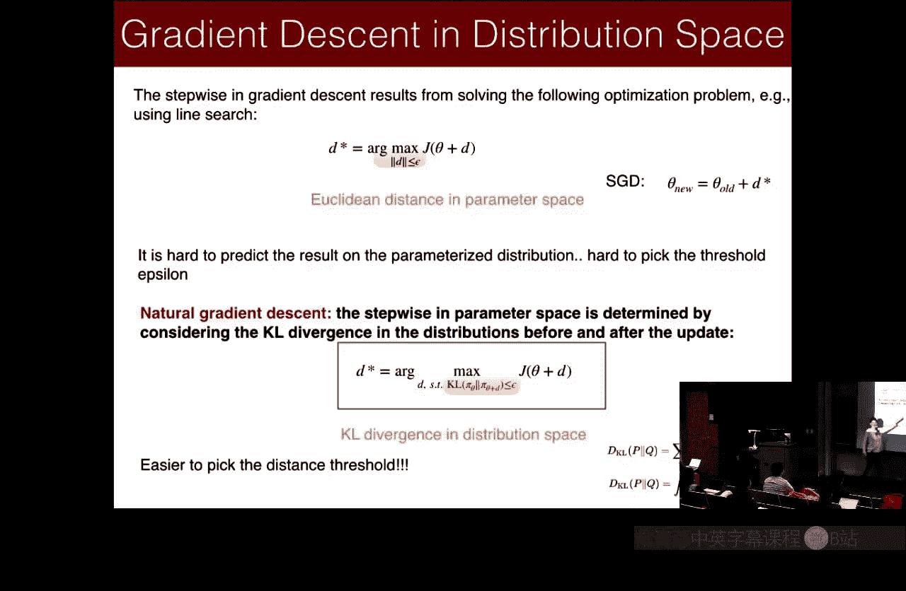

Well， the way we're going to do it is we're going to put the constraint as a penalty。

 and now we have an unconstrained objective。And what we're going to do is we're going to take a first orbittri expansion of。

The initial objective。And second order Tayloror expansion on the KL divergence between the two distributions。

And now you' going to say， what happened to the first and second terms of the second order tele expansion of the K L。

 Is that right， Are you going to say this。Great。So let's take a look at the tailor expansion of the K divergence。

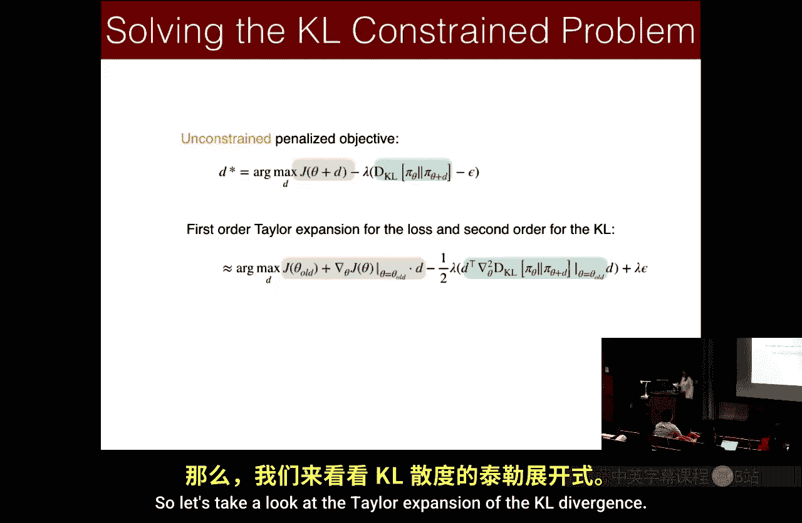

Imagine we have two distributions set old and settan new， by the way， just to be concrete。

Policies are distributions。 For each state。 We have two distribution。

 When we talk about Kdirgence between policies We usually mean the mean across states。 Okay。

 of the difference between the police。 Allright， makes sense。 So how would be the tailor expansion。

 Well， first， we have the distance between Pial and Pifial。 How much is this。

How much is the kdrgence between a distribution and itself。Okay。

 so let's plug here the same distribution。This is going to be。完。Love a good one。Is 0。 okay。

 So it's 0， which makes sense。 We're trying to measure distributions。

 If the distribution is the same is the smallest distance，0 makes sense。 Now。

 the interesting thing is that the first order term also vanishes somehow。 And let's follow the math。

Grad with respect to theta because theta is the parameters of our policies of the K between the old and theta。

How much is this？😮，Oh， yes。 So， alright。 So what we need to do here。Do you see how this？ Yes。

Kale divergence minimum。いま。Also0。At the minimum home point。

Is theta on more than like when theta equals theta O k is over just at a minimum and it's also zero or right。

It also been0。So， because you know that it is。Yeah continue much。

So all continuous access first order derivative to0。Oh， for the minimum point。I see。

 because you're saying for theol in any case will be0。

 because I know that the minimum of k will be a theol， and there's another minimum。right。Sounds good。

 I agree。 Let's see also the deri， the exact derivation， okay。So。

So we take the gradient of the theta。 So if you take log of the term in denominator。

 minus the log of the denominator。Expectation of X underetol， log pathetol does not depend on theta。

 Does this make sense。It does not depend on that， so it's 0。Forget about this term。

 So now we have expectation of x sampled under theta old。 Okay， of log of P theta x。Correct。

 and this is very easy to estimate why， because paththeal does not depend on theta。 Okay。

 it's just the other value of parameters。And so you can push the gra oftheta inside the expectation。

And you can estimate how is the gra of the1 over and gra theta， Okay， Greg。嗯。Now。

 if the gradient is evaluated at theta cost at all。Then this is exactly by definition。One second。

Okay， great。 So now these guys will cancel each other。😊，And now we have an integral of a gradient。

 The gradient goes outside。 Now we have an integral of Beththeta， and then this gives 0。Alright。Now。

 I'm wondering if the fact that it is 0 depends on the fact that it was evaluated on sit type equal sitta old。

Does this make sense what I'm asking？Because， okay， this goes away。Then we have， that's fine。Then。

 well， yeah， Okay， great。 So we used it here。One over path towel。 If we hadn't used that。

 I'm not sure things would go。思路。Yeah， okay， so。That's correct。

 So it might be your interpretation as well。 Okay， so it's the gradient。

 The first order term evaluate that theta is theta all exactly where we're taking the Tor expansion at。

 okay。😊，But do you see this is clear that it is0 now first term。

 so the only thing we have is the hesian of the kd versus。

 that's the only thing we need to worry about。But we can repeat this what is not clear here。Yes。

Why the first expectation is 0。 the first expectation。 Sure。 So this guy， this is our K L。 Okay。

 it's an expectation of the log of the ratio。 So this becomes expectation of the log nominator。

 minus expectation of the log denominator。 correct。 Now， the expectation of the log nominator。

 notice that essentially is constant。Is based on theta all。 Theta all is a particular value。

s not Theta。 Here is the theta。 That's the only thing you need to worry about。

 So it's a constant and you and use a gradient of theta respect to constant is 0。

 Does this make sense。Great， so now we only have the minus， blah， blah blah there。ok。Great。

 sos since the only thing， the only term that survived is the second order term。

 let's try to expand it and see how it looks like。

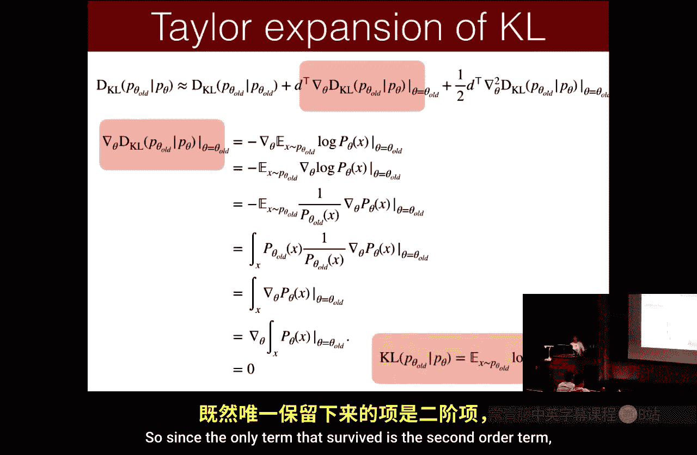

HOkay， so for the same reason。Expectation path ital。 Look path it old。嗯。Well， it disappeared， okay。

Now we have expectation， expect all， minus expected all log to paththeax。

 And we need to take the secondary derivative for this。 Does this make sense。Okay， great。

So we take the first derivative of that log paththeax。

 and this is what we get one over paththeex grad。Betheex evaluate that it old。

 And then we take again， the derivative。 And this is just from。You know。

 the rules of computing derivatives is gradient of the。

Nominator multiplied with the denominator minus nominator multiplied with the gradient of the denominator divided by twice the denominator。

 sorry， the denominator square。😡，Do you， does this make sense。

Most of people don't include those to me doesn't look like straightforward。 how these came out。

 So here they are in the slides so that we don't have a lot of mysteries。O。Okay， so now what happens？

Well。你记过他本事。Now， lets this divided by this minus this divided by this。

 Now this divide by this interestingly， we have this gradlog， Px， gradallog Px。

 do you see because the paththeax comes in the denominator。Cool， right， this is pretty cool。Now。

 let's here。Okay， great， so this canceled with this and now we have this guy here。

We have an expectation。嗯。I forgot the equal sign here guys。 sorry there is a series of equals。

 Does this make sense， so this could be updated before we upload， but basically why this term is 0。

Why this term is 0。Expectation of X。The sample from paththetaal of this guy。

 So if we would like to expand this out， how would we expand it， we'll take an integral O of x。

Petal X， that's what means by expectation to multiply。

 So then this pathetal x with pathal x will cancel。 Okay。

 so you would have an integral of the double derivative。

 double derivative will go outside of the integral。 You have an integral of the probability。

 The integral probability equals1。 the double derivative of one of a constant is0。

 exactly what happened。 That's why I didn't write down is exactly what happened in the previous slide。

 with this other term。 Co。 So now we have only this term。 Look how beautiful is this term。 And also。

 this gridlock paththeta has nothing to do with this theta all。 like this is always true。

 Does this makes sense。 This doesn't have to do with where we evaluated。Okay。Yes。

Where there is a transpo。わい。嗯，Yes， so there is a transpose already from there， guys。 And this。

 so as long as we try to expand this guy out， because these guys are vectors， there is this。

 you need to， I I forgot to put the transpose there。 Okay， there's already the transpose up there。

All right。From these life。You take multiplication。 So if these are scholars。

 you don't need transport， just colorss。 But if you vectors。

 you need to take every derivative of this guy with every derivative of that other guy。

 This is just rules of differentiation， okay。So but this is a good point， this is forgotten there。

 I apologize， it didn't not magically come out here， absolutely okay。

So this is what this is a matrix。 this gridlock paththeta just a vector。 Allright。

 And here is another vector horizontal。 And this guy is a matrix， right， Grandlock。😊，Of for every。

 every coordinate with every other coordinate right， iss the hesian of the K L。

 And this is exactly the definition of efficient information metrics。

 So it is a pretty important quantity。😊。

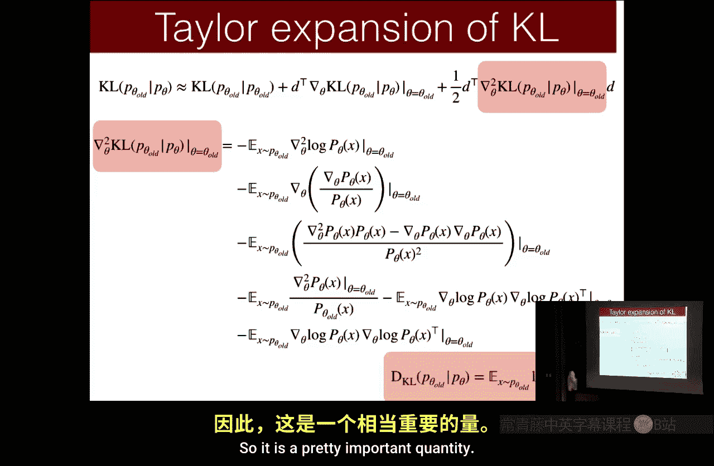

Here it is is exactly equal to the heation of K between two distributions。😊，And， essentially。

The visual information gives us。An idea， okay， of how the resulting distributions change as we're changing the parameters of the distributions。

 the theta。 Okay， right， it relates the probability of。

The parameters is setta x with changing of the setta parameters。So now， if you go back。So。

 so now nothing is surprising here。 Let me see。Well， yes。 so now these two terms are canceled。

 have canceled and only the second order term survived， here is the approximation of the KL。And here。

 here's what it is。 So we go back to substitute this approximation to our original。

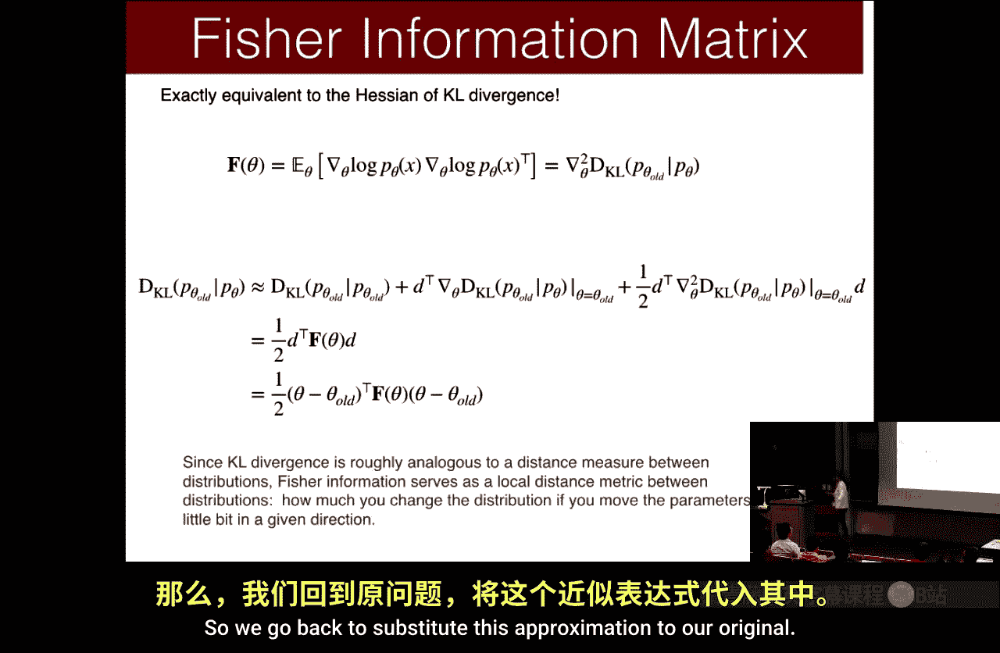

Unconstrained objective。 Okay， so now there is no surprise that we have this term。

How we're going to solve it。 Well， we need to solve for D。 it seems this is a quadratic here。

And we change the the signs。 So what are we going to do。

 We're going to set is gradient with respect to D 20， right？ This is how we're going to minimize。

Down there is the minimum， correct。So， let's do that。Okay， doesn't make sense， guys。

 This is the first order。 Tayloror expansion of the objective。 This， of course， is a constant。

 So it doesn't depend on on D or it doesn't depend on anything。 So here we go。

 We take the zero respect to D。

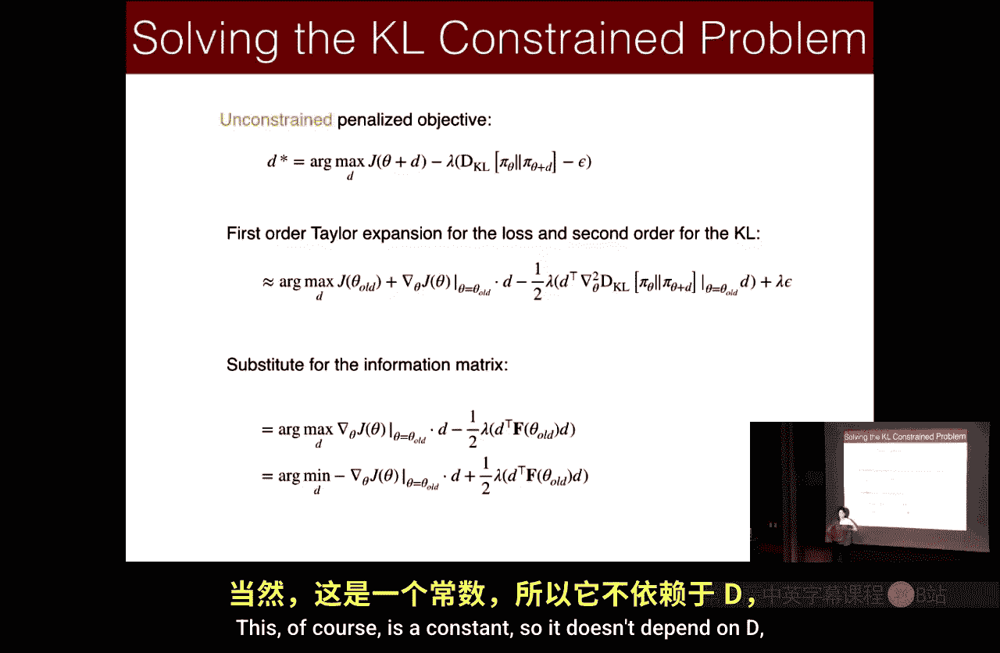

And that's the resulting。Good edge interaction。Okay。

 so you see that if we don't have the kel constraint， we get essentially this gradient direction。

 Now that we take into account the k constraint， this gradient direction has be pre multiplied with the inverse of the fi information matrix。

 Okay， and this is the definition of the natural gradient。And this was not invented。

In reinforcement learning is known。In standard machine learning， and we use it here。To essentially。

 give us more informed。Gient directions for， for in our policy， gradient optimization， right。

 in our policy optimization。So this is the direction。 Okay， this is the direction。Now。

 we didn't discuss about the step size。Well， the step size。Hes essentially found by。

Looking at this K L。 So we have a linear term。 and we say， okay， the K L can only be up to epsilon。

 Let's say if you remember the contrain we had epsilon。 So we say， okay， let's try to see if we just。

Go as far as possible from the current policy and the KL is exactly epsilon。

 What should be the step size。 Well is gonna to be like that。 Okay， that's just a scholar number。

 by the way， right， this is a scholar。 So now you know exactly what should be the step size。

 Now in practice， people don't use the step size They throw it away。 They do use the direction。

 though， right， They do use the direction to find the exact step size。

 you will see what we're going to do。 We're going to do a lot of things。Is that clear， though？

That is not that difficult to add this scaleL constraint。 And here is a nice algorithm。

 right in pseudocode， natural policy gradient， essentially poly gradient while taking into account this scaleL constraint。

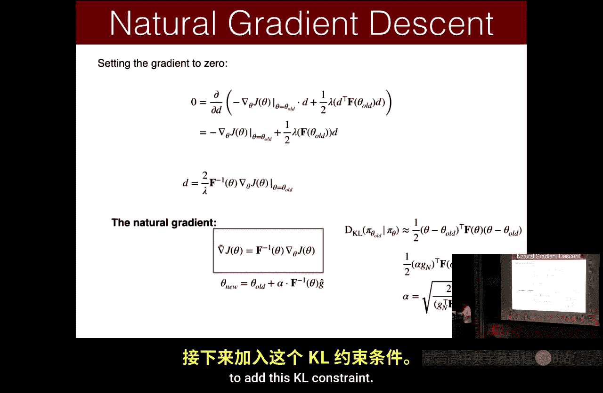

Will collect a set of trajectories by the current policy willll estimate the advantages with your favor pay either Monte Car or critics。

 And there are gazillion different critics you can use advantage critics， state value critics。

 Q critics， etcter。Then we'll compute the pulse gradient direction。

You will do the sample estimate of the information metrics， and。Here is your new direction。

 And if you want to use the step size that comes out of the theories， This one， otherwise。

 you will use another step size in practice， people just put some step size there。 and that's it。

 because now the gradient in direction is much more informative， okay。Yeah。

 so what is the big problem here， The big problem is。This guy， it's a huge， huge matrix。 right。

 N square where n is the length of our parameters。 We need that much storage。

 let alone inverting it the。You know， more how to say na way and to the third。What do people do。

 A lot of things。A lot of things。 let's see。Actually， let's but are we are we kind of okay with this。

 So this actually is used in practice。 I'm going to show you， in fact。

 in the next lecture where we're going to have presented all the model three methods we're going to start comparing them with respect to each other on standard benchmarks and you will see from 2017。

 there is a paper that essentially used another paper that used a very good approximation from that fiser metrics and has fantastic results like state of the results。

 exactly doing nothing else other than a to C。 you remember what is a to C a critictic multithdduct critic with synchronous gradient updates you remember from the previous lecture。

 So A to C compared with taking policy gradients， not the way we saw from the previous lecture but rather taking gradients with this pre multiplier here theverse of the fissure metrics give state of the R performance is in this exciting It's exciting because we're not wasting our time here。

Is equations， right， There is a purpose mind。 I think is's pretty exciting， Great now。The problem。

 of course， is in practice， how do you compute this hesian for so many hundreds of thousands of parameters of neural networks。

😡，I don't have the details in this lecture。😊，I think it's important enough。

 And we may have the details of this in the next lecture， okay。Now， what do people do in practice。

 Either theyre very smart and they use other peoples where even that do exact research on how to approximate that featuressure。

 and they have amazing fisure approximations or。They use con a gradient。 They never form that matrix。

 They just estimate this multiplication directly。 Still， it's way more expensive。 but basically。

 you do few iterations as opposed to lots of iteration。 you do approximate natural gradient descent。

 or they give up。 They say， you know what， I'm going to give up on this。

 I'm going to use the can constraint。Alright so when I take step sides I'm going always going to be checking my KL。

 make sure that things don't go crazy， but I will never I will never compute any prettymaticifier for my G。

 I'm just going to still use the vanilla gradient direction that I get from the likelihood ratio estimator does this make sense what I'm saying and this is the proximal poly optimization method we're going to see in fuel slides。

😡，All possible things they do。 they do align searches。 Okay， so then you need to use a con gradient。

 Okay， let's see。Here we are。Now the second， so now we discuss the step size， now another problem。

We see here because we're trying to do two things to discuss step sizes and to write down the optimization problem。

 Okay， now another thing we see here is that the data。Here， this， this method is on policy。

 You can never use data of older policy versions you had。 Does this make sense。

 While deep learning can use any data you give it， which is good。 So how can we use of data。You know。

 experience of policy， note of data， of policy experience for our policy gradients， well。

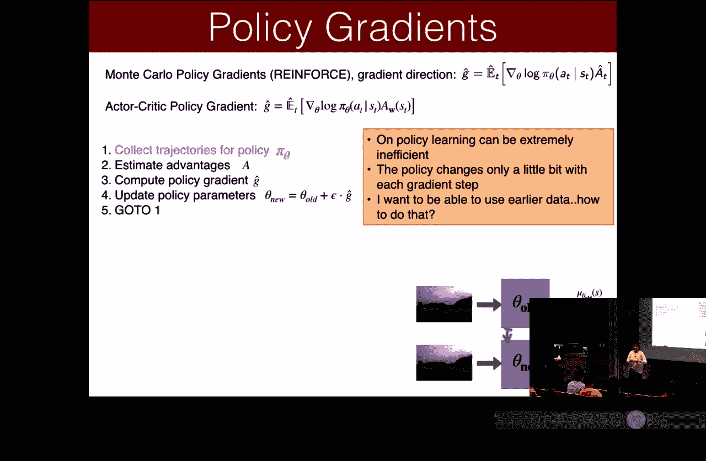

We can use things that we know， important sampling。So right now。

 our objective is an expectation and their trajectory is sampled by the current policy，😮，Of。

Theyre expected rewards。 So when you say are， you can think advantages。 right， We said here。

 sure rewards。 But practice， you better you know， take off the baseline。 Otherwise。

 your version would be crazy。Great， so what can you do， Well， you can take trajectories。And。

 you can take this。Expectation， which is under the current policy。 Divide and multiply with。

Another probability over tra is from a different policy。

 which is parameterized by the parameter theta old， correct？Very nice。 So then what can you do， Well。

 this sum across projector path looks like an expectation。 Here it is。Here is this。

The important sample weight of that trajectory。The probability that the current how to say parameters put on the trajectory versus the old ones multiplied with the reward。

 And there is no approximation。 Everything is exact here， right， This is just important sampling。

 That's why we say this is an a biass。 We haven't changed anything， okay。嗯。And now， interestingly。

If you take a gradient of the objective。Okay， so are we global deal that far， very simple。Like。

 nothing surprising here。All right。Okay， is this still here kind of clear？Yes。よにお前ららかん。

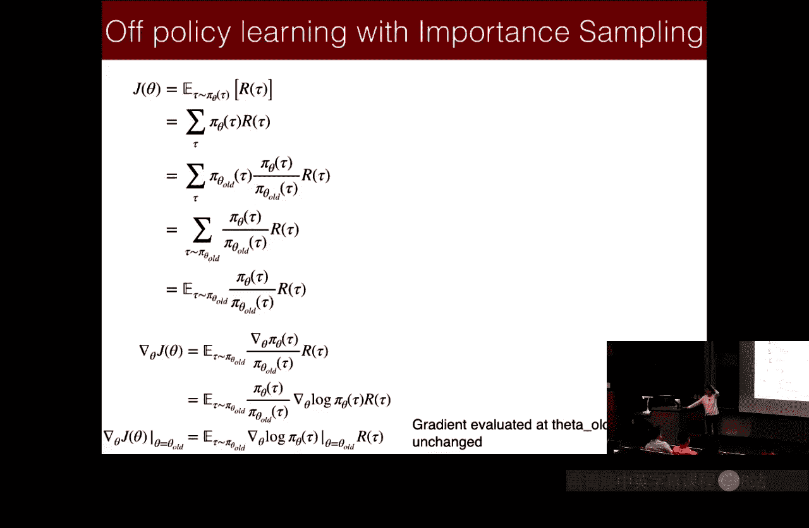

I see。 well， that's a good point。 So here basically what it says is that。You have a policy。

And to optimize this policy， to try to optimize it， you need to use data of that particular。Policy。

 you cannot use。Previous data collected with previous policy。

 That's why it's called own policy methods， right， You cannot use previous experience。All right。啊。

So you have your theta， you collect data， you fit and you improve， and then you use the new theta。

 collect trajectories。 Now， the interesting thing， which I don't have an answer is the following。

 once I have a theta in my hand and I collect data with that theta， and I try to optimize theta。

 Of course， the theta new is one step away。😊，Right， it's not like it's not just。

 I try different thetas， and I collect data after different thetas， and I feed also the advantages。

 and I take the best。 That would be the literal understanding of all policy， right。

 You have a theta trying to optimize， and you collect。😊，Data under the theta。 So in practice。

 we always collect data with have right before it。 Let's say， does this make sense。

So I think this how I， I'm having a。Meeting about this issue。

 So I I may be able to say something more informative on this soon。 but basically。

 here I'm telling you that， you know what， I want to collect data with another policy。 Well。

 that's fine。 You just need to make sure you multiply your trajectories with this。

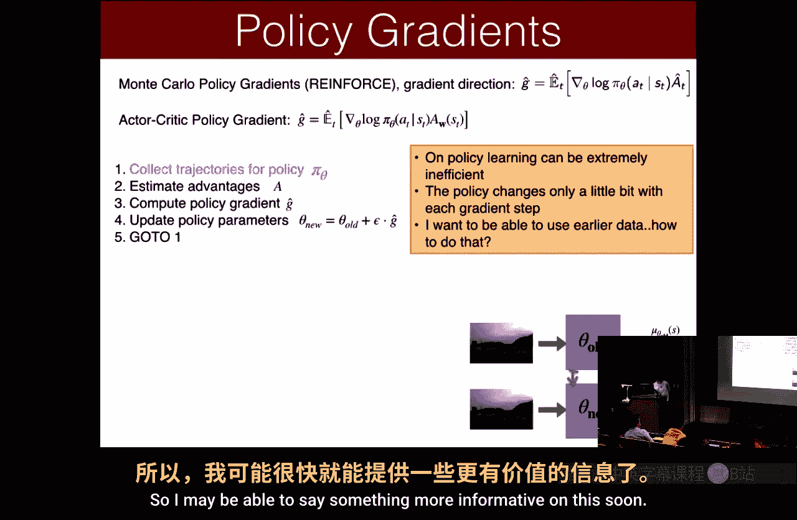

Correct， you need to just multiply the trajectories。 Here is the return of the trajectory。

 but you need to make sure you multiply with that ratio。Let's see how fine it is。

 Let's see how it's okay。 let's see how okay this is。 So let's take the gradient， first of all。 Okay。

 so the gradient with respect to theta。 Theta has nothing to do with theta， right。

 It's just a constant。 So of course， grata is going to enter here。😊，一人多。Yes， so that's what no。Yes。

 so。So this ends here。 Okay， but if。The gradient is evaluated theta old。Alright。

 so if we're close to theta al， then this can be rewritten as the grab log of petal deator theta the old multiplied with this R T。

 Does this make sense。So basically， when were close to theta al。

 the gradients that this objective gives versus the previous one are very close， very similar， okay。

Which says that if your set are close。😡，I mean， also， these guys are gonna be close to one， right。

 So we're gonna be similar， very close to the previous objective that we didn't who importance weight。

 Yes， whole yes， I agree it's not right。 So to be honest。

 at the end of the day is not gonna be too much off even like in T P all it this。Model flip methods。

 We always use our current theta。 Okay， but I think the reason of this is to fix the discrepancy of saying epsilon under theta。

 Let's say， expectations under theta。The trajectoryjector sample under theta of， let's say log。

Probability of actions of theta， ettera， et cetera。 How can you at the same time。

 optimizing a theta and sampling data out of it， Does this make sense。

 You always need to in practice， need to have a theta， collect data。

 use that data estimate that that just an update， right， So if you try maximize over theta。

 there is always a theta prime there。 where the data comes from a theta right before that。 Okay。

 so I think this just triess to make this more explicit。 Okay， as opposed to hiding under the。Carbon。

 does this make sense。I this saying like you can't。こイみてい。系い。I'll make that turn。

Where is the capital pie like the product。The ratio of the probabilities of the trajectories is saying you can't do that。

Well， here is the thing。So like I'm not sure why it's important that if datata equal theta old。

Because they does never。The problem is if like this term。

 which essentially is a trajectory segment and the essentially you take the ratio of this trajectory segment。

 correct， this can explode or vanish even with very slight difference between the two policies。

What happens is the following。 We don't actually use this。

 What we do is we say this to an approximation where the states will always be sampled my by my older fe and not with my current one。

 And the only thing I'm going to try to sample are the actions。 Okay。

 so then what happens for every action I form。Ptheta pathetal for every action in the trajectory without needing to pre multiply all the probabilities that let me till that action。

 Actually， I have exactly that point in two three slides from now。

So basically here with this important sampling， we can use all data。

 but essentially we have this term， which essentially increase the variance like crazy， okay。

 because there is sequential multiplications or probabilities of actions。Okay。Does this make sense？

So let's see。

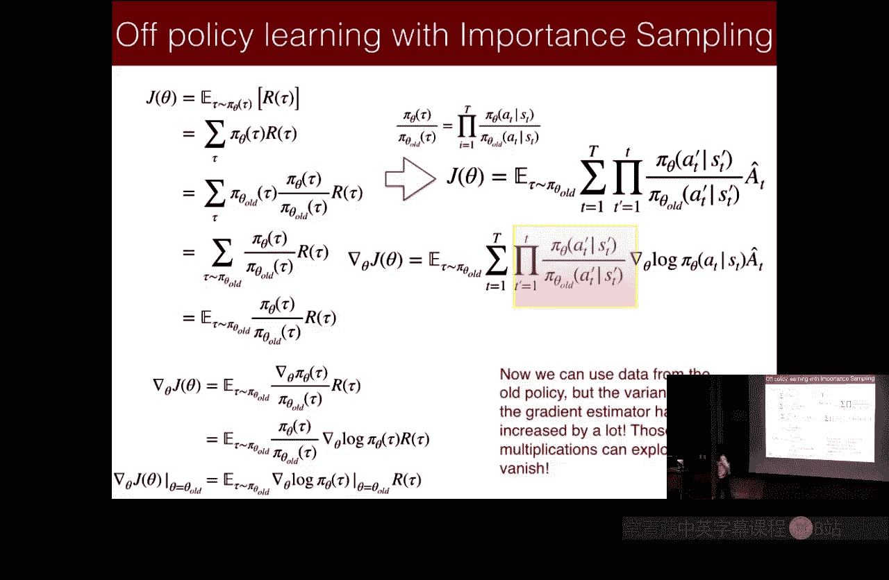

So this is no use basically because of this huge variance。😡，U。So， here is the。

Tacity on police optimization。Objective， which has the K L constraint that we just saw earlier。

 correctect， You remember， we just saw it earlier， and it has this。Probability of actions， right。

 ratio。And there's no product， okay。No products。 So the problem is the sequential products。

 which essentially explored or vanish。 So this seems that。

How did this guy Mad manage to get rid of those products？

 And let's see where this approximation comes from。So the way this problem is solved。Is， again。

 the same thing。 We take a linear。Taylor expansion， first order for the objective。

 second order for the KL， exactly the same as natural policy gradients，😊。

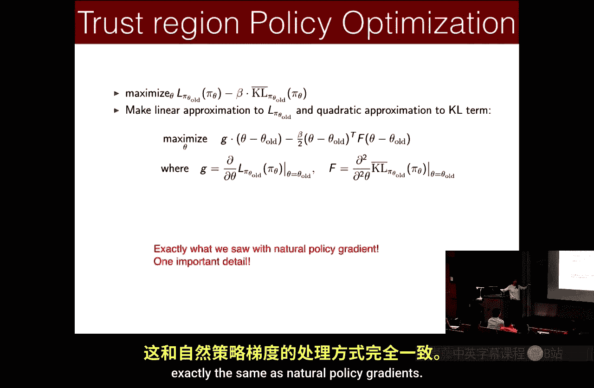

Nothing new hear。 So now what you're going to say is that TrRPO。Yes， so the。

 the one thing that TRPO had that we didn't see in natural policy gradients is instead of choosing the step size as coming out of the theory。

 they do a line search。 Does this make sense。So this is what came out of the theory and they use it。

 but basically they say if my objective is improving。

 this is my objective and my constraint is below delta and this delta is the KL distance and it's a hyperparameter of the algorithm。

 then accept the update， then you know you are safe to step there this excess so basically we have a small optimization over this step size either than that。

 there is nothing more it's exactly natural policy gradient。😡。

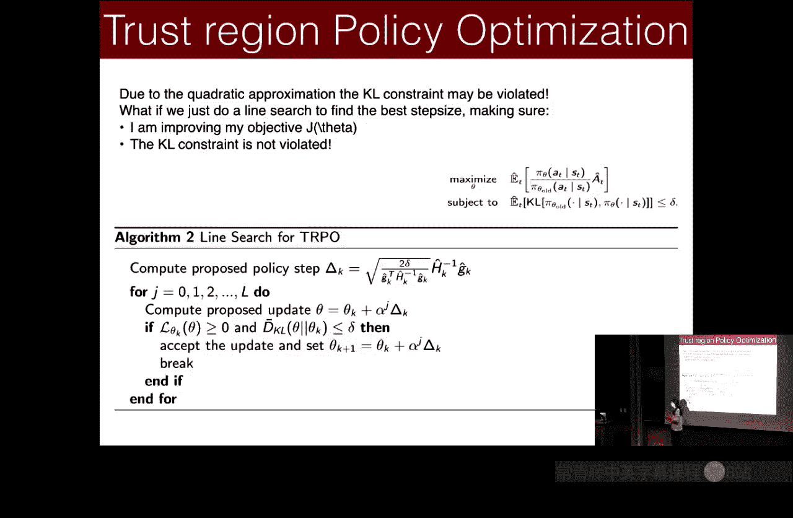

Well， there is one little thing。TRRPO equals natural policy plasma not online search。😡。

Let's see what it is。We have a policy Theta Ka， okay。We collect some trajectories。

 We estimate the advantages。Okay。And we form the gradient， We form a sample estimate of the hessian。

 So this now is called H not F from the hessian of the K。 All right， instead of fissure。

 its the same thing。Here is。The direction。Oh no here here we use this country with gradient essentially as an approximation of this very ugly F minus-1。

 Okay， this H minus-1 multiply with G。 Here we get the country with gradient essentially gives us ready estimates of of this。

 which we can plug into our update。And then you're going to say， okay， what is so big deal。

 this TRPO has， you know， it's kind of very famous algorithm over to 2015。

 And the new thing is that they propose the theory that is backing up essentially this algorithm。

And showing that if you do this type of updates， you will guarantee that the policy will be monotonically improving。

 Okay， that you are not going to jump to a crazy degradation。Does this make sense？

And so let's see why this is the case。

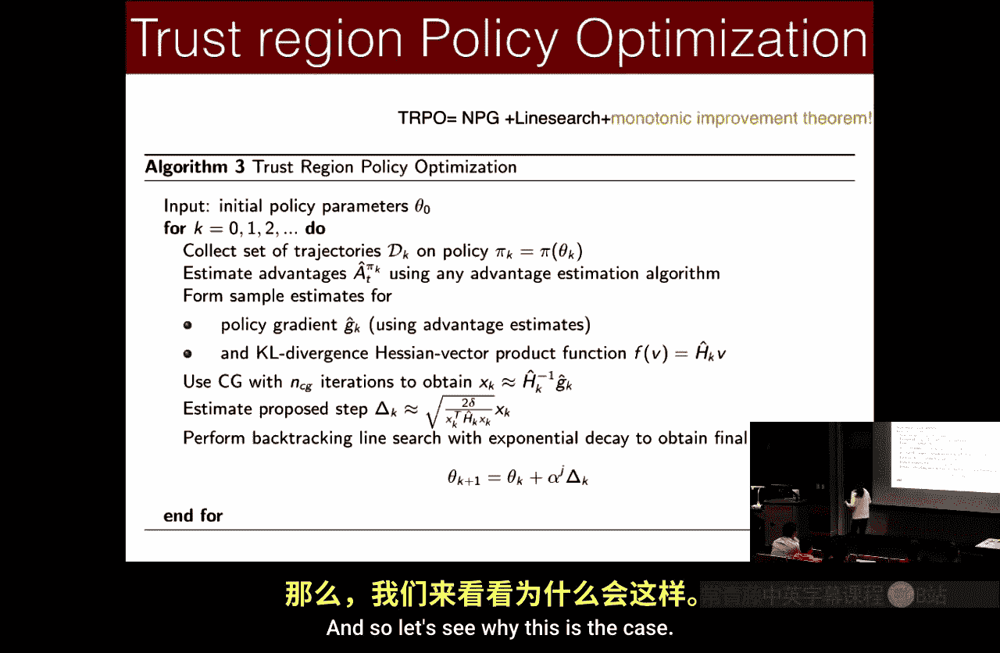

By the way， I think there is something wrong with this important sampling slide because the two estimates are different。

 So I'll give back to this slide in the next lecture。

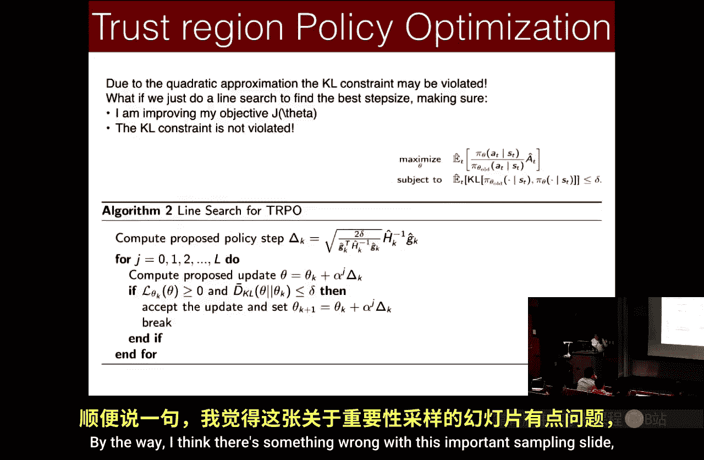

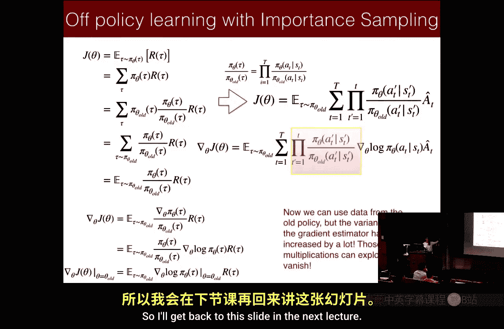

But。So。This is our objective。 sum of future rewards。Can we write this objective。

In terms of a previous policy。For example， Je J Beththeta， prime minor J Beththeta。

This is essentially the sum， the expectation of the advantages， okay。嗯。Right， the expectation。

 the advantage and why this is the case， well。Here we're going to show。Because。

Take an expectation where the trajectory is are sample from the new policy P prime。

Over the advantages。Where the advantage are valued with the previous policy。Use for this advantage。

 A TD1。Estimate， which is the current reward plus gamma。

 the value function of the next state minus the state value function of the current state。 Allright。

 so if you expand， you will see that the first term discounted reward。

 the sum over future discount words is exactly。The JP prime， correct。

Well if we take a summation for t equals to zero till infinity of the two last terms。

 essentially youll see that we'll cancel each other。😮，Okay。And if you cancel all those terms。

You will end up with this VP of F0。 Only the first state is going to survive。Is that。

 So we just now why the two， the objectives， why we can write the。Objective of a new policy by prime。

In terms of the objective of a previous policy， pi。All right， plus， an expectation。

Under trajectory sample from the new policy， pi prime of the advantages evaluated over the previous policy pi。

 All right， this is just to show that this holds this how to say real right， okay。Well。

 here's the thing。 S is 0 is the initial state and the initial state distributions between pi and pi prime are the same。

 So this is exactly equal to J P。 And this is exactly the way Tom proved the。

Policy gradient E theorem。 He used exactly the same identity。 So there is no question here。Okay。

So great。 So this holds。Very nice。 So we have。

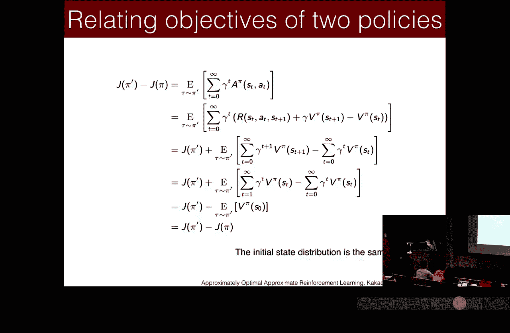

Yeah， so this beautiful identity comes from 2002 paper of Shamkacade and Langford。And。So， now。

So if you remember in this identity， the trajectory is a sample based on the new policy by prime。

 Okay， but this is extremely weird。 How can you optimize over policy and sample data from that policy。

 Does this make sense。Do do you see what I' try and say there is some inconsistency。

 This means that you need to each time change your policy， like update， change your hit randomly。

Collect trajectories under this new theta estimate advantages and pick the one that gives you the highest the highest。

 maximize this objective。 Do you see on try and say there is some inconsistency between what we add down the equation what we actually do What we actually do we always have some previous policy。

 We collect this trajectories， We fix those trajectorors that we take great as makes those trajectories。

 Does this make sense， Great。 So basically， they say， okay。

 So this looks difficult to optimize in the sense， weird。😊，So what if instead of sampling actions。

From the current post which I'm trying to optimize。

 what if I sample actions from the previous policy。O。

 because since this is the thetas I'm trying to optimize for。 I cannot sample from them。

 I haven't found them yet。 Does this make sense when I'm trying and say。

 when do you even max maximize over theta。In in an optimization problem， right。

 this data is to be searched for。 You cannot sample from it。 You still sample from previous one。

Do you see what I'm trying to say。Great， okay， so very nice。 So there we said yes。Yes。

 so dip I this a good point。 I that 0 is the same。 This a mistake。 I'll change。

 I'll fix it is essentially。They discounted。State visitation。Fre state frequency distribution。

 How much。It's without the gamma is going to be an estimate of how much the policy spends time in each state。

Now， because you put the gamma， okay， because you essentially you want to make the questions come out。

 essentially， if the state is further in the future， it counts less。 Does this make sense。

 Is a distribution of our states， How much on average the policy is going to state on a different different state。

 Does doesn make sense。讲刚。Exactly， yes。 So the gamma came out of there and not only the gamma。

 but also all this sum of T from 0 to infinity gamma。 Now。

 this all went inside the sampling of the states。 Okay， so now。

 instead of sampling trajectories with sample states and actions from that new policy by prime。😊。

However， if you put if you tell me to write down optimization problem。

 I definitely cannot sample and optimize over the same verbs at the same time。 Let's try to see。

 how can we sample from our previous policy。 Well， first of all。

 let's try to sample the actions from the previous policy。 We know how to do that。 I'm just going。

 you know， important sampling。 I'm going sample now from pi， not by prime。

 and I'm just going add this likelihood there。Does this make sense， so cool。Now。

 the problem is what's going to happen with this S， the state sampling。

 which needs to be from the current pipe prime。 This looks pretty difficult。 So usually for。

What we do for problems that are very difficult。 We just forget about them。 We say， okay， forget it。

 Let me just sample from pi and see what's gonna happen。 Do you see what I mean。

 And I change nothing。 And I say， I'm just going approximate。

 There's no way I can maximize over pi prime and sample states from pi prime。

 I definitely need to sample from some previous pi to maximize over pi prime。 correctect。

 makes sense。 So I want to sample also， that's why we have this approximation symbol from this。

And this approximation， we're going to call it L pi pi prime。

 Does this make sense because we are going to sample over pi。

We're going to use the advantages of pie， and this is good。

 because the advantages also need sampling。 So whenever we need to sample。

 we need to have a pie in our hands。 We cannot have the pie prime。

 The pie prime we're supposed to try to maximize over。 Does this make sense。

This comes in the conceptual part of the lecture that we're trying to write down a optimization problem。

Does this make sense what I'm saying？Say in long time。So you say that when we have。王秋山。较太。By prime。

Yeah， yes。 So we have an optimization problem over some particular policy， maximize over a policy。

Since you maximizers over pipe prime， you cannot sample from that pipe prime。 You do not know it yet。

 You are maximizing over it。 Okay， so you better be in your equation through an analytic form like here。

😡，So all the sampling now， both advantages and states and actions are happening from our previous pie。

 So So this is good。 this is great， right， Okay， great。 So let's see how bad is this approximation。

Because we just approximate。Well， it's not that bad。Is not that bad from this recent paper。

 constrained policy optimization。ICML 2017。They show that。You can bound this approximation error。

With this， if the KL。The mean K L， mean across states of the pipera Empire close。

Then this approximation is good enough。So now you're justified。 We basically， we wrote this weird。

We have what I'm trying to say guys， the， we have this likelihood ratio policy estimator correct。

 We are trying to understand， why is the objective function that if I maximize it。

 I'm going to have this gradient。Is not clear what it is。 what I told you is like， oh， put。

 put an expectation and put this expectation is going to be sampling from one pie。

 Do you see what I'm trying to say， You need to put two pi is there。

 One pi to sample from and the other pi to maximize over。That's what we're trying to do here。Okay。

 so， okay， so， O， this is not too bad。 Here's again the K L。 It's all about K L in this lecture。

here we go now， so。What changed would this speaker previous。Nothing changed。Right， so now basically。

 I swapped the sampling of states and actions with sampling of the trajectories for you to see that due to this approximation。

We have the sample t equal 0 to infinity。 I mean， if you have episodic task， of course。

 we have a capital T and shorter trajectory is not important。

 But the important thing is that every action you don't have this product before for every action。

 Let's say this section happened on the third part of the trajectory。

 We have to multiply the first second third ratio of the new pie over the previous pie。

 And this explodes or vanishes， This is bad because we have approximated。This make sense。

 We approximated。 We said I been sampling states from our previous policy。

 I'm just going try to simple actions。And actions frompon and use the likelihood ratios。 Basically。

 we approximated。 That's why。嗯。That's why this product went away。These guy。Does this make sense。

 This should be infinity。So we don't have this exploding terms anymore in this likelihood because we approximated。

 We say we will keep the states sampled from the previous policy。 That's okay。

So what is the gradient。Over this you thing？😮，Well， the gradient of this new thing。Right there。

Is exactly the same as what we had right。This is the menu you think。The great in respect to Theta。

It's only this that matters because this is theta K and this is theta K。 correct。

 That's what it is the gradient。 Now， if this gradient is evaluated， that theta K。

Then you get this guy， which is what we had。 Does this make sense。Yes。No， this is the previous guy。

 This is not what we're using。 Now we're using the thing above。Okay。

 so we say that we escaped this now。 We escaped because we said。嗯。We said。

 so what I'm trying to say is the following。 the important sampling derivation。

 There' is no approximation。 Everything is perfect is correct。 The math is exact。

 There is no approximation sign。 What we did to get there。 We had to approximate。

 Does this make sense。Essentially， what we did is the following。 I changed。 actually， Now。

 I can explain much better。 now， one second。😊，I instead。

 I started sampling from the previous distribution instead of the new one without adding an important sampling weight。

 That's what I'm trying to say。So does this make sense。

 So when I started sampling the actions from the previous distribution， I added an importance weight。

 When I started sampling the states， I didn't add anything。 I just said forget about it。

 Does this make sense。 And then we said， okay， great because I need to have the variance to be manageable。

 things now are not exactly。 Theyre approximated， but look， the approximation is not too bad。

 It depends on the KL。 So for this to hold， I just need to make small steps on my KL。 Okay。

 while the derivation with important sampling and trajectories， three slides ago。

 there was no approximation。 I， instead of sampling from the current distribution， post distribution。

 I start from the previous one。 And then I put all the likelihood all the issues of the probabilities in my objective。

 And then the variance of that thing looked horrible。 Do you see what I'm trying to say。Okay。Great。😊。

I think this is this is now kind of understood。The right。Yes。Yes， so one， let's see。So， of course。

 we need them。 So as soon as you don't have the discounted state frequency distribution。

 you better put the gam。 The gamma only goes away once you say sampling from this G。

 So where is the gamma that is not there。Okay， let me say don。

 it very much has to do with discounted returns is exactly because we care about thised returns that we put the gamma on the state frequency distribution。

 If the gamma was one and you had undiscounted returns。

 then your state distribution would not have any gamma。 Well throw away the gamma。 still。

 it would make sense。 And the state distribution just would not call it discounted。 Okay。

 so the only reason we call it discounted is so that we take the gamma from the equation and put it in the sampling。

Let's see why there's no gamma here。But we actually don't discount the return。No， we do。 want say。

You mean for this guy， right？嗯嗯。And I'm pretty sure there should be a gum。Does this make sense？

Is it In A？No， it's definitely not exciting because these other guys also not inside A， okay？嗯。嗯。

Let me check， I would say there should be a gamma there， Does this make sense？嗯哼。😊，Okay。

 so does this make sense。 Import sampling is exact exact but high variance here。

 we decided to start something from the previous distribution without adding the important sample weight we should we should have。

So now our variance is manageable， but we have an approximation。

 but there is this paper that showed the approximation is， is good approximation。

 especially if the theta the two thetas are nearby， okay。

And where we ended up again in the same place。We ended up in the same place。 No， almost there。

 So here it is。 Here is the bound。And then。The objective of the new policy minus the objective of the previous one is bigger or equal of this minus this。

And now basically， if you maximize the right hand side， you maximize those on the left hand side。

 right。Do you agree。 So basically， if I maximize the right hand side， I maximize the left。

 What does it mean， max the left hand side， I'm trying to make my current policy。Much。

I'm trying to make the objective of my policy as the objective of a previous policy。Larger， okay。

 now the question is。嗯。Great， does this make sense that I have an improvement。Or not。

 What if the right hand side of that。Equation is negative， for example， is a negative quantity。Okay。

 this is just always negative。 Then this means that the J P prime doesn't necessarily is better than Jpi right the only thing we see here is that maximizing the right hand sign will maximize the lefthan side。

 but there is no monotonic improvement guaranteed here to have guaranteed monotonic improvement。

 meaning that the J p prime is higher than JP， okay， the right hand side better B equal or0。

 right It's positive or equals to 0。Cool。Well， it is the case because。Here is the P K plus one。 Okay。

 the result of that， if you on the maximization problem。If P K is a feasible point。

Then the objective of the k is equal to 0 y because the kdrgence between pi k and pi k equals 0。

And because the expected advantages。All policy sampled our states and actually sampled from the same policy。

Equals 0。As fast。This should be bigger equal to 0。 and this means that this guy should be bigger equal of the J of the previous cupa。

 So now we have this monotononic improvement。 Let's say， okay， so this is a big deal。However。

 from the practical point point of view， we instead of putting this。

 instead of maximizing this minus this， we put the constraint。 It's easier。 And here is， again。

 the same algorithm。 Okay， it's all about objective maximized over。Under the k constraint。 All right。

 now， two things we've done so far。 Once we put the kill constraint。 And second。

 we solve this discrepancy that we had before。 Okay， that I said， oh， we have this likelihood。W1，60。

 so that we were taking expectation under the policy that we're trying at the same time to maximize it。

 And this just doesn't make any sense。 When you sample， you sample from the previous policy， right。

 that's what we end up doing， okay。

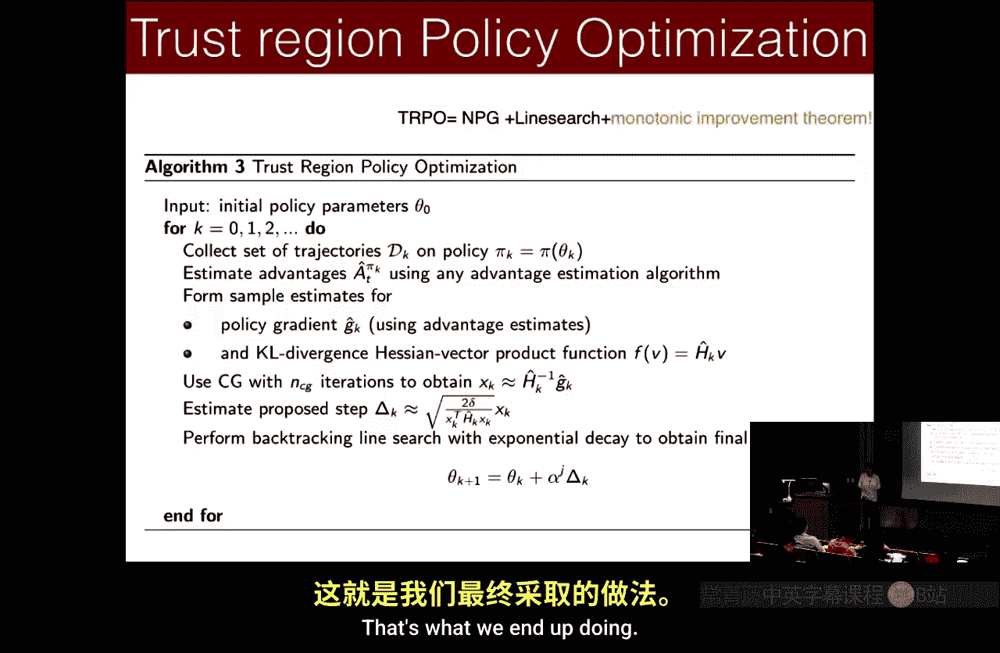

Now here is what people have done。 now this paper came after TrRPO。

 TRPO trust region policy optimization， white trust region。

 because this scale gives you the stress region it tells you that if you move within the stress region you' are going to guarantee you are going to improve right now these people said proximal policy optimization what are they trying to say they say can I achieve similar performance but without needing a second order information without trying to compute this feature。

😡，Matics or even use case you get gradient to try to estimate this multiplication F-1 with a gradient。

 That's what they said。 Can I do something only with a gradient。 And， yes。

 they came up with two ideas to do that。 The first。I they put an adaptive penalty on the KL。

 and I'm going to show you exactly the pseudocode。 The second very simple idea is they said。

 instead of showing the initial objective， I'm going to clip the objective。

I'm going to clip the objective。 R T of theta is those。Ratis。

 how probably is an action under the current policy versus how probably is an action over the previous policy。

 Okay， so they will multiply。And I'm going to show you both how they work。 Okayk， in practice。

 So they have these two ideas。 So let's see The first idea is the following。 Here is my objective。😊。

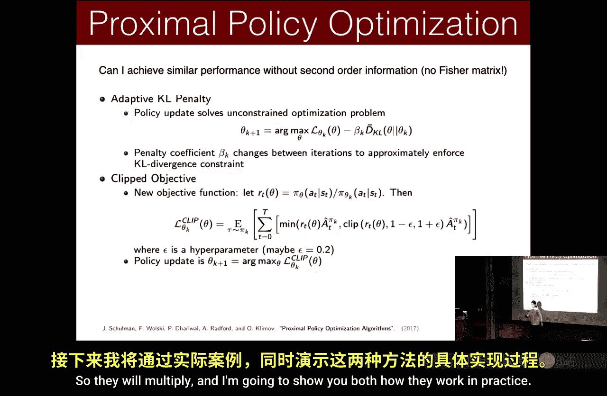

And， yes， I have a policy， current policy P Ka。 And， yes。

 I'm going to get some trajectors under this P Ka estimate advantages。No， no surprise here。

 I'm going to take this。A step， which I kind of。呃，未到。So no。

 So I'm going to just take the vanillalogy， the vanilla gradient descent without taking the KL in into account。

 However， if every now and then， I'm going to measure the KL。 and if I see。That。

 but how is this possible to estimate the scale without taking the fier。Information。I don't know。

 Let me take this。 Let me check about this。 I don't think this makes sense， right。

 because if you have the K L there。How are you going to compute your。Your， your gradient， if you。

 if you don't compute the K。 in any case， what I had understood is that you use only your term。

 you use your gradient direction and take some steps and always check how your K L is doing。

 If your K L is trying to violate， then you stop。 And there does this make sense if you don't。

 then you continue keeping steps size。 So let me check on this next time in practice。

 what came out of this paper is this clipped objective。 And this is what was used。

 So let's try to understand it。 It's extremely simple。 It works as good as TPO is much simpler too。

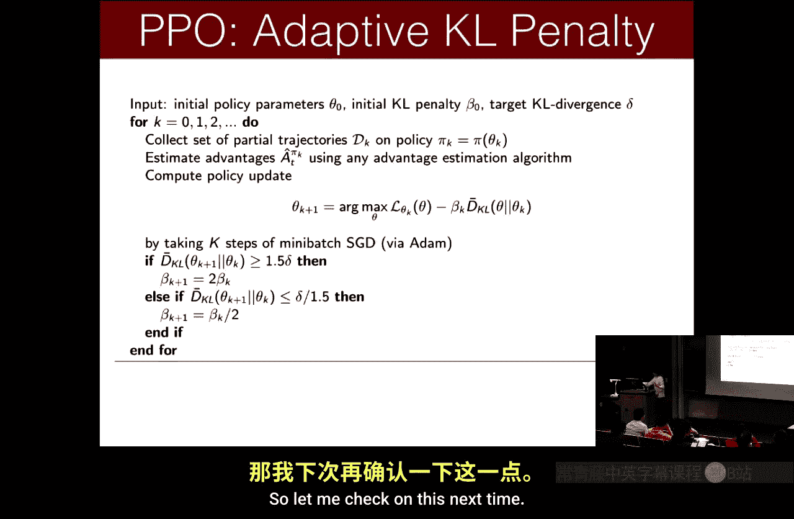

Implement， let's see why。Same objective， Nothing special。 Now， remember that A T is the advantage。

 Okay， that I get。For this particular action。 now， the advantage can be positive or can be negative。

 correct。Now， imagine at one is where I start。 The R。

 which is the ratio of the probabilities of the actions between the current theta and the previous theta。

 starts from one， correct。 And now I'm starting to move my theta so that this ratio goes away from one now。

If I was positive， I motivated to increase。Okay， to increase that R， right。

 because then the multiplication of R with alpha is something more positive。

 So I just want to go and drive this like crazy， right， So what does this mean。

 if a particular action， give me positive advantage。

 I want to maximize the probability of that action right and as I maximize the probability of action。

 This means that the nominator increases that nominator is fixed comes from the previous policy。

 So then this is going to eventually blow up。 correct， however the clip objective tells you that。

 well， you can only go up to one plus epsilon， because in any case。

 no matter how good of alpha you're going to get。I'm always going to take the minimum between。

The clipping over the R T between plus epsilon and minus epsilon。Right。

 so no matter what you're going to get here， this minimum is going to ignore it。

Do you see what I mean？So as I moved towardss here。

 what's going to be chosen from that clipped objective， I would say is going to be chosen。Ati theta。

 Cpto1 plus the absilin multiplied with alpha T， and then things are going to flatten。Okay。

 so then you are not motivated to change anymore。😡，Your probability of action。

 because it's not going to get to any reward and it's going to worsen your KL。😡，Does this make sense。

 Does this make sense， guys， Now， if the advantage you are in。

 you find an action where the advantage is negative。 What you want to do。

 You want to make that action as improbable as possible。

As you're trying to make this action as impro as possible， the ratio goes down， right。

 You're trying to drive the ratio down because the denominator is the same。However。

It doesn't allow you because it tells you， even if you give something very small。啊。One second。

I'm going to use the clip。😡，Objective。But呢。Did you get it here？Yes，They are say that some point。

Exactly， right。 And then I cannot。 yes， I'm not allowed to I'm not I cannot allow it。

 So let me show you also another picture。 So see how it looks。 So basically。

 no matter how you're changing this the clipped objective。

 this red is going make your reward note look promising once you move far away from your current theta。

 So it tells you not to move further from where you are。 just this makes sense very simple。

 this clip objective。 So next time we're going to see So I think we kind of understood a lot of things。

 next time we'll try to review what we saw， we'll try to see that amazing fier approximation that is used in state of the art methods。

 we will discuss about pathways derivatives， the deterministic policy gradients。

 a state of the art alone from last year with。

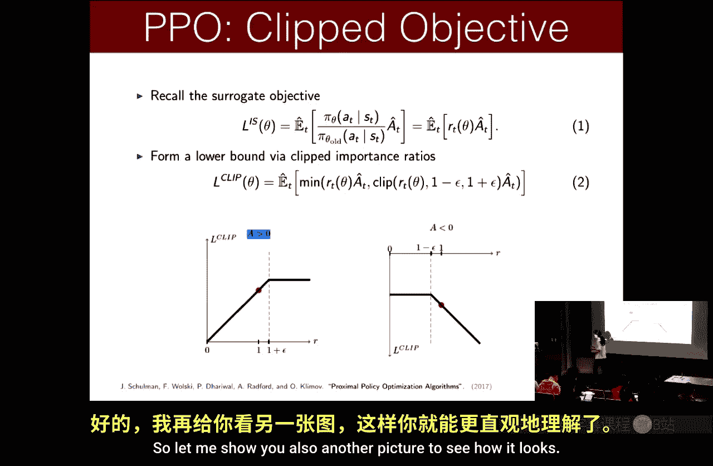

嗯。Theterministic policies are opposed to stochastic what we've been discussing so far。 Okay。

 and if we have time， we'll discuss about multi goal R and hindsight experience replay， else。

 this is going to go for next week。O。

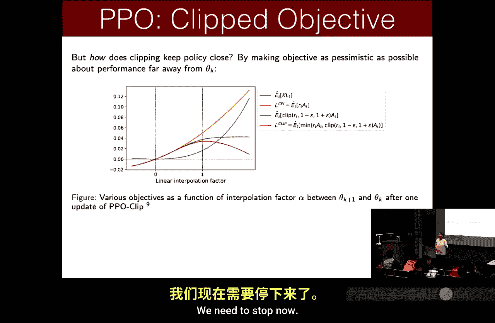

We need to stop now。