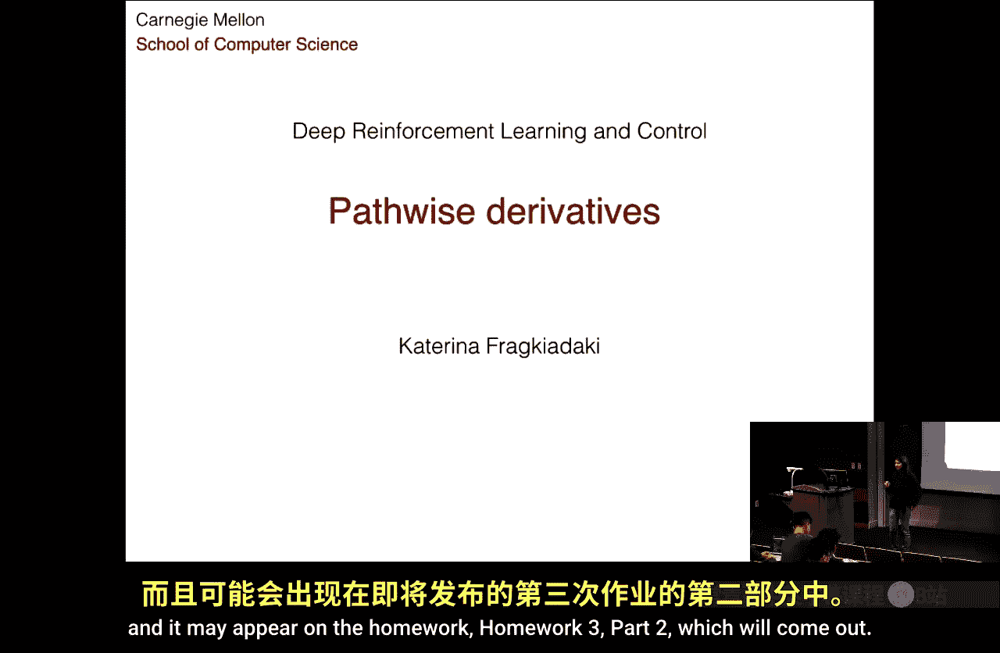
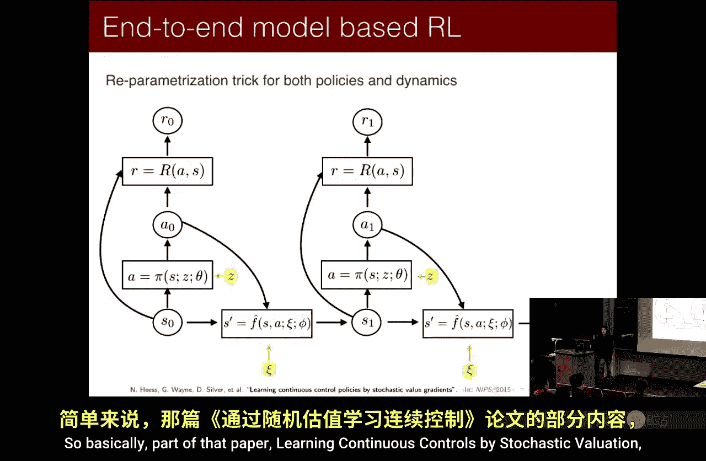
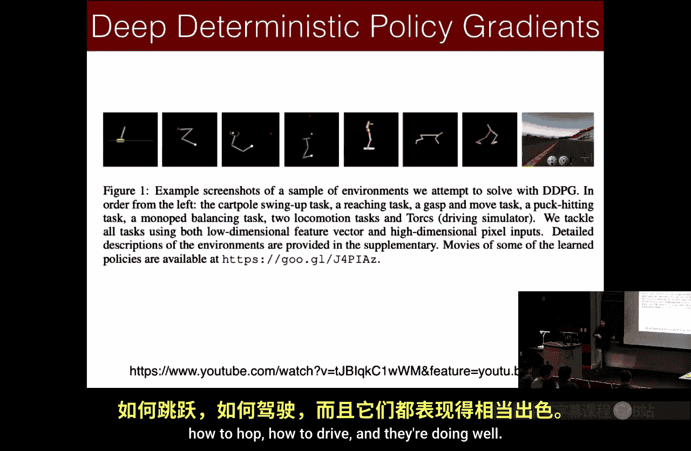
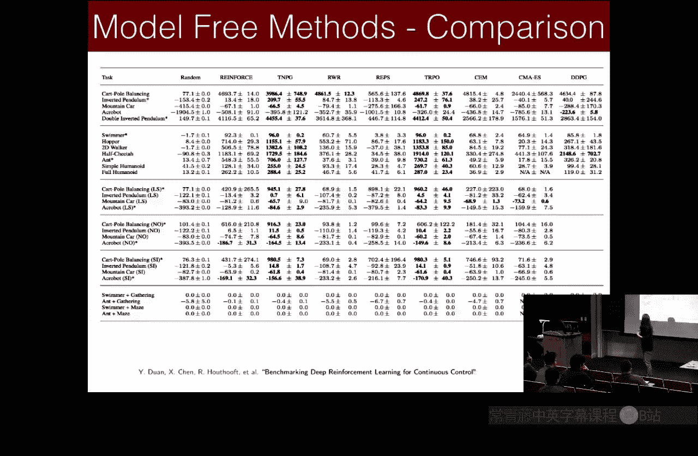
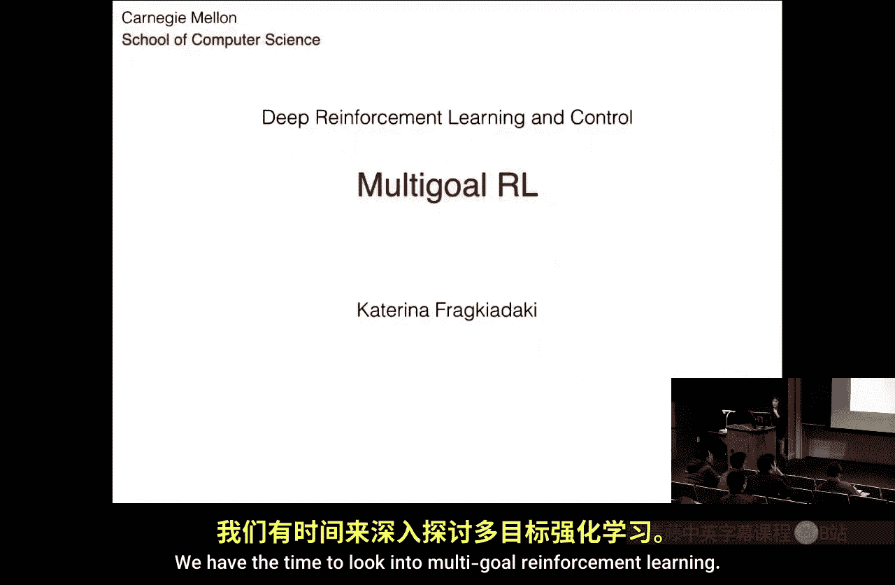
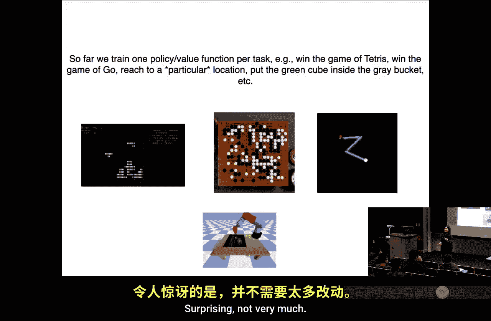
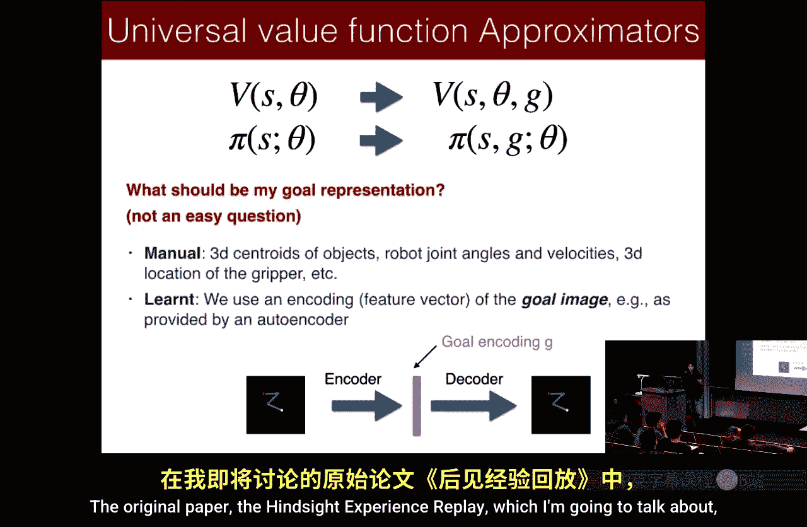
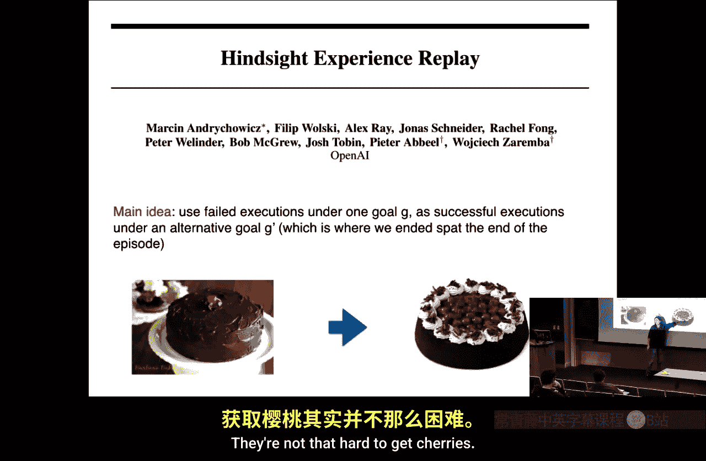
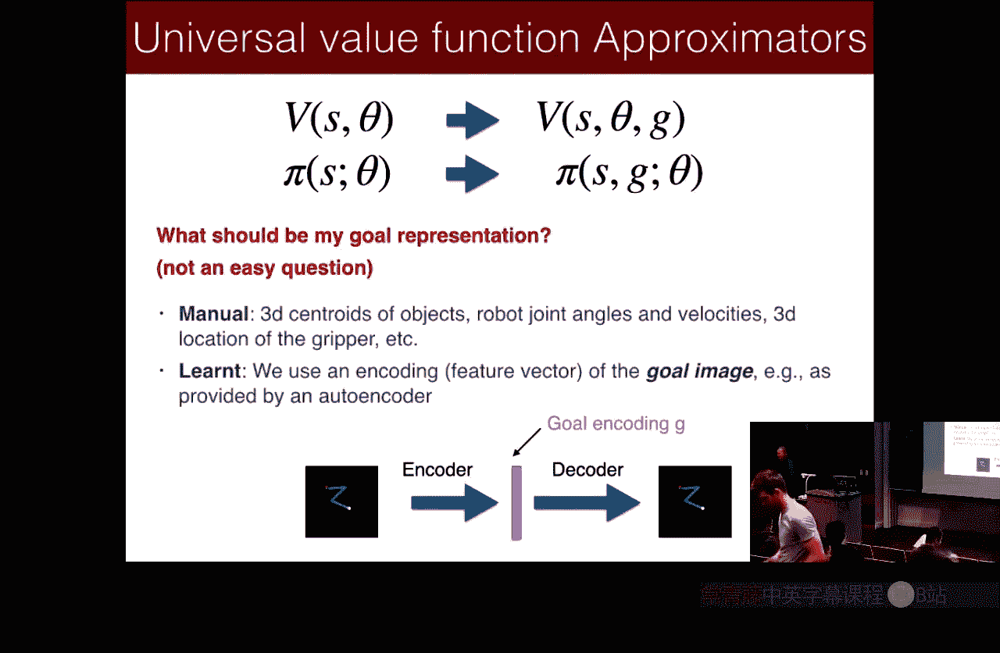

# 卡耐基梅隆大学【中英⚡深度强化学习与控制｜10-703 Fall 2018, Deep Reinforcement Learning and Control】 p15 P15 15  Pathwise derivatives -BV1RyqPBbEJV_p15-

We'll continue on Model3 reinforcement learning， okay from our previous time。

And we'll see some other types of derivatives we just derivative of gradient estimators and at the end because today is going to be the wrap up of model 3RL。

 we'll also see some relative comparison because I think this is going to not take us too long I hope to spend the last 15 minutes to talk about multi goal how can we learn value functions and pulse for multiple goals at the same time and talk to you about hit site experience replay which is a state of the art multi goal formulation is very simple。

 it can be combined very well with whatever model 3 methods you know already and it may appear on the homework。

😊，Homework C part2， which。

We come out， right， so please pay attention。Okay， so。Again， as continuation of the previous lecture。

 it's all about gradientding estimators and hopefully the lecture today because essentially we'll see all different ways of est grads together。

 this will also allow us to understand what are the advantages and disadvantages of each and when to use the one and when to use the other。

😮，Okay， so。How do we take gradients of expectations？We have computational graph where some。

Nots in that graph are stochastic variables， for example， actions。

How can we promulate Hual forastic therapist？Well。If the stochastic variable appears in the distribution。

As is the case well for neural network quas， which parameterize policies which define the distribution of our actions where we sample from。

Okay， we already already know how to do it。Right。We already know how to do it。Essentially。

 we have the light progression grade this matterter， and I decided here not to reddirectriiveve。

The formula， but essentially。What happens is we at this as an expectation。And we push it forward。

 and then we multiply and divide。Probability of x。 And then we notice that this is exactly the grid of the log。

 and we put it there， and we have the。Probability pre multiplying this so then this becomes an expectation right so we all are now。

 we have it on the homework we're all very familiar with this gra deator， correct？Okay， so briefly。

 though， when we talked about evolutionary methods。If you remember。

We derived what we saw parameterization for Gasian variables。

 So we'll revisit this parameterization trick， as it's known， both for Gasian distribute variables。

 as well as for categorically to distribute。Very， okay。Okay， so we know that already。Now。

 what happens when they on a variableable？No， when it happens when yes。

 the variable one to take derivative of doesn't appear in distribution。

 but appears in the expectation。Well， then things are even simpler because the gradient just goes inside the expectation。

And， you know， this is the standard derivative that we know。 And Z doesn't bother us at all。

 It comes from a fixed distribution that does not depend on theta， okay。

So what happens here is we'll just take we compute sample estimates of this derivative， all right。

 across samples from this variable Z。And this is called Pawise derivative。So we have two cases here。

If。The variable x that depends on theta goes in the distribution is inside the distribution。

Which has been the case where Feedda was run to address in the policy。

Then you need to have this light progression gra in thismato。え你。Un variable。X。

 which depends on theta is not in the distribution， right。

 but there is a distribution over some other variable which comes from a fixed distribution。

 For example， here， this fixed distribution is this oceans，0 mean one standard deviation of one。

Then it doesn't create any problem， the gradient just goes inside the expectation。オッケー。

So this is standard。And what you need to do is you need to take， you know。

 you need to aggregate across different samples of Z of this and see the sample estimate equation in a minute yes。

F is anything you like。Anything you like？Yes， again。In fact， I have 15 slides all about this。

 but what is there here， Imagine that we knew the reward function， we knew it。

 you remember this row from the raw S commma A from the first and second lecture。

 Imagine that we knew it and we had as an analytic form that it would depend on the current state and action。

 Okay so then we apply it here。All right， instead of F， it would be here a row。

This is going to be some state。 This is going to be our action that depends on theta。

 This going to be。Some z。Okay， and then we'll be able to， But， but why don't we wait。

 I have exactly the adapted thing for our in the next slide， But， but do you agree with those。

 Do you agree with these statements here。These are these two cases。 Now。

 what I want to say is that oftentimes is not either the one or the other。 We may have。

Are variable in the distribution， but by using a smart what we call reparametricization。

We'll be able to make the distribution depend on the fixed on a random variable that comes from a fixed distribution that does not depend on theta。

 okay。😡，And put our variable x being a deterministic function of that random variable Z。

 and then go from the first estimator to the second estimator。Okay， right。

 And this is called the Perponization trick。And we need to know about that。 and we'll visit this。

 And this， this is the first thing God that we need to know how to do it。

 And the second most important thing is to know， why is it important to do it， Why do we need it。

 okay。Okay， let's see those in detail。Okay， so this is a computational graph of a known mark decision process。

 All right， we have our states。And we have our transition dynamics， okay？And we have our policy。

And we have our options。And we have the reward functions and we have the different rewards that come from this reward function。

 and for now here what we assume is that we know the dynamics we know the rewards that this is how things would look like。

No。Let's make it a little bit simpler。We have here states。

 and here we have our policy that depends on her。Parameter theta。

 then we have our actions which are sampled for our policy。

And these actions in states are input to the reward function。

 which will assume that now it's known and deterministic， is that it' the simplest case。

 and what we want to do is how shall we estimate theta to maximize the reward。Does this make sense。

 It is a very simple example。 So I would like to ask you how what would you do。

What do we know how to do？ Well， we know how to use。The collective will ratio gradient estimator。

 right， We know that。 We know that sample to sample actions to look at the rewards that we get。

And to take gradlock P multiplied with rewards and average across the samples。

 so that is what we know， let's see。啊，那衣服。Our policy。Oh by the way。

 the very important thing I want to say， I'm going to use this type of notation。

 So if there is a node that is a random variable， that is sample。

 there's going to be a circle if it's a deterministic， it has a deterministic value。

 given its parents is going to be a square。Allright， so here our actions are stochastic。

 They're sampled。 Now， if let's go to the even simplest case。Our actions are deterministic。

 Our policy is no stochastic。 Its deterministic policy。

 How would you compute gradients here to try to estimate thetas that you maximize the reward。

 You would just use standard back propagation。 Do you agree。You know the word function。Okay。

So I think the reason people are confused。Is the following。 We somehow suddenly have jumped back。

Many many lectures， and we assume we know the reward function。Because for the last。

 let's say 10 lectures， we assume we didn't know the word and back propagation was， of course。

 out of a question。The reason I put it now in is that only if we know the reward function things in excess to use the parameterization trick。

 and I'll explain why。Now at the same time， after we explain this。

 we'll jump signal that with another word that's okay， we can use in place the word Q functions。

 Q estimates， so to allow me to do the presentation this way which I think is the easiest one。

 I want everybody not to think that we know the reward function。

I want to at the same time mention that in two weeks from now。

 we're going to talk all about model based resal learning。

We're all the time going to try to fit reward functions and transition dynamics。 Okay。

 so this is going to happen at the same time。I want you to think that all this Q we've been talking about。

 it's all about approximating the discounted future discount future expected rewards， so yes。

 we don't know the reward， but many， many algorithm words we've used use Q estimates。

 which essentially try to have to say。😡，Conditions， of course， on the current policy。

 predict how the reward looks like， okay？Yes。Yeah， it's。 Yeah， This is fixed。

 It doesn't at all on No， it's just a fixed computation right there。 Okay， yes。

Doesn't depend at all on your policy。 So given this fixed computation。

 what should be your theta to maximize the reward， you would just do standard by propagation in this case。

The complications start coming in the picture。Okay， and this is the case even with the unfolded。

 if we hadn't unfolded， imagine an RN where everything is known， transition dynamics rewards。

Policies are deterministic， what would you do to estimate your policy would just use standard back propag on this RN。

 right？😡，Right。Okay。嗯。So basically you initialize your policy， you will enroll。

 you will estimate reward， but propagate， update your policy， sample again， but propagate。

 update your policy， et cea，Does this make sense Now one small thing we need to keep in track is that if you plan to use a deterministic policy。

 you better sample with noise right so when you choose actions。

 it should not be the actions of your determinist school you need to explore and we'll see we'll see exactly we'll see for example the method today they called deep deterterministic policy gradient。

 which all about the deterministic policies， a very good method from last year a state of the art so just let's follow along Yes so in this case。

saying that didn't occur。Given a state you do the same action or yes， that's what I mean。

 that this is a function that depends of some parameter under stta and once it takes a state。

 it spits out a particular action。So in this graph。大条。What do you mean what about propagation are we？

A0 and S0。 So we start of as0， and we always add that A。

Here here is we take the derivative overall overall with respect to alpha。

 and then we take the derivative alpha with respect to theta。Okay。So what are we。

We have taken Palmterstta。还家的据。It isn't deteristic， but you don't know what it is。

 deter deterministic means that I give some parameter data。

 and there is a specific action you're going to spit out。 But if I give a U parameter status。

 it will be different， actually， you're going to spit out。

 The deterministic means that given a parameter statusta and status you don't have。

A distribution to sample form， you just have a deterministic single outcome， of course。

 but you need to change the parameters to find what should be this outcome for a particular state。

 right？Does this make sense？So the definition- so I didn't put that slide of what is a stochastic and deterministic policy。

 but the stochastic policy is the policy that given a state and some parameters predicts a distribution out of which you sample your actions。

Deterministic policy is the policy that given parameters of states predicts all the same action。Okay。

so we don't know what I think。なだけ。Not given status given status and theta and parameters， right？

Embarrameterters。Stand regression， right， What is the regression。

 you change parameters you change the output top music， right， but all the time did the same。

 given the same data all the time the same amount okay， we don't stumble。Yes， where are they with it？

Okay， is that clear？Here it is。So row is a function that depends on our action。

And depends on the state， so we're able to from Rome， right？Okay。So as theta changes。

 alpha change and row values change right is that clear from that graph okay so this is the simplest case we can have as we see everything is deterministic in this graph。

 try to find the parameters。Now， let's start by making things a little bit more complicated。

 so what has changed from the previous slide， our action became from square a circle。

What does it mean we switched from deterministic policies to stochastic policies okay and now can I tell you may not realize the importance of stochastic policies because we haven't done the lecture yet that shows why stochastic policies are so much better than deterministic policies and indeed DDPG was state of the art till I would say a few months ago deep deterministic policy gradient there's going be a lecture as we said it's called maximum entropl later。

 which will explain the importance of stochastic policies which essentially say if you achieve the same reward。

 do not commit on a particular action just make your choice of actions as high enthtropy as possible。

 do not overcomit okay so in this way you will be able to have all your alternatives open to achieve a particular goal as opposed to committing to a particular way of achieving an action。

No， the box just means it's a computation。 It's a computation of these the forward pass in the backward the backward puzzle are gradients there。

 yes。Oh， yeah， the box there， the red box is just the like Caretio gradient inimator。No， one second。

 let me start the story of the slide。 So the story of the slide is we just switch the actions from the termministic to stochastic。

 What do we know how to compute the gradient， We know this type of gradient estimator， okay。

We essentially sample actions， we see the reward we get。

 sample actions see the reward we get and compute this quantity。

 and then we take a step and what step size we're going to choose， well。

 we had the whole lecture on this， about natural policy gradients and that it's good to use the natural gradient instead of the gradient and the step size need to be careful。

 et cetera， etter， okay。But so that is what we know already。 Now。

 let's see if we can do something else。So。Let's assume for now that our policies that our actions are continuous and our policies are parameter Gaussian distributions。

 How do we parameterize Gaussian distributions where the output of our neural network should have one output for every coordinate of the mean and the standard deviation。

 And if you want to have the full covariance matrix you need to spit out every element of that covariance matrix we see is's more complicated。

 Many times people either use a standard deviation。Fixed。Or they just use an isotroppic Gaussian。

 right， so isotrop Gasian is very， very hard to say common。Now， I just said， let's use Gaussians。

 and this is by far the most used case in the literature。 What can we do？😡，Well。Sure。

 we can use the the ratio gradial likelihood ratio estimator。

The likelihood ratio gradient in this matter， And it will look will take this form。 Okay。

 for Gaussians， Gaussian policies。 Very simple。 Now， you may have more in your mind associated this。

Grading the memato with discrete actions where you would just plug here the output of the softm。

 button try and say here， you can just use it also with continuous access。 There's no problem。

 Allright， And what is the probability。 You just take the gatian equation， right， the equation that。

Of the normal distribution， you take the log， the expectation， the sorry， the exponent goes away。

 you take a gradient。 The square goes down。 and this is what you get， right， makes sense。Now， okay。

 so these things that we know， these things we know， this gradient and deimato we know already。

 So we haven't done anything new yet， okay。We haven't done anything new yet。嗯。

Let's do the parameterization。For this Gaussian distribution。 And some people may remember。

 we saw this。 if you remember when we were sampling。Parometerters。During evolutionary methods。

And we said that when you have a variable。DD不。Theres the coussian distribution here。

 this variable is alpha， you can write it as a deterministic function of another random variable。

 z guular z comes from a fixed distribution。What is a fixed distribution。

 a distribution that does not depend on the output of our network in any way。 Okay。

 so it has nothing to do with the parameters of our network。 So we can when with the gradient。

 we'll go to the second case of the previous slide。 Okay。

 where the distribution does not depend on feta。😡，And why this is the right。

 this notation means element wise multiplication， All right。

 why this requirement relationship trick is correct， Well， it's correct。

 because if you take an expectation， you get the same expectation for alpha。

And if you take the variance， you'll take sigma squared， which is the variance of alpha。

 so the variance of nu plus z sigma， this new way of writing alpha is exactly the same mean and variance as the original variable that was distributed from this parameterized。

 Gausi， do you agree？😡，Okay， so if you can you see why the variance is like this because we have variance of Z multiplied with sigma。

 Sigma is now a scholar， right， Z is the random And we know that the variance of alpha multily random variables with alpha squared with the variance of that random variable。

 okay。We haven't seen exactly yet what we said we just wrote down theization so far Do you agree just wrote downization and here we also see that by the way。

 let's see how our computational graph change you see now that Z is a circle because it is a random variable all right。

 it doesn't matter that it doesn't depend on the weight of our network Its still。

It is comes from this fixed distribution， co ocean  zero in and。This is a topic go okay。

 then you need to。Covariance matches， and then alpha， our actions are not deterministic。

 They begin a square， okay。Do you see the change on the graphic on the diaper grade。

 So now let's try to take gradients based on this reparization。Well， the greater respect to Heta。

 what where we can to see how the our Hson reward changes with respect。

To the parameters of the network， we know now that since Z does not depend on whether we can push the grid and inside the expectation。

And here's what we get， we get the derivative of the reward with respect to the action。

 the derivative of the action with respect to the parameters of the network。Does this make sense。

 And we have an expectation， Why we have an expectation。

 because we have a stochastic knowledge in on graph。 Of course。

 we take expectation with respect to that。Round I very busyy， okay？Yes。

 is there a mean and a standard deviation vision for every action possible？Oh what does this mean。

One second， I think we have a small misunderstanding。

 let's say that our option is how to move your end defect。

 where your end effect should go in the freeze space， okay？So yeah I mean。

 I mean for sure we are here in the continuous actions now right because we go distribution。

 if we have discrete actions， we would be on categor distributions and softm completely different right。

 it's like in the next slide in5 Okay so here sure， we are in continuous actions。

Let's give a specific example。 We want to move。The hand of the robot。

 and so our ratio is the x Y Dz of the end defect。 where shall I move it， Okay。

 I'm trying to push something。And the mean here， how many numbers it will have three， one for Dx。

 one for DY on for Dz。哈め你 if服 haven't。Hsorop the ocean how many same as your head。Three。

 one for each cord， right？So six numbers are output on my network。Okay。

 and and this is what you get to you see， So we have yes continuous actions。

 we have continuous actions here。 Okay， we'll see discrete actions。You got slides。Is that clear。

 actually if that's a good question， maybe I should put an example of this motion of the griper of the robot to make it more concrete。

 okay， what is going on？okay。So this is clear， right， This is totally clear。

 we push the gradient and inside expectation， yes， are we。Like why are we just divided by one of？

It isn't a can change around。So this epsilon。SoSo first of all。

 we are going to approximate these expectations。With a finite set of samples from random variables Z。

 right， I mean， sure you can write expectation， P of Z， probability of Z， D Z。 Okay。

 at the end of the day， this expectation， Okay， will be approximated will be estimated using a set of finite set of samples from Z。

 and in fact， we will see this， maybe。Okay， so so if you want the more general Gaussian distribution as opposed to asotropic。

 you need to do this type of reization。 I forgot to write L。哦。What is this。Yes， this is state guys。

 I apologize。 So this is state commmafeta。 and L also depends from state commafeta。

 So you need to have for many outputs of your network for all the different。Vues of the。

Of the covariance metrics。 And well， I don't have here， the sample。No， I haven't。 it's right there。

Right， so here it is， so it's the sum for the different Cs。 Okay。

 that's the exactly how we're going to estimate it。Okay， so now the big question here is why， yes。

 So you need to predict the new as well as a signal。Yes， except if you want to say you know what。

 I just click what new and I'm just going to put a fixed s， Allright。

 I'm going to get a fixed sigma not to be and stick。But so people do that all。 Allright， But yes。

 and other people also are interested。Now， the big question is why do we care to the parameterized。

 right That's what we need to understand。 So let's compare the two gradient estimators Here is the likelihood ratio gradient estimator。

And here is the pathwaywise， and there is an expectation over our samples and the samples are from actions。

And here's an expectation over Z and the these are from this fixed。The ocean distribution。

What do you see as the big difference between。AreThe two estimators？嗯。

It seems to me that the big difference。Is that。Well。

 one thing that you need to realize is that this alpha here is essentially the policy network， right。

 that's what it is is this paththeta here， All right， I think what we need to realize is that。

There is a new here basically， so when you say alpha theta comma Z。

 you just go here on new Sigma theta， et cetera， so the policy network new and Sigma。

 that's how the policy appears in here。I see the big difference is this。

That when we're using the lack regression gradient estimator。

 we don't exploit at all the gradient of the reward with respect to our action。😡，ok。😊。

So if this is known and available to you， this is a big information， okay？😡。

In the idea with racial gradients made， we just sample actions and we just look at final rewards that we get。

In the one on the left， we know how this reward changes with respect。

 we have the derivative available， Okay this is given to you。Now， in the previous lectures。

 of course， this。S metal was not available to us because the reward wasnt there。

 So we'll show now what we can do that if the reward isn't there， et cetera。

 we'll show alternative methods， let's say， okay， so this is the big， the importance。

 So basically when this derivative is available to us， yes， it is worth parameterizing our go okay。

Now the question is， okay， great， this is what happens with continuous actions。

 We'll show concrete methods in a moment。 Okay， now let's discuss a little bit about discrete actions。

Can we do similar thing with discrete actions？I would say， yes， I'm not that why。是？So here。

 mu and sigma， they are still variables。Vnu and sigma。

 so first of all this mu needs to be s comata so this is the tab right there menunu is the following you give me a state and you give me parameters and I give you particular value of you are just functions of my neural ways and my states okay。

So absolutely determin they're paraizing the ga， okay and using。自け。

We're using Z as a way to sample from our policy okay to see our policy is a distribution is a distribution is a Gaussian distribution。

 how should this Gaussian distribution change， the change we need to change maybe the mean。

 we need to change maybe the sigma， okay so that we maximize our word。O。I think your question is。

 and it's a good question， why do we bother so much with all these distributions。

 let's why House is going to be so bad if our policy deterministic and we'll get on this question okay？

Yes， can we say that。But once second the actions here are also sampled from a Gaussian one second。

 so here or maybe I didn't write it like this。Yes， so options here are also sample for negotiation。

Like for each parameter of my network， I have a specific notion。Okay， my network paraizes a Gasian。

 describes the oceansian as you change the parameters， different Gas are described。And I'm trying to。

To see， how should I change my feta to get a very good gaugeuss？and was saying in practice。

 sure you can use a lot quo ratio， but then whatever comes after your action， after this circle。

 you cannot use its derivative， you can only use the very final value reward you're going to get in your loss function and plug it into the formula Well if you do the sertization。

 you are able to use the derivative of what comes after okay。That's all we're saying。

 And this potentially is useful， right， because it's gives you useful signal because as we saw two lectures ago。

 reinforces not that different that big different from finite difference methods。

 You just sine you merely Smith some gradient。 right， So here you're not like。

 is you use the gradient。 Allright， when the gradient is available， we should always use it。嗯。Okay。

Well， here's the thing。嗯。What do we expect to happen once we have discrete actions Why are we going to back probe through discrete actions of course we cannot backpro through discrete actions it is not differential any function that map something continues。

 Something discretere is not differential is not continues So what are we going to do What do people do and does it work what big people do So there has been some recent fancy tricks which I'm going to discuss in this slide I'm not sure how they workflow this makes sense so you can point it there and say。

 look， I didn't use reinforcefor I use this fancier gradient， but at the end of the day。

 I'm not sure in practice how big the difference you're going to get okay but I want to show you because it's an active area of research。

So here's what people say they say。These lookP are your logics。

 what comes out of the network as the scores of the different actions。

 which the softmax layer will convert it to a distribution。So they say take a uniform， this is again。

 a distribution that is not parameterized with your weights from anyway sample you。

Make this transformation of that you。But this capital you should be small you， by the way， okay。

 take this Epsilon J and add it to your logic。And take the action that has the largest value。

 That's how you sample from a categorical distribution。 Okay。

 so this is how you sample in your forward class。 You need to be able to sample from your actions。

 okay。Okay， so we have a distribution that's how was sample category that's how was sample for me。

 The question is what happens in the backward pass what happens with the gradients。 Well。

 things are not as easy as in the Gausian case because Gausian is still a continuous function Okay。

 so here what people do and there is an explosion of recent papers is the following。

In the forward pass， we will be sampling from this guy， why we sampling because indeed。

 when we take actions， these actions are discrete， they're not soft， here we going to pick。This。

 so imagine you're trying to， your action is to crop the box from an image。

 You want to attend somewhere。 Okay， you want to crop the bonding box。 You need to。to one box。

 just commit in one box， sample it and splitit it out and move forward with your computation in your forward pass。

 Now on the bump pass， imagine that there's a discrete set of boxes that you can sample we are here discrete actions Allright have eight boxes。

 you can choose one of those eight boxes okay in the forward pass you choose one Allright now you're not going to choose all the time to see now you're going to say why don't that just a max well I need to put the ga in there Well if you put our max。

 you cannot sample all the time I'm gonna to be picking the same thing okay so this ga just add a little bit of noise based on your you know logics。

 of course， right。And in the backward， in the backward pass。

 forget about your samples just but propagate directly to your soft so much distribution。

Distribution out of your soft。 And this is how it looks like。 So for binary neurons。Well。

 I forgot to put the title there is for general。This is for general， not for binary。

 but for general cat or distributions。no here， sorry it's one2， so the forward pass is always hard。

 as we say， we sample either from the categordaical distribution or from ouroid， okay？

And in the backward past， either well use theoid the way it was。

 or we say we approximate through this straight route because the gradient is even more beautiful in that linear part。

And we just keep this soft distribution out of our soft max。Do I have it here， Do I have another。 No。

 I don't have another。 In any case， it looks。Like this okay now I just wanted you to know about this that yes。

 there are rapidpaization tricks for discrete variables。

 they are very different than the ones used in Ga oceans okay why because of course we cannot propagate through discrete nodes in our graph and what they do is they sample the forward pass and they keep the distribution software on the backward that's it Now how much better they are over the score theial lining the lining gradient estimate made is not is not very clear okay。

All right， so we saw that at least now at least now we know a lot of things， we know a lot of things。

 we know how to re parameteraitraize and now we say great， let's get an epiic。AndDP like this one。

 this graph I'm I'm going interact with my environment for 150 steps and then get the word and I want not to back propagate and since I learned the parameterization trick what I'm going to do here my actionss are stochastic。

 they depend on this theta parameter， but I want to use the tricks that I learned。

 so I'm going to add Z。So castastic goes for every one of those action choices and the actions are going to become now deterministic squares。

 okay？And I'm ready to do D， R， D， A， D， A， Dta， okay。Now。

 where things are going to get stuck is on the DRDA。呃。Because to back propagate the reward。

 as we said， not only you the reward function， but if you have more than one steps in the previous slide we just said one step right in one state gives you a reward。

 no multi step here to be propagate from the future to the past。

 you also need to know the transition dynamics。You need to know how things。

 how actions influence the dynamics of the environment。Now we don't know any of those。

 if we use them， we will do what we call end to end model based reinforce learning。

 we'll just propagate with those transition dynamics and we will have lectures on this。

 which will make this very， very clear。😡，And discuss challenges， et cetera。For now， here is our。

The grading we care to compute how the accepted reward of the last sunset。You know， depends on theta。

 okay？And we said we are the alpha， the alpha， deteta， so we've seen this before。

And the problem is to estimate this， either you need to know the dynamics or the reward function。

Or what can you do， Well， you can plug your queue， you can have a queue。😡，All right。

 you can have a queuee。And you can just。あ、テでビてきま。O。And let's stay here little bit to see。

So what do we know so far from aritic， We know Grolo。

Prob of an action multiplied with the Q of an action。 This is completely different gradient de meter。

 We will use the derivative of the Q with respect to alpha and all the next slides are all about this。

 okay。レストたか。in fact， it's super， super easy to implement and we'll see。And here is what it is。

 you take your cube， you differentiate it with respect to alpha。

 and then you take the alpha the theta and the alpha the theta you know already。

 you're just going to find your Z and you will form a very nice estimator here and there is some z variable。

 the expectations over those zero variables okay。So we'll see this many times in many different ways one second。

 just give me one second。How this is how it looks like this comes out of this paper。

Continues controlled by stochastic value gradients， okay。So let's see。

 we need to for sure estimate Q functions， yes。Yes， we collect trajectoryor， sounds good。嗯。

We take gradient of the queue， yes， and we think the queue。 That's all it says。

 So we know how to fit cus。 We use the D0 to the1 multi step returns， whatever you like。

 and then we back propagate。All right， and when we bumpagate。

Because we haven't compromised our policy， our policy is stochastic， you see the Z， okay？Now。

Does this make sense to you guys now if you don't want to see that Z there？Then straight away。

 you cannot use the Q so the only way we can use the derivative of Q with respect to our actions。Is。

 if you also use。The pathway is derivative beyond there。

 the derivative reaction respect to theta If you decide to use the likelihood ratio estimator。

 you cannot use D Q D， you just use the Q right gradlock P multiply with Q whenever you have，え？

Like gradientest me， you cannot use the derivative of whatever comes beyond that node or action or stochastic variable。

 you can only use the final loss value， note its gradient， does this make someone say？In any case。

 we don' just give a few more slides and if it's still not super clear。

 we'll see now things will become more clear if we finally say。

 you know what these stochastic policies are such a big burden， I'm just going to throw them away。

 Let's just give the deterministic policy。 Shouldn't this make things way simpler。😡，Yes， it will。

 How do you expect this pseudoko to change if we have deter deterministic policy？😡。

How do we expect this suitable to change if instead of stochastic policies。

 we have deterministic policies？For Sch de Moi throw very nice。

 so since we have an deterministic policy， this means that there is a state there is a theta and alpha comes in and we have the alpha the theta。

 we can wem this a derivative from our back propaganda neural network and we just plug it in here well action here is not available。

嗯。Well， it's inside there。 we showed the。The estimator right here。All right here。So this guy。

 now it's much simpler， there is no Z， there is no dis expectation over random variable Z， correct？

So that's for sure， nice。Do we have any other type of expectation？Well， we'll see。

 so now because now we don't have stochistic respect actions， we have deterministic actions。

And why we need。An expectation。Well， we're still going to sample actions and we said that when you sample Uni toax exploration noise right otherwise all your actions are going to be the same to be able to take rate and you need to you know take different actions from your deterministic policy and see how well they do and you aggregate over those anyhow this is not that algorithm we say what if we give up stochastic so first of all。

 our graph is going to change and forgot to mention this now we not have circles on our action wave squares since they're deterministic and we have this the R D D theta as we said theyre simple。

And this expectation here。Right， so we haven't introduced anyQes。

 this expectation comes only from the dynamics， why， because our policies are deterministic， okay？

Here is the queue because there is nothing else we can do。

 we just don't know the dynamics and we don't know the reward functions we'll just put our estimates。

 okay？😡，And that's it。 So now there's no Z， the Q D A， D A the theta， indeed。

 this is theta this cube， very simple， okay。嗯。First。

 we'll spend some time here and then we'll see the computational graphs again one more time to see how simple it is。

So。This is a go called deep deterministic。Policy gradients。Okay。

 there are policy gradients for deterministic policies。Let's see。

 first they say we need a critic network， of course we need a critic network。

 we need the Q to how are going the gradient otherwise， and we need the actor。

 and the actor now is not paththeta is immune and this is just a notation just to signal to you guys that this is just deter termminist。

 you put the segment text on theta splits out in action。

These have the weights and there are target networks also why because we know that when we fit Q values。

 it's always good to have a target network。Okay， and that is not going to change very fast and now you should be a little bit like why there two。

 didnn't we know that there's only one cube？Right， we say we have one Q and then we have another network Q prime to provide targets why we have here also new prime。

So that's one question to come in our minds， do you agree or not？Okay if you agree Well fine。

 so we need run the process for action exploration and how we're going to sample actions where we take the output of our policy and they will have noise this the most standard our way to do it correct nows how we sample actions we execute those actions。

Observatory words， next stage， we create the experience doubleples， nothing new here。

 we throw them in our experience buffer。And here is the target。Does doesn't look very different。

 It's like R plus gamma Q。 This looks to me like standard T0。Right， or 21。

 I don't remember how God called it。And it's just that now I'm wondering if this is for you a little bit weird。

 we have the state and we'll just give it an action。那这。Okay， so in the action is exactly this。

This guy， essentially you fit the sigma。要飞得食吗？And you get the whole Q of your target network。

Allright， and what is sigma the next state。 So nothing， nothing new hear is just that actually。

 I heavy picture will come back to this。 It looks like this that you network。 Now。 There is a state。

 and there is an alpha。And this goes into your。Well， before we just had the state。

And then we would speak out different issuess for different actions。

So think about this GDPTPG is as if we're trying to do cool learning for continuous actions。

Before we had deepQ， what did we do， we had the Q network and had if you remember as many outputs as actions we had do we had discrete actions。

 let's say 16 actions， if you remember for a time， we have 16 outputs in our Q network。

And we would always try to fit you had the target network and we would always say， okay。

 here's the target， so my current estimate should be R plus gamma the target of the next state。

 correct？And then to pick an action， we will take mark next if you remember of the queues。

 Now here we have continuous action。And these ares over continuous Space forever。 Okay。

 we need to optimize to see which is the right action so we say。

Let's parameterize that policy network also here is a state and now it speaks in action and that action enters into my view。

And I want to tell you something， did you remember the very like many lectures ago that we said？

What are Q values， Q Q， state action values， they take a state。

 they take an action and they splitit out the Q value。 You remember that we said that。

 and then we said， oh， where we can disc actions because we don't want to run the network 16 times。

 I have 16 actions。 That's why I'm going to fit the state and have 16 outs。 You remember that。

But the way state action values is in the first place， it takes a stage and it takes an axis。

That is how we had defined it where we're in doubler methods。

 Okay so now we go back to this because we're trying to accommodate for continuous actions。

And here is our peer network that takes the state and takes an option。

And this action comes out of this deterministic policy network that takes the status' input。

 so this is just the computational graph you fit the state and hope the Q value comes out。

 very simple。Do you see how simple it is and you probe， everything is deterministic in this graph。

 very simple。All right。Yes， so we'll go a little bit back here with the DDPG to yes。The policy is。

Yes， the policy， that's what we're saying we say deep deterministic policy gradients。

 how do you take gradients of deterministic policies？そにずらもさ。Well， with not exactly stochastic policy。

 Yes， if there is exploratory policy， you can use whatever you want Sure。

 you can use any exploratoratory as course as you like。

 What I'm going to use is the output of my network that which think the action is the right and then I'm gonna to have noise based on this action okay that's one way to do it。

 you can use whatever you want。 This is an of policy learning algorithm。

 It's an of policy learning and always when you have deterministic actions。

 always will do of policy right because we need to sample to explore So you cannot explore from your deterministic policy youll always do off policy okay。

That's one way to explore in it case let's see what happens。

So this is updated the critic by minimizing this， I don't see anything you hear。

 the critic is always the same。The target looks the same to me now that we understood that this guy is just a Q network。

 Okay， this guy is just a Q network。 All right， it's just a little bit。Longer expression。

 because you need to put the action there， the action is parameterized with some theta。嗯。Alright。

 and this is our gradient and this has nothing to do with their likelihood pressures。

 completely different is all the minutes to log away and with some of all the actions that we have sampled。

 and here is how they update their target networks， they essentially update them slower by taking。

This is weird， other people， just as we said， they update periodically the target to take exactly the same values as the current network so they do this other update。

 it doesn't matter。喂。你个你位嗰啲啊。Yes， okay。 So let's assume。Let me try to see how to say。Okay， great。

 I know what's happening。 So let's go back to this。

 So these people have in the previous algorithm that I show。

 they assume there are two sets of parameters。 One is called fetaq， and the others called feta mu。

If you would assume that all this is your Q network。

 you' you can just say well you hear my Q network， all right。

 and there's whole thing called Fetaqui and I need to have a target。

It's just this set of mu is part of your Q network。

 How you're going to estimate that you value if you don't have the set of new。

 Do you see what I mean， It's part of your Q network So you want to have a target Q network Well for sure need to have a target set the queue and a target set new。

Does this make sense？So things are very simple， maybe much simpler than what。Yeah。

 so they're much simpler than what they tried to make。 But I'm wondering why they like this。

Why didn't they just combine everything？嗯。Oh， I see， because we need to。

Put here the different actions。But still， it would have worked。Do you see what I asking。

 why they had to present it in this way as opposed to just a big cu， you know。

 whatever that takes the state and spits out。A state noise state so you need to feel the state in action and of course you need to have this part of the action as well。

 just this makes sense， by the way， there is a very high probability that your homework will be about deterministic policy gradient with H experience reply。

Which is what we're going to see in this electricity because it is so much， it is everywhere。

 it is very much loose， it is simple enough， so it would be great if you have some questions to ask them now。

Yes。😊，We're finding the target， we're not like taking the back of the action。There is no box here。

 yes， it's the g， so like our target is not as good of a target as。If。No。

 the target is still done for stability purposes， Do you see what I mean the target network I mean？

Like the the wifi。And like what we're trying to do。Move our forward points to length。

I wouldn't say that even for DQ learning or the DQ learning， we had a target network right。

 this has nothing to do with the A Max， it is just for stability purposes because if you are trying to take gradients based on something that continuously is changing。

It is hard to stabilize， that's it， so the target is only to just give you some stable values to regress against。

 okay？Yes， I think mean。I mean， like the why。喂。了だて。明国会。Yes。

 this is exactly what we're trying to optimize towards for our critic。 That's correct。 Yes。

 in this version we're using our。You decide the queuee for the next。In DQN。2。

But I want to tell something， even if we didn't have a target network， Oh。

 so you're saying independent of the target network， forget about the target network， yes。Yes。

 but can I tell something this guy is continuously moved towards better and better actions， Okay。

 this is continuously moved there we had darkrcms， okay。

 here we have this derivative that always tries to move your continuous actions towards the right reward。

Right， do you agree with this， Po， that's why they like their target networks to be frozen。

 but rather also to be changing all the time。 do you see。Because these were kept frozen。

In DQ N for like 2000 iterations， these are not kept frozen here。

 So potentially it's exactly because of the reason。You're saying， okay。Yes。

 so it seems like you're only。Updating the actor。Like by copyping through the queue。

 that's exactly right， that's exactly how you update the outcomector you but propag get through your queue so couldn you also do something similar to just regular policy gradients or you're also updating the actor？

By。Yeah， so of course， of course actually think， so what you're saying is。

 can I have the deter actions and the reward from the actions because I you get a really deep network then you're sort of like skipping。

呃。Having to go through the greetings for the。So actually I don't think I understood the question。

 would you mind repeating your question， I think I wrote it。

 but I didn't Yeah so you're onlycroing the actor network by going first through the Q network。

 but can you also directly get greetings by just taking the reward？Based on the action。

 So the same way that you do in policy gradients。 I see right that this cu though。

 this cu though is constantly trying to match exactly this the reward plus gamma cube Okay。

 so it's constantly trying to。To do that。 now， maybe what you're saying is that we had some target。

Do you see so the critic， you need to decide what you want your critic to be。

 So if you want your to be a Monte Carlo。Estimate in this， you cannot propagate through。

 You can always only use the。Likeli could ratio gradient dister。

 And what you're saying is that shall I use both gradient inters at the same time。

 Maybe that's one thing you may be saying， right。Well， why don't you try。

 I would say that it will not improve over this， right。

 reinforceinments like the lowest possible baseline。

 as we're going to see among all the model free methods。Do you agree。あとか。Okay， yes。

 So what if we have both continuous and discrete options。 Okay， yeah。

 there are some papers about this。 We may want to。We implementedted that paper and didn't work at all for us。

 We can present that paper in。Here。Yeah， people essentially try to combine this two。 They say， oh。

 I'm going to try to predict the discrete versions with this gradients and the other version with that。

 There is a particular one that I can send。If something good comes out。

 we may try to present that paper here。嗯哼。Like there is a paper about parameterized actions。

 for example， that they have discrete and they have continuous parameters。When we implemented it。

 it didn't。Help us。Okay。However， I will present another method that uses discrete actions。

 discrete skills。😊，For exploration。 So you use discrete actions to try to see fast。 You know。

 each of those actions is a macro action。 Okay， so to see fast which way you should very worldwide and then still drain a low level policy over low level continuous actions。

嗯哼。It seems to me that the。Pins of like deep。You just plugged in。Very nice。 Yes。

 that's what's what it is， actually。Deep Q learning for continuous actions equals the yes。

ItIt is okay。 I can。 But it's just， I got so happy because you said that。嗯。Yes，こ youら。

Why there isn't a map。But what Max Mark over what。Actionions。But once again。

 here is continuous actions。All right。So how can you take marks over continuous actions。

 It will be an optimization process itself。 How do people imagine you have a network that spits out something continues and this continues centers another differentiable thing and spits out a reward word What people do is they back propagate。

 they optimize for gradient the centertract well what is their right action I need to choose do you see and essentially this is what we're doing we about propagating we have incorporated the arc max into the algorithm Do you see So this derivative here it like an arc max He's trying to do where shall I go where is the max Does this make sense for continuous actions。

Yes so。You know I guess what did double。一ぐです。Thisま。Yes， Yeah， they are。You know。

 it feels like arbitrary choices。Could you have added up the answer。Yes， so let me ask。

 I don't know when we implement， I'm not sure exactly how we updated the targets。

 so I'm not sure if this is important or you know the implementations are or each one is using its own so I can take a look into this and put a comment on the slide。

嗯哼。😊，Okay。Yeah。Right， so here is the computational graph of state。

 there is an action that enters in the queue and then we take the expectation and this expectation is of there this exploratory policy beta。

 okay that samples actions， the graph A of Q and the grad。😊，The grand of Q with respect to A。

 the grand or V with respect to theta， all right。And if you want to see how our previous algorithm was。

 you remember this， well， you just had some Z there。Okay， you just add some Z and thats it。

 this is what you get。 And the difference， do you see the two things are extremely similar。Okay。嗯。

Now this is called version zero， there is a version one and a version infinity。

 these are about model based reinforcement learning and we'll see what happens in later lectures so basically part of that paper learning continuous controls bestto urine will be covered in a different lecture so that's why you don't see different versions here。

😡。

DDPG is going well， it has been trying to these tasks， the carpo， how to put it up。

 how to reach the particular place， how to grab this green and put it at the red location。

 how to walk， how to move this dog， how to hope， how to drive。

They're doing well。 The important thing here is one thing that everybody should ask all the time is what is the state representation they use two different state representations。

 One is you fit in the robotic angles and the location of the objects they X Y z locations and the other is they train directly from pixels for those at least the tasks that they have visual input and both do well they say that it's very important to have target networks and why they say that because they're essentially comparing to the previous paper。

 which has very similar gradients， only this different， but they didn't have target networks okay。呃。

Mmhm。😊，Okay， that's it and here is one paper called Bch markking deeper Enment Learning for continuousin Control。

 which using the open AIG or extending it proposed a set of continuous tasks starting from simple going to more and more complex okay for example of a couple of examples of the very complex task is hopeer so you really to learn to hope but at the same time gather food in some labyrinth okay and they benchmark different algorithms and many of those we know so this is an exciting time right so we know random okay we know random we reinforcefor。

We know natural policy gradient， they call it truncated natural policy gradient because they use the conjugate gradient to estimate the hard part with the natural policy gradient is this fissure minus-1。

 you remember gradient how you estimate this quantity and I'm supposed to today to have presented a state of the art。

 approximation measure to that fissure matrix， which I haven't because it's not ready yet。

 but it will come in a different lecture。 So the better that approximation you have。

 the better you're gonna do。 Allright， So this is doing very well。

 And I want to tell you that there's no critic in there。

 there is no cr in the T andG is essentially exactly layer reinforce force baseline and Monte Carlo estimates。

But with using this natural。Gradian descent as opposed to gradient descent。 Okay， and natural to。

 to policy gradients。Natural policy gradients opposed to standard policy gradient。 We know the RRPO。

 The RRPO differs to the natural policy gradient has a critic。 Okay， it has a critic。

 and also it has this line search to essentially control better the step size。

 We know C M crosscenttropy method this evolutionary method that doesn't estimate。A covariance。 O。

 you remember， And then CMA is measure Foberus。 And here is the DPG， which doesn't do very well。

 but we will see。How you can make it to do well once you consider multi goal policies。

So I think this' is exciting because now we know we understand what's happening。

 we see that the natural policy gradients are important。

We have the time to look into multigural reinforcement learning。

 Now this is important if you choose the project with a manipulation so far we train policies and value functions based on one task。

 we want to win the game。 We want to push the particular location， okay。

What if we want to push to different location are going to learn a different policy to push the object to go there and push the object to go there。

 just this't make sense。 Now we want to learn one policy to push towards different locations。😡。

To do that， what do you need to do？Surprising， not very much。

What you need to do is。To parameterize your value functions with the goal， There is an next。

 parameterize your pulse to deal with the goal。Everything so far works that we've learned when you start an episode。

 instead of just sampling your initial state， you're also going to sample your goal。😡，Okay。

 and that's it。 So now say， are we done。No， and the experience stops now also have the goal。Now。

 a very important question， a very non easyy question is what should be the call representation？Okay。

 what should be the goal representation？This is not an easy question。

 I'm going to tell you what people use。The most people use 3 decent centrals of objects or rubber joint angles。

 velocities， the location of the griper， the desired location， right。

 So you see what is my desired object location you put okay here。 I this X， Y， Z。

 this where I want my object to go， okay。Now a better choice would be that I give you a goal image。

 I give you a goal image where I want your object to be etc cetera。

 and you learn an encoding of that goal image。 Okay for example。

 using the simplest thing you can use is just a standard autoencor。

 just let to compress that encoding。And you know， put it there。

 We will see this type of methods is's not as simple ideal your recording should be optimized for your objective。

 Okay， so we will see this type of methods。😡，The original paper， the hindight experience Re。

 which I'm going to talk about， just use the manual state encoding， all right。😡。

Use the manual Sa and code。 So what is the why multi goal is important。Well， here's the problem。啊。

This paper came out which has a very simple idea， imagine that you tell me that you want me to move the robotic gripper so that the object ends us in that target location。

 so I start playing around and the objects ends up all over the place。😡，So I get zero reward。 Okay。

 so it's so sparse。 It's so sparse to get reward。So hindight experience employee said， you know what。

Sure， you failed。 Look at the end of the episode。 The object is completely where it's not supposed to be。

 but you succeeded to put the object in that  location。Right， the result of your failed execution。

 So it's only a matter of how you see things。 you know， So here you go。 So now you see， well。

 I achieved that goal。 I'm going to put now experienced apples that I not only that I failed on my original goal。

 but also that I achieved on the alternative goal。And now we're going to say， how is this useful。

 Well， we're going to see how this is useful。Another way to think about her is that they say that the reward and reinforcement learning is a cherry on the cake。

 so it's extremely extremely sparse and inside experience places you can have many cherries。

 they're not that hard to get cherries。

Now， let's see concretely what happens and why having such alternative experienced Apple helps。

I have highlighted the algorithm， only the parts that are new。 Okay。

 compared to previous methods that we have seen。 Now。

 the first thing you need to see is that when you start your episode， you need to sample a goal。

 Alright， to be concrete in our minds， let's say that the call is parameterized based on the resulting location of your object where you want your object to end up。

 All right， Mag you're trying to push your object。 Okay。Okay， you sample an action。 Yes。

 your policy also need to be conditioned on the goal。 You need to start that transition。😮。

This is the original goal。 Probably you didn't succeed。 So this going be zero。

 And here there is the new thing that says， apart from the original goal。

 sample a set of additional goals。 Now what they explain in the paper is this additional goals are usually the goals that succeeded from your fail episode。

 So this hopefully is going to be something good from for this alternative goal， G prime。

 Okay Now why this extra taps help。 then you then you train again。

 your critical actors and everything。Because。If I'm a network， I am a smooth function。

 so you fit me both the state now in the goal。 okay so you tell me that to go from the state to that goal。

 this is what you need to do Okay because I have now in my experience double。

 Let's say we're training an actor。 Well， this actor is a smooth function。

 probably is going to get an idea of to go in that nearby goal also you know。

 it's not like that to go there。 I'm going to know exactly what to do and to go there。

 I'm going to fail dramatically。 it's a smooth function。 Okay。😡。

So this is how this failed executions。Help each other to cover the space of how do you reach to different locations。

 Okay， now this means that your goals， now， if you understand how this works。

 this means that hair is particularly successful when the goals like in cases like pushing where the goals are dense in the space。

 if you just try to go somewhere。 and for example， imagine that you try to。Put something very high。

 And as if you make a small mistake， it drops down。

 right So how you go here is not going to help you very much to go there。

 Do you see the goals cannot boostrap each other very much。 So sure， how to go down on the floor。

 they're going to help a lot， but how to jump up there because there is not much support from the context。

 you're not going be held dramatically。 But in any case for pushing is doing very well。

 And for other tasks like this，Now， theres no reward shaping。

 which means what switching from binary words to euclidean distances of your goal configuration。

 So we'll probably discuss reward shaping more or later in the course。 Okay。

 where we're going to talk about learning these wordss， etcter。

The reward shaping implicitly is done through the goal configuration as I said。

 you learn how to go to that wrong place， this gives you an idea of how to go nearby and nearby and nearby and you bootsshop in this way。

Okay， so some of this will come also with practice。

What I want to show here is GDPPG is doing terrible alone。

 but once you combine it with her and this implicit shaping through parameterization for the goals。

 you see that the curve goes up。😡，Does this make sense。

 So trying to it does make sense because we give more information to the network。

 So instead of saying either you go there or you fail dramatically， now you， yes。

 you know how to go there。 Now you know how to go there。 you know how to go there。Okay。

 so the network knows more。 I would like to say that these multiple goal formulations make the distinctions between learning inverse model given to states what's the action versus learning policies。

😡，Not as distinct as it used to be right。 Things are fading now because if your goal is everywhere。

 then it iss as if you are learning an inverse model， given this state and this goal。

 how I'm going to go is like a multistep。 I give your policy a multistep inverse model。 Allright。

 the important thing is how not to waste experience。😡，And learning dynamics says。

Policy learning waste experience unless you get a reward， you don't， don't learn anything。

 So learn forward models instead of learning policies。 Wolf the goal else says， no。

 I'm not wasting experience。 Every failed experience is going to be useful for this alternative goal。

 So now things are just trying to are a little bit fading the distinctions between what is moto based and what is not。

Model base。 you， You know what I mean。嗯。That's the end， I think， of what we have。HYeah。

 that's the end for sure。 We have five minutes。Okay， yes。

I guess I had a couple comments I think the hindsight experience is a very exciting idea。

 so it's one of those ideas where once you see it you can't forget it。

 but until you see it was like why would you ever think of that so comment number one a little humorous but it does turn out this is sometimes a successful strategy for writing research papers？

😊，I can think of concrete examples where I've successfully published papers by just redefining goal and is wonderful。

 but on a maybe more serious note， there is a very interesting question at the heart of this。

 which is how do we learn representation of goals or what representation of goals that we use and if you think that through you see？

😊，You know， you want。Yeah， it's tricky， right， You want a parameterization。 you， for example。

 if you're going to represent goals by some vector embedding。

Then you want goals that have very similar vector embeddings。To require similar strategies。But。

 there become。If you make the goal itself， part of the。Input to the policy， then。

It gets very interesting。 so one kind of generic thing to think about is。嗯。

To learn those embedding basically， and the autoencor approach that we saw in the previous slide。

OhI lost it。 doesn't matter。 We saw， oh， there it was。I shouldn't play with your computer。

There it is， so an autoencor is one way of getting embedding。嗯。And。

If you have a set of more discrete goals， then you can actually start with a。

One hot encoding and learn the vector embedding itself。 And so the final remark I want to make。

s we have a paper coming up this month in EMNLP， which is a natural language。Conference。Where。

It's not a reinforcement learning paper。But。We have a system that does machine translation。

The inputs to the machine translation system are three things。

 one is the sentence that you want to translate。The second is。The name of the。Source language。

And the second is the name of the target language。And so if you think about it。

 the goal of this system。Is given by the second two inputs。It's saying。

Translate this English thing into German or translate this。German thing into French。And。In that case。

 again， we faced the question of how to represent。That goal for the system。And in fact， in that case。

 because we had a discrete number of languages。In this case， we had eight different languages。

 we used the one hot encoding。So the goal was， you know， here's the one language that's the source。

 all the other vector bits are zero， and here's the target language。

 but then in the very first layer of the neural network。

 it learns an embedding of those initial one hot。Encodings。

And so if you train the system and in fact， it works。

 it's state of the art performance on some of the test sets that are used for translation。

After it's trained on many different examples of translate language A to language B。

different A's and B's， then you can look at those learned in beddings and you see you can look for the implied similarity metric among languages。

And it's actually quite interesting because you end up with seeing， for example。

 that Vietnamese is similar to French。Which is kind of interesting because the French lived in Vietnam for many years。

Whereas you see you can see sort of different distance metrics that fit your kind of intuition about similarities across languages。

 certainly that's a little far afield from reinforcement learning。

 but perhaps interesting from the point of view of schemes that have to learn。

How to represent goals and then use them。And potentially we can fit to this h ver directly the images it needss going to learn。

G and baby that's going to help with the most。That's right。

 so what's really interesting and different here is you have a continuous language of goals as opposed to the discrete natural languages we were talking about。

 and so maybe it's actually easier to have learned embeddings for these kinds of goals。

Its very interesting。Liten man but for the I said experience for your play， why wouldn't you just？

Made like every state。のし。Like it sounded like when you're doing it。

 you wait until you reach some term？And you say， okay， this is like go。For that particular。

I also doing。So yes they also sample in the media books。

 so basically all the states where you during your episode。

 they all become the readers so every state is so that's why this hair result is like a second model for every state how to many other state。

 what action shall I call？Right。Okay。Thanks。

